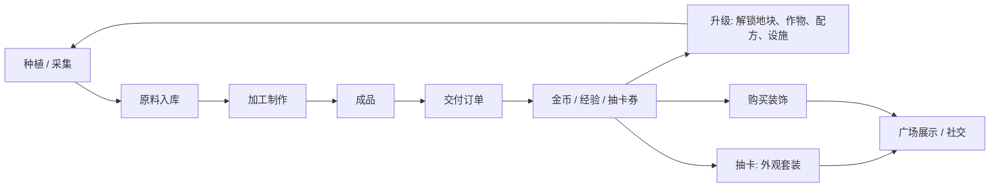
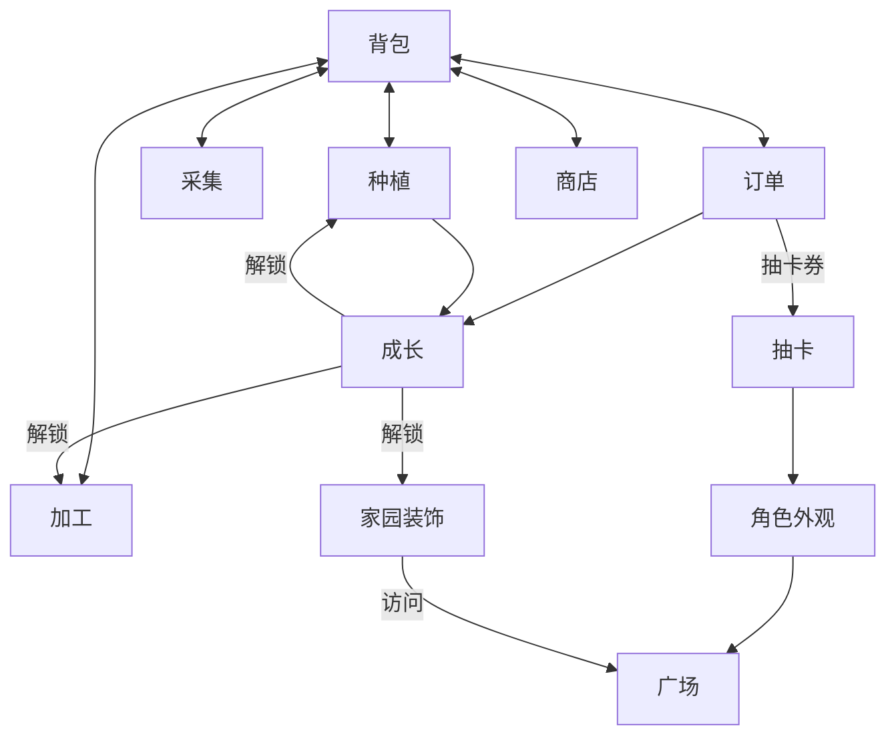
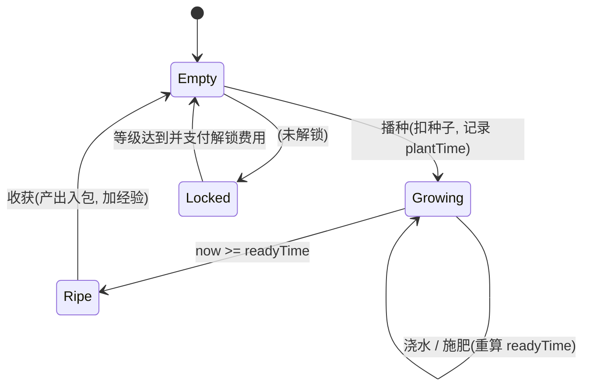
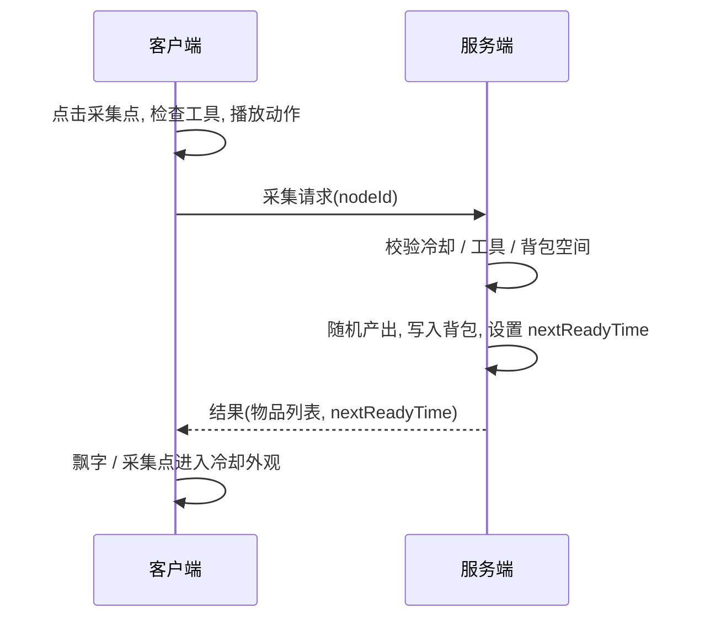
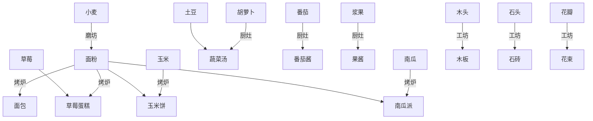
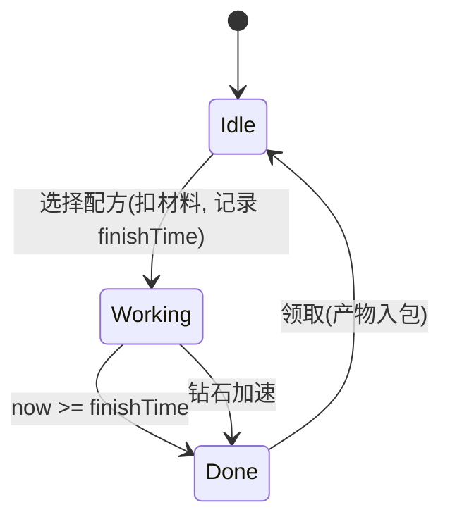
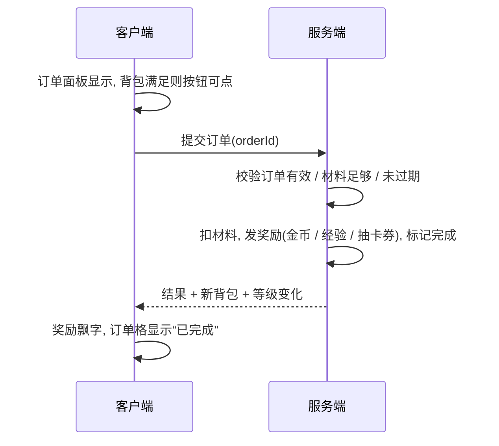
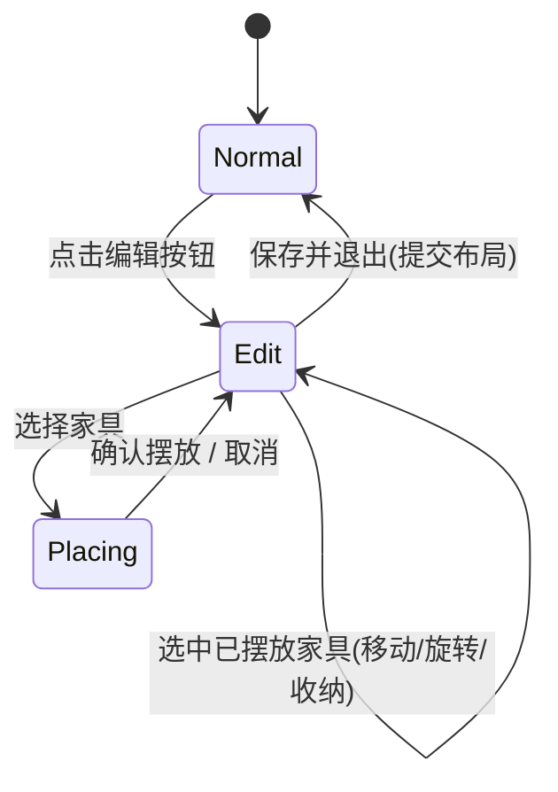
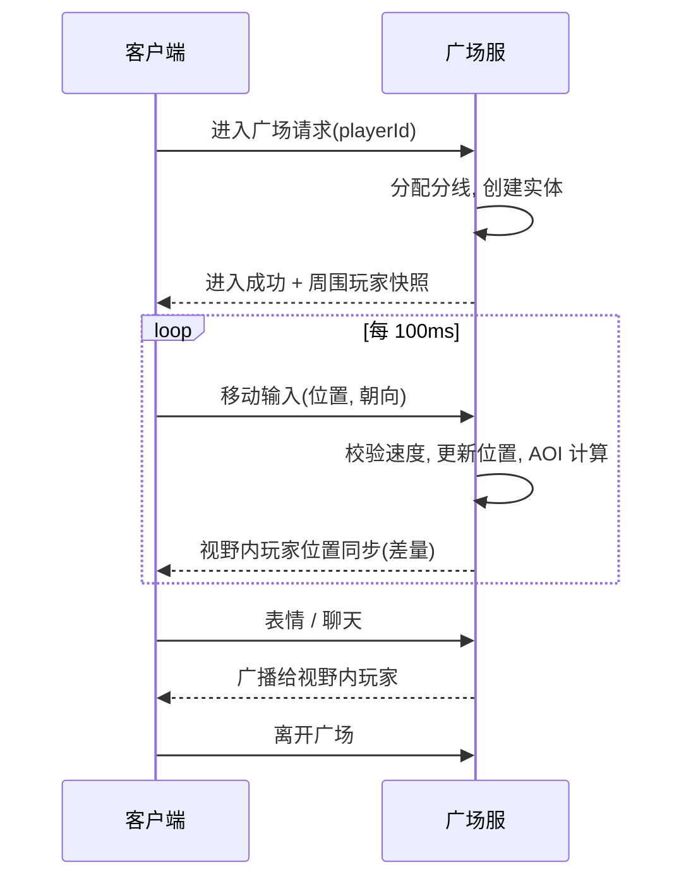
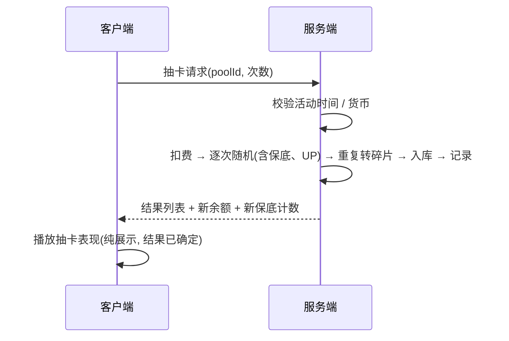

# 02 玩法设计

> 本文档定义**规则与流程**；具体数值见 `03_数值与配置表.md`，协议见 `05_协议与接口.md`。
> 约定：所有涉及**时间、随机、资产变动**的规则均以服务端为准，客户端只做预表现。

---

## 1. 设计目标与体验节奏

| 循环 | 时长 | 内容 | 玩家感受 |
|---|---|---|---|
| 短循环 | 1~3 分钟 | 收菜、播种、采集、领成品、交订单 | 操作简单，每步有即时反馈 |
| 中循环 | 一次游玩 20~30 分钟 | 完成日常订单、升级、解锁新作物 / 设施 | 有明确的小目标 |
| 长循环 | 多天 | 套装收集、限时活动、抽卡 | 有收集与展示的动力 |

> 作品集演示场景：**10 分钟内**必须走完一次短循环 + 一次升级 + 进入广场 + 一次抽卡。

### 核心循环

### 系统关系

---

## 2. 通用规则

| 规则 | 说明 |
|---|---|
| 时间 | 一律使用**服务器 UTC 时间戳**；客户端本地时间仅用于显示倒计时 |
| 离线 | 种植、加工、采集冷却在离线期间继续；上线时服务端结算 |
| 货币 | 金币（软货币）、钻石（虚拟硬货币，仅游戏内发放）、抽卡券 |
| 背包容量 | 初始 60 格，升级与家具可扩充；同类物品可堆叠（上限见物品表） |
| 背包满 | 收获 / 采集 / 领取时若背包满，**操作失败并提示**，不丢失物品 |
| 随机 | 全部在服务端；客户端不参与结算 |
| 幂等 | 每个写操作携带客户端序号，服务端去重，防止重复提交 |

---

## 3. 种植系统

### 3.1 规则

1. 家园有若干**地块**（初始 6 块，随等级解锁，见数值表）。
2. 选择种子后点击空地块播种，扣除种子；也可**拖拽划过多个地块**批量播种。
3. 作物按**生长阶段**表现：种子→幼苗→生长→成熟（共 4 个视觉阶段，总时间由作物表决定）。
4. 成熟后点击收获，产量在 `[min, max]` 之间随机（服务端）。收获同时获得经验。
5. 成熟作物**不会枯萎**（降低挫败感）；可无限期留在地里等待收获。
6. **浇水**：每个作物可浇水 1 次，缩短 **10%** 剩余时间；浇水无消耗，每天地块总浇水次数不限。
7. **肥料**（道具）：使用后缩短 **30%** 剩余时间，每块地仅可用 1 次。

### 3.2 状态机

### 3.3 关键数据与计算

- 地块记录：`plotId, state, cropId, plantTime, readyTime, watered, fertilized`
- 成熟判定：`now >= readyTime`（服务端）
- 浇水 / 施肥：`remain = readyTime - now; readyTime -= remain * ratio`
- 离线无需推算：状态由时间戳直接判定，上线时只返回地块当前状态

### 3.4 异常与边界

| 情况 | 处理 |
|---|---|
| 背包满时收获 | 失败，提示“背包已满”，作物保留 |
| 种子不足 | 失败，提示并引导至商店 |
| 修改本地时间 | 无影响，服务端裁决 |
| 同一地块重复提交 | 幂等序号去重，返回当前状态 |
| 等级不足的作物 | 种子在商店中不可购买；背包中也不可种 |

---

## 4. 采集系统

### 4.1 规则

1. 家园内有固定**采集点**：树、矿石、花丛、浆果丛。
2. 点击采集点，需要对应**工具**（斧头 / 镐 / 采集篮）；缺少工具时提示。
3. 采集耗时约 1.5 秒（播放动作）；完成后进入**冷却**，期间采集点显示为“已采集”外观。
4. 采集产出在 `[min, max]` 内随机；有小概率掉落**稀有物**（见数值表）。
5. 工具可在**工坊**升级：提高产量上限与稀有掉落率。
6. 每个采集点冷却相互独立，按服务端时间刷新。

### 4.2 流程

### 4.3 异常与边界

- 冷却中重复点击：直接提示剩余时间，不发请求（客户端先判断，服务端再校验）。
- 背包满：失败，不进入冷却。

---

## 5. 加工系统

### 5.1 规则

1. 4 种设施：**磨坊、烤炉、厨灶、工坊**，由等级解锁，均可升级。
2. 每个设施有**生产槽位**（初始 2，升级最多 4）；每个槽位同时只能生产一个配方。
3. 点击设施 → 选择配方 → 材料足够则**立即扣除材料**，进入倒计时。
4. 生产完成后产物**留在设施内**，需要玩家手动点击领取（防止离线时背包满丢失）。
5. 每个设施有**待领取上限**（等于槽位数）；已满则不能继续开始新生产。
6. **加速**：使用钻石可立即完成（费用按剩余分钟数，见数值表）。
7. 设施升级消耗金币与材料，提升槽位与生产速度（速度加成见数值表）。

### 5.2 加工链

### 5.3 状态机（单个槽位）

### 5.4 异常与边界

| 情况 | 处理 |
|---|---|
| 材料不足 | 按钮置灰，显示缺少的材料与数量 |
| 背包满时领取 | 失败，产物保留在设施内 |
| 加速钻石不足 | 提示并引导至获取途径 |
| 离线期间完成 | 上线时直接显示 Done，无需客户端推算 |

---

## 6. 订单系统

### 6.1 订单类型

| 类型 | 说明 | 数量 / 刷新 |
|---|---|---|
| 日常订单 | 随机生成，需要若干物品 | 每日 6 条，每日 0 点（服务器时区 UTC+8）整体刷新 |
| 限时订单 | 活动期间出现，奖励更好 | 由活动配置决定 |

### 6.2 订单生成规则

输入：玩家等级 `L`、已解锁配方 / 作物集合 `U`。

1. 每条订单包含 1~3 个**需求项**（物品 + 数量）。
2. 需求项的物品从 `U` 中按权重抽取：
   - 加工品权重 = 40%，原料权重 = 60%（等级 ≥ 4 后加工品比例升至 60%）。
3. 数量：原料 2~6，加工品 1~3，根据物品价值调整（价值越高数量越少）。
4. 保证：**至少有 2 条订单**，其所有需求项均为“玩家当前可立即制作或已拥有”的物品（防止全是难单导致挫败）。
5. 订单难度档位：简单（1 项）、普通（2 项）、困难（3 项）；比例 3:2:1。
6. 奖励 = 需求物品基础价值总和 × 系数，详见数值表。
7. **刷新**：玩家可花费金币刷新**单条**订单（每日免费 1 次，之后收费）。

### 6.3 交付流程

### 6.4 额外奖励

- 每日完成 3 条订单：额外 **抽卡券 ×1**；完成 6 条：再得 **抽卡券 ×1**（每日上限 2 张）。
- 订单奖励中有 10% 概率附带“**稀有加成**”：金币 ×1.5（显示金色边框）。

### 6.5 异常与边界

| 情况 | 处理 |
|---|---|
| 提交时材料不足 | 失败并返回缺少项（客户端背包可能与服务端不同步，以服务端为准并刷新） |
| 跨 0 点提交 | 以服务端判断；过期订单提示“订单已刷新” |
| 订单全部完成 | 显示“今日订单已完成”，并提示倒计时 |

---

## 7. 成长与解锁

### 7.1 规则

1. 经验来源：收获作物、完成订单、采集（少量）、加工领取（少量）。
2. 升级所需经验见数值表；**升级时**：弹出升级提示，展示解锁内容。
3. 最高等级 20（MVP）。
4. 解锁项：地块、作物、配方、设施、装饰、商店商品。

### 7.2 解锁节奏

| 等级 | 主要解锁 |
|---|---|
| 1 | 小麦、6 块地、背包、商店、订单、树 / 浆果丛采集 |
| 2 | 胡萝卜、磨坊 |
| 3 | 土豆、工坊、矿石采集（镐）、木板、石砖、扩展到 9 块地 |
| 4 | 烤炉、厨灶、面包、蔬菜汤、果酱 |
| 5 | 番茄、扩展到 12 块地、番茄酱 |
| 6 | 花丛采集、花束、家园装饰系统 |
| 7 | 玉米、玉米饼、广场入口开放 |
| 8 | 扩展到 16 块地、设施升级（Lv2） |
| 9 | 草莓、草莓蛋糕、抽卡入口开放 |
| 12 | 南瓜、南瓜派、扩展到 20 块地 |
| 15 | 设施升级（Lv3） |
| 16 | 扩展到 24 块地 |
| 20 | 满级（MVP） |

> 节奏目标（初版，M2 用试玩与模拟校准）：**新玩家约 30 分钟升到 Lv7（广场开放），约 60 分钟升到 Lv9（抽卡开放）**。作品集演示时通过调试面板直接设置等级，保证 10 分钟内能看到全部关键功能。

---

## 8. 家园场景

### 8.1 规则

1. 固定尺寸的岛屿：农田区、采集区、加工区、装饰区（预设分区，不可自由改造地形）。
2. **装饰摆放**：进入编辑模式 → 选择家具 → 网格吸附摆放 / 旋转（90°）/ 收纳回背包。
3. 家具占用若干格，不可重叠，不可压在地块、设施与采集点上。
4. 装饰仅影响外观与**舒适度**；舒适度用于展示（访问时点赞数），不影响经营数值，保持规则简单。
5. 布局保存于服务端；退出编辑模式时一次性提交。

### 8.2 编辑模式状态

### 8.3 访问他人家园（P1）

- 只读：可参观、点赞（每人每天对同一家园限 1 次）、查看对方装扮。
- 不可采集、收获、修改。

---

## 9. 广场（多人在线）

### 9.1 规则

1. Lv7 开放广场入口。进入后分配到一个**分线**（单线上限 100 人；优先好友所在线；满则新开线）。
2. 玩家使用**点击地面移动**（PC：鼠标点击 / WASD；移动端：虚拟摇杆 / 点击）。
3. 其他玩家以其当前外观（换装）显示；头顶显示昵称。
4. **交互**：表情（6 种）、气泡聊天、点击玩家查看资料（昵称、等级、外观）、加好友（P1）、访问家园（P1）。
5. 广场功能点：抽卡 NPC、公告板（显示当前活动）、商店 NPC、公共采集点（每人每日限次）。
6. 同屏渲染：**距离近的完整模型 + 动画，远处降级**（见技术方案）。
7. 广场内不可进行经营操作（种地、加工）；离开广场返回家园。

### 9.2 流程

### 9.3 异常与边界

| 情况 | 处理 |
|---|---|
| 断线重连 | 30 秒内重连恢复原位置；超时则视为离开 |
| 位置作弊（瞬移 / 超速） | 服务端拒绝并拉回最后合法位置 |
| 聊天刷屏 | 每 3 秒最多 1 条；敏感词替换为 `*` |
| 分线满员 | 自动尝试其他分线或新开线 |

---

## 10. 角色外观与换装

### 10.1 规则

1. 部位（6 个）：**发型、上衣、下装、鞋子、帽子、饰品**；各部位互不冲突（如连衣裙占据上衣 + 下装，另设“套装”类型）。
2. 外观来源：初始外观、商店购买（基础款）、抽卡（稀有款）、任务奖励。
3. 每个外观有稀有度：N / R / SR / SSR。
4. 玩家保存 **1 套当前外观**（P1 可扩展为 3 套衣橱）。
5. 外观 ID 组合由服务端保存，广场内同步给他人，客户端据此拼装模型。

### 10.2 套装

- 套装由多个部位件组成；集齐 **3 件及以上**显示“套装”徽章（仅展示，不加属性）。

---

## 11. 抽卡系统

### 11.1 卡池

| 卡池 | 内容 | 开放时间 | 消耗 |
|---|---|---|---|
| 常驻池 | 全部基础与稀有外观 | 永久 | 1 抽卡券 或 160 钻石 / 抽 |
| 限时池（示例：春日野餐） | UP 套装 + 部分常驻外观 | 活动期（服务端配置） | 同上 |

> 抽卡券通过订单与任务获得；钻石为虚拟货币，**仅由游戏内发放**，没有任何付费途径。

### 11.2 抽取规则

1. 单抽 / 十连。十连不打折（保持规则简单，也避免误导）。
2. **基础概率**（常驻池 / 限时池相同）：

| 稀有度 | 基础概率 |
|---|---|
| SSR | 1.0% |
| SR | 6.0% |
| R | 28.0% |
| N | 65.0% |

3. **SSR 保底**：连续未出 SSR 达到 40 抽后，每抽 SSR 概率 **+4%**，**60 抽必出**。出 SSR 后计数清零。
4. **SR 保底**：每 10 抽至少出 1 个 SR 或以上；出现 SR 或以上后计数清零。
5. **限时池 UP 规则**：出 SSR 时有 50% 概率为 UP 套装；若未出 UP，则**下一次 SSR 必为 UP**（大保底）。
6. 保底计数**分池独立**，常驻池与限时池互不影响；限时池计数在活动结束时清零。
7. **重复物品**：已拥有的外观转化为**碎片**（N:1 / R:5 / SR:20 / SSR:50），碎片可在碎片商店兑换外观。
8. 概率公示页：展示基础概率、保底规则、UP 规则、当前保底计数；**抽卡记录**可查询最近 100 条。

> 经脚本验证（见数值表）：综合 SSR 出率约 2.75%，平均约 36.3 抽出 SSR，50 抽内必出概率约 97.6%。

### 11.3 抽卡流程

### 11.4 异常与边界

| 情况 | 处理 |
|---|---|
| 活动已结束 | 拒绝请求，提示卡池已关闭 |
| 请求重复（网络重试） | 幂等序号去重，返回同一结果 |
| 抽卡过程中断线 | 结果已由服务端写入；重连后可在抽卡记录查看并补发表现 |
| 货币不足 | 拒绝并提示 |

---

## 12. 热更新活动（玩法侧要求）

“上线一个新卡池”的标准流程：

要求：

- **资源提前下发，开关由服务端控制**；客户端不得依赖本地时间决定活动是否开启。
- 活动入口、界面、抽卡表现、卡池内容全部由热更资源与配置表驱动。
- 演示验收：不重新打包客户端，仅通过补丁 + 服务端配置，完成“新卡池从无到有”。

---

## 13. 新手引导

强引导 7 步（目标 5 分钟内完成）：

| 步骤 | 内容 | 完成条件 |
|---|---|---|
| 1 | 欢迎，介绍角色与家园 | 点击继续 |
| 2 | 引导播种小麦（高亮地块） | 播种 3 块 |
| 3 | 引导浇水加速 | 浇水 1 次 |
| 4 | 引导收获（新手作物成熟时间缩短为 10 秒） | 收获 |
| 5 | 引导采集一棵树 | 采集 1 次 |
| 6 | 引导查看并交付第一个订单（预置订单，材料已备好） | 交付 |
| 7 | 引导升级并提示后续目标 | 点击完成 |

规则：引导可跳过；引导进度保存在服务端；新手期使用专门的缩短时间与预置订单，**仅用于引导**。

---

## 14. 界面清单（低保真级别）

| 界面 | 主要元素 |
|---|---|
| 主界面 HUD | 头像 / 等级 / 经验条、金币 / 钻石 / 抽卡券、背包 / 订单 / 商店 / 编辑 / 广场入口 |
| 背包 | 分页（原料 / 成品 / 种子 / 工具 / 家具 / 外观）、格子、物品详情、出售 |
| 种子选择 | 横向列表，显示数量与成熟时间 |
| 设施面板 | 槽位列表、配方选择、倒计时、领取、加速、升级 |
| 订单面板 | 订单卡片（需求 / 奖励）、交付、刷新、每日进度 |
| 商店 | 标签页（种子 / 工具 / 家具 / 外观），购买数量 |
| 升级弹窗 | 新等级、解锁内容 |
| 装扮界面 | 部位页签、预览、保存 |
| 广场 HUD | 小地图（可选）、聊天框、表情盘、返回家园 |
| 抽卡 | 卡池切换、单抽 / 十连、概率公示、记录、碎片商店 |
| 设置 | 画质、音量、账号 |
| 调试面板（GM） | 加资源、跳时间、重置、活动开关（仅 Debug 构建） |

---

## 15. 自测清单（功能验收）

用于每个里程碑结束时逐项勾选，对应 `06_开发计划.md`。

**种植**
- [ ] 播种、浇水、施肥、收获流程正确，经验与产量符合配置
- [ ] 离线 8 小时后上线，作物状态正确
- [ ] 背包满时收获失败且不丢失作物
- [ ] 修改本地系统时间不影响结果

**采集 / 加工**
- [ ] 采集冷却正确，离线刷新正确
- [ ] 加工扣料、倒计时、领取、加速正确
- [ ] 离线完成的产物在设施内保留

**订单**
- [ ] 每日订单刷新正确，至少 2 条可立即完成
- [ ] 交付校验正确；重复提交只生效一次
- [ ] 每日抽卡券奖励上限正确

**成长 / 家园**
- [ ] 等级解锁与解锁表一致
- [ ] 家具摆放无重叠；保存后重登布局一致

**广场**
- [ ] 两个真人客户端互相可见、移动平滑
- [ ] 100 机器人压测 30 分钟无断线、无崩溃
- [ ] 超速 / 瞬移被服务端拒绝

**抽卡 / 热更**
- [ ] 概率统计（10 万次模拟）与公示一致
- [ ] 保底与 UP 规则正确，分池独立
- [ ] 重复请求不重复扣费
- [ ] 纯热更完成新卡池上线与下线
