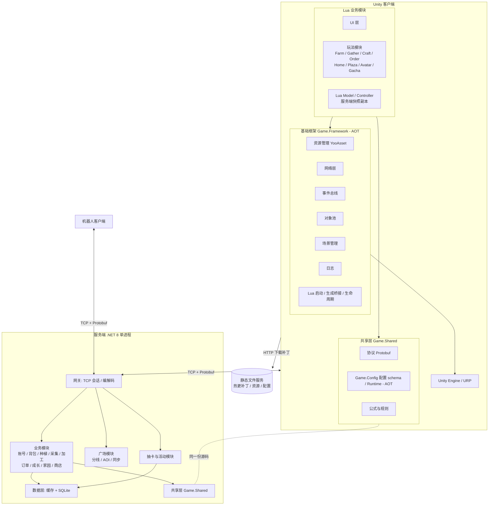
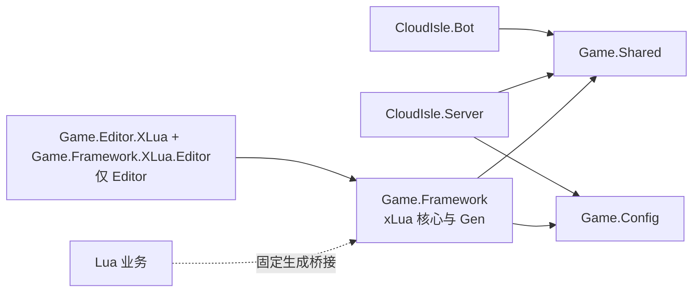
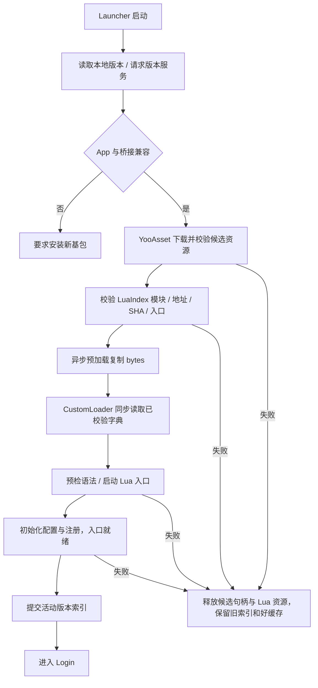
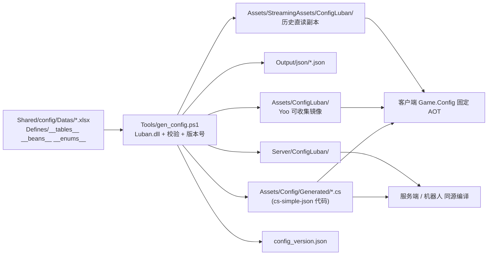
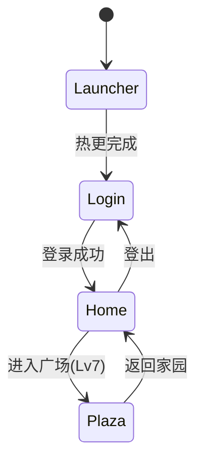
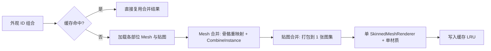
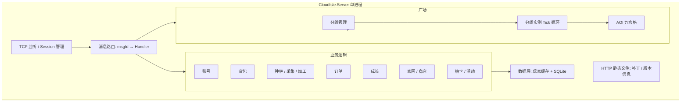
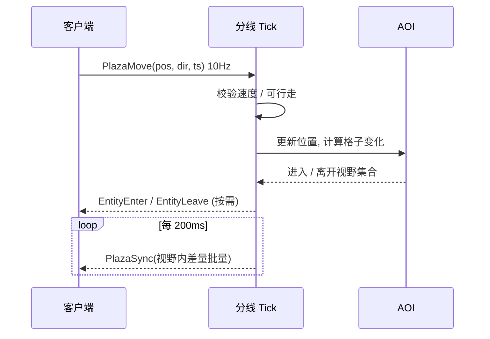

# 04 技术方案与架构

> 面向单人开发的**可落地方案**：每个选择都给出理由、验证方式与备选。
> 第 1–14 节是现行架构；第 15–17 节保留原历史实测，第 18 节和 [07](07_xLua迁移方案与PoC.md) 登记本次 xLua 验证。目标设计与已实现状态分别注明。
>
> **v1.1 修订**：配置表管线由“自写导表（PoC #7）”改为 **Luban**（第 2、4.1、5.4、9、10、11、12、13、14 节与新增第 16 节）。自写 `gen_config.py` 管线保留为回退基线。

> **v1.2 迁移**（2026-10-20）：xLua Lua53 业务 + 固定 C# AOT 桥接；旧安装需更换基包。主工程最终路径、清理与复验结果以 07 为准。

---

## 1. 目标与约束

| 项 | 内容 |
|---|---|
| 引擎 | Unity 6000.3（Unity 6.3 LTS），URP |
| 平台 | PC（首发）；移动端（Stretch），**架构与资源从第一天按移动端预算设计** |
| 玩法 | 家园单机经营（服务端权威）+ 多人在线广场 + 热更新抽卡活动 |
| 团队 | 1 人；每周约 15~20 小时 |
| 核心原则 | ① 简单可控，少造轮子 ② 服务端权威 ③ 数据驱动 ④ 逻辑与表现分离 ⑤ 先跑通再优化，但**性能红线每月核对** |

> 单人项目的取舍：**架构要“看起来专业”但“实现上克制”**。例如服务端采用单进程 + 模块化，文档说明如何拆分为多进程，而不真的实现分布式。

---

## 2. 技术选型

| 领域 | 选择 | 理由 | 备选 / 回退 |
|---|---|---|---|
| 渲染管线 | **URP** | PC 与移动端共用；SRP Batcher、GPU Instancing 完善 | — |
| 业务热更 | **xLua（Lua53）** | Lua 模块承载业务；C# AOT 服务经生成白名单桥接 | 固定来源及 Windows IL2CPP 验证见 07；Android / iOS 尚未验证 |
| 资源热更 | **YooAsset** | 补丁流程完整，支持本地 / 远程模拟，国内资料多 | 备选：Addressables |
| 配置表 | **Luban 4.x**（`cs-simple-json` + `json` 数据；详见 5.4） | Excel → JSON + C# 代码生成，类型 / 枚举 / 引用校验，前后端同源；表头、主键、校验规则全部声明式 | 回退：自写 `Tools/gen_config.py`（PoC #7 已验证，见 `PoC_ConfigExport_操作说明.md`） |
| 协议 | **Protobuf（proto3）** | 强类型、体积小、双端代码生成 | — |
| 网络传输 | **TCP**（自定义帧：长度 + 消息 ID + 序号） | 经营与广场均使用；广场更新频率低（5~10 Hz），TCP 足够 | 进阶：广场改 KCP/UDP（文档说明，不实现） |
| 异步 | C# **UniTask**；Lua 回调/操作租约 | C# 负责异步与取消，完成后在主线程回调 Lua | Lua 不直接 await UniTask |
| UI | UGUI + TextMeshPro | 成熟稳定 | — |
| 服务端语言 | **C#（.NET 8）** | 与客户端共用协议、公式、配置结构；单人维护成本最低 | — |
| 服务端存储 | **SQLite（Microsoft.Data.Sqlite + Dapper）** | 零运维；Schema 与 MySQL 兼容，可切换 | 可切 MySQL |
| 缓存 | 进程内内存缓存（玩家会话数据） | 单进程无需 Redis | 文档说明何时引入 Redis |
| 日志 | 服务端 Serilog；客户端自封装文件日志 | 排查问题 | — |
| 测试 | NUnit（共享逻辑）、机器人（联网） | 覆盖离线结算、订单生成、抽卡等核心规则 | — |
| 版本控制 | Git + Git LFS | 管理大资源 | — |
| 构建 | Unity `-batchmode` + PowerShell 脚本 | 一键出包 / 出补丁 | GitHub Actions（仅服务端测试，可选） |

> **版本基线**：Unity 6000.3.22f1；xLua 固定官方 tag `v2.1.16_ndkr21b_with_win` / commit `161a6757af2ac30049e9c863534086430a12cb53`，Lua53 Win64。YooAsset 3.0.6；下载来源、SHA、许可和平台限制见 07。此版本是验证基线，不宣称为最新版本。

---

## 3. 总体架构



### 关键设计决策

1. **C# AOT 与 Lua 分层**：`Game.Framework` 包含基础服务、xLua 核心及生成桥接；`Game.Shared`、`Game.Config` 为双端同源的固定 C#。Lua 承载客户端业务与 UI 控制，不创建可更新 C# 程序集。新增桥接类型/签名、协议类型、原生库需新 AppVersion。
2. **前后端共享代码**：协议、配置结构、公式（如成熟时间计算、订单奖励公式、抽卡概率函数）放在 `Game.Shared`，客户端与服务端通过**同一份源码**引用，避免双端不一致。
3. **服务端权威**：时间、随机、扣费、产出全部服务端完成；客户端只做预表现与展示。
4. **单进程模块化**：网关、业务、广场、活动在同一进程内以模块划分，通过接口隔离，便于后续拆分。

---

## 4. 工程结构

### 4.1 仓库结构

实际工程根为 `E:/Workbench/UnityWorkBench/Farming`，不是示意图中的 Client 子工程。下列含当前落点与后续模块规划，未实现模块以 M1/后续里程碑清单为准。

```text
Farming/
├── Assets/
│   ├── Framework/              # Game.Framework，固定 AOT
│   │   ├── Boot/               # Lua 宿主 / BootContext；Launcher 仍属 M1 待办
│   │   ├── Lua/                # 固定桥接、xLua 核心与 Gen，同程序集
│   │   ├── Config/             # C# ConfigService / 地址规则
│   │   ├── Resource/ Network/ Core/ Input/
│   ├── Shared/                 # Game.Shared：Proto / 网络契约 / 规则
│   ├── Config/                 # Game.Config：Generated / LubanRuntime
│   ├── Lua/                    # *.txt TextAsset 模块（Yoo 地址无扩展名）；catalog/active-index 随兼容补丁发布
│   ├── Editor/XLua/            # Editor 生成器 / 构建和验证工具
│   ├── ConfigLuban/               # Yoo EditorSimulate 可收集镜像（与导表同事务）
│   ├── StreamingAssets/ConfigLuban/ # 历史/直读副本；不可直接作 EditorSimulate 收集根
│   ├── Scenes/                 # 迁移验证场景；正式 Launcher/Login/Home 尚按 M1 完成
│   └── ReferenceDoc/           # 当前规范、保留历史、迁移说明
├── Server/                     # .NET 8 服务端 / 测试 / 机器人
├── Shared/config/              # 配置源表、Luban 定义
├── Tools/                      # gen_proto.ps1 / gen_config.ps1 等实际入口
├── Docs/Acceptance/xLuaMigration/ # 原件、SHA、完整源码/命令与验收报告
└── PoC/xLuaMigration/           # 独立验证工程与工具；不替代主工程证据
```

### 4.2 程序集依赖规则



| 规则 | 说明 |
|---|---|
| 核心与 Gen 同一 AOT 程序集 | 生成桥接需要访问 Framework 类型；避免拆成 Framework→XLua→Framework 循环 |
| Editor 生成器单独程序集 | 不进入 Player；Gen 后完成重编译再构建 |
| Shared / Config 无 UnityEngine 依赖 | 双端源码引用，客户端 AOT；不是可热更 DLL |
| Lua 使用稳定桥接 | LuaCallCSharp / CSharpCallLua 白名单和 link.xml 由基包固定 |
| UI 资源和控制分离 | Lua 控制器使用已有 C# 通用宿主，新增窗口不要求新增 C# 类 |

---

## 5. 客户端核心模块设计

### 5.1 启动与热更新流程

以下是正式 Launcher 的目标流程。当前迁移宿主与完整 M1 登录流程的完成状态见 07 和 M1 任务表，不能由验证场景推定正式 Launcher 已交付。



| 版本号 | 含义 | 变化边界 |
|---|---|---|
| AppVersion | 引擎、C# AOT、原生库、生成桥接基包 | 改类型/API/桥接需新包；本次由原 0.1.0 切新 xLua 0.2.0 开发基线，最终结果见 07 |
| ResVersion | Lua 业务与资源 | 既有桥接契约内的 100→101 补丁 |
| ConfigVersion | 兼容配置数据 | 现有 schema 内数据变化；类型变化需新 AppVersion |
| ProtoVersion | 协议契约 | 本次保持 1；按 05 兼容规则判断 |

当前迁移宿主为 `HotfixLoader`（脚本 GUID `57deb669d1a8d234791b2d287bf2d64d`，场景 `Assets/Scenes/xLua_PoC.unity` GUID `5010700a5136bdb4981d75b47633300d`）：默认 `autoStart=true` 走 `Start`；公开 `StartAsync` 前须 `autoStart=false`，统一 boot gate 防双启。候选 catalog（`RuntimeCatalog`）含 `bridgeContract` / `requiredAppVersion` / `protoVersion`、模块唯一映射与入口 SHA；预加载后 `CustomLoader` 只同步读已校验字典。协程经 `DriveStack` 捕获嵌套异常；成功后 `CommitActiveIndex` 用同卷 `File.Replace` 提交 `active-index.json`，失败/取消/销毁走 `AbortBootForDestroyOrCancel`，保留旧索引与好缓存。`AsyncLease` 对共享 `DelegateBridge` Target 引用计数，宿主实现 `IAsyncLeaseHost` 登记局部租约。

Editor 模拟、内置基线与 HTTP 补丁模式分别用于日常开发、可离线启动的新安装和远端补丁验收。CustomLoader 不发网络请求、不伪装异步；由 C# 在调用 require 前预加载。旧 HybridCLR 安装不能仅下 Lua 完成架构切换。

每个候选在新 Lua 环境中验证，入口就绪后提交索引。失败只回滚宿主明确跟踪的句柄、表、回调和面板，不宣称可撤回任意 C# 副作用。已运行的业务升级通过重新启动流程切换；不承诺任意同进程热替换。

Lua 不直接 await UniTask；固定 C# 服务提供主线程回调/操作租约，定义一次完成、取消、超时和退订。关闭窗口、登出、关闭环境须停止旧生产者回调并清理拥有的 LuaTable / LuaFunction / 生成接口。共享委托桥不能被单个使用者提前 Dispose。LuaEnv.Tick 由宿主推进；vendor Dispose 内部带 GC，报告 gcForced=0 只表示项目未额外强制 GC。

Protobuf 编解码仍在 C# AOT。Lua 用快照、DTO 或 bytes；大 ID 使用 Lua53 整数或经桥验证的十进制字符串，不先转 double。bytes / repeated / map / signed int64 与真实生命周期专项证据见 07。

### 5.2 资源管理

| 项 | 方案 |
|---|---|
| 分包 | `common`（UI 基础、通用特效）、`home`（家园场景与资源）、`plaza`（广场场景）、`avatar`（外观，按部位 / 稀有度分包）、`config`、`activity_xxx`（每个活动一包） |
| 加载 | 统一 `ResMgr.LoadAsync<T>(address)`；返回句柄，**持有者负责释放** |
| 引用计数 | 句柄计数，场景切换后统一回收；开发期提供“资源泄漏报告” |
| 预加载 | 进入场景前预加载关键资源；活动资源在开始前 3 天预下载 |
| 缓存 | 玩家外观合并结果按外观组合 hash 缓存（LRU，上限 64） |

### 5.3 网络层

| 项 | 方案 |
|---|---|
| 帧格式 | `[len:4][msgId:2][seq:4][body:N]`（小端，len 为后续长度） |
| 请求 / 响应 | 请求携带 `seq`；响应带回同一 `seq`；支持超时（默认 8 秒）与有限重试（仅幂等请求） |
| 推送 | `seq = 0` 的服务端消息为推送，按 `msgId` 分发 |
| 心跳 | 每 10 秒一次，30 秒无响应判定断线 |
| 重连 | 指数退避（1/2/4/8 秒，上限 30 秒）；重连后携带登录 Token，服务端恢复会话并对账 |
| 写操作幂等 | 每个写请求带客户端递增 `opId`；服务端记录最近 N 个，重复请求直接返回缓存结果 |
| 线程模型 | 网络收发在后台线程，消息通过线程安全队列在主线程分发 |
| 弱网 | 请求队列 + 界面“处理中”遮罩，防止重复点击 |

### 5.4 配置表（Luban）

> 目标：**一份 Excel 数据源 → 一次导出 → 客户端、服务端、机器人读到同一份强类型数据**；
> 数值只改表不改代码；热更时配置作为资源包的一部分下发。

#### 5.4.1 总体流程



| 决策 | 选择 | 理由 |
|---|---|---|
| 代码目标 | `cs-simple-json` | 纯 C#、不依赖 UnityEngine，在客户端 AOT 和服务端同源编译；Lua 经固定服务读取快照或字符串 KV |
| 数据目标 | `json`（暂不用 `bin`） | 配置总量小（< 1 MB），可读、可 diff、热更替换简单；加载变慢时再切 `cs-bin` + `bin`（Tables 构造代码不变） |
| 目标分组 | 单一 target `all`，不区分 `c` / `s` 字段 | 当前所有字段双端都需要；保证双端代码完全一致。出现仅服务端字段时再启用 `group` |
| Runtime | **Luban Runtime 的 C# 源码同源纳入 `Game.Config`**，**不安装** `com.code-philosophy.luban` UPM 包 | 服务端无法使用 Unity 包；两处同时存在会类型冲突 |
| 数据源 | `Shared/config/Datas/*.xlsx` **一表一文件** | 便于 Git 管理与按表复核；原 `云屿小筑_配置表与开发进度.xlsx` 仅保留“设计 / 进度 / 计算器”用途，不再作为导表输入 |
| 主键类型 | 全部 **int**；原 `C01 / RC001 / F01 / P01 / A001` 取数字部分为 `id`，另设 `code:string` 保存可读编码 | 与 `05_协议与接口.md` 中 `crop_id / recipe_id / facility_id / pool_id` 均为 `int32` 对齐 |

#### 5.4.2 程序集归属与热更

- 当前生成代码和 Runtime 位于 `Assets/Config/Generated` 与 `Assets/Config/LubanRuntime`，属于固定 AOT `Game.Config`，服务端同源编译。
- `Game.Framework.Config.ConfigService` 使用 C# 生成类型/快照；Lua 经稳定桥读取需要的数据，不直接把任意生成集合当作通用 Lua 表。
- 既有字段/表内数据和 Global 字符串 KV 新键可作为兼容补丁。新增 C# 表、字段、枚举、桥接或 Runtime 类型需新 AppVersion。
- T41 的 18 表导出/哈希/事务同步记录保留；T42 搬迁与基础测试不等于正式双端验收完成。

#### 5.4.3 `luban.conf`

```json
{
  "groups": [
    { "names": ["c"], "default": true },
    { "names": ["s"], "default": true }
  ],
  "schemaFiles": [
    { "fileName": "Defines/__tables__.xlsx", "type": "table" },
    { "fileName": "Defines/__beans__.xlsx",  "type": "bean"  },
    { "fileName": "Defines/__enums__.xlsx",  "type": "enum"  }
  ],
  "dataDir": "Datas",
  "targets": [
    { "name": "all", "manager": "Tables", "groups": ["c", "s"], "topModule": "CloudIsle.Config" }
  ]
}
```

#### 5.4.4 Excel 表头规范（每张业务表）

Luban 以 A1 单元格标记识别表头，**A1 不以 `##` 开头的 Sheet 会被整体忽略**。

| 行 | A1 标记 | 内容 | 示例（`item.xlsx`） |
|---|---|---|---|
| 1 | `##var` | 字段名 | `##var \| id \| name \| type \| stackMax \| sellPrice \| buyPrice \| unlockLevel \| desc` |
| 2 | `##type` | 类型 | `##type \| int \| string \| ItemType \| int \| int \| int \| int \| string` |
| 3 | `##` | 注释 | `## \| 物品ID \| 名称 \| 类型 \| 堆叠上限 \| 出售价 \| 购买价 \| 解锁等级 \| 描述` |
| 4+ | 空 | 数据行 | `\| 1001 \| 小麦 \| Material \| 99 \| 8 \| 0 \| 1 \| ...` |

约定：

- 字段名以 `#` 开头的列为注释列，不导出（与现有管线一致）。
- 每个 Sheet 只放一张表；Sheet 名与文件名一致（`item.xlsx` 的 Sheet 名 `item`）。
- 校验规则写在类型后缀（如 `int#ref=Item`），见 5.4.7。

#### 5.4.5 表注册（`Defines/__tables__.xlsx`）

列：`full_name | value_type | read_schema_from_file | input | index | mode | comment`；全部 `read_schema_from_file = true`（字段与类型取自各数据表头）。

| full_name | value_type | input | index | mode | 说明 |
|---|---|---|---|---|---|
| `TbGlobal` | `Global` | `global.xlsx` | — | one | 全局常量；列式（纵向）表，字段强类型 |
| `TbItem` | `Item` | `item.xlsx` | `id` | map | |
| `TbCrop` | `Crop` | `crop.xlsx` | `id` | map | |
| `TbGatherNode` | `GatherNode` | `gathernode.xlsx` | `id` | map | |
| `TbTool` | `Tool` | `tool.xlsx` | `toolId+level` | map | **联合主键**（单列不唯一） |
| `TbFacility` | `Facility` | `facility.xlsx` | `id` | map | |
| `TbFacilityLevel` | `FacilityLevel` | `facilitylevel.xlsx` | `level` | map | 各设施通用；若日后按设施区分，主键改 `facilityId+level` |
| `TbRecipe` | `Recipe` | `recipe.xlsx` | `id` | map | |
| `TbLevel` | `Level` | `level.xlsx` | `level` | map | |
| `TbPlot` | `Plot` | `plot.xlsx` | `stage` | map | |
| `TbOrderRule` | `OrderRule` | `orderrule.xlsx` | — | one | 订单生成参数；列式表 |
| `TbShop` | `Shop` | `shop.xlsx` | `id` | map | **单独出表**（`ShopBuyReq.shop_item_id` 需要稳定商品 ID），见 5.4.6 |
| `TbFurniture` | `Furniture` | `furniture.xlsx` | `id` | map | |
| `TbAvatarItem` | `AvatarItem` | `avataritem.xlsx` | `id` | map | |
| `TbGachaRule` | `GachaRule` | `gacharule.xlsx` | — | one | 概率 / 保底参数；列式表 |
| `TbGachaPool` | `GachaPool` | `gachapool.xlsx` | `id` | map | |
| `TbGachaPoolItem` | `GachaPoolItem` | `gachapoolitem.xlsx` | — | list | `poolId` 不唯一；运行时按 `poolId` 分组 |
| `TbActivity` | `Activity` | `activity.xlsx` | `id` | map | |

> **不进入 Luban**：`OrderCalc`、`GachaSim` 等计算器 / 模拟页，以及 xlsx 内“说明 / 校验 / 进度”页。
> **回退说明**：若联合主键 `a+b` 或 `mode=one` 列式表在选定版本上不可用，`Tool` 改 `mode=list`、`Global / OrderRule / GachaRule` 改 `map(key→value)`，
> 由 `Game.Shared` 中的强类型访问器（如 `GlobalCfg`）包装；此项在 PoC #7b 实测后回填。

#### 5.4.6 类型与复合字段规范（`__beans__` / `__enums__`）

**Bean**

| Bean | 字段 | 单元格写法 |
|---|---|---|
| `ItemCount` | `int id; int count` | `3001:2`（`sep=":"`） |

**列表写法**

| 字段 | Luban 类型 | 单元格示例 |
|---|---|---|
| `Global.bag_expand_costs` | `list#sep=;,int` | `500;1000;2000;4000;8000` |
| `Global.order_reroll_costs` | `list#sep=;,int` | `50;100;150;300` |
| `Crop.stageRatio` | `list#sep=;,int` | `25;25;25;25` |
| `GachaPool.upItemIds` | `list#sep=;,int` | `7101;7102` |
| `Recipe.inputs` | `list#sep=;,ItemCount` | `1004:3` / `3001:2;1006:3` |
| `Tool.materials` / `FacilityLevel.materials` | `list#sep=;,ItemCount` | `4001:10;4002:10` |

- 原 03 中 `order_ticket_reward = 3→1T, 6→1T` 拆为两个 int 字段：`order_ticket_at_3`、`order_ticket_at_6`。
- 范围字段保持 **`xxxMin / xxxMax` 两列**（如 `yieldMin / yieldMax`），不使用 `2~3` 字符串；`~` 仅用于文档展示。
- 材料原先若为 `mat1_id / mat1_n` 多列，统一合并为 `list,ItemCount` 单列（由迁移脚本转换）。

**枚举（`__enums__.xlsx`）**

| 枚举 | 值 | 使用字段 |
|---|---|---|
| `ItemType` | `Seed / Crop / Craft / Gather / Tool / Consumable / Furniture / Currency` | `Item.type` |
| `AvatarPart` | `Hair / Top / Bottom / Shoes / Hat / Acc / Dress` | `AvatarItem.part` |
| `Rarity` | `N / R / SR / SSR` | `AvatarItem.rarity`、`GachaPoolItem.rarity`（与 `gacha.proto` 的 `Rarity` 数值保持一致） |
| `AvatarSource` | `Initial / Shop / Gacha` | `AvatarItem.source` |
| `ShopCategory` | `Seed / Consumable / BagExpand / Furniture / Avatar` | `Shop.category` |

**`Shop` 表字段**：`id:int, category:ShopCategory, itemId:int#ref=Item, priceCurrency:int, price:int, limitCount:int, unlockLevel:int`
（家具与基础外观商品由迁移脚本从 `Item / Furniture / AvatarItem` 生成初始行，之后以 `shop.xlsx` 为准）。

#### 5.4.7 校验规则

| 层级 | 规则 | 方式 |
|---|---|---|
| **导表期（Luban）** | 主键唯一 | `index` 自带 |
| | 引用存在：`Crop.seedId / yieldItemId`、`Recipe.output / inputs.id`、`GatherNode.toolId / itemId / rareItemId`、`Shop.itemId`、`Activity.poolId`、`GachaPoolItem.poolId / itemId` | `#ref=表名` |
| | 数值范围：`Level.level ∈ [1,20]`、`speedFactor ∈ (0,1]`、数量 / 价格 > 0 | `#range=[a,b]` |
| | 枚举值合法 | 枚举类型自带 |
| **构建期（NUnit，`CloudIsle.Tests/ConfigTests`）** | 概率千分比之和 = 1000；`hard_pity > soft_pity_start`；SSR / SR 保底参数与 `GachaRule` 一致 | 读取导出数据断言 |
| | ID 段与 `Item.type` 一致（1xxx 作物、2xxx 种子 ...） | 断言 |
| | 解锁等级一致：配方等级 ≥ 其材料来源作物 / 采集点解锁等级；`Level` 解锁表与 `02` §7.2 一致 | 断言 |
| | 加工品售价 / 原料总价倍率在 [1.3, 2.3] 之外时告警（经济校准） | 告警，不阻断 |
| | 订单候选池在每个等级非空 | 断言 |

校验失败 → `gen_config.ps1` 返回非 0，**不覆盖**客户端 / 服务端目录。

#### 5.4.8 生成与加载

实际主入口是 `Tools/gen_config.ps1`，其参数、Luban 版本、源表、校验和同步行为以 T41 日志及脚本为准。不要手工绕过事务同步而覆盖双端产物；原回退管线只作历史与故障参考。

客户端 `Assets/Framework/Config/ConfigService.cs` 通过 ResMgr 异步读取清单和表 TextAsset，复制 bytes 后交共享 ConfigSnapshotReader 校验；失败/取消释放租约且不替换好快照。地址规则见 ConfigAddresses，当前清单为 `config_manifest`，表名去 `.json` 扩展名。不存在的 `ResMgr.LoadTextSync` 不作为项目接口。

服务端以文件读入同一清单和导出 bytes，复用共享读取/校验规则。正式双端版本/必需键的验收仍由 T42 完成。Lua 配置读取桥与业务模块按实际白名单扩展；类型变化必须先构建新基包。

#### 5.4.9 配置版本与热更

- `config_version.json`：整数，**导出数据的内容哈希变化时由脚本自增**；随资源清单发布。
- 登录：`LoginReq.config_version` 上报；服务端若 `< need_config_version` 返回 `need_config_version`，客户端回到热更流程（见 `05` 第 4.2 节）。
- 改数值：改 `Datas/*.xlsx` → `gen_config.ps1` → `build_patch.ps1`（`config` 包重新打包，ResVersion 递增）→ 服务端同时替换 `Server/Config/` 并重启或热加载。
- **“上线新卡池”**：仅新增 `gachapool / gachapoolitem / activity / avataritem` 的数据行与 `activity_spring_picnic` 资源包，无需改代码。
- 服务端与客户端的配置版本必须一致；服务端启动时加载并校验，失败则拒绝启动。

#### 5.4.10 迁移策略（自写管线 → Luban）

| 阶段 | 内容 | 退出条件 |
|---|---|---|
| A（M0 末，PoC #7b） | 用 `Item`、`Global`、`Crop` 三张表跑通 Luban：表头、`__tables__`、双端读取、热更替换 | 第 12 节 #7b 全部通过 |
| B（M1 第 1 周） | 迁移脚本把现有 xlsx 全部业务表转为 Luban 格式；新旧管线导出数据**逐字段对比**一致 | 差异清零 |
| C（M1 第 1 周末） | 切换 `gen_config.ps1` 到 Luban；`gen_config.py` 移入 `Tools/legacy/` 保留为回退 | `verify_config.ps1` 改用 Luban 输出并通过 |
| D | 更新 `03_数值与配置表.md` §13（Luban 表头、`__tables__`、主键、列表类型、Shop 出表） | 文档与 `Datas/` 一致 |

### 5.5 事件与模块

```csharp
// 事件总线（强类型，避免装箱）
EventBus.Publish(new CropHarvestedEvent { PlotId = 3, ItemId = 1001, Count = 3 });
EventBus.Subscribe<CropHarvestedEvent>(OnCropHarvested);
```

每个玩法模块的结构：

| 层 | 职责 |
|---|---|
| `XxxModel.lua` | 接收服务端快照副本，维护业务展示状态；权威规则仍在 C# 服务端 |
| `XxxService.lua` | 调用固定 C# 网络桥，处理回调并更新 Model；协议与连接由 C# 持有 |
| `XxxController.lua` | 处理输入，调用 Service，驱动 View |
| 通用 C# View 宿主 / Prefab | 既有组件绑定、资源与生命周期；Lua 注册并控制表现 |

### 5.6 UI 框架

- 窗口栈 + 层级（Scene / Hud / Window / Popup / Guide / Toast）。
- 窗口生命周期：`OnCreate → OnOpen(args) → OnClose → OnDestroy`；窗口资源使用句柄管理。
- 控制器与窗口注册在 Lua，Prefab 只使用基包已有的 C# 组件/通用 View；100 不包含补丁演示，101 可新增 Lua 模块、Prefab 和 Global 键。具体全套 UI 仍按 M1 T48–55 实施。
- 大列表使用循环滚动列表（Loop Scroll）；动静分离 Canvas，减少重建。
- 适配：CanvasScaler 参考分辨率 1920×1080，Match 按宽高比动态；预留 Safe Area 组件。

### 5.7 场景管理



- 场景：`Launcher`（内置）、`Login`、`Home`、`Plaza`；UI 常驻 Root 不随场景销毁。
- 切换：Loading 遮罩 → 卸载旧场景资源 → 异步加载新场景 → 预热 → 关闭遮罩。
- **家园与广场不同时驻留内存**，避免移动端内存叠加。

### 5.8 输入抽象

```
IInputProvider: Move(Vector2), Tap(Vector2), DragStart/Drag/DragEnd, Zoom(float)
├── MouseKeyboardInput   (PC)
└── TouchInput           (移动端，Stretch)
```

玩法层只依赖 `IInputProvider`，保证后续移动端适配不改玩法代码。拖拽批量种植 / 收获沿用同一套拖拽事件。

### 5.9 家园系统（表现层要点）

| 项 | 方案 |
|---|---|
| 地块 | 网格坐标；地块与作物以对象池复用；作物按 4 阶段更换模型 / 材质属性 |
| 倒计时 | 使用服务端时间偏移 `serverTimeOffset` 计算剩余时间；每秒统一 Tick，而非每个作物单独 Update |
| 摆放 | 网格占位表（`bool[,]`）；摆放预览用半透明材质；碰撞检测在 Model 层 |
| 批量操作 | 拖拽划过地块，客户端合并为一次批量请求（`BatchPlant` / `BatchHarvest`） |

---

## 6. 角色换装与性能方案

### 6.1 换装拼装流程



| 项 | 方案 |
|---|---|
| 骨架 | 所有外观共用同一套骨骼与动画 |
| 合并 | 6 个部位合并为 1 个 Mesh、1 张图集（512×512 / 1024×1024）、1 个材质 → 每角色 **1 DrawCall** |
| 异步 | 资源加载异步；合并在主线程分帧完成（每帧最多合并 1~2 个角色），避免卡顿 |
| 缓存 | 按外观组合 hash 缓存，LRU 上限 64；超出时回收合并后的 Mesh / 贴图 |
| 隐藏部位 | 连衣裙隐藏上衣 + 下装；帽子隐藏部分发型（用部位遮罩配置） |
| 蒙皮 | 项目设置启用 GPU/Compute Skinning（若平台支持），限制骨骼数 ≤ 50 |

### 6.2 广场角色分级渲染（LOD）

| 距离 | 表现 | 动画 |
|---|---|---|
| 近（≤ 15 m） | 完整合并模型 | 全帧率 |
| 中（15~30 m） | 完整合并模型 | 降低 Animator 更新频率 |
| 远（> 30 m）或超过上限 | 简化占位（低模 / 胶囊 + 名牌） | 无 / 站立 |

- **同屏完整角色上限：40**（可配置，按画质分档）。
- 超出上限的角色按距离排序，最远者降级。

---

## 7. 服务端设计

### 7.1 进程与模块



### 7.2 并发模型

| 项 | 方案 |
|---|---|
| 网络 | `System.Net.Sockets` + `System.IO.Pipelines`，异步收发 |
| 业务串行化 | **每个玩家一个串行任务队列**（类似 Actor）：同一玩家的请求按序执行，天然避免并发修改玩家数据，无需细粒度锁 |
| 广场 | 每条分线一个**固定 Tick 循环**（100 ms），单线程处理该线所有玩家的移动与广播；分线之间并行 |
| 跨玩家操作 | 访问他人家园为只读：读缓存快照；点赞等通过目标玩家队列投递 |
| 定时任务 | 每日 0 点刷新订单（按玩家惰性刷新：玩家请求时若跨日则刷新）；无全局批处理 |

### 7.3 数据层

- **玩家数据缓存**：登录时从 SQLite 加载到内存；修改后标记脏，**定时（5 秒）+ 登出 + 关键操作（抽卡、扣费）**写回。
- **事务**：抽卡、订单交付、加工开始等涉及多表的操作使用一个事务。
- **幂等**：每个玩家保存最近 64 个 `opId` 及其结果，重复请求直接返回。

**主要表结构（SQLite，与 MySQL 兼容）**

| 表 | 主要字段 | 说明 |
|---|---|---|
| `account` | id, username, pwd_hash, salt, created_at | 账号 |
| `player` | id, account_id, nickname, level, exp, gold, gem, ticket, shard, bag_slots, guide_step, last_daily_reset | 玩家基础 |
| `bag_item` | player_id, item_id, count | 背包（复合主键） |
| `plot` | player_id, plot_id, state, crop_id, plant_time, ready_time, watered, fertilized | 地块 |
| `gather_node` | player_id, node_id, next_ready_time | 采集点冷却 |
| `facility` | player_id, facility_id, level | 设施等级 |
| `facility_slot` | player_id, facility_id, slot_id, recipe_id, finish_time, state | 加工槽位 |
| `tool` | player_id, tool_id, level | 工具等级 |
| `daily_order` | player_id, order_id, slot, items_json, reward_json, difficulty, rare, status, day_index | 日常订单 |
| `order_progress` | player_id, day_index, done_count, reroll_count, claimed_json | 每日进度 |
| `home_layout` | player_id, layout_json, version | 家园布局（JSON） |
| `avatar_owned` | player_id, avatar_id, obtained_at | 拥有外观 |
| `avatar_equipped` | player_id, slot, avatar_id | 当前装扮 |
| `gacha_state` | player_id, pool_id, pity_ssr, pity_sr, up_guarantee | 保底计数 |
| `gacha_log` | id, player_id, pool_id, item_id, rarity, is_up, time | 抽卡记录（保留 100 条 / 玩家） |
| `activity` | activity_id, config_json, start_time, end_time, enabled | 活动配置 |
| `idempotent` | player_id, op_id, result_blob, time | 幂等记录（可仅内存） |

### 7.4 关键算法

**离线结算**：采用**时间戳判定而非逐秒推算**。

- 种植：`now >= ready_time` 即成熟。
- 加工：`now >= finish_time` 即完成。
- 采集：`now >= next_ready_time` 即可采。
- 上线时无需结算循环，只需返回当前状态；任何时刻状态都可以由时间戳直接得出，**天然免疫离线时长与本地时间篡改**。

**订单生成**：输入等级与已解锁集合，按 `03_数值与配置表.md` 第 8 节规则生成，并校验“至少 2 条可立即完成”；种子（随机数）可记录到日志，便于复现。

**抽卡**：见 7.5。

### 7.5 抽卡服务端实现要点

```text
Pull(player, poolId, times):
  校验活动有效 / 货币足够
  开启事务
  扣费
  for i in 1..times:
      pity_ssr++ ; pity_sr++
      rarity = RollRarity(pity_ssr, pity_sr)     # 使用加密安全随机数或服务端 PRNG
      if rarity == SSR:
          isUp = pool.hasUp && (up_guarantee || Rand() < 0.5)
          item = isUp ? PickUp(pool) : PickNonUp(pool)
          up_guarantee = pool.hasUp && !isUp
          pity_ssr = 0; pity_sr = 0
      elif rarity == SR: pity_sr = 0
      item = PickItem(pool, rarity)
      重复? -> 转碎片，否则入库
      写抽卡记录
  提交事务
  返回结果 + 最新保底计数
```

- 随机数：服务端生成，客户端永不参与。
- 记录：每次抽卡写日志（含随机结果），便于审计与概率统计。
- 配套工具 `CloudIsle.Tools`：`gacha_sim` 跑 10 万次，输出各稀有度占比与平均抽数，与公示对照。

### 7.6 广场服务端设计

| 项 | 方案 |
|---|---|
| 地图 | 约 200 m × 200 m；从 Unity 场景导出**可行走格**（0.5 m 精度）文件，服务端加载用于位置合法性校验 |
| AOI | 九宫格，格子边长 20 m；玩家移动跨格时计算进入 / 离开视野的实体集合 |
| 上行（客户端→服务端） | 移动输入 10 Hz：位置、朝向、速度档位、时间戳 |
| 校验 | 距离 ≤ `maxSpeed × dt × 1.2 + 容差`；落点必须可行走；不合法则拉回最后合法位置并推送纠正 |
| 下行（服务端→客户端） | AOI 内玩家位置**差量**广播，5 Hz 批量合并为一个包；进入 / 离开视野单独消息 |
| 带宽估算 | 单实体位置更新约 16 B；最坏情况（100 人全部在同一 AOI）：每客户端下行约 99 × 5 Hz × 16 B ≈ 7.9 KB/s；服务端总出口约 0.8 MB/s（≈ 6.3 Mbps），可接受；常态因 AOI 远小于该值 |
| 分线 | 单线上限 100；好友优先同线；人数低于阈值（如 20）的线可合并 |
| 断线 | 30 秒内重连恢复原位置；超时移除实体 |



**客户端表现**：位置插值缓冲 100~150 ms；本地玩家直接按输入移动（客户端预测），收到服务端纠正时平滑回拉。

### 7.7 机器人客户端

- 独立控制台程序，复用 `Game.Shared` 协议，实现登录、进入广场、随机移动、发送表情与聊天。
- 参数：机器人数量、行为频率、地图范围；输出：连接成功率、平均延迟、掉线数。
- 用途：压测（100 机器人 30 分钟）、演示录屏（广场热闹场景）。

### 7.8 日志与可观测

| 项 | 方案 |
|---|---|
| 服务端日志 | Serilog：Info 业务、Warn 异常请求、Error 异常；每条请求日志含 `playerId / msgId / opId / 耗时` |
| 指标 | 每 10 秒输出一行：在线人数、各分线人数、Tick 耗时、每秒消息数、内存 |
| 客户端日志 | 文件日志（滚动），崩溃时附带最近日志；Debug 构建显示 FPS / 内存 / 网络延迟覆盖层 |
| 性能记录 | `PerfLogger` 通过 `ProfilerRecorder` 采集 FPS、DrawCall、三角面、内存，输出 CSV，供 `Docs/Perf/` 使用 |

---

## 8. 性能预算与优化策略

### 8.1 预算（PC 与移动端 Stretch）

| 指标 | PC | 移动端（中端机） |
|---|---|---|
| 目标帧率 | 60 FPS | 30 FPS |
| 家园 DrawCall | ≤ 200 | ≤ 150 |
| 广场 DrawCall | ≤ 300 | ≤ 250 |
| 场景三角面（可见） | ≤ 300k | ≤ 150k |
| 单角色三角面 | ≤ 8k | ≤ 5k |
| 同屏完整角色 | 40 | 30 |
| 内存（场景峰值） | ≤ 2 GB | ≤ 1.2 GB（家园）/ 1.5 GB（广场） |
| 单张贴图最大边 | 2048 | 1024（UI 与角色图集 512~1024） |
| 场景切换 | ≤ 5 s | ≤ 8 s |
| 每帧 GC 分配 | 接近 0（热路径） | 接近 0 |

### 8.2 优化手段

| 方向 | 手段 |
|---|---|
| 渲染 | URP + SRP Batcher；作物 / 装饰 GPU Instancing；静态物体批处理；实时光源 ≤ 1 个主光；阴影用 Blob / 片状阴影或低质量阴影 |
| 材质 | 统一 2~3 个 Shader（卡通 Lit、Alpha 特效、UI），控制变体数；构建时剥离未用变体 |
| 贴图 | 图集化；PC 使用 BC7 / DXT，移动端使用 ASTC；开启 Mipmap；角色图集合并 |
| 模型 | 低多边形风格；装饰按距离 LOD；关闭不必要的 Read/Write |
| 动画 | 共用骨架；远处降频；必要时 GPU 动画（Stretch） |
| UI | 图集拆分合理；动静分离 Canvas；循环列表；避免 Layout 组件嵌套 |
| 内存 | 句柄引用计数；场景切换后卸载；音频压缩（BGM 流式、音效 Decompress On Load 小文件） |
| GC | 禁止热路径 `new`、LINQ、字符串拼接；使用对象池、`Span`、缓存委托；UniTask 取代协程 |
| 加载 | 异步加载 + 分帧实例化；预热 Shader 变体集合（ShaderVariantCollection） |
| 画质分档 | 低 / 中 / 高：分辨率缩放、阴影、后处理、同屏角色上限、特效数量 |

### 8.3 性能回归流程

1. 每个里程碑结束，在固定测试场景运行 `PerfLogger`，输出 CSV 与截图到 `Docs/Perf/`。
2. 与预算表对比，超标项进入下一迭代的修复任务。
3. 每月至少一次 Android 真机构建（即使移动端是 Stretch），提前暴露兼容与性能问题。

---

## 9. 热更新发布流程


**“上线新卡池”演示脚本（验收用）**

1. 记录当前客户端 ResVersion（如 100），客户端**保持安装不变**。
2. 制作 `activity_spring_picnic` 资源包（新外观、活动界面、抽卡表现）与配置表 `P02`、`A001`。
3. 运行 `Tools/build_patch.ps1` 生成补丁（ResVersion → 101）。
4. 服务端写入活动配置：开启时间设为 2 分钟后。
5. 启动旧客户端：自动下载补丁 → 进入游戏 → 此时活动入口不可见。
6. 到点：服务端推送活动开启 → 入口出现 → 抽卡可用。
7. 到结束时间：入口消失，抽卡请求被服务端拒绝。
8. 录屏留存。

---

## 10. 构建、版本与工具

| 项 | 方案 |
|---|---|
| 分支 | `main`（稳定，每个里程碑打 tag）、`dev`（日常）、`feature/*`（较大功能） |
| 提交规范 | `feat/fix/perf/docs/refactor: 描述`，便于回顾 |
| LFS | 贴图、模型、音频、DLL 等二进制 |
| 一键脚本 | `build_client_win.ps1`（出 PC 包）、`build_patch.ps1`（出补丁）、`gen_proto.ps1`（生成协议）、`gen_config.ps1`（Luban 导表 + ConfigTests 校验 + 同步双端目录 + 更新 config_version）、`run_server.ps1` |
| 编辑器工具 | 调试面板（加资源 / 跳时间 / 重置 / 活动开关）、资源泄漏报告、外观预览窗口 |
| 版本号 | `AppVersion = 主.次.修订`；`ResVersion = 递增整数`；`ProtoVersion = 递增整数` |

---

## 11. 测试策略

| 类型 | 内容 | 方式 |
|---|---|---|
| 单元测试 | 成熟时间计算、订单生成与奖励、抽卡保底与 UP、等级计算、背包堆叠 | NUnit，针对 `Game.Shared`，不依赖 Unity |
| 概率测试 | 抽卡 10 万次模拟 | `gacha_sim` 工具，结果与 `03` 文档对照 |
| 配置测试 | 引用完整性补充校验、概率千分比和为 1000、保底参数、解锁表一致、加工倍率告警 | NUnit `ConfigTests`，读取 Luban 导出的 JSON；导表脚本内置调用 |
| 集成测试 | 登录 → 种植 → 加工 → 订单 → 升级 | 机器人脚本（无界面）自动跑一遍 |
| 压力测试 | 广场 100 机器人 30 分钟 | 机器人客户端，记录延迟 / 掉线 / CPU |
| 热更测试 | 新 xLua 基包 100→101，三安装哈希不变；坏入口/语法/损坏 bundle/运行时异常不提交好索引 | 自动报告与实际 Player；供应商能力决定是否称字节续传 |
| 性能测试 | 家园 / 广场固定路线 | `PerfLogger` |
| 手动自测 | 对照 `02_玩法设计.md` 第 15 节清单 | 每个里程碑一次 |

---

## 12. PoC 验证清单（当前技术栈）

原 M0 历史完成记录在第 15–17 节；以下是当前栈的检查口径，实际通过范围见 07，不能把此表当全项已通过。

| # | 验证项 | 通过标准 | 失败时的回退 |
|---|---|---|---|
| 1 | Unity 6000.3 + URP 建工程，打 Windows 包 | 正常运行 | — |
| 2 | xLua 固定源码、原生库、生成桥接与真实 Windows IL2CPP | Lua require、双向桥接、跨帧取消/环境关闭，以及 100→101 同安装 | 保留失败证据，修正桥接或回退资源补丁 |
| 3 | YooAsset 本地补丁模式 | 修改一个 Prefab，补丁下发后客户端显示新内容 | 改用 Addressables |
| 4 | C# AOT Protobuf 与 Lua 数据边界 | bytes 往返、repeated/map、signed int64=9007199254740993 精确；实际 Player 无裁剪错误 | 调整固定桥接与保留清单，再出新基包 |
| 5 | 前后端共享 `Game.Shared` 源码 | 服务端与客户端均可编译引用 | 改为生成 DLL 引用 |
| 6 | 客户端 ↔ 服务端 TCP 登录与读写 | 登录并读取 / 修改一条数据 | — |
| 7 | 导表工具（自写管线） | Excel 修改后重新导出，客户端与服务端均读到新值 | ✔ 已通过，作为 Luban 的回退基线 |
| 7b | **Luban 接入**（时间盒 6 h，超过 12 h 即停止并保留自写管线） | 见第 16 节清单：表头 / 注册 / 联合主键 / 列式表 / `ref` 校验 / 双端同源 / C# AOT 读取与 Lua 边界 / 改表重导 + 补丁生效 | 保留自写管线（`Tools/legacy`），ADR-12 标记为“未采纳” |
| 8 | Android xLua 原生库 / IL2CPP / 补丁真机验证 | 本次尚未验证；不继承旧栈真机勾选（Stretch 项） | 未验平台不宣称通过 |
| 9 | 角色换装合并 Demo | 6 部位合并为 1 DrawCall；同屏 40 个角色 PC ≥ 60 FPS | 减少部位 / 简化材质 |
| 10 | 100 个机器人连接空广场 | 服务端稳定，Tick 耗时 < 20 ms | 优化广播 / AOI |

**PoC 结论模板**（完成后追加到本文档末尾）：

```
验证日期：
Unity 版本 / 包版本：
结果：#1 ✔ / #2 ✔ ...
遇到的问题与解决方式：
是否需要调整选型：
```

---

## 13. 架构决策记录（ADR 摘要）

| 编号 | 决策 | 理由 | 备选 / 影响 |
|---|---|---|---|
| ADR-01 | URP 作为唯一管线 | PC 与移动共用，减少维护 | 不使用 HDRP / 内置管线 |
| ADR-02 | 客户端业务和 UI 控制放入 Lua；基础能力与协议/配置 schema 为 C# AOT | 既有桥接内新增活动和修复 | 桥接或 C# 类型变化需新基包 |
| ADR-03 | 服务端使用 C# | 共享协议与公式，单人维护成本最低 | Go 性能更好，但需双语言维护 |
| ADR-04 | 服务端权威（时间 / 随机 / 扣费） | 防篡改，规则一致 | 客户端需做预表现与失败回滚 |
| ADR-05 | 时间戳判定，不做逐秒离线推算 | 简单、可靠、免疫本地时间篡改 | 所有“进行中”状态必须存时间戳 |
| ADR-06 | 广场使用状态同步 + AOI，不做帧同步 | 休闲社交，对一致性要求低、对人数要求高 | 需客户端插值与服务端校验 |
| ADR-07 | TCP 单通道承载全部消息 | 实现简单，更新频率低足够 | 进阶可对广场使用 KCP |
| ADR-08 | 单进程服务端 + SQLite | 零运维、够用 | 拆分路径：网关 / 业务 / 广场独立进程 + Redis + MySQL |
| ADR-09 | 外观合并为单 Mesh 单材质 | 降低 DrawCall 与蒙皮开销 | 增加首次拼装耗时，需缓存与分帧 |
| ADR-10 | 活动资源提前下发，开关由服务端控制 | 避免本地时间依赖与上线瞬间拥堵 | 需要版本信息与活动配置接口 |
| ADR-11 | 抽卡使用虚拟货币，不接支付 | 不上线，聚焦技术展示 | 接口层保留支付抽象的位置（文档说明） |
| ADR-12 | Luban `cs-simple-json` + `json`；`Game.Config` 生成代码/Runtime 为 AOT，数据单独发布 | 声明式校验与双端同源；既有 schema 内数据可更新 | T41 产物与工具已验；T42 双端加载尚未正式验收。新增 C# 表/字段/枚举需新基包 |

---

## 14. 技术风险

| 风险 | 影响 | 应对 |
|---|---|---|
| xLua 原生库 / 生成桥接与目标平台不兼容 | 阻塞 | Windows 已有专项证据；Android / iOS 独立构建和真机验证，不沿用旧栈结果 |
| 桥接遗漏、裁剪、整数精度或回调泄漏 | 运行时错误 | 固定生成白名单/link.xml；IL2CPP bytes/int64/生命周期验证；ID 不先转 double |
| 角色合并耗时造成卡顿 | 广场进入时掉帧 | 分帧合并、缓存、预热；限制同帧合并数量 |
| 广场同步抖动 / 纠正过多 | 体验差 | 插值缓冲、客户端预测、放宽校验容差；先用机器人定位问题 |
| 单人维护两端（客户端 + 服务端） | 进度慢 | 共享代码；协议与配置自动生成；优先保证 P0 |
| 美术资产不足 | 展示效果差 | 先灰盒；统一素材包；最后一个里程碑集中替换美术 |
| Luban 版本 / 语法与预期不符（联合主键、列式表、`ref` 校验、Runtime 源码同源） | 迁移延期、双端数据不一致 | PoC #7b 时间盒；锁定 Luban 版本；保留 `Tools/legacy/gen_config.py`；新旧管线逐字段对比后再切换 |

---

> **以下第 15–17 节是原 HybridCLR / Luban PoC 历史原文**，已由 xLua 方案取代。旧菜单、路径、依赖、schema 热更结论和待安装事项只反映当时状态，不再作为现行实施要求。完整原文保留以追溯证据。


## 15. PoC 结论回填

```
验证日期：2026-10-12
Unity 版本 / 包版本：6000.3.22f1 / HybridCLR 9.0.2（嵌入）/ YooAsset 3.0.6（OpenUPM）
结果：
  #1 ✔（工程已存在）
  #2 ✔（用户确认闭环；见 PoC_HybridCLR_操作说明.md）
  #3 ✔（YooAsset 3.0.6 OfflinePlayMode 本地补丁通过，见 PoC_YooAsset_操作说明.md）
  #4 ✔（热更内 Protobuf 序列化/反序列化通过，见 PoC_Protobuf_操作说明.md）
  #5 ✔（Game.Shared 前后端同源编译通过，见 PoC_GameShared_操作说明.md）
遇到的问题与解决方式：
  1. git 全局代理 127.0.0.1:7890 不可用 → 以 git -c http.proxy= 本地克隆 hybridclr_unity / hybridclr / il2cpp_plus，Installer 用 InstallFromLocal。
  2. HybridCLR 9.x 命名空间为 HybridCLR.Settings / HybridCLR.Commands / HybridCLR.Installer（非 *.Editor.*）。
  3. 当前 Unity 安装缺少 Windows IL2CPP 模块 → Generate/All 与正式出包失败（错误：Currently selected scripting backend (IL2CPP) is not installed）。
  4. 编辑器 Play Mode 已验证：HotfixLoader 反射调用 Game.Hotfix.Entry.Start，日志 `[Hotfix] Entry.Start OK — patch v1`。
  5. YooAsset：构建 v1（红 PatchCube）→ Play 显示 prefab=v1；改 Prefab 为 v2（蓝）并 ClearAndCopyAll 到 StreamingAssets → Play 显示 PatchCube_v2。
  6. 2026-10-13 复测 #3：v1→v2 OfflinePlayMode 闭环再次通过（OK package=1 prefab=v1 / OK package=2 prefab=v2）。
  7. 2026-10-13 复测 #4：热更程序集内 Protobuf LoginReq/Resp（repeated+map）往返成功（见 PoC_Protobuf_操作说明.md）。
  8. 2026-10-13 复测 #5：Server net8 + CloudIsle.Shared 编译 Assets/Shared 同源源码，Client/Server 均 OK（见 PoC_GameShared_操作说明.md）。
是否需要调整选型：#2/#3/#4/#5 确认选用 HybridCLR + YooAsset + Protobuf + 同源 Shared；无需回退。
下一步（需人工）：
  1. Unity Hub → 6000.3.22f1 → Add Modules → Windows Build Support (IL2CPP)
  2. Farming/HybridCLR PoC/3. Generate All
  3. Build And Run（场景 Assets/Scenes/HybridCLR_PoC.unity）
  4. 改 Assets/Hotfix/Entry.cs 的 HotfixVersion → 菜单 5. CompileDll + Copy → 仅替换包内 StreamingAssets/Game.Hotfix.dll.bytes → 重启客户端验收
```

---

## 15.1 PoC 执行总表（截至 2026-10-13）

| # | 结果 | 说明 |
|---|---|---|
| 1~5 | ✔ | 见各 `PoC_*.md`；§15 首轮回填 |
| 6 | ✔ | TCP:17777 登录 + PocAddGold SQLite 落库；`Tools/verify_tcp.ps1`；见 `PoC_ServerTcp_操作说明.md` |
| 7 | ✔ | xlsx→JSON+Shared 代码生成；`Tools/verify_config.ps1`；见 `PoC_ConfigExport_操作说明.md`（Luban 回退基线） |
| 7b | △ | Luban 4.8.0 主路径已通；Tool 联合主键回退 list；enums/ItemCount 暂 string；见 `PoC_Luban_操作说明.md`；ADR-12 有条件采纳 |
| 8 | ◻ | Android 真机 Stretch，**可延期至 M1**，不阻塞 M0 |
| 9 | ✔ | 6 部位→1 SMR/URP Unlit；LRU64；40 人 Demo；见 `PoC_换装合并Demo_操作说明.md` |
| 10 | ✔ | 100 Bot×600 s；EnterOk=100；掉线 0；Tick P99≈4.8~7.8 ms；见 `PoC_服务端稳定性测试_操作说明.md` |
| 灰盒 §3.0.3 | ✔ | TCP+服务端权威种→收→加工→交单；GuideUI T01–T13；`verify_greybox.ps1` 闭环 ~30 s；见 `灰盒玩法测试_操作说明.md` |

> 完整结论文本见文末 **§17**。

---

## 16. Luban 接入：决策汇总与 PoC #7b 清单

### 16.1 对照 `PoC_ConfigExport_操作说明.md` §7 缺口的落实

| 缺口 | 本文档落实位置 | 结论 |
|---|---|---|
| A. Excel 表头格式 | 5.4.4 | `##var / ##type / ##` 三行表头，一表一文件 |
| B. `__tables__` 注册 | 5.4.5 | 18 张业务表全部注册，`read_schema_from_file=true` |
| C. 主键与 mode | 5.4.5 | 单主键 `map`；`Tool` 联合主键；`GachaPoolItem` 用 `list`；KV 类表用 `one`（回退 `map`） |
| D. 列表 / 复合字段 | 5.4.6 | `list#sep=;,int`、`ItemCount(sep=":")`；范围保持 min / max 两列；枚举进 `__enums__` |
| E. Shop / 文件组织 / 校验 | 5.4.5–5.4.7 | `Shop` 单独出表；一表一文件；校验分“导表期 Luban”与“构建期 NUnit” |
| F. 工程级内容 | 5.4.1–5.4.3、5.4.8 | `luban.conf`、版本锁定、Runtime 源码同源、生成命令与输出目录、切换策略（5.4.10） |

### 16.2 PoC #7b 清单（M0，时间盒 6 h）

| # | 验证项 | 通过标准 |
|---|---|---|
| 1 | Luban 在本机 .NET 8 运行 | 命令行导出成功，`Tools/Luban/VERSION` 已记录 |
| 2 | 表头与注册 | `Item / Global / Crop` 按 `##var / ##type` 导出；`__tables__` 生效 |
| 3 | 联合主键与列式表 | `Tool(toolId+level)` 可 `Get`；`Global` 以 `mode=one` 强类型读取（失败按 5.4.5 回退并记录） |
| 4 | 列表 / Bean | `Recipe.inputs`（`ItemCount` 列表）、`Crop.stageRatio` 解析正确 |
| 5 | 引用校验 | 故意写入不存在的 `seedId`，导出报错且不覆盖目标目录 |
| 6 | 双端同源编译 | `Game.Config`（Unity 6000.3，IL2CPP）与 `CloudIsle.Server`（net8）均通过；未安装 Luban UPM 包 |
| 7 | 热更程序集内加载 | Hotfix 中 `new Tables(...)` 并读取数据，无 AOT 泛型报错（必要时补充元数据 DLL 列表） |
| 8 | 改表重导 + 补丁生效 | 修改 `bag_init_slots` → 重导 → 服务端读到新值；客户端仅通过 YooAsset 补丁替换 json 后读到新值 |
| 9 | 新旧对比 | `Item / Crop / Global` 与自写管线导出结果逐字段一致 |

**#7b 结论**（已回填 §17；摘要如下）：

```
验证日期：2026-10-13
Luban 版本 / Runtime 来源：4.8.0 / Assets/Config/LubanRuntime（源码同源，未装 UPM）
结果：导表/双端读/mode=one/stageRatio/ref/改表重导 ✔；联合主键 △ 回退 list；ItemCount/enums 暂 string
是否采纳（ADR-12 状态）：有条件采纳（主路径用 Luban；缺口记入风险表，自写管线保留回退）
```

---

## 17. PoC 结论回填（汇总 · 截至 2026-10-13）

> 对应第 12 节清单 + M0 §3.0.3 灰盒。明细操作说明见各 `PoC_*.md` / `灰盒玩法测试_操作说明.md`。

### 17.1 总结果

| # | 验证项 | 结果 | 是否调整选型 |
|---|---|---|---|
| 1 | Unity 6000.3 + URP | ✔ | 否 |
| 2 | HybridCLR 热更 DLL | ✔ | 否（正式 IL2CPP 出包仍需安装 Windows IL2CPP 模块） |
| 3 | YooAsset 本地补丁 | ✔ | 否 |
| 4 | Protobuf 热更内往返 | ✔ | 否 |
| 5 | Game.Shared 前后端同源 | ✔ | 否 |
| 6 | TCP 登录 + SQLite 读写 | ✔ | 否（确认 ADR-07/08） |
| 7 | 自写导表管线 | ✔ | 保留为 Luban **回退基线** |
| 7b | Luban 接入 | △ | **有条件采纳** ADR-12；联合主键/Bean 缺口见下 |
| 8 | Android 真机 | ◻ 延期 | Stretch；不阻塞 |
| 9 | 换装合并 1 DrawCall | ✔ | 确认 ADR-09；PoC 用 Unlit 证单 Pass |
| 10 | 100 Bot 空广场稳态 | ✔ | 确认 ADR-06；九宫格 AOI 延期 M4 |
| — | 灰盒联网闭环 + GuideUI | ✔ | 确认 ADR-04/05；Unity TCP 收包模型见 17.3 |

```
验证日期：2026-10-12 ~ 2026-10-13
Unity / 服务端：6000.3.22f1 URP / .NET 8 CloudIsle.Server
包版本：HybridCLR 9.0.2（嵌入）/ YooAsset 3.0.6 / Luban 4.8.0 / Google.Protobuf 3.21.12
结果：#1✔ #2✔ #3✔ #4✔ #5✔ #6✔ #7✔ #7b△ #8延期 #9✔ #10✔ ；灰盒§3.0.3✔
是否需要调整选型：
  - 热更栈 HybridCLR + YooAsset + Protobuf + Shared：确认，无需回退
  - 配置表：主路径 Luban（有条件）；自写 gen_config 保留回退
  - 网络：TCP 单通道 + 服务端权威：确认；Unity 侧必须「唯一收包循环 + inbox」，禁止每帧 Pump 抢锁
```

### 17.2 分项结论与关键数字

| # | 关键验收数字 / 结论 | 文档 |
|---|---|---|
| 6 | `127.0.0.1:17777` Login + `PocAddGold` 落库；`verify_tcp.ps1` | `PoC_ServerTcp_操作说明.md` |
| 7 | Excel→JSON+生成代码；客户端/服务端同读 | `PoC_ConfigExport_操作说明.md` |
| 7b | `bag_init_slots` 改值重导可读；`ref` 故意坏 seed 导出失败；Tool 联合主键→`list`；enums/ItemCount→string | `PoC_Luban_操作说明.md` |
| 9 | 6 部位→**1 SMR + 1 URP/Unlit**；LRU **64**；40 人 Demo 可跑 | `PoC_换装合并Demo_操作说明.md` |
| 10 | Bot **100** / **600 s**；EnterOk=**100**；dropped=**0**；Tick P99≈**4.8~7.8 ms**（&lt;20 ms） | `PoC_服务端稳定性测试_操作说明.md` |
| 灰盒 | grow=**10 s** / craft=**8 s**；收获产量 **2**；交单 +**20** 金 +**10** 经验；`verify_greybox` 闭环 ≈**30.1 s**（≤300 s） | `灰盒玩法测试_操作说明.md` |

### 17.3 遇到的问题与解决方式（跨 PoC）

| 来源 | 问题 | 解决 |
|---|---|---|
| #2 | 全局 git 代理不可用；命名空间非 `*.Editor.*`；缺 IL2CPP 模块 | 本地克隆 InstallFromLocal；改用 `HybridCLR.Settings/Commands`；Hub 补模块后再 Generate/出包 |
| #3 | 补丁覆盖方式 | `ClearAndCopyAll` 到 StreamingAssets；v1→v2 OfflinePlayMode 复测通过 |
| #7b | Luban 联合主键 / Bean / enums 与预期不符 | Tool 回退 list；ItemCount/enums 暂 string；记入 ADR-12 条件与风险表 |
| #9 | Lit/阴影导致难证 1 DC | PoC 用 **URP Unlit 单材质关附加 Pass** 先证结构；正式美术后再 Frame Debugger 复核 |
| #10 | AOI 未做 | 全图广播下 Tick 仍达标；九宫格 **延期 M4** |
| 灰盒 Unity TCP | ① `ReadAsync`+短 Cancel 假死；② 每帧 `PumpAsync` 在锁上排队致点击回包 ≥30 s | **唯一 RecvLoop → inbox**；删除每帧 Pump；`[GreyboxClick]`/`[GreyboxNet]` 日志；详见灰盒操作说明 **§6.1** |

### 17.4 对架构条款的确认 / 未决

| 条款 | 状态 |
|---|---|
| ADR-01~05、07~09、11 | 已由对应 PoC / 灰盒确认或沿用 |
| ADR-06 广场状态同步 | #10 确认空广场 100 人稳态；AOI 细化待 M4 |
| ADR-12 Luban | **有条件采纳**（§16 / #7b） |
| ADR-10 活动热更 | 未在本轮 PoC 实测（M5） |
| #8 Android | 未决 / 延期 |
| HybridCLR 正式 Windows IL2CPP 包 | 依赖本机安装 IL2CPP 模块（人工） |

### 17.5 下一步（人工 / 后续里程碑）

1. Unity Hub 为 6000.3.22f1 安装 **Windows Build Support (IL2CPP)** → HybridCLR Generate All → Build And Run 验收整包热更。  
2. Luban：补齐 enums / `ItemCount` Bean / 评估联合主键替代方案后，将 ADR-12 从「有条件」升为「完全采纳」。  
3. 灰盒手测走完 GuideUI T01–T13（数值已由 `verify_greybox.ps1` 覆盖）。  
4. #8 Android、广场 AOI、正式换装美术资源：分别进入 M1 / M4 / 美术替换节点。


## 18. xLua 架构迁移现行结论（2026-10-20）

固定来源、文件处理矩阵、独立 PoC、主工程迁移、旧依赖删除、FinalPolish 与配置导出同步分别见 [07](07_xLua迁移方案与PoC.md)。主工程证据根：`Docs/Acceptance/xLuaMigration/20261020/MainProject/`（含 `Cleanup/` 与 `Cleanup/Final/`）；独立 PoC 原报告仍在 `20261019/`，勿与主证据串线。

**已核实（Windows x64）**：清理后标准 IL2CPP；内置 100 与 HTTP 100→101 同安装三哈希不变；PlayMode Config+BootCancel 7/7（`DisposeError` 为空串断言）；旧 HybridCLR 包/Settings/HybridCLRData/StreamingAssets 旧 DLL 已删；导表 `gen_config.ps1` 同步 `Assets/ConfigLuban` 与 StreamingAssets/Server/Shared 四数据目录清单一致（ConfigVersion=100）。

**未完成**：完整 M1（T42 后续、T43–68 多数）、正式 T63（需新 Lua+Prefab+Global 键；当前 101 仅为 `m1_patch_message` 模块/文案演示）、Android / iOS。独立 PoC 或迁移小演示不替代账号/UI/Launcher 交付。

导表源为 `Shared/config`；生成 C# 在 `Assets/Config/Generated`；数据四出口为 `Shared/config/Output/json`、`Server/ConfigLuban`、`Assets/StreamingAssets/ConfigLuban`（历史直读）、`Assets/ConfigLuban`（Yoo 可收集镜像）。**不得**声称 StreamingAssets 目录可直接 EditorSimulate 收集。
