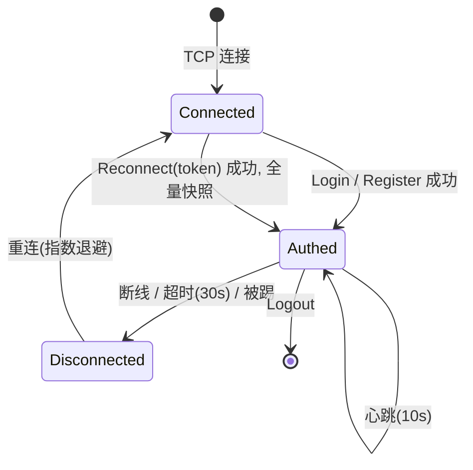
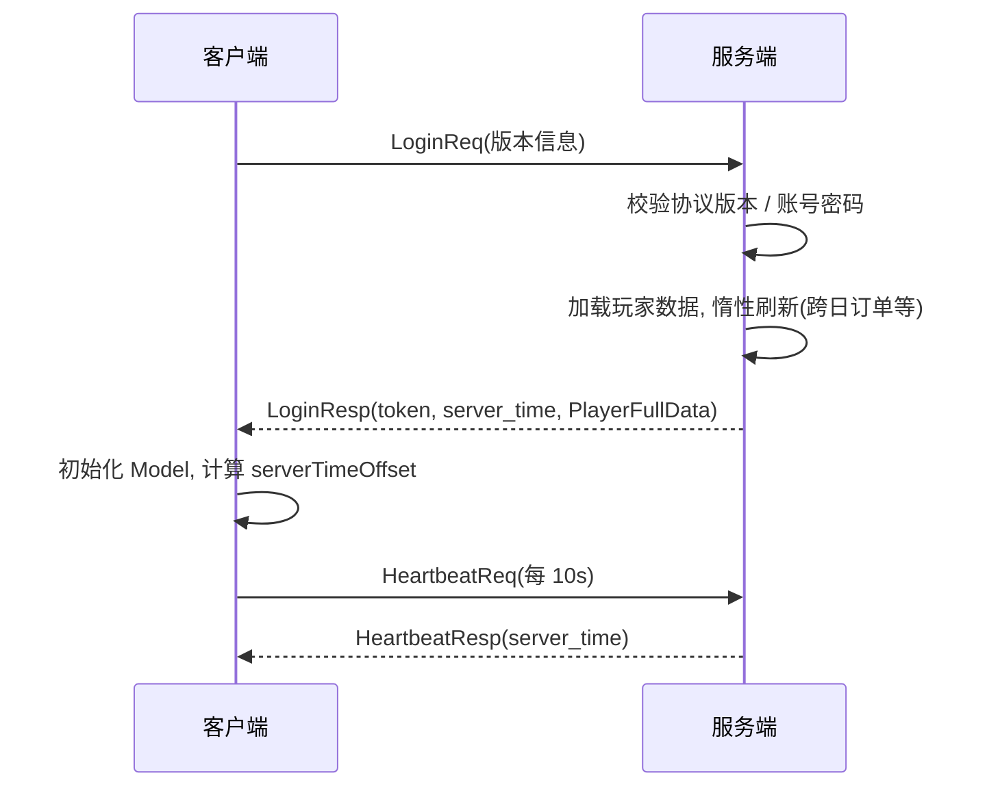
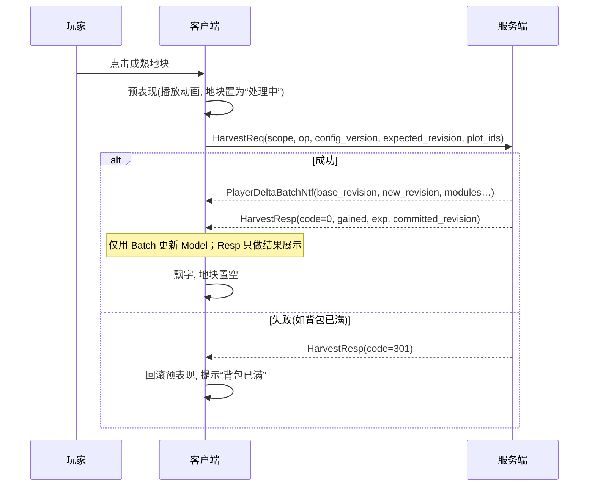
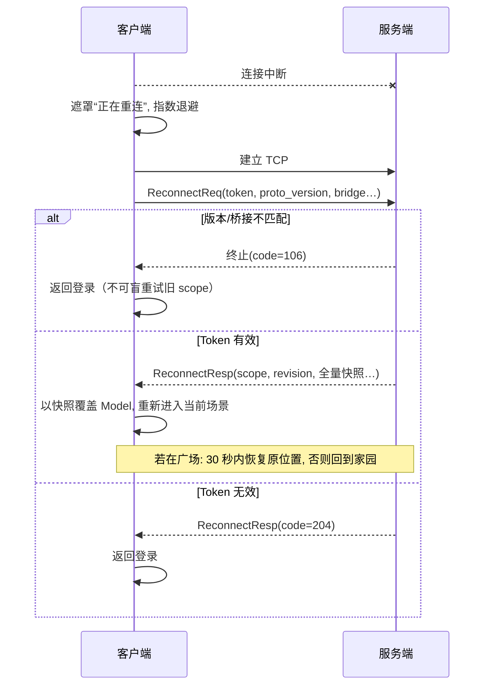
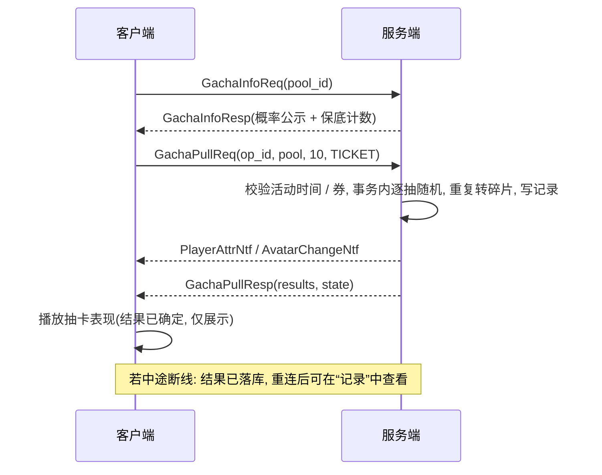
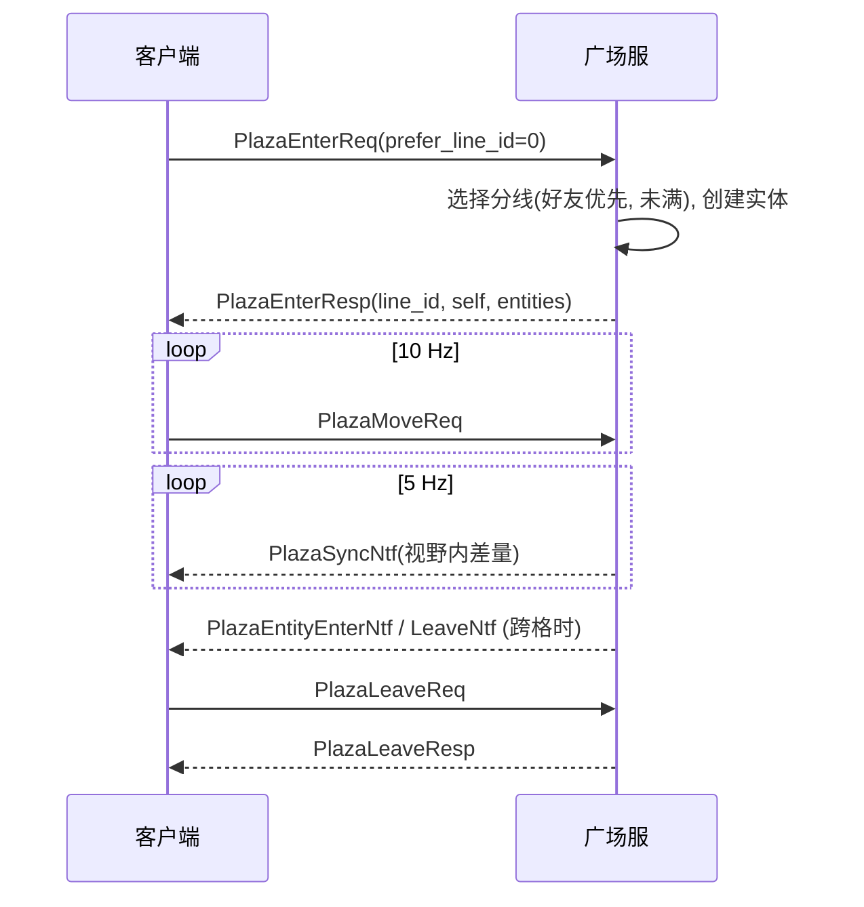
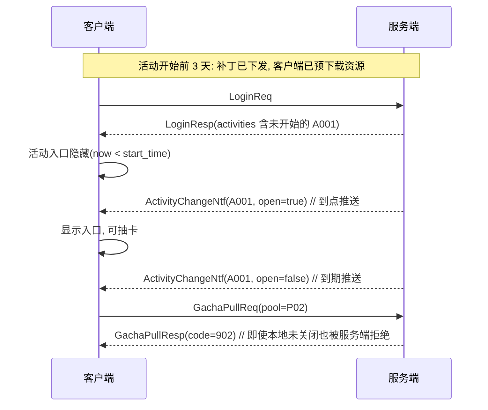

# 05 协议与接口

> 客户端、服务端、机器人三方共用同一份 `.proto`（位于 `Shared/proto/`），由脚本生成 C# 代码。
> 本文档是协议的**权威说明**：新增 / 修改消息必须先改本文档与 `.proto`，再改代码。

---

## 1. 通信约定

### 1.1 传输与帧格式

| 项 | 约定 |
|---|---|
| 传输 | TCP 长连接（单连接承载全部业务与广场消息） |
| 序列化 | Protobuf（proto3） |
| 字节序 | 小端 |
| 单包上限 | body ≤ 64 KB；超过视为非法并断开 |
| 压缩 / 加密 | 未实现（扩展位：TLS、LZ4）；密码仅在服务端以加盐哈希存储 |

**帧结构**

```
+----------+----------+----------+------------------+
| len (4B) | msgId(2B)| seq (4B) | body (len-6 B)   |
+----------+----------+----------+------------------+
```

| 字段 | 说明 |
|---|---|
| `len` | 其后全部字节数（`msgId + seq + body`） |
| `msgId` | 消息 ID（见第 2 节） |
| `seq` | 请求序号：客户端发出的请求递增；响应原样带回；**服务端推送 `seq = 0`** |
| `body` | Protobuf 序列化内容 |

### 1.2 消息类别与命名

| 后缀 | 方向 | 说明 |
|---|---|---|
| `Req` | C→S | 请求 |
| `Resp` | S→C | 响应，`msgId = Req.msgId + 1`，`seq` 与请求一致 |
| `Ntf` | S→C | 服务端推送，`seq = 0` |

- 所有 `Resp` 的第 1 个字段固定为 `int32 code`，`0` 表示成功，非 0 见第 3 节。
- 少数高频消息**无响应**（如 `PlazaMoveReq`），在消息表中标注。

### 1.3 数据同步原则（重要）

> **数据变化统一通过 `Ntf` 同步，`Resp` 只返回操作结果。**

- 货币 / 经验 / 等级 → `PlayerAttrNtf`；背包变化 → `BagChangeNtf`；地块 / 采集点 / 设施 / 订单 / 外观等同理。
- 服务端在发送 `Resp` **之前**先发送相关 `Ntf`，同一连接保证有序；客户端先更新 Model，再处理 `Resp`。
- 好处：客户端只有一个数据更新入口，断线重连后也可用“全量快照”走同一套更新逻辑。

### 1.4 时间

- 所有时间戳均为 **Unix 毫秒（UTC，int64）**。
- 登录响应与心跳响应携带 `server_time`；客户端计算 `serverTimeOffset = server_time - localNow`，倒计时使用 `localNow + offset`。
- 客户端本地时间仅用于显示，**任何判定以服务端为准**。

### 1.5 写操作幂等

> **M1 historical superseded（不得再作 M2 实现依据）：** M1 曾声称「每玩家内存最近 64 个 `op_id` 及响应缓存」。该窗口**不是** M2 权威账本；M2 以持久 `(player_id, scope_id, op_id)` + 规范摘要 + `CommandAck` 为准。下文 M2 节为权威。

**M2 权威（T010）：**

- 写身份键：`(player_id, operation_scope_id, op_id)`；`op_id` 在当前 open scope 内从 1 单调；权威高水位为 `command_scope.next_op_id`（永久）。
- **NotAccepted**（预受理）：鉴权/版本/shape/busy/rate/scope 无效/op 间隙等——**不消费** op，无账本行。
- **Recorded**：同 key 同规范摘要重放原 `code/revision/config/blob`；业务前置冲突（如 109 revision、config）在受理后亦记为 Recorded 业务拒绝（消耗 op，资产 revision 不动）。
- **异摘要**：同 key 不同 hash → **112**，不执行。
- **NotRecorded**：`op == next` 且无行；当前 open 为瞬时（不可换 payload / 跳号 / 自动新 scope）；Query 用 `code=0` + `result_state=NOT_RECORDED` + `ack.disposition=UNSPECIFIED`（查询未受理命令，**不是** NotAccepted）。
- **Expired（111）**：`op < next` 且行已剪，或 `now >= committed_at + 7×24h` 逻辑过期；高水位永久，**永不**当 NotRecorded 重做。
- **外 scope（110）**：无归属则不返回权威 next / scope_state / 详情。
- 超时客户端态为 Unknown，可 `CommandResultQuery` 确认；Query **不**触发 init grant / 日切 / 配置规则 / RNG。
- 新登录关闭旧 scope 写权；旧 scope 仅只读查询/回放已记录结果。
- 读请求与 Ntf 不携带写 Ack；线消息种类数保持 **63**；`ProtoVersion` 在 M2 App/Bridge 门闸下仍为 **1**。

### 1.6 限流

| 类型 | 限制 | 超限处理 |
|---|---|---|
| 普通请求 | 每玩家每秒 ≤ 20 | 返回 `ERR_TOO_FAST`（104） |
| 广场移动 | 每秒 ≤ 15 | 丢弃多余包 |
| 聊天 | 每 3 秒 1 条 | 返回 `ERR_CHAT_TOO_FAST`（804） |
| 抽卡 | 每秒 ≤ 2 | 返回 `ERR_TOO_FAST` |
| 非法包（长度 / 反序列化失败） | 连续 5 次 | 断开连接 |

### 1.7 连接生命周期



### 1.8 版本兼容

| 版本 | 说明 |
|---|---|
| `ProtoVersion` | 协议版本（整数）。**不兼容变更才递增**；登录时校验，不兼容返回 `ERR_VERSION`（106）并提示更新 |
| 兼容变更 | 只允许：新增字段（使用新的字段号）、新增消息、新增枚举值 |
| 禁止 | 修改已有字段号 / 类型；复用已删除的字段号（删除字段使用 `reserved`）；改变消息 ID 含义 |

---

## 2. 消息 ID 总表

> 范围规则：`1xxx` 系统、`2xxx` 玩家与背包、`3xxx` 种植、`4xxx` 采集、`5xxx` 加工、`6xxx` 订单、`7xxx` 商店与家园、`8xxx` 外观、`9xxx` 广场、`10xxx` 抽卡与活动、`12xxx` 调试。
> 请求为奇数，响应为请求 +1；`1xx` 开头的第二位表示推送（如 `3101`）。

### 2.1 系统（1xxx）

| ID | 名称 | 方向 | 说明 |
|---|---|---|---|
| 1001 / 1002 | HeartbeatReq / Resp | C↔S | 心跳；响应含 `server_time` |
| 1003 / 1004 | RegisterReq / Resp | C↔S | 注册（创建账号与角色） |
| 1005 / 1006 | LoginReq / Resp | C↔S | 登录；Req 含版本+`bridge_contract`；Resp 含全量数据与 `operation_scope_id` |
| 1007 / 1008 | ReconnectReq / Resp | C↔S | 凭 Token 重连；Req 追加 app/res/config/bridge；Resp 含快照与 scope |
| 1009 | LogoutReq | C→S | 登出（无响应） |
| 1010 | KickNtf | S→C | 被踢下线（原因：顶号 / 维护 / 违规） |

### 2.2 玩家与背包 / 同步（2xxx）

| ID | 名称 | 方向 | 说明 |
|---|---|---|---|
| 2001 / 2002 | BagSellReq / Resp | C↔S | 出售物品 |
| 2003 / 2004 | BagExpandReq / Resp | C↔S | 背包扩容 |
| 2005 / 2006 | GuideStepReq / Resp | C↔S | 上报新手引导进度 |
| 2007 / 2008 | SyncStateReq / Resp | C↔S | 全量家园快照（full sync） |
| 2009 / 2010 | CommandResultQueryReq / Resp | C↔S | 查询已记录旧命令结果（不重执行） |
| 2101 | PlayerAttrNtf | S→C | 货币 / 等级 / 经验变化 |
| 2102 | BagChangeNtf | S→C | 背包增量变化 |
| 2103 | LevelUpNtf | S→C | 升级与解锁内容 |
| 2110 | PlayerDeltaBatchNtf | S→C | 单次逻辑提交的完整增量批次 |

### 2.3 种植（3xxx）

| ID | 名称 | 方向 | 说明 |
|---|---|---|---|
| 3001 / 3002 | PlotUnlockReq / Resp | C↔S | 解锁地块 |
| 3003 / 3004 | PlantReq / Resp | C↔S | 播种（支持批量） |
| 3005 / 3006 | HarvestReq / Resp | C↔S | 收获（支持批量） |
| 3007 / 3008 | WaterReq / Resp | C↔S | 浇水 |
| 3009 / 3010 | FertilizeReq / Resp | C↔S | 施肥 |
| 3101 | PlotChangeNtf | S→C | 地块状态变化 |

### 2.4 采集（4xxx）

| ID | 名称 | 方向 | 说明 |
|---|---|---|---|
| 4001 / 4002 | GatherReq / Resp | C↔S | 采集 |
| 4003 / 4004 | ToolUpgradeReq / Resp | C↔S | 工具升级 |
| 4101 | NodeChangeNtf | S→C | 采集点冷却变化 |
| 4102 | ToolChangeNtf | S→C | 工具等级变化 |

### 2.5 加工（5xxx）

| ID | 名称 | 方向 | 说明 |
|---|---|---|---|
| 5001 / 5002 | FacilityBuildReq / Resp | C↔S | 建造设施 |
| 5003 / 5004 | FacilityUpgradeReq / Resp | C↔S | 升级设施 |
| 5005 / 5006 | CraftStartReq / Resp | C↔S | 开始生产 |
| 5007 / 5008 | CraftCollectReq / Resp | C↔S | 领取成品 |
| 5009 / 5010 | CraftSpeedupReq / Resp | C↔S | 钻石加速 |
| 5101 | FacilityChangeNtf | S→C | 设施 / 槽位变化 |

### 2.6 订单（6xxx）

| ID | 名称 | 方向 | 说明 |
|---|---|---|---|
| 6001 / 6002 | OrderListReq / Resp | C↔S | 获取订单列表 |
| 6003 / 6004 | OrderSubmitReq / Resp | C↔S | 交付订单（不含日里程碑奖） |
| 6005 / 6006 | OrderRerollReq / Resp | C↔S | 刷新单条订单 |
| 6007 / 6008 | OrderMilestoneClaimReq / Resp | C↔S | 显式领取每日 3/6 里程碑奖（03：仅 ticket/gem，满包不 301） |
| 6101 | OrderChangeNtf | S→C | 订单列表 / 进度变化（含每日刷新） |

#### 订单生成语义澄清（M2-T002/T003，与 03 §8.1 / ADR D05 同步）

服务端按日生成订单时区分：

| 情形 | 输入示例 | 边界 | 预期 |
|---|---|---|---|
| 库存充足 | 当前背包可合并分配满足 ≥2 条订单全部需求 | 合并分配后两条仍同时可交 | ≥2 条 `submit_ready=true`，`degrade_reason=NONE` |
| 库存不足 | 空/少库存，但已解锁作物或配方链可使 ≥2 条可达 | 禁止伪造库存、零需求、重复礼包 | ≥2 条 `producible=true`，`degrade_reason=INVENTORY_SHORT` |
| 空候选 | 候选池为空 | 不可静默空列表 | 生成失败，错误码 **504 ERR_ORDER_GEN_EMPTY** |

日切：权威时区 UTC+8，刷新小时读 `Global.daily_reset_hour`。`OrderData` 字段 8–10：`submit_ready` / `producible` / `degrade_reason`。批量种植/收获上限 **24**。数据变更走 `PlayerDeltaBatchNtf`（及必要时模块 Ntf 载荷嵌入批次）；Resp 只含结果码与结果摘要。

### 2.7 商店与家园（7xxx）

| ID | 名称 | 方向 | 说明 |
|---|---|---|---|
| 7001 / 7002 | ShopBuyReq / Resp | C↔S | 购买商品 |
| 7003 / 7004 | HomeSaveReq / Resp | C↔S | 保存家园布局 |
| 7005 / 7006 | VisitHomeReq / Resp | C↔S | 访问他人家园（只读，P1） |
| 7007 / 7008 | LikeHomeReq / Resp | C↔S | 点赞（P1） |

### 2.8 外观（8xxx）

| ID | 名称 | 方向 | 说明 |
|---|---|---|---|
| 8001 / 8002 | AvatarEquipReq / Resp | C↔S | 更换装扮 |
| 8003 / 8004 | ShardExchangeReq / Resp | C↔S | 碎片兑换外观 |
| 8101 | AvatarChangeNtf | S→C | 拥有外观 / 装扮变化 |

### 2.9 广场（9xxx）

| ID | 名称 | 方向 | 说明 |
|---|---|---|---|
| 9001 / 9002 | PlazaEnterReq / Resp | C↔S | 进入广场（分线分配） |
| 9003 / 9004 | PlazaLeaveReq / Resp | C↔S | 离开广场 |
| 9005 | PlazaMoveReq | C→S | 移动上报，10 Hz，**无响应** |
| 9007 | PlazaEmoteReq | C→S | 表情，**无响应**（结果走 9105 推送） |
| 9009 / 9010 | PlazaChatReq / Resp | C↔S | 聊天 |
| 9011 / 9012 | PlazaProfileReq / Resp | C↔S | 查看玩家资料 |
| 9013 / 9014 | PlazaGatherReq / Resp | C↔S | 公共采集点（P1） |
| 9101 | PlazaEntityEnterNtf | S→C | 实体进入视野 |
| 9102 | PlazaEntityLeaveNtf | S→C | 实体离开视野 |
| 9103 | PlazaSyncNtf | S→C | 视野内位置差量（5 Hz 批量） |
| 9104 | PlazaCorrectNtf | S→C | 位置纠正（拉回） |
| 9105 | PlazaEmoteNtf | S→C | 表情广播 |
| 9106 | PlazaChatNtf | S→C | 聊天广播 |
| 9107 | PlazaAppearanceNtf | S→C | 他人外观变化 |

### 2.10 抽卡与活动（10xxx）

| ID | 名称 | 方向 | 说明 |
|---|---|---|---|
| 10001 / 10002 | ActivityListReq / Resp | C↔S | 获取当前活动列表 |
| 10003 / 10004 | GachaInfoReq / Resp | C↔S | 卡池信息、概率公示、保底计数 |
| 10005 / 10006 | GachaPullReq / Resp | C↔S | 抽卡（1 或 10 抽） |
| 10007 / 10008 | GachaLogReq / Resp | C↔S | 抽卡记录 |
| 10101 | ActivityChangeNtf | S→C | 活动开启 / 关闭推送 |

### 2.11 调试（12xxx，仅 Debug 构建与开发服务端）

| ID | 名称 | 方向 | 说明 |
|---|---|---|---|
| 12001 / 12002 | GmCommandReq / Resp | C↔S | 调试指令（生产配置下服务端直接拒绝） |

**GM 指令**：`add_item <id> <n>`、`add_currency <gold|gem|ticket> <n>`、`set_level <n>`、`finish_all_timers`、`reset_daily`、`reset_player`、`open_activity <id> <startOffsetSec> <durationSec>`、`close_activity <id>`、`set_pity <poolId> <ssr> <sr>`。

---

## 3. 错误码

| 范围 | 类别 |
|---|---|
| 0 | 成功 |
| 1xx | 通用 |
| 2xx | 账号 |
| 3xx | 背包与经济 |
| 4xx | 种植 / 采集 / 加工 |
| 5xx | 订单 |
| 6xx | 家园 |
| 7xx | 外观与商店 |
| 8xx | 广场 |
| 9xx | 抽卡与活动 |

| 码 | 名称 | 含义 | 客户端处理建议 |
|---|---|---|---|
| 0 | OK | 成功 | — |
| 101 | ERR_PARAM | 参数非法 | 记录日志，提示“操作失败” |
| 102 | ERR_NOT_LOGIN | 未登录 | 返回登录 |
| 104 | ERR_TOO_FAST | 请求过快 | 稍后重试，界面做防抖 |
| 105 | ERR_BUSY | 服务器繁忙 | 提示稍后重试 |
| 106 | ERR_VERSION | 协议 / 版本不兼容 | 提示更新并重启热更流程 |
| 107 | ERR_INTERNAL | 服务端内部错误 | 提示稍后重试，上报日志 |
| 108 | ERR_LEVEL_LOCKED | 等级不足 / 功能未解锁 | 提示解锁等级 |
| 109 | ERR_REVISION_CONFLICT | expected_revision 与服务器不一致 | 全量同步后重试 |
| 110 | ERR_SCOPE_INVALID | scope 无效或已关闭 | 重新登录获取 scope |
| 111 | ERR_COMMAND_EXPIRED | 账本详情已过期 | 全量同步；不得重做 |
| 112 | ERR_COMMAND_PAYLOAD_CONFLICT | 同 scope/op 不同 payload | 停止重试并上报 |
| 201 | ERR_ACCOUNT_EXISTS | 用户名已存在 | 提示更换 |
| 202 | ERR_AUTH_FAILED | 用户名或密码错误 | 提示 |
| 203 | ERR_NICKNAME_INVALID | 昵称非法 | 提示 |
| 204 | ERR_TOKEN_INVALID | Token 无效或过期 | 返回登录 |
| 205 | ERR_LOGIN_ELSEWHERE | 账号在别处登录 | 提示并回到登录 |
| 301 | ERR_BAG_FULL | 奖励含物品且新占格超限（纯货币/经验不触发） | 提示清理 / 扩容；日 3/6 纯货币领奖满包仍应成功 |
| 302 | ERR_ITEM_NOT_ENOUGH | 物品不足 | 显示缺少的物品 |
| 303 | ERR_GOLD_NOT_ENOUGH | 金币不足 | 提示 |
| 304 | ERR_GEM_NOT_ENOUGH | 钻石不足 | 提示 |
| 305 | ERR_TICKET_NOT_ENOUGH | 抽卡券不足 | 提示 |
| 306 | ERR_ITEM_INVALID | 物品不存在 / 不可操作 | 刷新背包 |
| 401 | ERR_PLOT_LOCKED | 地块未解锁 | 提示 |
| 402 | ERR_PLOT_NOT_EMPTY | 地块非空 | 刷新地块 |
| 403 | ERR_CROP_NOT_RIPE | 作物未成熟 | 刷新地块 |
| 404 | ERR_CROP_LOCKED | 作物未解锁 | 提示 |
| 405 | ERR_ALREADY_BOOSTED | 已浇水 / 已施肥 | 提示 |
| 406 | ERR_NODE_COOLDOWN | 采集点冷却中 | 显示剩余时间 |
| 407 | ERR_TOOL_MISSING | 缺少工具 | 提示获取方式 |
| 408 | ERR_FACILITY_LOCKED | 设施未解锁 / 未建造 | 提示 |
| 409 | ERR_SLOT_BUSY | 槽位忙 / 无空槽 / 待领取已满 | 提示先领取 |
| 410 | ERR_RECIPE_LOCKED | 配方未解锁 | 提示 |
| 411 | ERR_SLOT_NOT_DONE | 生产未完成 | 刷新槽位 |
| 501 | ERR_ORDER_INVALID | 订单不存在或已过期 | 刷新订单 |
| 502 | ERR_ORDER_DONE | 订单已完成 | 刷新订单 |
| 503 | ERR_ORDER_REROLL_LIMIT | 刷新条件不满足 | 提示 |
| 504 | ERR_ORDER_GEN_EMPTY | 日订单候选池为空，无法生成 | 提示并记录；不写空成功列表 |
| 505 | ERR_ORDER_MILESTONE | 日里程碑不可领（未达/已领/跨日） | 刷新进度 |
| 601 | ERR_HOME_CONFLICT | 摆放冲突 / 越界 | 提示并恢复布局 |
| 602 | ERR_FURNITURE_MISSING | 家具数量不足 | 刷新背包 |
| 603 | ERR_ALREADY_LIKED | 今日已点赞 | 提示 |
| 701 | ERR_AVATAR_NOT_OWNED | 未拥有该外观 | 刷新外观 |
| 702 | ERR_AVATAR_CONFLICT | 部位冲突 | 提示 |
| 703 | ERR_SHOP_ITEM_INVALID | 商品不存在 / 达到限购 | 刷新商店 |
| 704 | ERR_SHARD_NOT_ENOUGH | 碎片不足 | 提示 |
| 801 | ERR_LINE_FULL | 分线已满 | 自动重试其他分线 |
| 802 | ERR_NOT_IN_PLAZA | 不在广场 | 返回家园 |
| 803 | ERR_POS_INVALID | 位置非法（通常同时下发纠正推送） | 以服务端位置为准 |
| 804 | ERR_CHAT_TOO_FAST | 聊天过快 | 提示 |
| 805 | ERR_CHAT_INVALID | 内容非法 | 提示 |
| 806 | ERR_TARGET_OFFLINE | 目标不在线 | 提示 |
| 901 | ERR_POOL_INVALID | 卡池不存在 | 刷新活动 |
| 902 | ERR_POOL_CLOSED | 卡池未开放或已结束 | 刷新活动，关闭界面 |
| 903 | ERR_PULL_TIMES | 抽数非法（仅允许 1 或 10） | 记录日志 |
| 904 | ERR_ACTIVITY_INVALID | 活动不存在 | 刷新活动 |
| 990 | ERR_GM_FORBIDDEN | 无调试权限 | — |

---

## 4. Protobuf 定义

> 以下为 `Shared/proto/` 中的主要文件摘要。字段号一经发布不得更改。
> 时间字段均为 Unix 毫秒；坐标为**厘米**（int32）。

### 4.1 `common.proto`（通用结构）

```proto
syntax = "proto3";
package cloudisle;
option csharp_namespace = "CloudIsle.Proto";

message ItemStack { int32 item_id = 1; int32 count = 2; }

message Reward {
  repeated ItemStack items = 1;
  int32 gold   = 2;
  int32 gem    = 3;
  int32 ticket = 4;
  int32 exp    = 5;
}

message PlayerInfo {
  int64  player_id = 1;
  string nickname  = 2;
  int32  level     = 3;
  int32  exp       = 4;
  int64  gold      = 5;
  int64  gem       = 6;
  int64  ticket    = 7;
  int64  shard     = 8;
  int32  bag_slots = 9;
  int32  guide_step = 10;
}

enum PlotState { PLOT_LOCKED = 0; PLOT_EMPTY = 1; PLOT_GROWING = 2; PLOT_RIPE = 3; }
message PlotData {
  int32 plot_id    = 1;
  PlotState state  = 2;
  int32 crop_id    = 3;
  int64 plant_time = 4;
  int64 ready_time = 5;
  bool  watered    = 6;
  bool  fertilized = 7;
}
message PlotResult { int32 plot_id = 1; int32 code = 2; PlotData plot = 3; }

message NodeData { int32 node_id = 1; int64 next_ready_time = 2; }
message ToolData { int32 tool_id = 1; int32 level = 2; }

enum SlotState { SLOT_IDLE = 0; SLOT_WORKING = 1; SLOT_DONE = 2; }
message SlotData { int32 slot_id = 1; int32 recipe_id = 2; int64 finish_time = 3; SlotState state = 4; }
message FacilityData { int32 facility_id = 1; int32 level = 2; repeated SlotData slots = 3; }

message OrderData {
  int32 order_id = 1;            // 当日唯一
  int32 slot = 2;               // 0~5
  repeated ItemStack needs = 3;
  Reward reward = 4;
  int32 difficulty = 5;         // 1 简单 2 普通 3 困难
  bool  rare = 6;               // 稀有加成
  int32 status = 7;             // 0 进行中 1 已完成
}
message OrderProgress {
  int32 day_index = 1;
  int32 done_count = 2;
  int32 reroll_count = 3;
  bool  claimed_3 = 4;
  bool  claimed_6 = 5;
  int64 next_refresh_time = 6;
}

message FurniturePlacement { int32 furniture_id = 1; int32 x = 2; int32 y = 3; int32 rotation = 4; }
message HomeLayout { repeated FurniturePlacement items = 1; int32 version = 2; }

message AvatarData {
  repeated int32 owned = 1;
  map<int32, int32> equipped = 2;   // 部位 -> 外观ID
}

message GachaPoolState {
  int32 pool_id = 1;
  int32 pity_ssr = 2;
  int32 pity_sr = 3;
  bool  up_guarantee = 4;
}

message ActivityInfo {
  int32  activity_id = 1;
  string name = 2;
  string type = 3;                 // "gacha"
  int32  pool_id = 4;
  int64  start_time = 5;
  int64  end_time = 6;
  int64  preload_time = 7;
  string resource_bundle = 8;
}

message PlayerFullData {
  PlayerInfo info = 1;
  repeated ItemStack bag = 2;
  repeated PlotData plots = 3;
  repeated NodeData nodes = 4;
  repeated ToolData tools = 5;
  repeated FacilityData facilities = 6;
  repeated OrderData orders = 7;
  OrderProgress order_progress = 8;
  HomeLayout home = 9;
  AvatarData avatar = 10;
  repeated GachaPoolState gacha_states = 11;
  repeated ActivityInfo activities = 12;
  int64 revision = 13;               // M2 追加
  int32 grant_version = 14;          // M2 追加
}
```

### 4.1.1 ProtoVersion=1 兼容决策（M2-T003）

- **保持 ProtoVersion=1**：本轮仅**追加**字段与新消息 ID，不修改既有字段号/类型/语义，不复用已删号。
- 旧客户端忽略未知字段；缺省 `bridge_contract` / 重连缺版本字段时的 **0.4 基包门槛拒绝（106）** 由 **T009** 接入运行时，本任务只登记契约。
- M3 保留 ID（家园编辑 7003+、外观 8xxx、广场 9xxx、抽卡 10xxx、GM 12xxx）**不**进入当前正式 `MsgId` 枚举，直至对应正式消息落地，避免无消息枚举项。

### 4.2 `system.proto`

```proto
message HeartbeatReq  { int64 client_time = 1; }
message HeartbeatResp { int32 code = 1; int64 server_time = 2; }

message RegisterReq {
  string username = 1; string password = 2; string nickname = 3;
  int32 proto_version = 4; string device_id = 5;
}
message RegisterResp { int32 code = 1; }

message LoginReq {
  string username = 1; string password = 2;
  string app_version = 3; int32 res_version = 4;
  int32 proto_version = 5; int32 config_version = 6;
  string device_id = 7;
  string bridge_contract = 8;        // M2 追加；旧安装可缺省
}
message LoginResp {
  int32 code = 1;
  string token = 2;
  int64 server_time = 3;
  int32 need_res_version = 4;        // 服务端要求的最低资源版本
  int32 need_config_version = 5;
  PlayerFullData data = 6;
  int64 operation_scope_id = 7;      // M2 追加
  optional int64 next_op_id = 8;     // M2-T010：成功时权威 next（新登录=1）；拒绝不设置
  OperationScopeState scope_state = 9;
}

message ReconnectReq {
  string token = 1; int32 proto_version = 2;
  string app_version = 3; int32 res_version = 4;
  int32 config_version = 5; string bridge_contract = 6;  // M2 追加
}
message ReconnectResp {
  int32 code = 1; int64 server_time = 2; PlayerFullData data = 3;
  int64 operation_scope_id = 4;      // M2 追加
  optional int64 next_op_id = 5;     // M2-T010：存储实际 next；拒绝不设置
  OperationScopeState scope_state = 6;
}

message LogoutReq {}

enum KickReason { KICK_ELSEWHERE = 0; KICK_MAINTENANCE = 1; KICK_VIOLATION = 2; }
message KickNtf { KickReason reason = 1; }
```

### 4.3 写命令公共字段约定（M2）

除只读查询外，写请求在业务字段之外携带：

| 字段 | 职责 |
|---|---|
| `op_id` | 当前 scope 内单调操作号 |
| `operation_scope_id` | 登录/重连签发的写权限身份 |
| `expected_revision` | 客户端基于的状态 revision；冲突返回 109 |
| `config_version` | 本命令固定的配置快照版本 |

成功写响应可含 `committed_revision`（结果元数据），并在 **全部 19 个写配对 Resp** 上追加 `CommandAck ack`（字段号取既有 max+1，不删旧业务字段、不另造资产投影）。**资产投影**仍仅通过 `PlayerDeltaBatchNtf`（ID 2110）投递。

批量种植/收获：`repeated` 上限 **24**；重复 `plot_id` 整包拒绝。

#### `CommandAck` / 处置枚举（`common.proto`，无独立 MsgId）

```proto
enum CommandDisposition {
  COMMAND_DISPOSITION_UNSPECIFIED = 0;   // 永不表示已记账
  COMMAND_DISPOSITION_NOT_ACCEPTED = 1;  // 预受理拒绝，未消费 op
  COMMAND_DISPOSITION_RECORDED = 2;      // 已记账（含业务拒绝重放）
  COMMAND_DISPOSITION_EXPIRED = 3;
}
enum OperationScopeState {
  OPERATION_SCOPE_STATE_UNKNOWN = 0;
  OPERATION_SCOPE_STATE_OPEN = 1;
  OPERATION_SCOPE_STATE_CLOSED = 2;
}
enum CommandResultState {
  COMMAND_RESULT_STATE_UNSPECIFIED = 0;
  COMMAND_RESULT_STATE_RECORDED = 1;
  COMMAND_RESULT_STATE_NOT_RECORDED = 2;
  COMMAND_RESULT_STATE_EXPIRED = 3;
}
message CommandAck {
  int64 operation_scope_id = 1;
  int64 op_id = 2;
  CommandDisposition disposition = 3;
  optional int64 next_op_id = 4;     // proto3 optional：未设置≠权威0；正数才是权威 next
  OperationScopeState scope_state = 5;
}
```

规范摘要格式 **`cmdhash-v1`**：长度定界流 = format + kind + expected_revision + config_version + 规范化业务字段；**排除** transport seq / Token / player / scope / op。BagSell 按 `item_id`、Plant 按 `plot_id`、Harvest `plot_ids` 升序；重复身份整包拒绝。

### 4.4 `inventory.proto` / `farm.proto` / `gather.proto` / `craft.proto`

源文件见 `Shared/proto/`。字段号与上表 ID 对齐；写请求均含 scope/op/expected_revision/config_version；写 Resp 含 `ack`。`NodeData.config_node_id=3` 为配置类型，`node_id` 仍为实例身份（不改义）。

### 4.5 `order.proto`

```proto
message OrderListReq  {}
message OrderListResp { int32 code = 1; repeated OrderData orders = 2; OrderProgress progress = 3; }

message OrderSubmitReq  {
  int64 op_id = 1; int32 order_id = 2;
  int64 operation_scope_id = 3; int64 expected_revision = 4; int32 config_version = 5;
}
message OrderSubmitResp {
  int32 code = 1;
  Reward reward = 2;        // 订单本身奖励
  Reward bonus = 3;         // 保留字段号；M2 恒空，日奖改 6007/6008
  bool  rare_applied = 4;
  int64 committed_revision = 5;
  CommandAck ack = 6;       // M2-T010
}

message OrderRerollReq  {
  int64 op_id = 1; int32 order_id = 2;
  int64 operation_scope_id = 3; int64 expected_revision = 4; int32 config_version = 5;
}
message OrderRerollResp {
  int32 code = 1; OrderData order = 2; int64 gold_cost = 3; int64 committed_revision = 4;
  CommandAck ack = 5;
}

message OrderMilestoneClaimReq {
  int64 op_id = 1; int32 milestone = 2;  // 3 或 6
  int64 operation_scope_id = 3; int64 expected_revision = 4; int32 config_version = 5;
}
message OrderMilestoneClaimResp {
  int32 code = 1; Reward reward = 2; OrderProgress progress = 3; int64 committed_revision = 4;
  CommandAck ack = 5;
}

message OrderChangeNtf {
  repeated OrderData orders = 1;
  OrderProgress progress = 2;
  bool daily_refreshed = 3;
}
```

`OrderData` 追加：`submit_ready=8`、`producible=9`、`degrade_reason=10`。

### 4.6 `shop.proto` / `sync.proto`（M2）与家园外观（M3 保留）

```proto
message ShopBuyReq  {
  int64 op_id = 1; int32 shop_item_id = 2; int32 count = 3;
  int64 operation_scope_id = 4; int64 expected_revision = 5; int32 config_version = 6;
}
message ShopBuyResp { int32 code = 1; int64 committed_revision = 2; CommandAck ack = 3; }

message SyncStateReq {}
message SyncStateResp {
  int32 code = 1; int64 server_time = 2; PlayerFullData data = 3; int64 operation_scope_id = 4;
  optional int64 next_op_id = 5; OperationScopeState scope_state = 6;  // M2-T010
}
message CommandResultQueryReq  { int64 operation_scope_id = 1; int64 op_id = 2; }
message CommandResultQueryResp {
  int32 code = 1;                 // 0=Recorded/NotRecorded；110 外scope；111 Expired
  int32 original_code = 2;        // 字段 1–5 保留
  int64 committed_revision = 3;
  int32 config_version = 4;
  bytes result_blob = 5;
  CommandResultState result_state = 6;
  CommandAck ack = 7;
  // Recorded：result_state=RECORDED + ack.RECORDED + details
  // NotRecorded：code=0 + NOT_RECORDED + ack.UNSPECIFIED（非 NotAccepted）
  // Expired：111 + EXPIRED + ack.EXPIRED，省略 blob/原详情
  // 外 scope：110，无权威 next/scope_state/details
}
message PlayerDeltaBatchNtf {
  int64 base_revision = 1; int64 new_revision = 2;
  int64 operation_scope_id = 3; int64 op_id = 4; int64 server_time = 5; int32 config_version = 6;
  // 模块载荷字段 7–14 见 sync.proto
}
```

家园布局/访问/点赞/外观消息 ID 仍见 §2.7–2.8，**本轮不进入正式 MsgId**（M3）。原文档片段：

```proto
// M3 保留，非本轮正式生成
message HomeSaveReq  { int64 op_id = 1; HomeLayout layout = 2; }
message HomeSaveResp { int32 code = 1; int32 version = 2; }

message VisitHomeReq  { int64 player_id = 1; }
message VisitHomeResp {
  int32 code = 1; string nickname = 2; int32 level = 3;
  HomeLayout layout = 4; repeated PlotData plots = 5;
  map<int32, int32> equipped = 6; int32 likes = 7;
}
message LikeHomeReq  { int64 op_id = 1; int64 player_id = 2; }
message LikeHomeResp { int32 code = 1; int32 likes = 2; }

message AvatarEquipReq  { int64 op_id = 1; map<int32, int32> equipped = 2; }
message AvatarEquipResp { int32 code = 1; }
message ShardExchangeReq  { int64 op_id = 1; int32 avatar_id = 2; }
message ShardExchangeResp { int32 code = 1; }
message AvatarChangeNtf { AvatarData avatar = 1; }
```

### 4.7 `plaza.proto`

```proto
message PlazaEntity {
  int64 player_id = 1;
  string nickname = 2;
  int32 level = 3;
  repeated int32 avatar_ids = 4;     // 当前装扮外观ID列表
  int32 x = 5; int32 y = 6;          // 厘米
  int32 dir = 7;                     // 0~359 度
  int32 state = 8;                   // 0 站立 1 走 2 跑 3 表情中
}

message PlazaEnterReq  { int32 prefer_line_id = 1; }                 // 0 = 自动分配
message PlazaEnterResp { int32 code = 1; int32 line_id = 2; PlazaEntity self = 3; repeated PlazaEntity entities = 4; }
message PlazaLeaveReq  {}
message PlazaLeaveResp { int32 code = 1; }

// 无响应，10 Hz
message PlazaMoveReq {
  int32 x = 1; int32 y = 2; int32 dir = 3;
  int32 state = 4;                   // 1 走 2 跑 0 停
  int64 client_time = 5;
}
// 无响应
message PlazaEmoteReq { int32 emote_id = 1; }                        // 1~6

message PlazaChatReq  { string text = 1; }                           // ≤ 60 字符
message PlazaChatResp { int32 code = 1; }

message PlazaProfileReq  { int64 player_id = 1; }
message PlazaProfileResp { int32 code = 1; PlazaEntity entity = 2; }

message PlazaGatherReq  { int64 op_id = 1; int32 node_id = 2; }
message PlazaGatherResp { int32 code = 1; repeated ItemStack gained = 2; int32 remain_today = 3; }

// 推送
message PlazaEntityEnterNtf { repeated PlazaEntity entities = 1; }
message PlazaEntityLeaveNtf { repeated int64 player_ids = 1; }
message EntityMove { int64 player_id = 1; int32 x = 2; int32 y = 3; int32 dir = 4; int32 state = 5; }
message PlazaSyncNtf { int64 server_time = 1; repeated EntityMove moves = 2; }   // 5 Hz 批量差量
message PlazaCorrectNtf { int32 x = 1; int32 y = 2; int32 reason = 3; }         // 1 超速 2 不可行走 3 瞬移
message PlazaEmoteNtf { int64 player_id = 1; int32 emote_id = 2; }
message PlazaChatNtf  { int64 player_id = 1; string nickname = 2; string text = 3; int64 time = 4; }
message PlazaAppearanceNtf { int64 player_id = 1; repeated int32 avatar_ids = 2; }
```

### 4.8 `gacha.proto`

```proto
enum Rarity { RARITY_N = 0; RARITY_R = 1; RARITY_SR = 2; RARITY_SSR = 3; }
enum PayType { PAY_TICKET = 0; PAY_GEM = 1; }

message RarityRate { Rarity rarity = 1; int32 permille = 2; }       // 千分比，SSR 1.0% = 10

message PoolInfo {
  int32 pool_id = 1; string name = 2;
  repeated int32 up_item_ids = 3;
  repeated RarityRate rates = 4;
  int32 soft_pity_start = 5;        // 40
  int32 soft_pity_step_permille = 6;// 40
  int32 hard_pity = 7;              // 60
  int32 sr_pity = 8;                // 10
  int32 cost_ticket = 9;            // 1
  int32 cost_gem = 10;              // 160
  bool  has_up = 11;
}

message ActivityListReq  {}
message ActivityListResp { int32 code = 1; repeated ActivityInfo activities = 2; int64 server_time = 3; }
message ActivityChangeNtf { ActivityInfo activity = 1; bool open = 2; }

message GachaInfoReq  { int32 pool_id = 1; }
message GachaInfoResp { int32 code = 1; PoolInfo pool = 2; GachaPoolState state = 3; }

message GachaPullReq  { int64 op_id = 1; int32 pool_id = 2; int32 times = 3; PayType pay = 4; }  // times 仅 1 / 10
message GachaResult {
  int32 item_id = 1; Rarity rarity = 2;
  bool is_up = 3; bool is_new = 4; int32 shard_gained = 5;
}
message GachaPullResp { int32 code = 1; repeated GachaResult results = 2; GachaPoolState state = 3; }

message GachaLogReq  { int32 pool_id = 1; int32 page = 2; }    // 每页 20 条，最多 5 页
message GachaLogEntry { int32 item_id = 1; Rarity rarity = 2; bool is_up = 3; int64 time = 4; }
message GachaLogResp { int32 code = 1; repeated GachaLogEntry entries = 2; }
```

### 4.9 `gm.proto`

```proto
message GmCommandReq  { string cmd = 1; }
message GmCommandResp { int32 code = 1; string message = 2; }
```

### 4.10 消息 ID 枚举（`msg_id.proto`）

```proto
enum MsgId {
  MSG_NONE = 0;
  HEARTBEAT_REQ = 1001;  HEARTBEAT_RESP = 1002;
  REGISTER_REQ  = 1003;  REGISTER_RESP  = 1004;
  LOGIN_REQ     = 1005;  LOGIN_RESP     = 1006;
  RECONNECT_REQ = 1007;  RECONNECT_RESP = 1008;
  LOGOUT_REQ    = 1009;  KICK_NTF       = 1010;
  // ……其余按第 2 节表格逐项填写；脚本校验“请求奇数、响应 = 请求 + 1”
}
```

> 工具 `Tools/gen_proto.ps1`：① 调用 `protoc` 生成 C#；② 根据 `MsgId` 枚举与消息名生成 **消息类型 ↔ ID 映射表**（`MsgRegistry.cs`），客户端与服务端共用；③ 校验 ID 不重复、命名与枚举一致。

---

## 5. 关键时序

### 5.1 登录与首次同步



### 5.2 收获：预表现与回滚

写命令资产投影只走 **单次** `PlayerDeltaBatchNtf`（§4.3）；`HarvestResp` 仅结果摘要（code / gained / exp / committed_revision 等），**不**再单独下发 Bag/Attr/Plot Ntf，客户端也**不得**用 Resp 覆盖资产 Model。



### 5.3 断线重连

`ReconnectReq` 须带协议/桥接门控字段（与 Login 同代：`proto_version` / bridge 元数据等，见 system.proto）；旧 Token 不能绕过版本门。桥接或协议不匹配时走 **106 终止**（不可用重连“猜 op”续跑）。



### 5.4 抽卡



### 5.5 进入广场与同步



### 5.6 活动热更上线（协议侧）



---

## 6. 协议自测清单

- [ ] 每个 Req 都有对应的 Resp（除标注“无响应”者）；ID 满足“Req 奇数，Resp = Req + 1”。
- [ ] 未登录发送任意业务消息 → `102`。
- [ ] 重复 `op_id`：第二次返回与第一次相同的结果，且不重复扣费 / 发奖。
- [ ] 协议版本不一致 → `106`。
- [ ] 超过限流阈值 → `104`；聊天过快 → `804`。
- [ ] 批量种植 / 收获：部分地块非法时，其余合法地块仍成功，`results` 中逐个返回 `code`。
- [ ] 断线 30 秒内重连：广场位置恢复；超时：回到家园。
- [ ] 抽卡：`times` 非 1 / 10 → `903`；卡池关闭 → `902`；货币不足 → `304 / 305`。
- [ ] 广场：超速移动 → 收到 `PlazaCorrectNtf`；不可行走坐标 → 被拒绝并纠正。
- [ ] 生产环境配置下发送 `GmCommandReq` → `990`。


---

## xLua 客户端边界补充（2026-10-20）

上文 MsgId、字段号、类型、错误码、鉴权、校时、幂等与服务端权威规则保持。实际源码和验收见 [07](07_xLua迁移方案与PoC.md)。

| 职责 | 固定 C# AOT | Lua 业务 |
|---|---|---|
| 帧与协议 | TCP、帧编解码、MsgRegistry、Protobuf 编解码、请求匹配 | 经稳定桥发起业务，不重写 wire layout |
| 状态 | 校验服务端快照，提供明确 DTO 或副本 | 更新业务模型与 UI，不修改网络层持有的正式 Protobuf 对象 |
| 异步 | 主线程回调、超时/取消、操作租约、一次完成保护 | 登记/退订回调并释放租约，不直接 await UniTask |
| 64 位整数 | 原协议 int64；完整整数或显式十进制字符串桥 | Lua53 integer 保持整数，禁止先转 double 后用于大 ID |
| 集合与 bytes | 保持 repeated/map 字段与编码；必要时转换 DTO | byte[] 可往返；直接迭代消息集合需另做包装与 IL2CPP 验证 |

当前 PoC 用 `HeartbeatReq.client_time=9007199254740993` 验证 Lua53 signed integer，并在 C# 解析回传 HeartbeatReq / AvatarData bytes，确认 repeated/map 和字段号未变。这不等于所有生成消息、泛型集合都已直接暴露 Lua。十进制字符串方案必须在桥接层显式校验格式和范围，不接受已丢精度的 Lua 浮点值冒充原 ID。

LuaCallCSharp / CSharpCallLua 白名单、生成桥接和 link.xml 在基包构建前固定。C# 协议类型、桥接签名、原生库或基础能力变更需升级 AppVersion；ProtoVersion 按上文兼容规则处理。只有 Lua 业务、资源和兼容数据可单独发 ResVersion / ConfigVersion 补丁。

回调与资源必须有所有者。取消、登出、顶号、窗口销毁、环境关闭时，先停止旧生产者回调并退订，再按拥有权释放 Lua 表/函数/生成接口和 C# 引用；不要误释放仍被其他调用方共享的桥。迟到响应由 C# 匹配层丢弃，异常路径同样清理。固定版本 LuaEnv.Dispose 内部含 GC；项目未额外强制 GC 不等于供应商释放过程不 GC。

当前主工程 Lua 模块为 `Assets/Lua/*.txt` TextAsset；报告区分 `Application.version`（AppVersion）与 `bridgeContract`（如 `main-bridge-1`）。完整生命周期与整数证据见 [07](07_xLua迁移方案与PoC.md)。
