# M1 基础框架：工作流、接口、单步任务与验收

版本：v1.4（xLua）；原编制日期：2026-10-17；迁移日期：2026-10-20；最终验收日期：2026-10-21。**T01–T68完成，58项验收全部通过。** 最终候选为Root Final 100 R2 / Root Final Publish R2，AppVersion0.3.0、ProtoVersion1。证据与逐条结果见 [M1最终验收记录](../../Docs/Delivery/M1/M1_Acceptance.md)，执行、问题与源码记录见 [M1_07](Logs/M1_07_Logs.md) 和 [M1_09](Logs/M1_09_Root验收复核_Logs.md)。迁移专项另见 [07](07_xLua迁移方案与PoC.md)。

## 1. 依据、范围与已知前提

以仓库实际文件 `ReferenceDoc/06_开发计划.md` 的 M1 为主，结合 `04_技术方案与架构.md`、`05_协议与接口.md`、`03_数值与配置表.md` 和现有 PoC 源码。用户所说的“06开发计划.md”对应上述实际文件名。

- Unity 固定为 **6000.3.22f1（Unity 6.3）**，客户端 Windows IL2CPP，服务端 .NET 8。
- IL2CPP 模块已安装。原 M0 与基线中的 HybridCLR 结果为历史证据；当前 xLua 固定来源、独立 PoC、主工程迁移和清理后验证见 07，不把旧栈结果直接继承为新栈通过。Windows x64 以实际报告为准，Android / iOS 尚未验证。
- M1 交付：注册、登录、空家园、存档、自动重连，以及不重装客户端新增面板和配置。只实现基础框架和最小账号业务。
- 种植、采集、加工、订单、广场、抽卡等只在项目模块图中定位，正式业务放到后续里程碑。
- 本文不安排工时、工期或人员估算。心跳、超时、落库间隔等均为运行参数。
- T01 已定位完整工程 `E:\Workbench\UnityWorkBench\Farming`，其中 Server、Tools、配置源表、Packages 和 ProjectSettings 均已找到。开发期间Git工作树根为Assets；本次经用户确认已上移到完整工程根，Server/Tools/Packages/ProjectSettings纳入同一仓库并保留原提交历史。历史路径、包版本、导表入口和PoC差异见 [M1_Baseline.md](M1_Baseline.md)。

### 1.1 原始需求编号

| 编号 | 原 M1 任务 | 本文归属 |
|---|---|---|
| R-C01 | Launcher、版本检查、下载、进度、LuaIndex / 预加载 / Lua 入口 | 启动与补丁 |
| R-C02 | 加载、释放、句柄、引用计数、泄漏报告 | 资源 |
| R-C03 | TCP、帧、请求匹配、超时、心跳、重连、op_id | 协议与网络 |
| R-C04 | 事件、对象池、计时器、文件日志 | 公共核心 |
| R-C05 | 窗口栈、层级、生命周期、Toast、弹窗、Safe Area | UI |
| R-C06 | Launcher → Login → Home、Loading | 场景 |
| R-C07 | IInputProvider、鼠标键盘 | 输入 |
| R-S01 | TCP 会话、Pipelines、路由、Handler | 服务端网关 |
| R-S02 | SQLite、缓存、脏标记、落库、玩家队列 | 数据 |
| R-S03 | 注册、登录、Token、重连、顶号 | 账号 |
| R-S04 | 补丁和版本静态服务 | 发布 |
| R-S05 | Serilog、基础指标 | 可观测 |
| R-E01 | gen_proto.ps1、MsgRegistry、ID 校验 | 协议工具 |
| R-E02 | 已验证导表管线接入 | 配置工具 |
| R-E03 | 三个一键脚本 | 构建工具 |
| R-E04 | NUnit 工程及第一条测试 | 测试 |

### 1.2 从现有代码迁移的明确处理

原状态与字节快照保留在专项验收目录。下表是迁移处理契约；实际实施、删除清单和清理后复验结果见 07，不能以本表代替测试通过。

| 原实现 / 记录 | 当前处理 |
|---|---|
| HotfixLoader 反射调用 Game.Hotfix，补 AOT 元数据 | 替换为 Lua 宿主；保留原脚本 GUID，参数/取消/初始化一次语义。名字若仍为 HotfixLoader，只表示历史命名，不再加载可更新 C# DLL |
| Assets/Hotfix/Entry.cs 与 Game.Hotfix.asmdef | 业务入口改 Assets/Lua/entry.txt；Proto 诊断留固定 C# 桥，旧活动入口和 asmdef 删除 |
| Assets/Hotfix/Config | 移到 Framework/Config，Game.Config schema/Runtime 与共享读取器保持 AOT；更新调用方和测试 |
| 旧包、HybridCLRData、生成元数据、旧 Editor 菜单与设置 | 完成新主工程运行后删除精确的旧依赖/配置，再用清理后的主工程重建运行 |
| Shared/Proto/Poc.cs 与正式生成物 | 保持隔离，不修改正式 MsgId/字段/鉴权；生成与 bytes 往返工具仍可运行 |
| Game.Shared 无 UnityEngine 依赖 | 保留；Framework → Shared/Config，无反向依赖。xLua 核心和 Gen 同属 Framework，Editor 生成器独立 |
| 历史日志 / 原 PoC | 原文保留，加迁移说明；不改名、不伪改验证技术 |
| 旧 PoC 资源版本 1 / 2 | 保留历史；xLua 专项及 M1 100→101 从新基包开始。专项演示不代表完整 M1 登录/UI 交付 |

### 1.3 本文补充的设计决策（区别于原文已有要求）

1. **固定 C# AOT 与 Lua 业务边界。** Game.Framework（含 xLua 核心/Gen/桥）、Game.Shared、Game.Config、Protobuf 和平台/网络/资源基础属于基包；Lua 承载客户端业务与 UI 控制。现有 Global 字符串 KV 新键可以兼容数据补丁；新增 C# 表/字段/协议类型、桥接签名或原生库需新 AppVersion。迁移PoC基线为0.2.0；正式M1最终基包为0.3.0、ProtoVersion 1、bridge m1-bridge-0.3，旧 0.1.0 HybridCLR 安装不能只下 Lua 转换。
2. **Token 可跨服务端重启恢复。** 服务端持久化 Token 的 SHA-256 摘要、player_id、到期时间和撤销状态；明文仅发给客户端，不记录日志。新登录撤销旧 Token，顶号后的旧连接禁止自动抢回。验收环境 Token 有效期建议 24 小时，可配置。
3. **注册不代表登录。** 05 的生命周期图把 Register 成功画为 Authed，但 RegisterResp 只有 code，没有 Token 和玩家快照。本拆解按其消息定义执行：注册成功后仍需 LoginReq；后续同步修正文档图，不擅改协议字段。
4. **重连间隔为 1、2、4、8、16、30 秒，之后每 30 秒一次。** 可取消；网络恢复后下一轮成功即可继续。Token 失效、顶号、版本不兼容分别进入登录或更新流程，停止无效重试。
5. **普通脏数据 5 秒批量保存；强杀只能恢复最后已提交状态。** 注册与 Token 发放先提交再响应。验收强杀前确认保存成功；不声称 5 秒缓存能保证所有未落库写入不丢失。
6. **op_id 与 seq 分工明确。** seq 只在单连接内匹配请求，0 留给推送；op_id 按玩家持久化且在发送前分配保存。跨设备单调序列尚非 M1 范围，M1 不对外开放游戏写接口；幂等用测试夹具验证。生产写业务在 M2 前必须选定跨设备 ID 分配策略与持久化幂等边界。
7. **导表沿用已实现工具。** T41 已接通 Tools/gen_config.ps1 的 Luban、18 表校验、清单/哈希和事务同步，保留原日志证据。T42 双端同版本/必需键校验已于 2026-10-20 xLua StageA 正式验收（见 M1_05 与 `Docs/Acceptance/M1/20261020-xLua/StageA/`）；迁移期单独跑测试不自动等同验收。源 xlsx 不因架构迁移改写。
8. **资源包先使用 DefaultPackage。** common/home/config 等先作资源组或标签；无需为 M1 强拆多个 YooAsset Package。第三方 API 调用按已安装版本封装，不把示意接口当成插件原生 API。

## 2. UML 工作流

下列状态图、时序图和类图采用 Mermaid 表达 UML；模块思维导图见第 7 节。图中正式 Launcher/UI/账号业务已按最终58项验收通过；迁移宿主与桥接来源见07，正式交付证据见M1最终验收记录。

### 2.1 启动与会话状态图

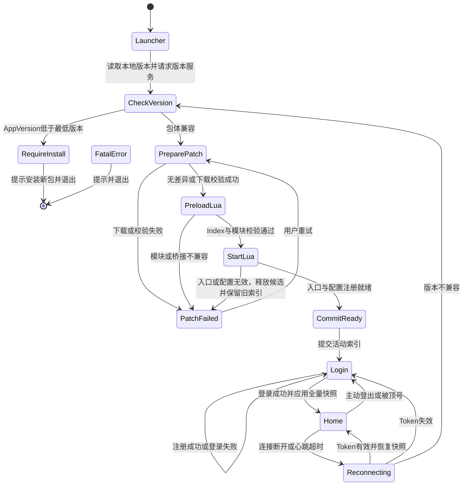

### 2.2 启动、补丁与新增面板时序

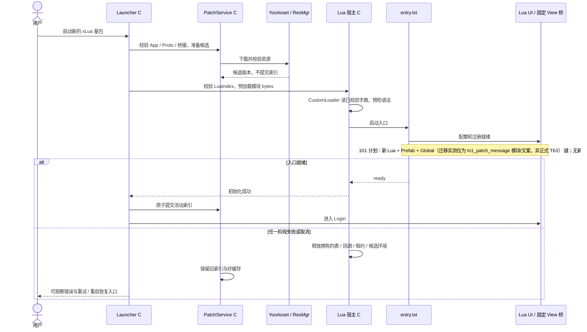

就绪指配置与注册可用，不等待用户登录成功。回滚仅覆盖宿主明确跟踪资源，不宣称能撤回任意 C# 副作用。更新已运行的业务通过重启流程，不能承诺任意同进程热替换。下载可复用完整缓存；只有供应商实际支持时才称字节级断点续传。

### 2.3 注册、登录与持久化时序

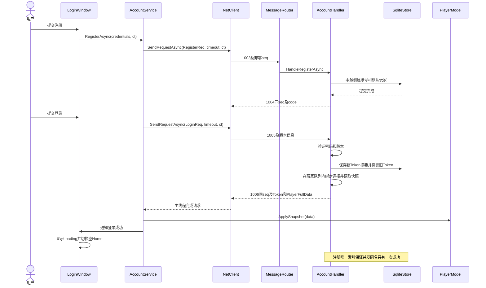

### 2.4 断线、重启与顶号时序

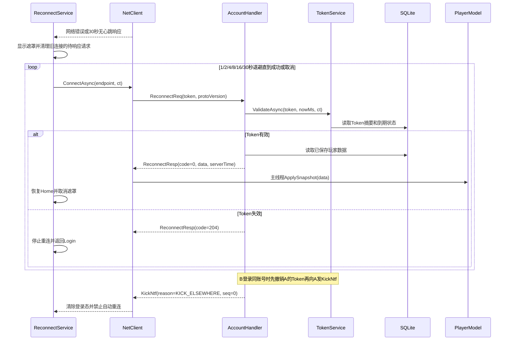

### 2.5 核心依赖类图

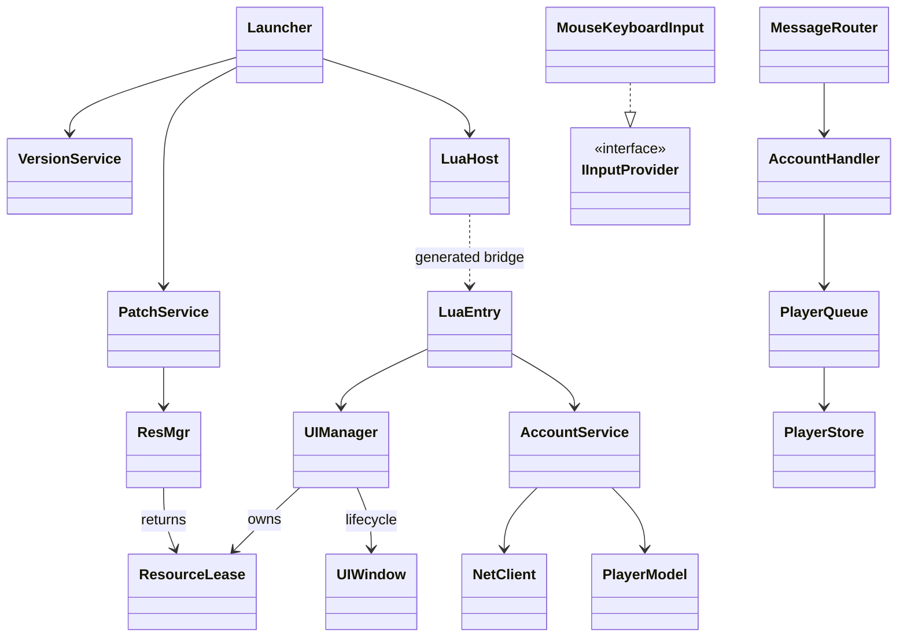

## 3. 目录、类型和接口约定

路径前缀：`A/` = Unity 工程 Assets，当前工作区即 A；`S/` = 仓库 Server/CloudIsle.Server；`ST/` = Server/CloudIsle.Tests；`T/` = 仓库 Tools。这些是设计路径，不假定当前工作区上级已经是完整仓库。

### 3.1 边界与基础类型

客户端和共享源码采用 Unity 6.3 支持的 C# 9 及 .NET Standard 2.1 API，不把 .NET 8 专用类型放进 Shared；普通 class/struct 配合构造函数，不依赖 required、文件作用域 namespace 或序列化 record。[Unity C# 编译器](https://docs.unity3d.com/6000.3/Documentation/Manual/csharp-compiler.html)、[API 兼容级别](https://docs.unity3d.com/6000.3/Documentation/Manual/dotnet-profile-support.html)。

表中方法均为**拟实现的项目接口**，不是 Unity/YooAsset 原生 API。C# 基础服务异步使用 `Cysharp.Threading.Tasks.UniTask`，Lua 使用固定桥提供的回调与可取消操作租约，不能将 C# async 签名直接改写为 Lua 方法，Socket 适配层和服务端使用 `Task`；所有 `ct` 都是 `System.Threading.CancellationToken`。`IMessage` / `MessageParser` 来自 Google.Protobuf；`Vector2` / `Rect` / `Vector2Int` / `Transform` 只出现在 Unity 层。

| 类型及建议文件 | 关键字段 / 约束 |
|---|---|
| `Shared/Contracts/VersionManifest.cs` | `string MinAppVersion`、`int ResVersion`、`int ProtoVersion`、`int ConfigVersion`、`string PackageVersion`、`string BaseUrl`；AppVersion 按语义版本比较，不能按字符串字典序 |
| `Framework/Boot/BootContext.cs` | `ResMgr Resources`、`NetClient Network`、`EventBus Events`、`VersionManifest Versions`；仅含 AOT 可见类型，不引用 Lua 业务具体窗口或未发布的 C# 类型 |
| `Framework/Boot/PatchProgress.cs` | `long DownloadedBytes`、`long TotalBytes`、`int CompletedFiles`、`int TotalFiles`、`string Stage`；总量为 0 时也能显示完成 |
| `Shared/Network/Packet.cs` | `ushort MsgId`、`uint Seq`、`byte[] Body`；构造时获得自有内存，不能长期持有 PipeReader 的 buffer |
| `Shared/Network/DecodeStatus.cs` | 枚举 `NeedMoreData / Success / Invalid`，区分半包与非法包 |
| `Shared/Network/RequestContext.cs` | `long SessionId`、`long PlayerId`、`ushort MsgId`、`uint Seq`；未认证 PlayerId=0 |
| `Framework/Network/ServerEndpoint.cs` | `string Host`、`int Port`；端口 1–65535；只含连接设置 |
| `Framework/Resource/ResourceLease.cs` | `ResourceLease<T> where T : UnityEngine.Object`；`T Asset`、`string Address`、`string Owner`、`bool IsDisposed`；只能由资源管理器创建 |
| `Framework/Resource/SceneLease.cs` | `string Address`、`bool IsLoaded`；持有插件场景句柄，由 SceneService 负责卸载 |
| `Framework/Resource/ResourceLeakInfo.cs` | `string Address`、`string Owner`、`int RefCount`、`long CreatedAtMs`；只报告，不自动销毁合法常驻资源 |
| `Lua/UI/UIContracts.lua（计划）` | 注册项 windowId / prefabAddress / layer / controllerModule；Lua 工厂控制生命周期，固定 C# View 负责绑定/句柄 |
| `Framework/UI/UILayer.cs（计划）` | 固定六层 Scene / Hud / Window / Popup / Guide / Toast；Lua 使用桥可见值 |
| `Lua/Modules/Account/AccountContracts.lua（计划）` | 注册输入 username/password/nickname；登录 username/password/deviceId；密码不写 Model 或日志 |
| `Lua/Modules/Account/AccountResult.lua（计划）` | code / message；成功 0；桥接传输异常与业务码分开 |
| `Lua/Modules/Player/PlayerModel.lua（计划）` | 拥有快照副本；经 Service 替换；大 ID 用精确整数或经桥校验的字符串 |
| `S/Data/PlayerState.cs` | `long PlayerId`、`PlayerFullData Data`、`long Revision`、`long SavedRevision`；Dirty 由版本不等判断 |
| `S/Account/TokenRecord.cs` | `string TokenHash`、`long PlayerId`、`long ExpiresAtMs`、`bool Revoked`；令牌原文不入库 |
| `S/Account/TokenValidation.cs` | `int Code`、`long PlayerId`；0 有效，204 无效；不在验证失败时返回玩家快照 |
| `Shared/Config/ConfigSnapshot.cs` | `int Version`、`IReadOnlyDictionary<string,string> Globals`；Global 表导出时规范化为字符串值；其余配置使用已有生成类型 |
| `Shared/Diagnostics/LogContext.cs` | `long PlayerId`、`ushort MsgId`、`uint Seq`、`long OpId`、`double ElapsedMs`；禁写密码和Token |
| `Framework/Core/TimerHandle.cs` | `int Id`、`int Generation`；防止取消已回收后被复用的计时器 |

### 3.2 帧与异步行为契约

- `[len:uint32 LE][msgId:uint16 LE][seq:uint32 LE][body]`；`len=6+body.Length`，body 最大 65,536 字节，len 最大 65,542，整帧最大 65,546。先校验长度再分配内存。
- 允许拆包、粘包、空 body；只有完整帧才消费。非法长度直接断开；可定位边界但反序列化失败的消息累计连续 5 次断开，合法消息重置计数。这解决 05 中“超长立即断开”与“非法包连续 5 次”的适用范围差异。
- 每连接只有一个发送循环，处理部分发送；响应同时匹配连接代次、seq 和预期 msgId。断线时使所有 Pending 失败，晚到包不得完成新连接请求。
- 默认请求超时 8 秒；默认不自动重发业务请求。仅显式声明可幂等的请求才有限重试并保留原 op_id；M1 用测试夹具验证这一接口。
- 后台接收后经队列在 Unity 主线程更新 Model / UI。切场景、登出、退出会取消所属异步工作；不使用未观察异常的 async void 业务方法。
- Pipelines 解析遵循 consumed/examined 位置语义；调用 AdvanceTo 后不再使用旧 buffer。参考 Microsoft 官方分帧示例：[System.IO.Pipelines](https://learn.microsoft.com/en-us/dotnet/standard/io/pipelines)。

## 4. 模块 → 脚本 → 方法接口清单

以下列出 M1 需要实现和评审的主要接口，C# 签名包含返回类型、参数类型和参数名。无参数方法用 `()`；构造注入与私有实现可按此契约补齐。

### 4.1 启动、补丁、资源（Game.Framework）

| 脚本 | 方法签名 | 功能与结果 |
|---|---|---|
| `A/Framework/Boot/Launcher.cs` | `UniTask RunAsync(CancellationToken ct)` | 串行执行版本、候选补丁、LuaIndex/预加载、入口就绪、活动索引提交；失败展示具体阶段 |
| `A/Framework/Boot/VersionService.cs` | `UniTask<VersionManifest> FetchAsync(Uri versionUri, CancellationToken ct)` | 获取版本清单；超时或格式错误不进入热更 |
| `A/Framework/Boot/VersionService.cs` | `bool RequiresAppUpdate(string installedAppVersion, string minAppVersion)` | 数值化比较主次修订版本 |
| `A/Framework/Boot/PatchService.cs` | `UniTask PrepareAsync(VersionManifest manifest, IProgress<PatchProgress> progress, CancellationToken ct)` | 初始化远端包、比较清单、下载校验候选；不在 Prepare 阶段提交，失败保留完整旧缓存 |
| `A/Framework/Boot/PatchService.cs` | `void CommitVersion(VersionManifest manifest)` | 原子替换本地活动版本索引，只在文件/Index/桥接校验及 Lua 入口就绪后执行 |
| `A/Framework/Boot/HotfixLoader.cs`（实际迁移宿主；保留 GUID） | `UniTask StartAsync(BootContext context, CancellationToken ct)` | 保留参数、取消与每进程初始化一次校验；当前实现细节见 07，正式Launcher衔接T56及R2原生冷启动已通过 |
| `A/Framework/Boot/HotfixLoader.cs`（现行迁移宿主；GUID 保留） | `Start`/`StartAsync(BootContext,ct)`；`DriveStack`；`ValidateCandidate`（委托 LuaLoader）；`CommitActiveIndex`；`AbortBootForDestroyOrCancel` | 实际：TextAsset/Yoo 预加载→catalog 校验→CustomLoader→`ILuaEntry.Start`→提交索引；autoStart 门闸；失败/取消保旧索引。正式核心见 LuaLoader |
| `A/Framework/Boot/LuaLoader.cs`（T47 已实现） | `PrepareAsync(LuaIndex,modules,config,ct)`；`StartEntryAsync(BootContext,phase,ct)`；`Tick()`；`Dispose()` | 预加载/校验→CustomLoader→Lua 入口就绪；phase 白名单；失败清理/取消/关闭；不补元数据或 Assembly.Load |
| `A/Framework/Lua/LuaIndex.cs`（T47 已实现） | ResVersion / EntryModule / Modules(Name,Address,Sha256) / bridgeContract / requiredAppVersion / protoVersion | 唯一映射、入口存在、内容 SHA 与基包兼容校验；由 RuntimeCatalog 提炼 |
| `A/Framework/Boot/PatchProgressView.cs` | `void Render(PatchProgress progress)`；`void ShowError(string message, Action onRetry)` | 更新下载文字/进度；重试按钮单门闸 |
| `A/Framework/Resource/ResMgr.cs` | `UniTask InitializeAsync(VersionManifest manifest, CancellationToken ct)` | 建立 DefaultPackage 的当前运行模式与访问根路径 |
| `A/Framework/Resource/ResMgr.cs` | `UniTask<ResourceLease<T>> LoadAsync<T>(string address, string owner, CancellationToken ct) where T : UnityEngine.Object` | 加载并返回显式租约；失败/取消释放中间句柄 |
| `A/Framework/Resource/ResMgr.cs` | `UniTask<SceneLease> LoadSceneAsync(string address, CancellationToken ct)` | 加载资源包场景，交给 SceneService 持有 |
| `A/Framework/Resource/ResMgr.cs` | `UniTask UnloadSceneAsync(SceneLease lease, CancellationToken ct)` | 卸载场景并清理关联插件句柄 |
| `A/Framework/Resource/ResMgr.cs` | `IReadOnlyList<ResourceLeakInfo> CaptureLeaks(string owner)` | 按持有者生成剩余租约报告，区分常驻与意外持有 |
| `A/Framework/Resource/ResourceLease.cs` | `void Dispose()` | 租约幂等释放；实例必须先销毁再释放其 Prefab 句柄 |

### 4.2 协议与客户端网络（Shared / Framework）

| 脚本 | 方法签名 | 功能与结果 |
|---|---|---|
| `A/Shared/Network/FrameCodec.cs` | `byte[] Encode(ushort msgId, uint seq, byte[] body)` | 校验长度后输出小端完整帧 |
| `A/Shared/Network/FrameCodec.cs` | `DecodeStatus TryDecode(ReadOnlySpan<byte> buffer, out Packet packet, out int consumedBytes)` | 完整帧返回成功；半包消费 0；非法数据返回 Invalid |
| `A/Shared/Proto/Generated/MsgRegistry.cs` | `ushort GetId(Type messageType)`；`IMessage Parse(ushort msgId, byte[] body)`；`bool TryGetResponseId(ushort requestId, out ushort responseId)` | 自动生成类型、解析器和响应关系；未知 ID 明确失败；LogoutReq 无响应 |
| `A/Framework/Network/TcpTransport.cs` | `Task ConnectAsync(ServerEndpoint endpoint, CancellationToken ct)`；`Task SendAsync(byte[] frame, CancellationToken ct)`；`Task ReceiveLoopAsync(Action<Packet> onPacket, CancellationToken ct)`；`void Close()` | 后台连接和有序收发，关闭可重复调用；回调只投队列 |
| `A/Framework/Network/NetClient.cs` | `UniTask<TResponse> SendRequestAsync<TResponse>(IMessage request, TimeSpan timeout, CancellationToken ct) where TResponse : class, IMessage` | 分配 seq、登记 Pending、匹配响应、超时/取消清理 |
| `A/Framework/Network/NetClient.cs` | `UniTask SendAsync(IMessage message, CancellationToken ct)`；`void DispatchPending(int maxMessages)` | 发送无响应消息；每帧按上限在主线程分发推送与响应 |
| `A/Framework/Network/NetClient.cs` | `IDisposable Subscribe<TMessage>(Action<TMessage> handler) where TMessage : class, IMessage`；`void Disconnect(string reason)` | 推送订阅可释放；断线结束所有等待并增加连接代次 |
| `A/Framework/Network/HeartbeatService.cs` | `UniTask RunAsync(TimeSpan interval, TimeSpan silenceTimeout, CancellationToken ct)` | 每 10 秒发心跳，30 秒无有效响应触发断线；使用单调计时 |
| `A/Framework/Network/ReconnectService.cs` | `UniTask<bool> RecoverAsync(ServerEndpoint endpoint, Func<CancellationToken,UniTask<bool>> restoreSessionAsync, CancellationToken ct)` | 负责连接退避；热更层回调负责 Token 恢复；返回 false 表示应停止重试 |
| `A/Framework/Network/OpIdStore.cs` | `long Next(long playerId)`；`long ReadLast(long playerId)` | 按账号锁定分配并先持久化再返回；保存失败不发请求；不允许回绕 |
| `A/Framework/Network/ServerClock.cs` | `void Synchronize(long serverUnixMs, long localUnixMs)`；`long NowUnixMs()` | 只给显示提供校时后的时间；不用于客户端发奖判定 |

### 4.3 公共核心、输入与场景

| 脚本 | 方法签名 | 功能与结果 |
|---|---|---|
| `A/Framework/Core/EventBus.cs` | `IDisposable Subscribe<TEvent>(Action<TEvent> handler)`；`void Publish<TEvent>(TEvent eventData)` | 强类型事件；主线程发布；退订句柄防止重复回调 |
| `A/Framework/Core/ObjectPool.cs` | `T Rent()`；`void Return(T item)`；`void Clear()` | `ObjectPool<T> where T : class`；构造注入 `Func<T> factory, Action<T> reset, int maxRetained`；重复归还报错 |
| `A/Framework/Core/TimerService.cs` | `TimerHandle Schedule(TimeSpan delay, Action callback, bool repeat)`；`bool Cancel(TimerHandle handle)`；`void Tick(double unscaledDeltaSeconds)` | 非缩放时间计时；repeat 时 delay 必须大于 0；取消后不回调 |
| `A/Framework/Core/FileLogger.cs` | `void Initialize(string directory, long maxFileBytes, int retainedFiles)`；`void Write(LogLevel level, string message, LogContext context)`；`void Dispose()` | 有界日志队列、滚动文件、脱敏；Dispose 刷出余量 |
| `A/Framework/Platform/IInputProvider.cs` | `Vector2 ReadMove()`；`Vector2 ReadPointer()`；`bool WasTapPressed()`；`float ReadZoom()`；`event Action<Vector2> DragStarted`；`event Action<Vector2> Dragged`；`event Action<Vector2> DragEnded` | 坐标为屏幕像素；移动归一化；事件共享同一拖拽识别规则 |
| `A/Framework/Platform/MouseKeyboardInput.cs` | `void Enable()`；`void Disable()`；`void Tick()` | 实现 IInputProvider；连接工程已启用的输入后端；绑定由输入配置决定 |
| `A/Framework/Scene/SceneService.cs` | `UniTask SwitchAsync(string sceneAddress, CancellationToken ct)` | 互斥切换，加载新场景前显示 Loading；失败保留可恢复界面，回收半成品 |
| `A/Framework/Scene/SceneService.cs` | `UniTask UnloadCurrentAsync(CancellationToken ct)` | 释放旧场景拥有的资源；不销毁常驻框架根节点 |
| `A/Framework/Scene/LoadingView.cs` | `void Show(string message)`；`void SetProgress(float normalizedProgress)`；`void Hide()` | 常驻 AOT Loading，值夹在 0–1，不依赖热更窗口初始化 |

场景 API 的 native AsyncOperation 不等于可随时撤销的事务：取消时禁止继续业务推进，仍等待底层完成并做清理。资源包场景用 YooAsset 适配，不能假定它已列在 Unity 内置场景清单。[LoadSceneAsync 官方说明与示例](https://docs.unity3d.com/6000.3/Documentation/ScriptReference/SceneManagement.SceneManager.LoadSceneAsync.html)。

### 4.4 Lua 入口、UI 与最小账号模块

Lua 方法以下列约定为**待实现设计**，不是声称源码已存在。`done(code, payload)` 在 Unity 主线程最多一次；调用立即返回取消/退订租约 `operation`。同步方法不带 done。Lua 不直接 await UniTask；固定 C# 桥做请求类型映射、Proto bytes/DTO、seq、取消/超时与主线程调度。

| 脚本 | 方法 / 参数契约 | 功能与结果 |
|---|---|---|
| `A/Lua/entry.txt`（当前迁移入口；正式业务待 T56） | `start(context, done)`；`dispose()` | 配置与注册完成后 ready，进入 Login；清理拥有的订阅/租约。当前迁移入口签名以 07 的实际源文件为准 |
| `A/Framework/Config/ConfigService.cs`（AOT，已搬迁） | `UniTask LoadAsync(string configAddress, int expectedVersion, CancellationToken ct)`；`string GetGlobal(string key)` | 复用共享配置清单/快照；版本、哈希、必需键、失败保留好快照。T42 已于 2026-10-20 正式验收 |
| `A/Lua/UI/UIManager.lua` | `register(registration)`；`open(windowId, args, done) -> operation`；`close(windowId, done) -> operation`；`closeTop(done)`；`closeAll()` | 控制器注册、同 ID 去重、层级/栈、释放资源和回调；与固定 C# View/资源桥配合 |
| `A/Lua/UI/UIWindow.lua` | `onCreate(view)`；`onOpen(args)`；`onClose()`；`onDestroy()` | 普通 Lua 控制器钩子，由管理器单点调用，不新增 MonoBehaviour 子类 |
| `A/Framework/UI/ViewHost.cs`（计划固定桥） | `Bind` / `SetText` / `SetInteractable` / `SubscribeClick` / `Dispose` | 精确签名于 T48 冻结并生成；只操作已有组件，返回退订租约，不暴露无限反射 |
| `A/Lua/UI/ToastService.lua` | `show(message, durationSeconds)` | Toast 层，durationSeconds>0；计时和资源租约经 C# 桥 |
| `A/Lua/UI/DialogService.lua` | `confirm(title, message, done) -> operation` | 确认 true / 取消 false；关闭后结束等待，无悬挂回调 |
| `A/Framework/UI/SafeAreaAdapter.cs`（固定组件） | `Apply(Rect safeAreaPixels, Vector2Int screenSize)` | 转为锚点；窗口变化重算，宽高非零，Lua 只使用宿主能力 |
| `A/Lua/UI/Windows/LoginWindow.lua` | `submitRegister(input, done) -> operation`；`submitLogin(input, done) -> operation` | 处理中防重，错误可见，销毁或登出取消 |
| `A/Lua/UI/Windows/HomeHudWindow.lua` | `refresh(model)`；`logout(done) -> operation` | 只显示账号与登出，UI 不改权威数据 |
| `A/Lua/UI/Windows/PatchDemoWindow.lua` | `bind(view, title, configKey)`；`refresh(config)` | 101 才新增，配合新 Prefab/Global 键；100 无该模块/资源/键 |
| `A/Lua/Modules/Account/AccountService.lua` | `register(input, done)`；`login(input, done)`；`restore(done)`；`logout(done)`；`onKick(notification)` | 每个异步方法返回 operation；请求经固定桥，成功后应用快照/校时；顶号清 Token、停止重连 |
| `A/Lua/Modules/Player/PlayerModel.lua` | `applySnapshot(snapshot)`；`clear()` | 替换快照副本、发布刷新，不追加旧集合、不修改 C# 正式消息对象 |

新增签名或 Protobuf 类型若不在基包白名单内，先新建 AppVersion 并重出生成代码/link.xml。ILuaEntry / LuaCallback 等当前迁移签名见实际 LuaGenConfig；上表未来业务契约不冒充当前迁移宿主已经支持。

### 4.5 服务端网关、数据与账号（.NET 8）

| 脚本 | 方法签名 | 功能与结果 |
|---|---|---|
| `S/Program.cs` | `static Task<int> Main(string[] args)` | 加载参数、配置和数据，启动 TCP/HTTP/指标服务；退出时保存并返回状态码 |
| `S/Network/TcpServer.cs` | `Task RunAsync(System.Net.IPEndPoint endpoint, CancellationToken ct)` | 监听连接，创建唯一 Session，停止时释放 Socket |
| `S/Network/ClientSession.cs` | `Task RunAsync(CancellationToken ct)`；`Task SendAsync(Packet packet, CancellationToken ct)`；`Task CloseAsync(string reason, CancellationToken ct)` | 有界发送队列；响应按序发送；慢连接超限关闭 |
| `S/Network/PipelineFrameReader.cs` | `Task ReadLoopAsync(System.IO.Pipelines.PipeReader reader, Func<Packet,Task> onPacket, CancellationToken ct)` | 处理跨 segment 的头/body，正确 AdvanceTo；完整 Packet 复制后再交给业务 |
| `S/Network/MessageRouter.cs` | `void Register<TRequest>(ushort msgId, Func<RequestContext,TRequest,CancellationToken,Task> handler) where TRequest : class, IMessage`；`Task DispatchAsync(RequestContext context, Packet packet, CancellationToken ct)` | 启动注册 Handler；重复 ID 启动失败；认证前仅允许系统白名单；普通请求 20次/秒 |
| `S/Players/PlayerQueue.cs` | `Task EnqueueAsync(long playerId, Func<CancellationToken,Task> action, CancellationToken ct)` | 同玩家串行，不同玩家可并行；异常不终止后续队列；队列长度有上限 |
| `S/Data/SqliteStore.cs` | `void Initialize(string databasePath)`；`Task<T> ExecuteAsync<T>(Func<Microsoft.Data.Sqlite.SqliteConnection,T> operation, CancellationToken ct)` | 专用数据库工作队列执行同步 SQL；Task 表示等待排队结果，不宣称 SQLite 原生异步 I/O |
| `S/Data/PlayerStore.cs` | `Task<PlayerState> LoadAsync(long playerId, CancellationToken ct)`；`Task SaveAsync(PlayerState snapshot, CancellationToken ct)` | 参数化查询，事务保存一致快照，失败保留 Dirty |
| `S/Players/PlayerCache.cs` | `Task<PlayerState> GetAsync(long playerId, CancellationToken ct)`；`void MarkDirty(long playerId)`；`void Remove(long playerId)` | 缓存由玩家队列访问；版本递增；只移除已成功保存且无活跃持有的玩家 |
| `S/Players/SaveService.cs` | `Task FlushDirtyAsync(CancellationToken ct)`；`Task FlushPlayerAsync(long playerId, CancellationToken ct)` | 每 5 秒将保存动作投到对应玩家队列；保存成功才更新 SavedRevision |
| `S/Account/PasswordHasher.cs` | `string Hash(string password, byte[] salt)`；`bool Verify(string password, byte[] salt, string expectedHash)` | 带随机盐的密码派生；格式存算法版本/参数，恒定时间比较；仅服务端 |
| `S/Account/AccountRepository.cs` | `Task<int> RegisterAsync(RegisterReq request, CancellationToken ct)`；`Task<long> AuthenticateAsync(string username, string password, CancellationToken ct)` | 注册事务和唯一索引；认证失败返回 0；其他数据库异常不伪装成密码错 |
| `S/Account/TokenService.cs` | `Task<string> IssueAsync(long playerId, long expiresAtMs, CancellationToken ct)`；`Task<TokenValidation> ValidateAsync(string token, long nowUnixMs, CancellationToken ct)`；`Task RevokePlayerAsync(long playerId, CancellationToken ct)` | 安全随机 Token；保存摘要；新登录、登出撤销；服务端重启可恢复验证 |
| `S/Account/SessionRegistry.cs` | `Task BindAsync(long playerId, ClientSession session, CancellationToken ct)`；`bool IsCurrent(long playerId, long sessionId)` | 同账号单在线；新连接替换时发送 KickNtf 后关闭旧连接；旧连接关闭回调不能解绑新连接 |
| `S/Account/AccountHandler.cs` | `Task HandleRegisterAsync(RequestContext context, RegisterReq request, CancellationToken ct)`；`Task HandleLoginAsync(RequestContext context, LoginReq request, CancellationToken ct)`；`Task HandleReconnectAsync(RequestContext context, ReconnectReq request, CancellationToken ct)`；`Task HandleLogoutAsync(RequestContext context, LogoutReq request, CancellationToken ct)` | 校验版本/认证，序列化同账号状态变化，构造准确响应；登出无 Resp |
| `S/Account/HeartbeatHandler.cs` | `Task HandleAsync(RequestContext context, HeartbeatReq request, CancellationToken ct)` | 更新连接存活时间，返回服务端 UTC Unix 毫秒 |
| `S/Players/IdempotencyStore.cs` | `bool TryGet(long playerId, long opId, string requestHash, out byte[] responseBody)`；`void Save(long playerId, long opId, string requestHash, byte[] responseBody)` | 最近 64 项，重复操作返回相同业务结果但用当前 seq 重封包；同 opId 不同请求拒绝 |
| `S/Config/ServerConfigService.cs` | `void Load(string directory, int expectedVersion)`；`string GetGlobal(string key)` | 启动读取并验证同一导表产物；配置错误拒绝启动 |
| `S/Hosting/PatchHttpService.cs` | `Task RunAsync(string listenUrl, string contentRoot, CancellationToken ct)` | 提供 /version.json 与版本目录；限制静态根路径；旧版本目录保留 |
| `S/Diagnostics/MetricsReporter.cs` | `Task RunAsync(TimeSpan interval, CancellationToken ct)` | 默认每 10 秒输出连接数、已认证玩家数、请求率、队列长度和内存 |
| `S/Diagnostics/LoggingSetup.cs` | `void Configure(string logDirectory, string minimumLevel)` | Serilog 控制台和滚动文件；统一 LogContext，避免敏感字段 |

SQLite 只允许一个并发写事务。数据库队列内同步执行 SQL，将注册的账号与玩家创建包在同一事务，启用 WAL 并配置忙等待；并发玩家请求不能共享正在使用的连接/事务。根据官方限制，简单改成 Dapper 的 Async 方法并不会得到 SQLite 异步 I/O。[异步限制](https://learn.microsoft.com/en-us/dotnet/standard/data/sqlite/async)、[事务说明](https://learn.microsoft.com/en-us/dotnet/standard/data/sqlite/transactions)。

新增持久表 `auth_token(token_hash PRIMARY KEY, player_id, expires_at_ms, revoked)`；注册至少写入 04 定义的 account/player 表，其他集合可返回空。默认玩家值取 03，不能为了测试随意赋予货币。重连在玩家队列中检查 Token 并绑定；禁止先验证后在无锁竞争下使已撤销 Token 重新上线。

### 4.6 生成、构建与测试入口

PowerShell 均以参数名固定契约，成功退出码 0，失败非 0；路径支持空格。脚本路径相对完整 Unity 工程根目录；参数 `RepoRoot` 传 `E:\Workbench\UnityWorkBench\Farming`，不能传当前 Assets Git 根目录。下表是待实现契约，现有脚本参数见基线第 3、4 节。

| 文件 | 参数 / 入口 | 功能 |
|---|---|---|
| `T/gen_proto.ps1` | `param([string]$RepoRoot, [string]$ProtocPath)` | 读取 Shared/proto，生成消息与 MsgRegistry，检查 ID 唯一、响应关系和例外，不手改生成 C# |
| `T/gen_config.ps1` | `param([string]$RepoRoot, [string]$SourceDir, [string]$ExporterPath, [int]$ConfigVersion)` | Luban→校验→同事务发布：`Assets/Config/Generated` + 四数据目录（Shared/Output/json、Server/ConfigLuban、StreamingAssets/ConfigLuban 直读、Assets/ConfigLuban Yoo 镜像）；StreamingAssets 不可 EditorSimulate 收集 |
| `T/build_client_win.ps1` | `param([string]$RepoRoot, [string]$UnityEditorPath, [string]$OutputDir, [string]$AppVersion, [int]$ResVersion)` | 生成协议/配置，生成固定 xLua 桥接并重编译，校验 LuaIndex/内置 100，标准 Windows IL2CPP 构建并记录 AOT/Proto/native/bridge/安装哈希 |
| `T/build_patch.ps1` | `param([string]$RepoRoot, [string]$UnityEditorPath, [string]$OutputDir, [int]$ResVersion, [int]$ConfigVersion, [string]$BaseBuildManifest)` | 检查 AOT/Shared/Config schema/Proto/native/bridge 与基包兼容，生成 LuaIndex 与 Lua/资源/兼容配置；输出待发布目录，不重建/覆盖旧 Player |
| `T/run_server.ps1` | `param([string]$RepoRoot, [string]$DatabasePath, [int]$TcpPort, [int]$HttpPort, [string]$ContentRoot)` | 构建并启动 .NET 8 服务，初始化 schema；端口占用/配置错误返回非 0 |
| `A/Editor/Build/ClientBuild.cs` | `static void BuildWindows()` | Unity -executeMethod 静态入口；读取命令行参数，检查 BuildReport 后退出 |
| `A/Editor/Build/PatchBuild.cs` | `static void BuildPatch()`；`static void ValidateBaseline(string baseBuildManifest)` | 检查基包、Lua 入口/模块 SHA/桥接兼容和资源地址；失败不更新远端 version.json |
| `Server/CloudIsle.Tools/ProtoRegistryGenerator.cs` | `void Generate(string protoDir, string outputDir)`；`void ValidateIds(string descriptorPath)` | 通过描述符/注册元数据建立类型映射；KickNtf 和无响应请求不套 Req/Resp 规则 |
| `ST/FrameCodecTests.cs` | `void Decode_HandlesSplitAndCoalescedFrames()`；`void Decode_RejectsInvalidLength()` | 首批 NUnit 测试：拆包、粘包、0/最大 body、非法长度 |
| `ST/AccountIntegrationTests.cs` | `Task RegisterLogin_PreservesPlayerAsync()`；`Task Restart_AllowsValidTokenAsync()`；`Task LoginElsewhere_RevokesOldTokenAsync()` | 临时 SQLite 与真实协议边界的集成验证 |
| `ST/PlayerPersistenceTests.cs` | `Task ConcurrentUpdates_AreSerializedAsync()`；`Task FailedSave_KeepsDirtyAsync()` | 并发顺序、落库失败恢复；夹具写 nickname，不新增生产玩法接口 |
| `ST/IdempotencyTests.cs` | `void DuplicateOp_ReturnsSameResult()`；`void ConflictingPayload_IsRejected()` | 写计数夹具验证一次执行、缓存淘汰及错误路径 |
| `A/Tests/PlayMode/UIResourceTests.cs` | `IEnumerator OpenClose_ReturnsToBaseline()`；`IEnumerator CancelSwitch_ReleasesTemporaryHandles()` | Unity Test Runner 中验证 UI 生命周期和取消后的资源回收 |

`-executeMethod` 方法必须是 Editor 目录内的静态方法，参数从命令行读取；构建失败必须传播到 PowerShell 退出码。[Unity 命令行参数与官方构建示例](https://docs.unity3d.com/6000.3/Documentation/Manual/EditorCommandLineArguments.html)。测试代码同样是待实现清单，本文没有宣称已经运行这些测试。

## 5. 可单步执行的实现任务

执行规则：先满足“依赖”，每行只完成一个可提交的交付动作，再执行该行检查。失败停在该行修复，不靠勾选后续任务掩盖。T01–T41 既有完成状态保留并引用原日志；T42–T44 已于 StageA、T45–T47 已于 StageB（2026-10-20）正式验收；T48–T68已于2026-10-21最终验收完成。xLua专项不代替逐项M1验收；无依赖互相阻塞的条目可独立实现。最终端到端验收另见第 6 节。

### 5.1 工程与协议

| 状态 / ID | 依赖 | 单步动作 / 主要文件或方法 | 本步通过条件 | 需求 |
|---|---|---|---|---|
| [x] T01 | 已验证的 M0 | 已生成 [M1_Baseline.md](M1_Baseline.md)，登记完整 Unity/Server/Tools 路径、包版本、现有导表命令及 PoC 结论 | 2026-10-18 完成：实际根目录明确；IL2CPP 与模块按已验证登记；只读核对，无重跑安装 | 全部前提 |
| [x] T02 | T01 | 按 1.2 整理 asmdef 和生产热更入口清单 | 固定 Framework→Shared/Config，无反向引用；xLua 核心/Gen 同程序集，Editor 独立；Shared 无 UnityEngine 依赖；迁移重评证据见 07 与 `20261020/MainProject`（asmdef/入口/GUID/清理后无 HybridCLR） | R-C01 |
| [x] T03 | T02 | 依据 05 建立正式 common/system/msg_id.proto | 1001–1010 的字段/ID与05一致，PoC 类型不冲突 | R-E01 |
| [x] T04 | T03 | 实现 gen_proto.ps1 与 ProtoRegistryGenerator | 同一输入两次输出一致；重复ID输入返回非0；Logout/Kick不被误配对 | R-E01 |
| [x] T05 | T04 | 建立 .NET 8 Server/Tests 项目并源文件引用 Shared | 两端均编译；服务端不引用 Unity DLL | R-S01/R-E04 |
| [x] T06 | T05 | 实现 FrameCodec.Encode | 空body帧长度10；长度和字节序符合3.2 | R-C03/R-S01 |
| [x] T07 | T06 | 实现 FrameCodec.TryDecode | 半包consumed=0；完整包仅消费一帧；非法长度返回Invalid | R-C03/R-S01 |
| [x] T08 | T07 | 添加并执行 FrameCodecTests | 每个分割位置、两帧粘包、最大/超限body全部断言通过 | R-E04 |

### 5.2 公共能力与资源

| 状态 / ID | 依赖 | 单步动作 / 主要文件或方法 | 本步通过条件 | 需求 |
|---|---|---|---|---|
| [x] T09 | T02 | 实现 EventBus.Subscribe/Publish | 订阅一次收到一次；Dispose后收不到；重复Dispose不抛异常 | R-C04 |
| [x] T10 | T02 | 实现 ObjectPool.Rent/Return | 归还时reset执行；下一次Rent无脏状态；重复Return被发现 | R-C04 |
| [x] T11 | T02 | 实现 TimerService.Schedule/Cancel/Tick | 暂停Time.timeScale后仍触发；取消后不触发；非法循环间隔拒绝 | R-C04 |
| [x] T12 | T02 | 实现 FileLogger 滚动日志 | 超过阈值滚动并限制保留数量；退出可读；不含密码/Token | R-C04 |
| [x] T13 | T01/T02 | 从已验证 YooAsset 调用提炼 ResMgr.InitializeAsync | Editor和HTTP模式初始化成功，模式由设置决定 | R-C02 |
| [x] T14 | T13 | 实现 ResourceLease 与 ResMgr.LoadAsync | 相同地址两次加载得到两份逻辑租约；释放一份不破坏另一份 | R-C02 |
| [x] T15 | T14 | 实现 CaptureLeaks | 故意保留一份租约可报告address/owner/count；释放后消失 | R-C02 |
| [x] T16 | T14 | 实现资源场景加载与卸载适配 | Home场景加载后可卸载，取消/失败无遗留临时句柄 | R-C02/R-C06 |
| [x] T17 | T01/T02 | 实现 IInputProvider/MouseKeyboardInput | 移动、点击、拖动三阶段、滚轮均有调试输出；Disable后无输出 | R-C07 |

### 5.3 网络和服务端基础

| 状态 / ID | 依赖 | 单步动作 / 主要文件或方法 | 本步通过条件 | 需求 |
|---|---|---|---|---|
| [x] T18 | T08 | 实现 TcpTransport 的发送循环 | 分片发送不丢字节；并发提交两帧没有交错头/body | R-C03 |
| [x] T19 | T18 | 实现 ReceiveLoopAsync 与主线程入队 | 后台不操作Unity对象；主线程能按接收顺序取Packet | R-C03 |
| [x] T20 | T19/T04 | 实现 NetClient Pending 匹配 | 乱序响应按seq完成；错误msgId/旧连接代次不能完成当前请求 | R-C03 |
| [x] T21 | T20 | 实现请求超时/取消/Disconnect清理 | 8秒超时有明确错误；取消或断线后Pending归零；晚到包不复活请求 | R-C03 |
| [x] T22 | T08/T05 | 实现 PipelineFrameReader.ReadLoopAsync | 测试跨segment头/body与半包；无重复消费、忙循环、已释放内存引用 | R-S01 |
| [x] T23 | T22 | 实现 TcpServer 与 ClientSession | 两客户端独立收发；关闭一个不影响另一个；慢连接有界 | R-S01 |
| [x] T24 | T23/T04 | 实现 MessageRouter.Register/DispatchAsync | 白名单可达；未认证业务返回102；重复注册失败；限流返回104 | R-S01 |
| [x] T25 | T20/T24 | 实现 HeartbeatHandler 与 HeartbeatService | 10秒发送，30秒静默触发一次断线；恢复后只运行一个心跳循环 | R-C03 |
| [x] T26 | T21 | 实现 ReconnectService.RecoverAsync | 记录1/2/4/8/16/30退避；取消能停止连接和延迟等待 | R-C03 |
| [x] T27 | T02 | 实现 OpIdStore.Next | 进程重启后新值大于旧值；保存失败不返回ID | R-C03 |

### 5.4 数据与账号

| 状态 / ID | 依赖 | 单步动作 / 主要文件或方法 | 本步通过条件 | 需求 |
|---|---|---|---|---|
| [x] T28 | T05 | 实现 SqliteStore.Initialize 与schema迁移 | 新库建表成功；重复启动不重复建数据；username唯一 | R-S02 |
| [x] T29 | T28 | 实现 SqliteStore.ExecuteAsync 数据库队列 | 并发提交无共享连接竞争；异常交付给调用方且队列继续 | R-S02 |
| [x] T30 | T05 | 实现 PlayerQueue.EnqueueAsync | 同玩家动作完成顺序等于入队顺序；抛异常后下一项仍执行 | R-S02 |
| [x] T31 | T29/T30 | 实现 PlayerStore 与 PlayerCache | 首次加载走DB，后续访问复用缓存；只能在玩家队列修改状态 | R-S02 |
| [x] T32 | T31/T11 | 实现 SaveService 定时和登出落库 | 修改后5秒保存；失败保留Dirty；重试成功才更新SavedRevision | R-S02 |
| [x] T33 | T29 | 实现 PasswordHasher 与 AccountRepository.RegisterAsync | 同密码不同盐哈希不同；并发同名仅创建一个账号和玩家 | R-S03 |
| [x] T34 | T33/T24 | 接入 HandleRegisterAsync | 成功code=0；重名201；昵称非法203；注册后仍不能发业务消息 | R-S03 |
| [x] T35 | T29 | 实现 TokenService 三个接口 | 新Token落库摘要可查；重启有效；撤销/到期返回204 | R-S03 |
| [x] T36 | T30/T35/T23 | 实现 SessionRegistry.BindAsync | 新连接取代旧连接；旧连接清理不会移除新连接 | R-S03 |
| [x] T37 | T31/T35/T36 | 接入 HandleLoginAsync | 正确密码返回Token与PlayerFullData；错误密码202；协议不兼容106 | R-S03 |
| [x] T38 | T37/T32 | 接入 HandleReconnectAsync/HandleLogoutAsync | 重连恢复快照；登出撤销Token并保存；Logout不生成伪响应 | R-S03 |
| [x] T39 | T30 | 实现 IdempotencyStore 与测试夹具 | 同opId相同负载只执行一次；不同负载拒绝；缓存上限64 | R-C03/R-S02 |
| [x] T40 | T23/T12 | 接入 LoggingSetup/MetricsReporter | 请求含关联字段；每10秒输出基础指标；日志脱敏 | R-S05 |

### 5.5 配置、版本与补丁

| 状态 / ID | 依赖 | 单步动作 / 主要文件或方法 | 本步通过条件 | 需求 |
|---|---|---|---|---|
| [x] T41 | T01/T02 | 接入 gen_config.ps1 | 同份配置产物分发到客户端与服务端；清单列版本及文件哈希 | R-E02 |
| [x] T42 | T41/T14 | 完成 AOT ConfigService 与 ServerConfigService（2026-10-20 xLua 正式验收） | 两端读到相同Global键值；错误版本/必需键缺失时明确失败 | R-E02 |
| [x] T43 | T05 | 实现 PatchHttpService 与version.json | 可读取版本清单与样例补丁；不存在文件返回404而非成功空文件 | R-S04 |
| [x] T44 | T43 | 实现 VersionService | 0.1.10正确大于0.1.9；最低包体版本高于本地时阻止启动 | R-C01 |
| [x] T45 | T44/T13 | 实现 PatchService.PrepareAsync（2026-10-20 xLua StageB） | 仅取差异资源；中断重试复用有效缓存；下载失败不提交版本 | R-C01 |
| [x] T46 | T45 | 实现 PatchProgressView 与重试入口（2026-10-20 xLua StageB） | 0字节更新完成，无除零；失败阶段可见；重试不会并行启动两份下载 | R-C01 |
| [x] T47 | T14/T02 | 从迁移宿主提炼 LuaLoader / LuaIndex 与生命周期（2026-10-20 xLua StageB） | 缺模块/入口、语法/桥接/下载/运行时失败不提交；异步预加载、生成桥接、取消/关闭清理；标准 IL2CPP 真实构建 | R-C01 |

### 5.6 UI、场景与客户端账号

| 状态 / ID | 依赖 | 单步动作 / 主要文件或方法 | 本步通过条件 | 需求 |
|---|---|---|---|---|
| [x] T48 | T14/T09 | 实现 Lua UIWindow 生命周期与 UIManager.register / 固定 C# View 桥 | 钩子由管理器单点调用；同ID重复注册明确拒绝 | R-C05 |
| [x] T49 | T48 | 实现六层、窗口栈、Open/Close | 连点打开只有一个实例；返回只关栈顶；关闭后退订且释放资源 | R-C05 |
| [x] T50 | T49/T10/T11 | 实现 ToastService 与 DialogService | Toast自动回收；弹窗确认/取消各返回一次；关窗不会悬挂等待 | R-C05 |
| [x] T51 | T49 | 实现 SafeAreaAdapter 与CanvasScaler配置 | 三种窗口比例下内容可用；模拟非零安全边距时锚点正确 | R-C05 |
| [x] T52 | T16 | 实现 LoadingView 与 SceneService.SwitchAsync | Loading先出现后隐藏；重复切换互斥；失败后可回Login | R-C06 |
| [x] T53 | T37/T38/T20 | 实现 Lua AccountService/PlayerModel 与固定 C# 账号/网络桥 | 快照覆盖不重复追加；登录成功才保存Token；顶号清Token并停止重连 | R-C03/R-S03 |
| [x] T54 | T49/T53 | 实现 Lua LoginWindow 和注册/登录 Prefab | 按钮调用正确接口；失败恢复可点击；同一提交未完成时不可重复发送 | R-C05/R-S03 |
| [x] T55 | T52/T53 | 实现空 Home 场景与 Lua HomeHudWindow | 显示playerId/昵称/等级；无玩法；登出返回Login并清Model | R-C06 |
| [x] T56 | T42/T47/T54/T55 | 串接 C# Launcher.RunAsync 与 Lua 入口就绪/索引提交 | 启动→热更→配置→Login→Home全过程无手动初始化 | R-C01/R-C06 |
| [x] T57 | T26/T53/T55 | 接入断线遮罩与RestoreAsync | 断线阻止业务输入；重连用服务端快照覆盖并解除遮罩；失效回Login | R-C03 |

### 5.7 构建与验收交付

| 状态 / ID | 依赖 | 单步动作 / 主要文件或方法 | 本步通过条件 | 需求 |
|---|---|---|---|---|
| [x] T58 | T56/T04/T41 | 实现 ClientBuild 和 build_client_win.ps1 | 生成100基包及baseline清单；命令返回0，IL2CPP Player可启动 | R-E03 |
| [x] T59 | T58 | 实现 PatchBuild 和 build_patch.ps1 | 能生成独立101目录；AOT差异会阻止仅补丁发布；不写旧Player目录 | R-E03 |
| [x] T60 | T38/T43/T40 | 实现 run_server.ps1 | 从命令行启动TCP/HTTP/DB；端口占用返回非0；终止能输出停机日志 | R-E03 |
| [x] T61 | T32/T38/T39 | 实现并执行持久化、账号、幂等NUnit用例 | NUnit报告无失败，临时DB与正式数据隔离 | R-E04 |
| [x] T62 | T49/T52 | 实现并执行UIResourceTests | 反复开关后窗口资源回基线；场景取消无临时资源残留 | R-C02/R-C05 |
| [x] T63 | T59/T42/T49 | 在 101 新增 Lua 模块、Prefab 和 Global 键（计划名可 PatchDemoWindow） | 100 无该模块/Prefab/键；101 三者皆有；不新增 C# 窗口类。早期迁移演示只含桥接面板；最终R2已交付真实新Lua模块/Prefab/Global并通过B组 | R-C01/R-E02 |
| [x] T64 | T58/T60/T61/T62 | 执行第6节A组账号存档验收 | A01–A11有日志/快照证据，逐步全部通过 | AC-1 |
| [x] T65 | T63/T64 | 执行第6节B组热更验收 | 同安装包从100到101，新面板/新配置均生效 | AC-2 |
| [x] T66 | T57/T64 | 执行第6节C组恢复验收 | 网络中断、服务端强杀重启、Token失效、顶号均符合预期 | AC-3 |
| [x] T67 | T58/T59/T60/T61 | 执行第6节D组脚本与测试验收 | 三脚本成功路径及失败退出码均有证据；测试报告可复现 | AC-4 |
| [x] T68 | T64/T65/T66/T67 | 填写M1验收记录并链接证据 | 四项原标准全部通过且相关基础检查通过，才将M1标完成 | 全部 |

## 6. 逐步验收规程

### 6.1 统一测试条件与证据格式

准备 Windows IL2CPP 客户端基包 `AppVersion=0.1.0 / ResVersion=100 / ProtoVersion=1 / ConfigVersion=100`、补丁101、独立测试数据库 `m1-test.db`、测试账号A和第二客户端B。T01 的路径与端口约定见基线第 4.3 节：TCP 17780、HTTP 18080、数据库 `Server/data/m1-test.db`；这些是后续验收约定，尚未启动服务。版本号是验收示例，不覆盖实际生产版本。

每步记录：`步骤ID、构建版本、提交标识、执行环境、实际结果、PASS/FAIL、证据路径`。证据存放建议 `Docs/Acceptance/M1/<run-id>/`。JSON快照比较玩家业务字段，排除Token、服务器时间、日志时间等变化字段；共享客户端测试时避免两个进程同时写同一OpId持久文件。

四个验收门：AC-1 注册登录与存档；AC-2 不重装热更面板/配置；AC-3 自动恢复；AC-4 三脚本与测试。原 M1 其他基础项还需通过 E 组检查，不能只做演示跳过框架正确性。

### 6.2 A组：新账号 → 空家园 → 重登保持（AC-1）

| ID | 前提 | 本次只执行的动作 | 可观察的通过结果 / 证据 |
|---|---|---|---|
| A01 | T60 | 对新的测试数据库运行run_server.ps1 | TCP/HTTP监听成功，schema初始化日志，无未处理异常 |
| A02 | A01/T58 | 启动100版Windows客户端 | Launcher完成并进入Login；版本日志完整 |
| A03 | A02 | 注册新账号A（使用唯一用户名和昵称） | RegisterResp=0；DB各有一条account/player；没有自动授权业务 |
| A04 | A03 | 用A登录 | LoginResp=0且进入空Home；可见相同playerId、昵称、等级 |
| A05 | A04 | 保存当前PlayerFullData业务字段快照S1 | JSON可读且标明playerId；与DB已提交字段一致 |
| A06 | A05 | 点击登出 | 返回Login；玩家保存成功；Token撤销；客户端Model清空 |
| A07 | A06 | 再次用A登录 | playerId与S1一致，业务字段不被重新初始化 |
| A08 | A07 | 关闭客户端 | 本进程退出，日志文件可读 |
| A09 | A08 | 重新启动客户端 | 正常到Login，无重复常驻UI/入口异常 |
| A10 | A09 | 用A登录 | 进入Home且业务字段仍与S1一致；不要求Token相同 |
| A11 | T61 | 运行PlayerPersistenceTests中的修改保存用例 | 测试夹具把昵称改成标记值，保存/重载后仍为该值；证明确实能写回而非仅重复读取默认值 |

A11 的数据修改只在隔离测试夹具执行，不为M1增加玩家改名功能或无鉴权调试协议。

### 6.3 B组：同一安装包热更新增面板和配置（AC-2）

| ID | 前提 | 本次只执行的动作 | 可观察的通过结果 / 证据 |
|---|---|---|---|
| B01 | 100安装包 | 记录客户端exe、GameAssembly.dll、global-metadata.dat的SHA-256及安装路径 | 保存baseline-hashes；标识真实IL2CPP基包 |
| B02 | B01 | 登录100版查看UI和配置清单 | 无PatchDemoWindow、无Global键`m1_patch_message`；保存截图及清单 |
| B03 | B02 | 退出客户端 | 确认进程结束，下次启动新 Lua 环境，不进行任意就地替换 |
| B04 | T63/B03 | 执行build_patch.ps1生成101 | 产物包括新的 Lua 模块 / LuaIndex、新面板 Prefab、配置键`m1_patch_message=热更新验证成功`；基包未重建 |
| B05 | B04 | 将完整101版本目录放入测试HTTP内容目录 | 清单所列每个文件可读；尚未切换version.json |
| B06 | B05 | 原子更新version.json指向101 | 清单版本和配置版本一致；保留100目录 |
| B07 | B06 | 从原安装路径再次启动同一客户端 | HTTP访问日志出现差异下载；显示进度；激活版本101 |
| B08 | B07 | 登录并打开新增面板 | 新面板可见，文案为“热更新验证成功”；日志显示 LuaIndex / Res / Config 均为 101 |
| B09 | B08 | 重新计算B01的三个文件哈希 | 与B01逐一相同；证明安装包/AOT未替换 |
| B10 | B09 | 关闭并重新启动客户端 | 已缓存101被复用；无必要的完整重复下载，面板仍存在 |
| B11 | B10，独立缓存副本 | 将HTTP目录中的101测试资源换成损坏副本 | 记录被改文件，仍保留正确清单，准备校验失败条件 |
| B12 | B11 | 用未缓存该文件的测试客户端启动 | 下载校验失败有可见错误；不启动无效候选 Lua、不提交坏版本 |
| B13 | B12 | 还原正确的测试资源文件 | 文件与清单哈希重新一致 |
| B14 | B13 | 点击重试 | 下载恢复并成功进入Login；无双下载任务 |

B11–B14 在隔离发布目录及缓存中测试，不修改已通过验收的归档补丁。扩展复测可在下载中断网后重试，按插件实际能力验证文件缓存复用；不强制承诺字节级续传。

### 6.4 C组：断网、服务端重启、Token边界（AC-3）

| ID | 前提 | 本次只执行的动作 | 可观察的通过结果 / 证据 |
|---|---|---|---|
| C01 | 已登录A | 保存当前playerId与业务字段快照R1 | 快照标明已提交到DB的版本 |
| C02 | C01 | 断开测试客户端到服务端的网络通路 | Socket立即报错或30秒静默后出现重连遮罩；业务输入被阻止 |
| C03 | C02 | 保持断开并观察一次完整退避序列 | 日志显示1/2/4/8/16/30秒序列；每次仅一个连接尝试，无并行循环 |
| C04 | C03 | 恢复测试网络通路 | 下一轮重连成功；无需输入密码；快照覆盖且与R1业务字段一致 |
| C05 | C04 | 运行保存检查并确认保存成功日志 | 记录SavedRevision/DB快照，作为强杀恢复基线R2 |
| C06 | C05 | 强制终止服务端进程 | 客户端进入重连；不崩溃、不重复叠加遮罩 |
| C07 | C06 | 使用原数据库和配置执行run_server.ps1 | Token记录保留；客户端自动恢复Home，playerId及业务字段与R2一致 |
| C08 | C07 | 在隔离数据库使当前Token过期 | 准备失效条件，记录到期时间；不把真实Token写入证据 |
| C09 | C08 | 触发一次测试连接中断 | Reconnect返回204；客户端停止自动重试并返回Login |
| C10 | C09 | 重新登录A | 新Token有效，A回到Home |
| C11 | C10 | 用第二客户端B登录同一个账号A | A收到KICK_ELSEWHERE并回Login，B正常进入Home；A无自动抢回 |
| C12 | C11 | 在隔离协议测试中用A的旧Token发ReconnectReq | 返回204；不能取回快照或踢掉B |
| C13 | C12 | 用不匹配ProtoVersion发送LoginReq | 返回106；客户端明确引导更新，无无限重连 |

拔网线只适用于客户端与服务端走真实外部网络的场景；同机localhost测试应使用测试代理或禁用对应连接通路，不能以拔网线却未中断localhost通信作为通过证据。强杀后允许丢失尚未提交的普通脏缓存；这不影响“已提交数据+有效Token自动恢复”的验收要求。

### 6.5 D组：三个一键脚本和NUnit（AC-4）

| ID | 前提 | 本次只执行的动作 | 可观察的通过结果 / 证据 |
|---|---|---|---|
| D01 | 完整仓库、Unity路径已登记 | 在带空格的输出目录运行build_client_win.ps1 | 退出0；Player、构建日志、基包清单齐全 |
| D02 | D01 | 运行build_patch.ps1，指定D01基包清单 | 退出0；输出补丁清单和资源；不覆盖Player |
| D03 | D02 | 运行run_server.ps1 | TCP/HTTP可连接，读取指定DB，输出指标 |
| D04 | D03 | 执行`dotnet test Server/CloudIsle.Tests --logger "trx;LogFileName=m1.trx"` | 返回0且报告中实际测试数大于0；不是“未找到测试”的假成功 |
| D05 | D04 | 在Unity Test Runner运行UIResourceTests | 两个PlayMode用例通过，导出结果 |
| D06 | D05 | 用不存在的UnityEditorPath运行构建脚本 | 非0退出且明确缺失路径，不产生成功标记 |
| D07 | D06 | 在测试配置副本中放入重复协议ID后运行gen_proto.ps1 | 非0退出；不覆盖最后一次成功生成物 |
| D08 | D07 | 对AOT差异的测试分支运行build_patch.ps1 | 拒绝纯补丁并要求新基包；无错误的101发布指针 |

### 6.6 E组：基础能力补充检查

| ID | 单次检查动作 | 通过条件 |
|---|---|---|
| E01 | 执行网络编解码测试集 | 半包/粘包/超长/未知ID/错误protobuf均符合3.2；无无界分配 |
| E02 | 执行超时与连接代次测试 | 超时/取消后Pending=0；晚到旧包不能完成新请求 |
| E03 | 执行OpIdStore重启测试 | 按玩家持久化值严格递增，重试保留原ID |
| E04 | 执行IdempotencyTests | 重复请求一次业务执行；不同负载拒绝；64项淘汰策略明确 |
| E05 | 连续开关同一窗口20次 | 生命周期计数正确，窗口数/订阅数/对应资源租约回到起始基线 |
| E06 | 连续切换Login/Home 10次 | 只有一套常驻Root；旧场景卸载；Loading正常消失 |
| E07 | 测试1280×720、1920×1080、1080×1920三种窗口尺寸 | 按钮可操作；Safe Area测试输入有边距时锚点正确；不把移动端优化算入M1 |
| E08 | 执行对象池、事件与计时器夹具 | 无重复归还、取消后回调、退订后通知；非缩放计时符合预期 |
| E09 | 从输入调试界面执行移动/点击/拖拽/滚轮 | 每类输入正确映射；被模态UI拦截的点击不透传到场景 |
| E10 | 连续运行基础服务并检查日志 | 有客户端滚动日志及服务端指标；错误能关联到msgId/seq；无密码/Token |
| E11 | 执行PlayerPersistenceTests失败保存分支 | DB不可写时保持Dirty并可观察；恢复后重试保存成功 |
| E12 | 修改配置源副本并重新导出 | 两端导出哈希/版本一致，读取同一个新值；错误配置被拒绝 |

### 6.7 验收归档模板

```text
RunId:
Unity版本: 6000.3.22f1
客户端App/Res/Proto/Config版本:
服务端提交标识与数据库路径:
AC-1账号存档: 待验收 / PASS / FAIL（A01-A11）
AC-2纯补丁更新: 待验收 / PASS / FAIL（B01-B14）
AC-3断线恢复: 待验收 / PASS / FAIL（C01-C13）
AC-4脚本与测试: 待验收 / PASS / FAIL（D01-D08）
基础检查: 待验收 / PASS / FAIL（E01-E12）
失败步骤及复现:
证据目录、截图、日志、测试报告:
遗留问题和是否阻塞M1:
结论: 所有必需步骤通过后才标记M1完成
```

## 7. 项目功能模块与思维导图

### 7.1 全项目分层与里程碑边界

为兼容当前页面的图表渲染环境，本节思维导图使用 `flowchart LR` 显式连接父子节点，保留原有模块、脚本与方法层级；不依赖 `mindmap` 的缩进布局。语法依据：[Mermaid Flowchart 官方文档](https://mermaid.js.org/syntax/flowchart.html)。

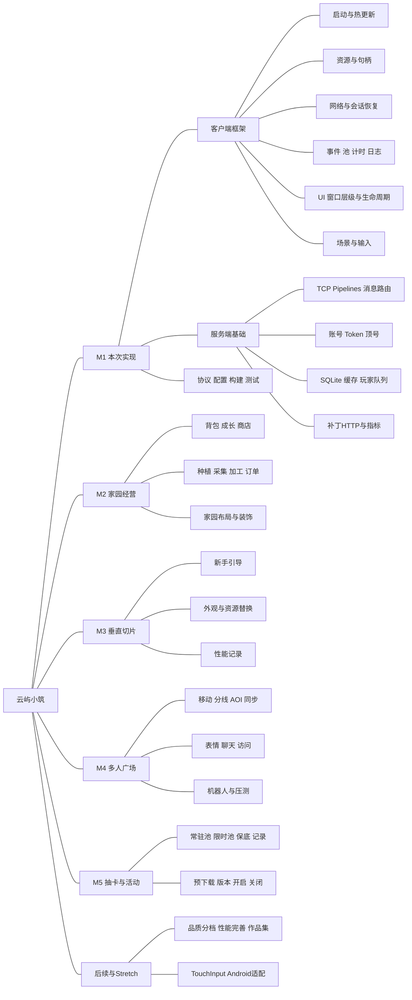

### 7.2 后续业务的脚本和方法落点（规划，不加入M1待办）

客户端业务采用 Lua Model → Service → Controller/View，固定 C# 桥负责异步与协议。下列 Lua 路径与方法均为**后续规划、并未实现**；参数对照 05 现有消息字段，不表示已冻结后续全部协议，亦不改服务端契约。同步本地方法（`apply*` / `tick` / `release` / `tryPlace`、纯模型与画质采样）不带 `done`，返回普通值或 void；异步网络/资源操作采用 `done(code, payload)`（主线程至多一次）并立即返回 `operation` 租约（所属窗口关闭时取消），不伪造 Lua UniTask 签名。写请求的 `op_id` 由 Service 经固定桥内部分配；`int64`（含 `op_id`、`player_id`）不得先转换成浮点数再往返，当前验证基线使用 Lua53 integer。服务端 Handler 复用玩家队列、幂等和事务。新增 C# 消息/桥接类型或签名必须检查基包兼容并重新生成桥接；Lua 只接触副本或 bytes，不直接修改 C# 正式消息集合。

| 功能模块 | 客户端脚本及核心方法 | 服务端或工具脚本及核心方法 | 边界 |
|---|---|---|---|
| 背包 | `Lua/Modules/Bag/BagModel.lua`：`applyChanges(changes)`（同步；`changes`=`BagChangeNtf.changes` 的 `ItemStack{item_id,count}[]`，count=0 表示移除）→ void。`BagService.lua`：`sell(items, done) -> operation`（异步；`items` 同 `BagSellReq.items`；Service 内部分配 `op_id`；`done(code, {gold_gained})`） | `S/Modules/Bag/BagHandler.cs`：`Task SellAsync(RequestContext context, BagSellReq request, CancellationToken ct)` | M2；库存/货币只认服务端 |
| 种植 | `Lua/Modules/Farm/FarmModel.lua`：`applyPlots(plots)`（同步；`plots`=`PlotChangeNtf.plots` / `PlotData[]`）→ void。`FarmService.lua`：`plant(items, done) -> operation`（`items`=`PlantItem{plot_id,seed_id}[]`，≤24）；`harvest(plotIds, done) -> operation`（`plotIds`=`int32[]` 同 `HarvestReq.plot_ids`）；均 Service 分配 `op_id`，`done(code, payload)` | `S/Modules/Farm/FarmHandler.cs`：`Task PlantAsync(RequestContext context, PlantReq request, CancellationToken ct)`；`Task HarvestAsync(RequestContext context, HarvestReq request, CancellationToken ct)` | M2；批量逐地块结果 |
| 采集 | `Lua/Modules/Gather/GatherService.lua`：`gather(nodeId, done) -> operation`（异步；`nodeId`=`GatherReq.node_id`；Service 分配 `op_id`；`done(code, {gained, rare_hit, node})`） | `S/Modules/Gather/GatherHandler.cs`：`Task GatherAsync(RequestContext context, GatherReq request, CancellationToken ct)` | M2；服务端冷却 |
| 加工 | `Lua/Modules/Craft/CraftService.lua`：`start(facilityId, slotId, recipeId, done) -> operation`（同 `CraftStartReq` 三字段；Service 分配 `op_id`）；`collect(facilityId, slotId, done) -> operation`（同 `CraftCollectReq`） | `S/Modules/Craft/CraftHandler.cs`：`Task StartAsync(RequestContext context, CraftStartReq request, CancellationToken ct)`；`Task CollectAsync(RequestContext context, CraftCollectReq request, CancellationToken ct)` | M2；输入与产出事务 |
| 订单 | `Lua/Modules/Order/OrderService.lua`：`submit(orderId, done) -> operation`（异步；`orderId`=`OrderSubmitReq.order_id`；Service 分配 `op_id`；`done(code, {reward, bonus, rare_applied})`） | `S/Modules/Order/OrderGenerator.cs`：`IReadOnlyList<OrderData> Generate(int level, int dayIndex, int seed)`；`S/Modules/Order/OrderHandler.cs`：`Task SubmitAsync(RequestContext context, OrderSubmitReq request, CancellationToken ct)` | M2；每日刷新及奖励 |
| 成长 | `Lua/Modules/Player/GrowthModel.lua`：`applyLevel(newLevel, unlockIds)`（同步纯模型；对照 `LevelUpNtf.new_level` / `unlock_ids`）→ void；本地可读 `Shared/Rules/LevelRules` 结果，不发网络 | `Shared/Rules/LevelRules.cs`：`int CalculateLevel(long totalExp, IReadOnlyList<int> levelCosts)` | M2；成长规则共享 |
| 商店 | `Lua/Modules/Shop/ShopService.lua`：`buy(shopItemId, count, done) -> operation`（异步；同 `ShopBuyReq.shop_item_id`/`count`；Service 分配 `op_id`；`done(code, nil)`） | `S/Modules/Shop/ShopHandler.cs`：`Task BuyAsync(RequestContext context, ShopBuyReq request, CancellationToken ct)` | M2；扣费/发物品事务 |
| 家园装饰 | `Lua/Modules/Home/HomePlacementController.lua`：`tryPlace(furnitureId, x, y, rotation) -> bool`（同步预览/碰撞；字段同 `FurniturePlacement`，无 done）。`HomeService.lua`：`save(layout, done) -> operation`（异步；`layout`=`HomeLayout{items,version}` 同 `HomeSaveReq.layout`；Service 分配 `op_id`） | `S/Modules/Home/HomeHandler.cs`：`Task SaveAsync(RequestContext context, HomeSaveReq request, CancellationToken ct)` | M2后续；服务端校验持有量/边界 |
| 新手引导 | `Lua/Modules/Guide/GuideController.lua`：`enterStep(step, done) -> operation`（异步上报；`step`=`GuideStepReq.step`；Service 分配 `op_id`；本地高亮可同步，不经 done） | `S/Modules/Guide/GuideHandler.cs`：`Task SaveStepAsync(RequestContext context, GuideStepReq request, CancellationToken ct)` | M3；M1不实现流程 |
| 外观 | `Lua/Modules/Avatar/AvatarAssembler.lua`：`build(equipped, done) -> operation`（异步资源合并；`equipped`=`map<slot,avatarId>` 同 `AvatarEquipReq.equipped` / `AvatarData`）；`release()`（同步释放展示句柄，无 done）→ void | `S/Modules/Avatar/AvatarHandler.cs`：`Task EquipAsync(RequestContext context, AvatarEquipReq request, CancellationToken ct)` | M3/M4；合并缓存与展示 |
| 广场 | `Lua/Modules/Plaza/PlazaService.lua`：`enter(preferLineId, done) -> operation`（异步；`preferLineId`=`PlazaEnterReq.prefer_line_id`，0=自动）。`PlazaInterpolator.lua`：`push(x, y, dir, state)`（同步写入待发/插值；字段同 `PlazaMoveReq`，无响应无 done）；`tick(dtSeconds)`（同步推进插值，无 done）→ void | `S/Modules/Plaza/PlazaLine.cs`：`void Tick(long nowUnixMs)`；`S/Modules/Plaza/AoiGrid.cs`：`IReadOnlyList<long> Update(long playerId, int xCm, int yCm)` | M4；AOI返回可见ID集，由调用方求差集 |
| 社交 | `Lua/Modules/Social/ChatService.lua`：`send(text, done) -> operation`（异步；`text`=`PlazaChatReq.text`，≤60）。`VisitService.lua`：`visit(playerId, done) -> operation`（异步；`playerId` 同 `VisitHomeReq.player_id`，经桥接以非 double 传 `int64`） | `S/Modules/Social/SocialHandler.cs`：`Task ChatAsync(RequestContext context, PlazaChatReq request, CancellationToken ct)`；`Task VisitAsync(RequestContext context, VisitHomeReq request, CancellationToken ct)` | M4/P1；范围按06保留或裁剪 |
| 抽卡 | `Lua/Modules/Gacha/GachaService.lua`：`pull(poolId, times, pay, done) -> operation`（异步；同 `GachaPullReq`：`pool_id`/`times`∈{1,10}/`PayType`；Service 分配 `op_id`；`done(code, {results, state})`） | `S/Modules/Gacha/GachaHandler.cs`：`Task PullAsync(RequestContext context, GachaPullReq request, CancellationToken ct)`；`Server/CloudIsle.Tools/GachaSimulator.cs`：`void Run(int poolId, int pulls, int seed)` | M5；服务端随机、保底、扣费、日志 |
| 活动 | `Lua/Modules/Activity/ActivityService.lua`：`apply(activity)`（同步；`activity`=`ActivityInfo` / `ActivityChangeNtf`）→ void；`preload(activityId, done) -> operation`（异步预载入口资源；`activityId`=`ActivityInfo.activity_id`） | `S/Modules/Activity/ActivityScheduler.cs`：`void Tick(long nowUnixMs)` | M5；入口和有效期由服务端决定 |
| 机器人 | `Server/CloudIsle.Bot/BotClient.cs`：`Task RunAsync(string host, int port, CancellationToken ct)` | `Server/CloudIsle.Bot/BotRunner.cs`：`Task RunAsync(int count, int seed, CancellationToken ct)` | M4压测；不扩入M1 |
| 性能与画质 | `Lua/Modules/Settings/QualityService.lua`：`begin(tag)` / `sample(frameMs, drawCalls)` / `end()` / `apply(qualityLevel)`（均同步本地采样与画质档位，无 done；`qualityLevel` 为客户端档位枚举/int）→ void | `Server/CloudIsle.Tools/PerfReport.cs`：`void Generate(string csvDirectory, string outputPath)` | M3起记录；缓冲/M6完善 |
| 调试工具 | `Lua/UI/Windows/GmWindow.lua`：`execute(cmd, done) -> operation`（异步；`cmd`=`GmCommandReq.cmd`；`done(code, message)`；生产配置服务端拒 990） | `S/Modules/Gm/GmHandler.cs`：`Task ExecuteAsync(RequestContext context, GmCommandReq request, CancellationToken ct)` | P1；非调试配置返回990 |
| 移动输入 | `Framework/Platform/TouchInput.cs`：`void Enable()`；`void Disable()`；`void Tick()` | 复用IInputProvider，无专属服务器脚本 | M7 Stretch |

配置源中的 Fxx/RCxxx/Pxx 等字符串ID，与05中部分 int32 ID存在映射需求；M2/M5前由导表生成稳定数值映射并检查唯一性，不能在运行时随意parse或按行号分配。此项不阻塞只使用Global键值的M1面板验收。


### 7.3 M1详细思维导图阅读说明

下列每张图按“功能模块 → 脚本 → 方法名”展开，与第4节接口表同源。参数和返回类型在第4节查阅；DTO/枚举是第3节的数据契约，不强行编造业务方法。大型模块拆图便于在Notion中阅读。

### M1 4.1 启动、补丁、资源（Game.Framework，目标设计）

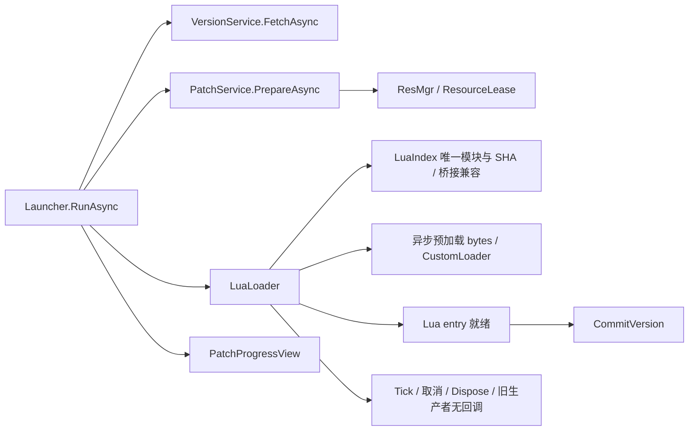

### M1 4.2 协议与客户端网络（Shared / Framework）

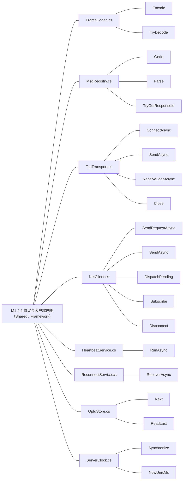

### M1 4.3 公共核心、输入与场景

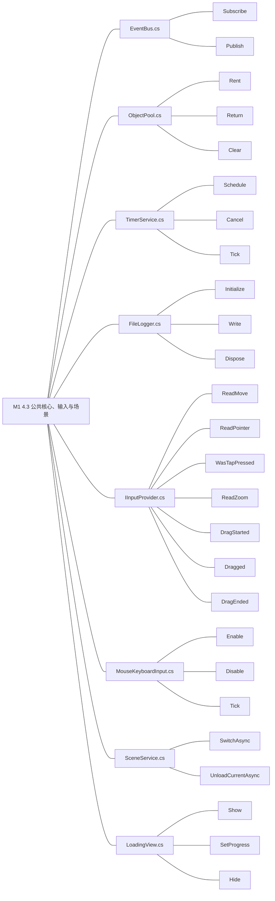

### M1 4.4 Lua 入口、UI 与最小账号模块（目标设计）

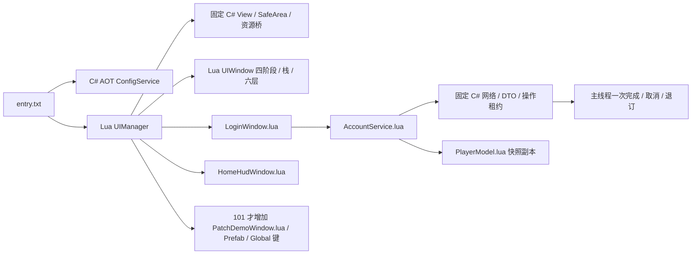

### M1 4.5 服务端网关、数据与账号（.NET 8）

```mermaid
flowchart LR
    n131["M1 4.5 服务端网关、数据与账号（.NET 8）"]
    n132["Program.cs"]
    n133["Main"]
    n134["TcpServer.cs"]
    n135["RunAsync"]
    n136["ClientSession.cs"]
    n137["RunAsync"]
    n138["SendAsync"]
    n139["CloseAsync"]
    n140["PipelineFrameReader.cs"]
    n141["ReadLoopAsync"]
    n142["MessageRouter.cs"]
    n143["Register"]
    n144["DispatchAsync"]
    n145["PlayerQueue.cs"]
    n146["EnqueueAsync"]
    n147["SqliteStore.cs"]
    n148["Initialize"]
    n149["ExecuteAsync"]
    n150["PlayerStore.cs"]
    n151["LoadAsync"]
    n152["SaveAsync"]
    n153["PlayerCache.cs"]
    n154["GetAsync"]
    n155["MarkDirty"]
    n156["Remove"]
    n157["SaveService.cs"]
    n158["FlushDirtyAsync"]
    n159["FlushPlayerAsync"]
    n160["PasswordHasher.cs"]
    n161["Hash"]
    n162["Verify"]
    n163["AccountRepository.cs"]
    n164["RegisterAsync"]
    n165["AuthenticateAsync"]
    n166["TokenService.cs"]
    n167["IssueAsync"]
    n168["ValidateAsync"]
    n169["RevokePlayerAsync"]
    n170["SessionRegistry.cs"]
    n171["BindAsync"]
    n172["IsCurrent"]
    n173["AccountHandler.cs"]
    n174["HandleRegisterAsync"]
    n175["HandleLoginAsync"]
    n176["HandleReconnectAsync"]
    n177["HandleLogoutAsync"]
    n178["HeartbeatHandler.cs"]
    n179["HandleAsync"]
    n180["IdempotencyStore.cs"]
    n181["TryGet"]
    n182["Save"]
    n183["ServerConfigService.cs"]
    n184["Load"]
    n185["GetGlobal"]
    n186["PatchHttpService.cs"]
    n187["RunAsync"]
    n188["MetricsReporter.cs"]
    n189["RunAsync"]
    n190["LoggingSetup.cs"]
    n191["Configure"]

    n131 --- n132
    n132 --- n133
    n131 --- n134
    n134 --- n135
    n131 --- n136
    n136 --- n137
    n136 --- n138
    n136 --- n139
    n131 --- n140
    n140 --- n141
    n131 --- n142
    n142 --- n143
    n142 --- n144
    n131 --- n145
    n145 --- n146
    n131 --- n147
    n147 --- n148
    n147 --- n149
    n131 --- n150
    n150 --- n151
    n150 --- n152
    n131 --- n153
    n153 --- n154
    n153 --- n155
    n153 --- n156
    n131 --- n157
    n157 --- n158
    n157 --- n159
    n131 --- n160
    n160 --- n161
    n160 --- n162
    n131 --- n163
    n163 --- n164
    n163 --- n165
    n131 --- n166
    n166 --- n167
    n166 --- n168
    n166 --- n169
    n131 --- n170
    n170 --- n171
    n170 --- n172
    n131 --- n173
    n173 --- n174
    n173 --- n175
    n173 --- n176
    n173 --- n177
    n131 --- n178
    n178 --- n179
    n131 --- n180
    n180 --- n181
    n180 --- n182
    n131 --- n183
    n183 --- n184
    n183 --- n185
    n131 --- n186
    n186 --- n187
    n131 --- n188
    n188 --- n189
    n131 --- n190
    n190 --- n191
```

### M1 4.6 生成、构建与测试入口

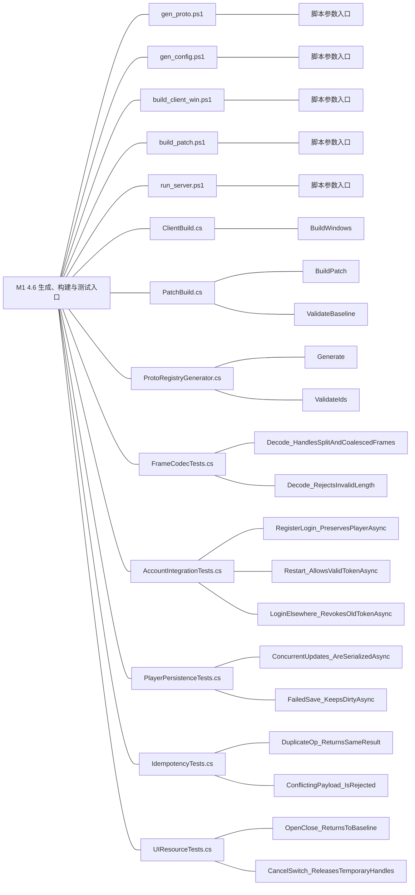

### 后续模块详细图（均不纳入 M1，本次迁移不实现业务）

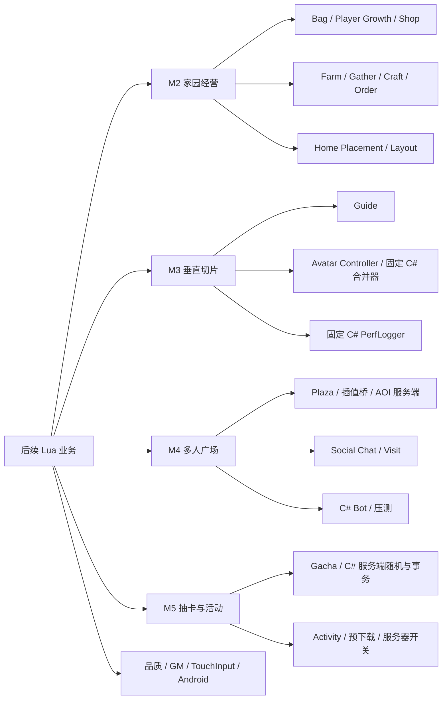

模块脚本/方法及服务端接口见 7.2 表。Lua 客户端经固定桥发请求、应用快照和控制 UI；C# 服务端继续承担随机、库存、扣费、事务、幂等和 AOI。原生角色合并、性能采样、移动输入等平台功能仍 C# AOT，不能仅因业务迁移而承诺新增任意 C# 能力可热更。

## 8. 官方依据、设计决策与完成状态

### 8.1 官方依据索引

| 来源 | 本文用到的结论 |
|---|---|
| [Unity 6000.3.22f1 Release Notes](https://unity.com/releases/editor/whats-new/6000.3.22f1) | 精确目标版本；通用API依据同版本系列6000.3手册，而非其他Unity大版本 |
| [Unity 6.3 C#编译器](https://docs.unity3d.com/6000.3/Documentation/Manual/csharp-compiler.html) | C#9及受限特性；Shared不使用较新语言特性 |
| [Unity .NET兼容级别](https://docs.unity3d.com/6000.3/Documentation/Manual/dotnet-profile-support.html) | .NET Standard 2.1 API边界与插件兼容；服务端.NET8实现不能直接搬入Unity |
| [Unity异步编程](https://docs.unity3d.com/6000.3/Documentation/Manual/async-await-support.html) | async/await与主线程响应；本文继续沿用04已选定UniTask，不替换为新的异步库 |
| [Unity LoadSceneAsync示例](https://docs.unity3d.com/6000.3/Documentation/ScriptReference/SceneManagement.SceneManager.LoadSceneAsync.html) | 原生异步场景加载行为；包场景在资源适配层处理 |
| [Unity Screen.safeArea](https://docs.unity3d.com/6000.3/Documentation/ScriptReference/Screen-safeArea.html) | 返回应用窗口内的像素矩形 |
| [Unity Editor命令行参数](https://docs.unity3d.com/6000.3/Documentation/Manual/EditorCommandLineArguments.html) | batchmode/executeMethod/logFile及非0失败退出 |
| [Microsoft Pipelines及解析示例](https://learn.microsoft.com/en-us/dotnet/standard/io/pipelines) | 半包/多段buffer及consumed/examined；AdvanceTo后不可保留旧buffer |
| [Microsoft.Data.Sqlite异步限制](https://learn.microsoft.com/en-us/dotnet/standard/data/sqlite/async) | 数据库队列内同步SQL；不是伪异步I/O |
| [Microsoft.Data.Sqlite事务](https://learn.microsoft.com/en-us/dotnet/standard/data/sqlite/transactions) | 多语句原子提交、写事务竞争处理 |

Token有效期、基包版本号、脚本命名、资源租约接口、任务粒度均是针对本项目的设计建议；官方来源支撑底层API行为，不意味着官方规定了本项目架构。YooAsset/导表已实现的中性能力保留原日志证据；xLua 固定来源及官方 API/生成配置依据见 07。新的平台和桥接能力必须实际验证，不能继承历史 HybridCLR 勾选。

### 8.2 文档和后续实施的状态分离

- T01–T41 的既有实现与验证保留在分段历史日志；T01/T02 的架构基线按本次迁移补充证据重评，参见 07，不机械取消无关服务端/C#能力的完成状态。
- T42–T44 已于 2026-10-20 xLua StageA 正式通过；T45–T47 已于同日 StageB 正式通过；T48–T52 已于同日 StageC1 最终审查修复后通过（证据 `Docs/Acceptance/M1/20261020-xLua/StageC1/Review/`）；T53–T57组件与最终R2原生业务链、清理和终止恢复均已通过；T58–T68与AC-1～AC-4全部通过。旧Root审查记录保留阶段状态，以2026-10-21的M1_Acceptance.md、StageE/AcceptanceMatrix.json和Root-Finalization/final-audit.json为最终结果。
- 本次独立 PoC、主工程迁移及补丁小演示只证明技术边界，不等于 Launcher、登录 UI、账号快照、正式新增面板与三个一键脚本全部完成。
- 后续逐项按依赖推进，并使用任务介绍→具体步骤/命令/源码和参数说明→验证名称/步骤/预期/实际→问题触发/原因/解决/复验的日志结构。
- 电量检查按用户指示暂停；此次迁移不恢复旧 M1 自动运行或旧电量退出流程。

### 8.3 最终交付（2026-10-21）

A11/B14/C13/D8/E12合计58项全部通过。当前服务端225/225、受影响PlayMode9/9、基础EditMode69/69、输入及模态PlayMode7/7，均无失败或跳过；未变更的UI/场景C1 27项和账号事务C2 13项证据继续适用。100→101同安装同缓存，实际下载42→5→0，三安装SHA不变；坏资源真实Retry、完整退避、同库强杀恢复、过期/顶号/旧Token/106均已原生实测。历史失败与原文保留，不追改成当时通过。

## 9. M1实际实现方法与问题复盘（2026-10-21回填）

本节将分段Log中的实际实施方法、失败原因、修复及复验汇总回任务拆解。T01–T68的详细命令、参数/函数注释和具体脚本见M1_01–M1_09；这里记录最后采用的实现及其边界，不把阶段计划当成已经执行的事实。

### 9.1 实际代码结构与职责

| 任务 | 实际位置 | 最终实现方法与数据流 | 采用原因/边界 |
|---|---|---|---|
| T01–T08 工程/协议 | `Shared/Proto`、`Assets/Shared/Proto/Generated`、`Tools/gen_proto.ps1` | proto单一来源，生成C#与MsgRegistry；生成到隔离暂存，校验ID重复/配对等后再替换成功产物；Shared不引用UnityEngine | 协议变更经固定代码重新构建；缺protoc必须非0退出，禁止静默跳过 |
| T09–T12 公共核心 | `Assets/Framework/Core` | 事件显式退订；对象池明确借还与重复归还保护；计时器有取消和非缩放时钟；FileLogger有大小/保留份数与敏感值脱敏 | 生命周期由拥有者负责；日志错误不改变业务成功状态 |
| T13–T17 资源/输入 | `Assets/Framework/Resource`、`Platform` | YooAsset调用封在ResMgr，ResourceLease/SceneLease统一释放；统计租约与泄漏；IInputProvider由MouseKeyboardInput实现，UI通过EventSystem阻挡 | 窗口/场景归还本身持有的租约；测试设备、全局输入设置必须恢复 |
| T18–T27 网络 | `Assets/Framework/Network`、`Server/.../Network`、`Assets/Shared/Net` | TCP帧和protobuf解析限长；Pending按seq和连接代次匹配；取消/超时结束等待并移除登记；心跳与恢复分离；重连1/2/4/8/16/30秒；OpIdStore先持久化再发号 | 旧连接清理不能结束新连接请求；op_id的本地单调性不等于跨设备或服务重启后的业务幂等 |
| T28–T32 数据 | `Server/.../Data`、`Players` | SQLite经唯一工作连接队列执行同步SQL；同玩家PlayerQueue串行；PlayerState用Revision/SavedRevision判断Dirty；保存使用快照，实际提交后推进已保存版本 | SQL异步API不被当成真实后台I/O；强杀只保证最后已提交状态，不保证5秒内尚未保存的修改 |
| T33–T38 账号 | `Server/.../Account`、`Hosting` | 注册成功不认证；密码加盐哈希；Token原文只给客户端，DB存SHA256/到期/撤销；登录撤销旧Token并顶号；重连读取持久记录 | 会话和服务进程生命周期独立；账号绑定的断开清理由SessionRegistry唯一负责 |
| T39–T40 幂等/诊断 | `Server/.../Players/IdempotencyStore.cs`、`Diagnostics` | 当前内存幂等窗口按玩家保留64个成功结果，校验请求摘要；Serilog实例局部拥有，指标记录连接/认证/请求/队列/内存 | M1没有正式游戏写接口；该窗口不是跨重启幂等保证，M2必须先补持久事务边界 |
| T41–T44 配置/版本 | `Tools/gen_config.ps1`、`ServerConfigService`、`VersionService` | Luban真实源表→临时生成/校验→各目标备份/同步，失败回滚；版本与逐表SHA清单；读取校验完成后整体替换快照；HTTP版本与静态资源 | 多目录复制带补偿恢复，不宣称跨目录文件系统原子事务；新增C#表结构需新基包 |
| T45–T47 Lua加载 | `LuaLoader`、`LuaModulePreloader`、`Assets/Lua` | LuaIndex模块映射唯一/语法/桥契约校验；预载与Lua Env归同一候选；入口ready后才提交活动索引；失败释放候选资源 | 固定C# AOT桥不随资源更新；每个进程新Lua环境，M1不做任意在运行模块替换 |
| T48–T52 UI/场景 | `Assets/Framework/UI`、`Scene`、`Assets/Lua/UI` | Lua控制器注册窗口，固定ViewHost提供控件能力；异步Open有pending、取消和释放；UiManager统一栈与模态；SceneService统一Loading/切换/失败回Login | 取消不是立即忘掉对象：必须等生产者结束并释放；池中返回对象仍由池在Dispose时销毁 |
| T53–T57 客户端账号 | `AccountSession`、`AccountBridge`、`AccountFlow`、`AccountService.txt` | 收包成功只产生pending快照/Token；Lua应用完整模型后Commit，才认证/启动心跳/解遮罩；AccountFlow按实际场景打开窗口；不可恢复码由上层统一通知Lua | 防止网络成功被误当业务完成；异步操作绑定发起时Session，旧回调不能清新pending；Lua委托原始身份保留至释放 |
| T58–T63 构建交付 | `ClientBuild`、`PatchBuild`、`BaselineFingerprint`、三个正式脚本 | 标准Win64 IL2CPP100、真实GenAll与Yoo；完整v2指纹覆盖3342实际编译/协议/schema/依赖/native及导入设置；101发布目录不可变，最后原子切指针 | 默认安装0.3.0/Proto1/bridge0.3；补丁不允许改AOT。100与101分别核对模块/Prefab/Global，不靠版本号推断内容 |
| T64–T68 端到端 | `Docs/Acceptance/M1/20261020-xLua/Root-Finalization` | Native生产UI按钮驱动，命令回执与业务完成分开；完整ScreenCapture；逐进程新UTC状态；实际DB/完整模型/安装SHA/日志核对，再汇总58项 | 自动脚本只能观察并驱动生产流程，不能直接伪造认证、面板或成功文案；任何超时都失败 |

### 9.2 关键事务与取消顺序

#### 登录与恢复

1. C#连接/请求收到服务端快照，绑定请求发起时的Session和尝试代次。
2. 只有该尝试仍有效才保存pending；此时尚未认证。
3. Lua解码并覆盖完整PlayerModel；int64标识/货币以字符串保真。
4. Lua调用CommitLoginToken；成功后才使会话认证、启动心跳、隐藏断线遮罩，并由实际场景控制HomeHud。
5. 取消、模型应用失败或旧回调只能清理自身拥有的pending；204/106等终止原因返回拥有者处理，禁止内层提前取消拥有者而漏掉终止通知。

```csharp
// AccountSession.ReconnectWithTokenAsync：终止码必须正常回到外层。
if (resp.Code == 204 || resp.Code == 106)
{
    ClearPendingTokenIfAttempt(attempt);
    // 不在这里StopReconnectLoop，否则外层RecoverAsync收到取消，Lua通知丢失。
    ClearToken();
    HideOverlay();
    SetResult(resp.Code, "biz");
    return (resp.Code, "biz", "{}");
}
// 外层RunReconnectAsync在RecoverAsync返回false后统一清理并NotifySessionExpired(terminalCode)。
```

#### 服务端单连接故障隔离

- TcpServer接受循环/HTTP/指标后台任务归Host；会话的接收、发送和清理归单连接。
- SessionRegistry观察连接完成并在锁内按连接身份解除映射，旧连接不能解除后来顶号的新连接。
- Host只释放自己的连接表、路由与心跳状态；每项清理独立执行，异常仅记录sessionId/阶段/类型，不进入全局停机信号。
- 监听或整体后台服务意外结束仍作为Host失败处理；正常客户端退出不拥有全服务的停止权限。

#### 补丁提交

完整内容生成→LuaIndex/配置/桥契约检查→全部资源就绪→入口ready→提交活动索引。服务端发布完整不可变版本目录后，最后原子替换version.json。指纹差异、坏资源或入口失败均保留原可用版本；普通模式保留可见错误，等待真正的Retry按钮。

### 9.3 实际问题、原因、解决与复验

| 发生条件与现象 | 确认原因 | 最终解决 | 实际复验 |
|---|---|---|---|
| Native启动仅见空场景 | 根作用域误用无参数CreateLinkedTokenSource，启动抛异常 | 根CTS使用new CancellationTokenSource；子流程再关联拥有者 | R2完整重建后真实Login/Home通过 |
| 下载失败后无法人工修复重试 | 旧路径无正式错误UI，曾有无条件自动重试/隐藏错误 | PatchProgressView串接正式启动，错误保留，Retry串行重建候选 | 损坏实际CDN副本→未entry/commit→恢复SHA→真按钮成功，仅prepare1/2 |
| 101标版本成功但找不到新模块 | catalog写CRLF，插入只匹配LF | 结构换行规范化，再插入并核对实际索引 | R2新Lua/Prefab/Global实际打开，下载42→5→0 |
| 新面板能显示成功但不能证明配置 | 曾有硬编码文案回退掩盖缺键 | 强制读取实际GetGlobal，缺键明确失败 | Native及正式ServerConfigService都读到热更新验证成功 |
| 模型观察总为{} | Json模块原只有decode，观察器调用encode不存在 | 实现确定性plain-data编码，禁止缺字段/null冒充0 | S1/R1/R2完整业务模型与只读DB逐项核对 |
| 截图无UI/误截其它应用 | Camera.Render不含ScreenSpaceOverlay，桌面窗口可被遮挡 | Unity完整帧ScreenCapture，等PNG IEND完整后回执 | 实际Home、新面板、错误、遮罩、恢复、Login截图逐张查看 |
| 重开客户端立刻退出 | 旧命令残留；Quit先退出后回执 | 持久ID去重、消费删除、先ack再Quit；重启退役未完成命令 | 同accept-root多次重开及缓存101通过 |
| 旧登录回调影响新会话 | await后读取可替换静态Session；失败无条件丢弃pending | 捕获拥有Session与尝试代次；Configure先取消旧操作；按代次收尾 | Root窄修13项及当前9项通过 |
| Lua Env释放出现委托泄漏 | 包装回调隐藏原LuaDelegate，无法对应保留/释放 | 保留原始委托身份，操作租约和事件处理器显式释放 | 真实Lua工作流退出DisposeError为空，资源回基线 |
| 取消Open/场景后资源稍后复活 | 只取消等待，没有等待生产者归还对象/租约 | pending登记、取消传递、等待收尾、CloseAll/Dispose拒绝重入 | C1最终27项及当前UIResource2项通过 |
| 池返回了Toast但销毁不完整 | 池外对象仍由池持有，计数归零不等于实际Destroy | 明确池内所有权，Dispose销毁实际对象 | 实际对象与回调/计时取消断言通过 |
| 客户端自然退出偶发让Host停机 | Host与Registry重复解绑，Host违反玩家队列前置条件；watch错误全局升级 | Registry唯一解绑；移除_watchFailure全局通道，Host逐项隔离清理 | 连续12次自然退出；两个账号并存RST后心跳/HTTP/新登录存活；225项通过 |
| 204已清Token但仍停Home | 恢复内层StopReconnectLoop取消自身，跳过外层Lua终止通知 | 正常返回终止业务码，外层统一通知 | 修复前真实用例1失败；后9项通过；R2 Native过期/顶号回Login通过 |
| 长退避记录读取失败 | Unity持续写日志，ReadAllLines共享方式冲突 | FileStream使用ReadWrite共享，finally释放 | 实际75秒以上1/2/4/8/16/30序列及恢复通过 |
| 服务测试出现配置版本失败 | 工作导出101，测试夹具要求100；证据版本混用 | 构建复制ServerConfig100/101，测试前恢复100，固定候选 | 原失败报告保留；最新225/225/0skip |
| 旧四文件指纹错误放行补丁 | 指纹覆盖不足、缺键被跳过，漏native/导入/锁/schema | 实际Player编译源完整v2指纹，缺失/新增/修改均拒绝 | 当前3342文件核对；真实固定C#差异exit1，原安装/指针不变 |
| headless键鼠4项读0，前台曾通过 | 默认Editor焦点/设备路由/自动更新影响手动事件 | 测试明确ProcessEventsManually/IgnoreFocus/全部路由，TearDown还原 | 原3/7失败报告保留；当前Input-Fixed7/7；生产输入不改 |
| 文档矩阵长期落后于实测 | 分散证据未绑定唯一候选，只有阶段声明 | 汇总器逐项读取结果/哈希/模型，硬检查后回填 | 58pass/0pending；主任务68行一致；86个报告链接存在 |

### 9.4 最终验证位置与复现原则

- 最终安装：`Root Final 100 R2/Player/Farming.exe`；补丁：`Root Final Publish R2/101`；App0.3.0/Proto1/bridge0.3。
- 服务端225/225；当前受影响PlayMode9/9、基础EditMode69/69、输入模态PlayMode7/7；复用未变更C1 27/C2 13单独记录，不混入当前测试总数。
- `Root-Finalization/Build-FinalCandidate.ps1`：实际完整100、导101、构建补丁、恢复工作配置100；候选目录存在即拒绝覆盖。
- `Run-NativeAccountsAndPatch/Run-NativeBadResource/Run-NativeRecovery/Run-NativeProtocolMismatch`：真实生产UI/TCP/DB验证；每次使用独立运行目录和私有随机凭证，不在CLI/日志输出密码Token。
- `Run-FinalAotNegative.ps1`：先备份实际源字节，再跑正式拒绝路径，finally原字节恢复，核对安装三SHA与发布指针。
- `Finalize-Acceptance.py`：只汇总已执行证据，不代替测试；检查3342源码、三个安装SHA、完整模型/DB、19配置JSON、39拥有日志对6个实际私密值0匹配后，才登记58项通过。
- 本地大体积安装、CDN缓存、原始运行目录不作为源码上传；仓库中保留整理后的可移植交付摘要、测试报告、关键截图和脚本，上传清单说明实际范围。

### 9.5 对M2的约束

M2先补“有副作用的写命令”基础：跨设备操作身份、持久幂等、状态与结果同事务、提交后增量同步、丢响应重试、强杀恢复和旧快照覆盖保护，再接入购买/播种/领取等正式业务。M1的5秒保存和64项内存窗口不能直接当经济写入保证。UI关闭只结束观察者，已经受理的服务端写命令继续完成自己的事务；会话错误只能影响对应会话。M2任务与验收见[06_M2_开发计划.md](06_M2_开发计划.md)。