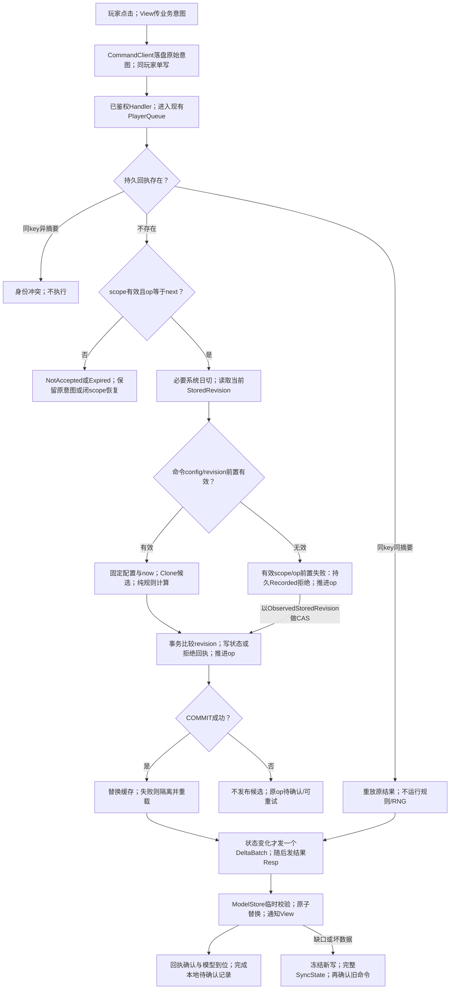
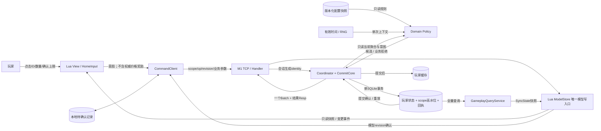

# M2 家园核心玩法开发计划

版本：**v2.0（架构重写）**；日期：2026-10-21。

**真实进度：42 / 80，M2-T001～T042 已验收（执行更新：2026-10-30）。** T042新IL2CPP、533/154实际重跑、Server1675明确复用；完整8故障+真实600秒自然离线，10DB/16完整PB-Model/127时钟采样/11逐图，14Native日志关键错误0，来源与精确进程回收闭环；33比较器及23PS片段，139既有保护延续为217，1775输入。见阶段E Log与T042-final-verification.json。 T041正式采集/工具UI已验收：78定向、57独立Root、533Edit/154Play，Server1660按546输入集/SHA复用；新IL2CPP、双画幅38实际OS选点/18完整PB检查/6业务写，旧经济9Native及25新图实际逐图审查；139保护/1772输入闭环。 T040工具升级已验收：61Root/130定向、成本溢出实测10、1660/468/140、新IL2CPP及9Native/独立DB与逐图；121保护/1712输入/3424编译与3601来源闭环。T039正式Gather/同事务随机回执已验收：19Root、定向89、1569/468/140、真实提交前后Host强杀、201/L1重放、当前Host九Native回归与逐图审查；114保护/1699输入/3424编译与3601客户端来源闭环。T038纯采集/配置投影与合成已验收：98Root+21普通，1537/468/140、新IL2CPP与9Native回归/逐图审查，110保护、3424/3601来源和1692输入闭环。T037实例Registry/初始化/非法身份已验收：77Root+15普通、真实SQLite重开4项；完整1418/468/140，105保护，1679当前输入与3422/3599客户端来源闭环。此前T036实际Native买种→播种→水/肥→自然成熟→收获→出售、重开/离线保留、真实60格满包301保留并UI出售腾格重收，以及Plant/Harvest各3故障完成；当前r5候选Server1326/1326、Edit468/468、Play140/140无失败跳过，3422编译/3599来源/1672Root输入一致、101保护。新候选经济9故障和农场6故障均实际退出0，独立原key/回执/nextOp/完整模型核对与逐图复核完成；正式201实际构建/激活27模块，旧规格收获3个+2经验、新规格10个+4经验，三Native SHA不变。观察器139次实际采样后文件读竞态退出，未声称全程监控；终态独立核对覆盖全部分支。严格来源首轮Sentis设置exit8保留，同判据r2真实0，无修改指纹或设置。权威T036-final-verification.json及阶段D Log。**用户指定六模块真实视频、模块范围/边界总结与视频索引已交付Demo Video（6片，完整解码2872帧、实际抽帧31张复核）；T042已验收，当前继续T043～T080。** I001 OPEN、电池PAUSED、终端100上限、无Git，T068处理构建跟进。

## 0. 阅读方式、依据与完成定义

- **先读第 1～3 节**：知道玩家如何操作、上下游是谁、系统怎样分层。
- **第 4 节是共同契约，第 5 节是叶子模块接口与最小清单**：接口列出的类、方法是本计划要求实现或修改的公开面；私有辅助函数在实现 Log 中逐个解释。`现有`、`草稿`、`拟新增/修改`明确区分。
- **第 6 节保留 T001～T080 稳定编号**，补足前置条件。一个任务可覆盖数个叶子模块，一个叶子模块可分数个任务完成；不得拿“写出一个类”替代完成整条验证链。
- **第 7～9 节**定义验收、实际命令、逐任务存档；**第 10 节**记录三个 subagent 的审查、对抗案例与计划修订。

项目依据：[总计划](06_开发计划.md)、[数值与配置](03_数值与配置表.md)、[协议与接口](05_协议与接口.md)、[M1 实现与复盘](06_M1_基础框架任务拆解.md)、[T002 冻结决策](M2_ADR_T002_写命令与玩法决策冻结.md)、[M2 执行 Log](Logs/M2_01_Logs.md)。规则与经济数值以 03 和 ADR 为准，正式消息以 05、proto 为准；出现冲突先补决策和兼容验证，禁止实现者静默选一个值。

### 0.1 交付范围和版本

M2 交付购买/出售/扩容、成长/解锁、种植/批量、采集/工具、加工、日订单/奖励，以及固定灰盒家园和 Windows x64 IL2CPP 的真实纵向闭环。M3 自由装饰/换装/引导、M4 社交、M5 抽卡活动、实际支付与移动端不在本次业务范围。

| 项目 | 当前事实 / M2 目标 | 对开发的约束 |
|---|---|---|
| 框架 | M1 已完成 T01～T68 / 58 项验收 | 复用 M1 Host、账号、TCP、xLua、资源、UI、输入；不用 M0 Demo 再建一条运行链 |
| 安装基包 | M2 目标 App `0.4.0`、bridge `m2-bridge-0.4` | 新 C# 桥/协议需新 IL2CPP 安装；T007 草稿版本改动不等于已有合格包 |
| 数据补丁 | Config/Res `200 → 201` | 仅兼容字段内的配置/Lua/资源；新增固定代码需要新基包 |
| 协议 | T003/T004 已作 Proto `1` 增量兼容登记 | 不能改旧字段号/语义；未来实际不兼容时先升版本和验证 106 |
| 数据库 | T005 已迁移 schema `3` | scope/receipt/clock 表存在；签发、幂等、经济提交机制尚未实现 |
| 已验收数据 | T006：8 商品、24 地块、13 采集点、4 未建造设施位 | 四设施不是赠送；地图坐标米；实例 ID 持久稳定 |
| 最近测试 | T006 服务端 236/236；M1 Unity 9/69/7 为历史基线 | 不能代替后续 M2 测试，更不能给 T007/T008 提前通过 |

完成 M2 必须同时满足：全部 80 任务退出条件、必需验收矩阵、真实 Native 操作与崩溃恢复、构建/源码/配置指纹一致、记录完整、干净工程可重建。电量检查按用户要求继续暂停。

## 1. 上下游依赖与玩家业务流

### 1.1 上游、M2、下游的责任

| 上游输入及拥有者 | M2 消费方式 | M2 交给下游的结果 | 上下游不能越权的地方 |
|---|---|---|---|
| 03 数值表 / 策划决策 | 导出校验后加载不可变玩法配置 | 固定版本的规则查询、模拟报告 | 客户端不提供价格、奖励、成熟结算；开发不凭空加礼包 |
| 05 / proto / 生成器 | 消息注册、兼容校验、DTO 映射 | 类型明确的请求/通知/响应 | 生成目录不手改；同一资产不经两套 Ntf 写两次 |
| M1 Host / SessionRegistry / PlayerQueue | 复用连接、鉴权、每玩家串行与组合根 | M2 Handlers 和提交端口 | 客户端退出只结束会话；不能使服务端 Host 停止 |
| M1 SQLite 玩家 / Token | 保留旧资产并补缺失玩法域 | schema3 玩家聚合和持久回执 | gold201 仍是201；旧未知 item1×7 保留并诊断 |
| M1 AccountSession / AccountBridge / AccountService | 登录和重连按现有applySnapshot→CommitLoginToken顺序扩展原子模型，再开放玩法 | 已确认的玩家会话、scope、完整模型 | TCP 连通/登录 Resp 不能直接等同业务模型就绪 |
| M1 xLua / UI / 资源 / 输入 / 场景 | 使用窗口和对象租约、模态输入、资源补丁 | 真实家园交互、HUD、生产结果展示 | View 不落库、不结算、不拥有全局命令生命周期 |
| M2 资产/地块/生产/订单结果 | 下游 M3/M4 按明确只读查询接入 | 稳定 ID、只读投影、应用服务端口 | 下游不能直接改聚合缓存或绕过经济提交入口 |
| M2 构建与证据 | 交付审查和回归读取 | 可重建候选、验收记录、问题解决链 | 测试夹具/模拟不能冒充真实安装操作 |

### 1.2 玩家的一次完整过程（自然语言）

1. **进入游戏。** 玩家安装 0.4.0，启动器校验桥和配置版本，随后注册或登录。服务器验证版本/凭证，在同一玩家执行通道里轮换 Token 和写命令 scope，加载旧存档，只为缺失的玩法域初始化一次。客户端原子应用完整快照并完成模型应用与认证提交 后才显示可操作家园。版本不符走 106 更新提示；Token 失效走 204 登录提示。
2. **买种和管理背包。** 新号有既定初始货币、6 块地、工具，没有种子和免费设施。玩家打开商店选择种子和数量；客户端只发送商品 ID/数量。服务端检查等级、服务器售价、货币和最终容量，同一提交扣钱并入包。玩家关闭窗口不取消已经受理的购买；HUD 和重开的背包从 ModelStore 显示结果。
3. **种植并收获。** 玩家选择种子、点击一块空地或拖过多块地。客户端形成去重后的意图，服务端再次验证 ID、数量和状态，最多处理24块。播种时固定产物规格和成熟时间。玩家可浇水一次、施肥一次；客户端倒计时只是显示。到服务端成熟时才能收获；满包时保留作物，不先清地再报错。
4. **采集和升级工具。** 玩家点地图上的树/矿等具体实例。服务端检查该实例冷却和所需工具，抽取掉落，连同奖励和新冷却一起提交。断线重试读取原回执，不重新抽奖。升级工具只影响之后的新采集。
5. **建造、加工和领取。** 玩家用材料/货币建造设施或升级；本期建造即时完成。选配方和空槽启动生产，一次扣材料并固定产物及结束时间。离线不会取消，也不会自动发成品。回来后领取；满包保留槽位。钻石加速必须提交确认上限，服务器按当前剩余时间重新计价；超过确认额度拒绝并提示重新确认。
6. **交订单、成长。** 玩家查看6条日订单。库存足够时至少2条能在合并分配库存后真正提交；库存不足时明确显示“可生产”，指引种植/加工，不假装当前能交。提交订单一次扣物、发奖励/经验、更新日进度；达到3/6条后玩家分别点击领取纯货币日奖。升级连续计算并按已有表解锁，Lv20经验清零。
7. **断线、跨日、换设备。** 网络断开时暂停新写，已提交命令在服务端保留。重连恢复同一 scope 和完整状态，然后确认待定命令。新设备登录创建新 scope，旧设备不能再写；它之前已提交的结果仍可被账号查询。跨日按 UTC+8 一次刷新到今天，不补发过去未领奖；8小时离线通过 deadline 投影恢复，不按帧补跑。

### 1.3 必须先打通的依赖链

`协议/配置/旧库 → 会话身份 → 持久账本与提交核心 → 保存/缓存/初始化 → 客户端待确认与模型同步 → 共享资产规则 → 单玩法纵向闭环 → 家园整合 → 最终候选/验收`。

两个易被任务表掩盖的前置条件：

- **T027 首次 Native 前就要有最小 0.4 构建入口**，由 T007 与 T027 增量完成；T068 是最终通用化与失败门槛收口，不是第一次才能构建。
- **T016 先交付通用日历/日切框架，T024 再接商店重置，T050～T055 再接订单日切。** 尚无订单模块时不能宣称订单跨日已经实现；外部命令、系统初始化和系统日切共用提交核心，但不共用客户端 op 编号。

## 2. 三类结构图

### 2.1 层级结构图：每个叶子模块在第 5 节有独立契约

```mermaid
flowchart TD
    M2["M2 家园核心玩法"]
    M2 --> P["P 契约与装配"]
    P --> P1["P01 协议与注册"]
    P --> P2["P02 配置快照"]
    P --> P3["P03 存档迁移与映射"]
    P --> P4["P04 组合根与路由"]
    M2 --> S["S 服务端可靠执行"]
    S --> S1["S01 会话与scope"]
    S --> S2["S02 哈希与回执"]
    S --> S3["S03 聚合与初始化"]
    S --> S4["S04 提交核心与命令协调"]
    S --> S5["S05 缓存与保存守卫"]
    S --> S6["S06 时钟与日切"]
    S --> S7["S07 查询与发布"]
    M2 --> C["C 客户端执行与状态"]
    C --> C1["C01 会话与线程 / C02 命令DTO"]
    C --> C2["C03 桥与租约 / C04 账号传输"]
    C --> C3["C05 待确认命令 / C06 收件箱"]
    C --> C4["C07 模型同步 / C08 业务服务"]
    C --> C5["C09 显示用单调时钟"]
    M2 --> D["D 纯玩法规则"]
    D --> D1["D01 库存 / D02 奖励 / D03 成长"]
    D --> D2["D04 交易 / D05 地块状态解锁"]
    D --> D3["D06 播种 / D07 水肥 / D08 收获批量"]
    D --> D4["D09 采集 / D10 工具"]
    D --> D5["D11 设施 / D12 生产 / D13 加速"]
    D --> D6["D14 订单候选 / D15 生成计价 / D16 订单操作"]
    M2 --> U["U 表现与输入"]
    U --> U1["U01 背包商店 / U02 种植"]
    U --> U2["U03 采集 / U04 加工 / U05 订单"]
    U --> U3["U06 家园与HUD"]
    M2 --> V["V 验证与交付"]
    V --> V1["V01 故障隔离 / V02 经济模拟"]
    V --> V2["V03 构建补丁 / V04 最终证据"]
```



### 2.2 流程图：一次写命令何时可以告诉玩家成功



预受理拒绝是否消耗 op 必须由协议返回明确状态，第 4 节定义。图中的“事务失败”不能返回经济成功；有效scope/op的revision/config冲突进入拒绝回执事务并推进op，不增加资产revision。入口NotAccepted保留原意图或先闭scope后放弃，不能从NotRecorded猜测永久未执行。

### 2.3 数据流图：输入的权威来源与持久边界



持久事实是 DB 已提交状态和回执；Cache、Model、View 都是投影。本地记录只保存待确认意图，不是资产依据；不保存 Token/密码。

## 3. 边界、所有权和依赖方向

| 层 / 路径（相对工程根） | 可以依赖 | 明确禁止 | 向调用者提供的保障 |
|---|---|---|---|
| `Server/CloudIsle.Server/Gameplay/Domain` | 不可变值对象、规则配置接口 | Unity、Socket、SQL、可变 Proto、直接发通知 | 纯输入→候选/拒绝；不修改传入聚合；可用假时钟/RNG独立验证 |
| `.../Gameplay/Application` | Domain、小端口、已有 PlayerQueue | 构造具体 Socket/Unity 对象、另建玩家队列 | 受理、幂等、版本、一次配置、提交/发布顺序 |
| `.../Gameplay/Infrastructure` | SqliteStore、生成配置、平台时钟/RNG | 在仓储里再开业务流程、嵌套玩家队列 | 一事务、CAS、不可变配置、故障明确分类 |
| `.../Gameplay/Handlers` | 消息映射、会话、应用接口 | 自己扣钱/发奖、信任请求playerId、直接改缓存 | 身份来自会话；限长；错误转译；一条正式路由 |
| `Assets/Framework/Gameplay` | M1 AccountSession/NetClient、固定Proto、主线程分发 | 服务端经济规则、任意反射调用、View生命周期控制事务 | 64位保真、单写待确认、会话epoch、取消观察者 |
| `Assets/Lua/Models` | DTO校验、64位比较端口 | Lua tonumber处理int64、View反写、每模块各自收Ntf改模型 | 整批应用/全量替换、revision连续、唯一权威投影 |
| `Assets/Lua/Services` | GameplayBridge、ModelStore查询 | 定价/随机/成熟结算、直接改Model | 业务意图API、可读状态、明确错误处理 |
| `Assets/Lua/UI`、`Home` | Services、只读Model、M1 UI/Input/资源租约 | 落库、决定scope/op、全局CancelAll、全局断网 | 只管理自己对象/观察者；重开可由快照还原 |
| `Tools/M2` / 测试 | 公开应用/规则端口、独立夹具 | 复制经济公式、修改用户OS时间、用假服务器代替最终验收 | 可重现输入、非零用例、原始失败证据和候选指纹 |

**真实客户端链：** `AccountService → AccountBridge → AccountSession → NetClient/TcpTransport`。现有AccountService先`PlayerModel.applySnapshot`再`AccountBridge.CommitLoginToken()`，M2改为ModelStore完整校验/候选安装后提交；不引入NetService或ModelLogin类。

**初始化规则路径决策：** T008 草稿在 `Assets/Shared/Domain/Init`、`Assets/Shared/Application/Init`，因此被 Game.Shared 同时编入客户端与服务端。正式规则移到上述 Server Domain/Application（保留命名和测试追踪），客户端只接收已提交投影；共享目录只保留确需两端共用的只读配置/DTO。此迁移属于 T008 退出前修正，当前未执行。不要因为两端能编译而让客户端获得初始化写权限。

组合根继续是 `M1ServerHost`，名字先保留以减少无关改动；把新增注册放 `GameplayModule`。一个 Host、一份 PlayerQueue、一条账号/Token 链；单连接故障只影响其连接，真正监听器/后台基础设施故障才由 Host 生命周期处理。

## 4. 所有模块共用的精确契约

### 4.1 参数类型、来源与返回

以下为**拟议公开契约**；T003/T004 已生成的 wire 类型不等于这些应用类型已实现。C# 的 `long` 在内部精确运算，跨 Lua/JSON 时为规范十进制字符串；int32 配置/实例 ID 不强行改 long。所有集合必须拥有副本并只读，不把 `List`/`ISet` 强转后暴露。

| 类型 / 字段 | 参数意义与唯一来源 | 校验 / 失败行为 |
|---|---|---|
| `SessionIdentity(PlayerId:long, SessionId:long, Generation:long)` | 由已验证 SessionRegistry 创建 | Handler 不接受客户端 playerId；队首再次确认会话有效 |
| `CommandKey(PlayerId:long, ScopeId:long, OpId:long)` | player来自会话；scope服务端签发；op客户端按scope单调申请 | 都>0；scope归属/CLOSED检查；旧scope只允许查询自己的已存结果 |
| `CommandEnvelope(Key, Kind, ExpectedRevision:long, ConfigVersion:int, Body:ICommandPayload)` | CommandClient 保存后发送的不可变意图 | 类型允许列表、限长、摘要、版本/revision；重试不改body或expectedRevision |
| `PlayerAggregate` | 从 PlayerStore 映射的已提交领域聚合 | 包含revision/grant/day/资产/玩法状态及已接受长任务规格；仅发布深拷贝只读版本 |
| `CommandContext(Config:IGameplayConfig, NowMs:long, Random:IRandomSource)` | 应用层每次受理固定一次 | 同一命令不混用两个配置或时间；RNG只服务端拥有 |
| `DomainResult<T>(Code:int, Candidate:T?, Effects, ItemResults)` | Policy 输出 | 成功是候选不是已提交；拒绝不改输入；中间数值checked |
| `CommitRequest(ObservedStoredRevision:long, Candidate?, Receipt?, ScopeAdvance?, SystemGuard?)` | 仅 CommitCore 创建并交仓储 | ObservedStoredRevision是队首读取的当前DB版本，用于存储CAS；不同于命令中可能过期的ExpectedRevision。系统guard含grant或各模块初始化/lastResetDay标记 |
| `CommitOutcome(Revision:long, StateChanged:bool, Receipt, Snapshot)` | SQLite COMMIT 后产生 | 仅此类型可以被发布；业务拒绝无资产变化则revision不变 |
| `CommandAck(Disposition, OriginalCode, CommittedRevision, AuthoritativeNextOpId:long?, ScopeState)` | 服务端由持久回执/高水位构造 | nextOp有值才可采用，携带归属scope；纯传输/入口拒绝可能未知，不能伪造0；不用code猜是否消耗op |
| `PendingCommand` | 本地持久化 key、规范payload、摘要、expectedRevision、版本和创建时间 | 不含凭证；按账号/环境隔离；写失败不发请求；损坏时锁写并同步查询 |
| `PlayerViewSnapshot` / `DeltaBatchDto` | 查询服务/发布器由已提交聚合映射 | 无服务端私密信息；int64字符串；固定版本与revision；Model只接受当前epoch |
| `AuthSnapshot` | 认证封套含kind(Login/Reconnect)、player/environment/scope/权威nextOp、authAttempt、AuthenticationStamp、data | 由AccountSession适配器映射完整认证响应；旧SnapshotCodec仅ToLuaJson(resp.Data)会漏scope等，不可直接沿用 |
| `AuthenticationStamp` | `EnvironmentKey:string, Epoch:long, ConnectionGeneration:long, AuthAttempt:int` | Begin阶段玩家/scope未知时只持此stamp；Attach验证认证封套后产生含身份的SessionStamp，同一epoch不等于同一认证实例 |
| `SessionStamp` | `EnvironmentKey:string, PlayerId:string, ScopeId:string, Epoch:long, ConnectionGeneration:long` | 同一账号不同会话/连接不可混用；每回调/模型确认都携带stamp |
| `DailyModuleMarker` | `ModuleKey:string, InitVersion:int, LastResetDay:int, Availability, CapabilityHash:string` | 各模块独立CAS；全局day到今天后新加入模块仍能首次初始化 |
| `SubscriptionLease : IDisposable` | 每一个订阅独立创建 | Dispose幂等，只停止该观察者；不是业务撤销指令 |

类型表里记录/DTO 无业务方法，构造必须验证必填参数、范围和深只读；后续各叶子模块列出其公开行为方法。`CancellationToken admissionCt`仅用于受理前排队；`completionCt`由服务端提交范围拥有；`shutdownCt`由Host拥有，不能用UI/连接取消令牌代替。硬关进程仍以SQLite事务结果/回执恢复。

### 4.2 op 受理、回执和本地确认状态机

1. 一次新登录以**同一 DB 事务**写新 TokenHash、关闭旧 scope、新建 scope。提交后才绑定新会话和投递顶号；网络顶号失败不回滚已提交身份。Reconnect 通过版本校验后原样恢复scope；合格M2旧Token补scope必须CAS一次。
2. `scope.next_op_id`是持久高水位。队首先查回执：同key同摘要重放；异摘要冲突；详情过期也不重执行。新op必须等于next；间隙、旧scope新写等在受理前拒绝。
3. 三种wire Ack：`NotAccepted`（鉴权/安装版本门槛、形状非法、限流/队列忙等受理前失败，不消耗op）、`Recorded`（有效current scope、op=next、形状合法后，成功及**expectedRevision/config冲突等确定性拒绝**均写回执并推进op）、`Expired`（详情已清但高水位证明不可再执行）。超时是客户端`Unknown`。T010已追加05/proto的disposition、真正optional的next_op、scope状态及查询语义，并实现只读投影；真实经济命令受理、写入及客户端状态机继续T011/T013/T014，尚未登记完成。
4. 同一个未决op重试保留完整原payload/expectedRevision/configVersion；哈希含消息类型及冻结前置、排除seq/Token。日切造成的revision冲突写Recorded拒绝，资产revision保持，确认后新的用户意图使用Ack.nextOp，不能跳号。`NotRecorded`只是瞬时查询：当前开放scope仍可能有旧请求在途，不能据此换payload复用op、递增或宣布永久未执行。
5. NotAccepted的限流/队列忙允许原payload有界退避；永久形状非法、payload丢失或玩家要放弃时，停止自动重试并明确提示“需重新登录恢复写入”。受控新登录在同一lane排在已受理事务之后关闭旧scope；**确认closed后**查询其Recorded/Expired/NotRecorded才形成稳定结论，旧请求此后不可新增受理。按结果同步/告知/封存后开放新scope；旧意图绝不自动迁移，新写需玩家重新确认。不新增Skip端点。
6. 回执详情保留7天，每小时分批清理；高水位/归属/scope墓碑保留。到期边界测试7天前1ms/恰好7天，清理不用客户端时间；账号删除/墓碑压缩不在M2实现。
7. 本地状态：`Prepared → InFlight → Unknown / RecordedAwaitModel → Completed`，另有`NotAcceptedAwaitRecovery`和`ArchivedClosedScope`。同一客户端、同一环境当前账号一个待确认写，并非多设备共享本地队列。Recorded业务拒绝可确认结果；成功需模型至少到CommittedRevision。当前scope Unknown必须恢复，关闭scope的稳定NotRecorded/Expired同步并告知后可封存，不永久阻塞新scope。本地记录缺失/损坏时不从revision猜op，先轮换关闭旧scope、查询可发现的旧记录、取得新scope权威nextOp，再开放新意图。

### 4.3 原子提交、锁和修订号

- 只使用已有 `PlayerQueue.EnqueueAsync(long playerId, Func<CancellationToken,Task> action, CancellationToken ct)`；队列内调用 `ExecuteInLaneAsync`，不能再Enqueue同玩家，也不能await需要自己lane的顶号/退出Flush。锁序固定：玩家lane→DB执行队列→同步SQLite事务；事务回调里不await、不再进队列。
- `GameplayCommitCore`有外部命令、初始化、日切三个入口。初始化使用grant_version CAS，日切用全局day及各模块InitVersion/LastResetDay CAS，均不伪造scope/op=0，也不消费客户端op。所有入口最终调用相同CommitStore事务/缓存发布能力。
- 外部命令的全部模块变化一次revision+1；纯拒绝只写receipt/next_op，资产revision不动；系统校正确有变化才+1；重复重放/NoOp不动revision。内部Reward/Progression无权单独递增。
- 事务内以队首观察的ObservedStoredRevision做条件写；命令ExpectedRevision先作为业务前置判断，冲突写Recorded拒绝而非拿过期值做存储CAS。状态、已接受规格、receipt和next_op一起COMMIT。拒绝也固定结果；DB暂时失败不写假回执。提交后缓存替换失败隔离该玩家并回源，绝不能再保存旧内存覆盖DB。
- `PlayerStore`同revision且同规范状态只幂等NoOp，同revision不同内容拒绝；低revision拒绝，高revision也不能绕过CommitCore做经济写。M1延迟Save/Logout受同一守卫，不以5秒落盘作为成功条件。

### 4.4 时钟、配置与长任务

- 服务端 `IGameClock.GetEffectiveNowMsAsync(CancellationToken ct)`异步读取平台UTC与持久下界；**先持久化提高的有效时间下界再返回**，崩溃重启不能倒退到已对外确认的时间。每次命令只取一次now，测试可注入原始UTC；不修改用户OS时钟。前跳的运维异常只能诊断/隔离，不能承诺算法自动撤销已经发生的真实时间。
- 日历固定UTC+8、resetHour读取当前Global=0。日切先在同lane独立提交并发batch；若造成有效scope/op的原命令revision过期，返回Recorded冲突并持久推进op，不悄悄扣旧订单。跨多天只校正到今天，无自动发奖。T016框架组合显式注册的策略；每模块有InitVersion/LastResetDay，不能因全局day已到今天跳过后来接入的订单首次初始化。订单合法候选为空只标记该域Unavailable+504，其他玩法/登录正常；条件变化后系统CAS重试，不能把504放大成全局锁死。
- `GameConfigSnapshot`现有只覆盖部分玩法；P02增加`IGameplayConfig`及Item/Crop/Level/Gather/Tool/Facility/Recipe/Order等强类型只读投影。Host不能仅加载旧Globals就宣称配置已接入；所有启用前校验引用、数量、层级可达、checked范围。运行期一次命令捕获一个快照，切换只影响新受理命令。同版本同manifest SHA为NoOp，同版本异SHA/低版本拒绝，禁止原地修改200经济规则。
- 播种保存`AcceptedHarvestSpec`，加工保存`AcceptedCraftSpec`，订单保存needs/reward/day与公式版本。**现有PlotData/SlotData没有承载完整固定产物，T029/T045必须先增加服务端持久化字段/sidecar与往返迁移测试**；不能把“配置版本号”当作已存产物规格，不能依赖历史配置永远可下载。**M2兼容补丁可调整/删除旧Recipe/Crop，但不得删除或改义200已存在Item、堆叠规则及稳定Map实例身份；P02/V03必须激活前校验。** 若要删除Item另做新基包/显式迁移，不隐含承诺旧产物无限兼容。客户端仅接收展示需要的字段。
- M1未知物品item1×7原样保留、按stack_default占格，不能获取/使用/出售；合法业务仍可进行。未知旧实例保留诊断，不能按新配置强删、重锁地块或重置已解锁状态。

### 4.5 客户端唯一写入与生命周期

**认证就绪顺序：** BeginAuthentication先建立新epoch/AuthenticationStamp并锁写，AttachCandidate在验证封套后产生含玩家/scope的SessionStamp→从完整AuthSnapshot映射scope/nextOp/data→ModelStore校验并安装候选root但不发可操作事件→匹配stamp+authAttempt提交Token→C05跨scope恢复/封存pending→模型、认证、恢复三门通过才MarkReady并发初始可操作事件。任何失败清候选root、失效stamp、封存pending并保持锁写。重连也按此门槛重新隔离旧连接回调。

- `GameplayBridge`草稿拆为LuaGameplayFacade和internal GameplayBridgeBinding，只做允许列表/DTO转换/端口/租约转接。主线程分发、订阅表和会话epoch是独立类；未绑定有效主线程分发器返回NotReady。旧port/旧epoch已排队回调必须静默失效；每订阅独立，不用全局单个handler覆盖。
- int64校验使用结构化JSON和protobuf Descriptor，递归识别camelCase/snake_case/转义属性名与所有嵌套int64，拒绝重复语义字段与非法数字；不依靠字段名正则。输出protobuf formatter的字符串值；Lua不得`tonumber`它们。
- ModelStore是唯一玩法状态写入口：校验完整批次→clone→验证每个模块和跨模块不变量→一次替换→一次变更事件；不是每模块收Ntf分别改自己的表。旧模块Ntf保留兼容定义，但M2只由Batch驱动资产；Resp中的已有状态摘要仅供展示结果/一致性核对，禁止再次应用。
- `new<=current`视重复，base缺口/坏DTO触发同步并冻结新写；完整快照也要校验epoch和revision，不能用晚到旧快照覆盖新模型。同步期间有界缓存增量，完成后仅按连续revision重放；超限重新同步。
- 主ModelStore订阅由玩家会话拥有，Window只订阅只读模型事件；Close/切场景释放自己租约，不UnbindBridge、不取消已受理命令。真正Logout/204/106由会话拥有者增epoch并清玩法投影、封存待确认记录、停止新写，恰好发一次终止通知。


## 5. 叶子模块：接口、调用关系、保障与最小执行清单

**共 46 个叶子模块：P01～P04、S01～S07、C01～C09、D01～D16、U01～U06、V01～V04。** 每个叶子都有输入方、调用方、输出承诺、独立退出测试和最小清单。清单是本轮修订后的工作要求，未勾选不推翻 T001～T006 的历史验收；已完成基础只补确有缺口的增量。

方法签名中的公共类型见第4节。`state`永远是调用者提供的当前只读状态视图，`ctx`是同一命令固定的配置/now/RNG；Policy只返回候选及效果。表中 Domain 类默认目录为 `Server/CloudIsle.Server/Gameplay/Domain/<业务>`，应用类为 `.../Gameplay/Application`，持久实现为 `.../Gameplay/Infrastructure`。未标“现有”的API都是本计划拟新增或修改的契约，实施前先在对应Log登记最终签名及参数注释。

### P01 协议与生成注册（T003/T004；增量 T009/T010）

**是什么/调用者：** 构建工具负责 wire 契约；Handler/NetClient 使用注册表。输入由05、`Shared/proto`及协议决策给出，不由Lua指定运行时Type。

| 类 / 状态 | 方法与参数接口 | 输出 / 权责 |
|---|---|---|
| `ProtoRegistryGenerator`（现有） | `void ValidateIds(string descriptorPath)`；`void Generate(string protoDir, string outputDir)` | descriptorPath为protoc输出；校验ID/字段后生成固定映射，不决定玩法规则 |
| `MsgRegistry`（现有生成） | `ushort GetId(Type messageType)`；`IMessage Parse(ushort msgId, byte[] body)`；`bool TryGetResponseId(ushort requestId, out ushort responseId)` | 仅固定C#调用；Lua无任意Type入口；未知消息拒绝 |
| `GameplayRequestMapper` | `CommandEnvelope Map(SessionIdentity identity, IMessage request)` | identity由会话给；request由Parse给；映射强类型意图并检查形状/长度，不计算价格 |
| `CommandAckMapper` | `IMessage ToResponse(CommandKind kind, CommandAck ack, CommandSummary summary)` | 向每种正式写响应映射disposition/nextOp/revision；不重复应用状态 |

**保障与独立验证：** 原消息113字段/21枚举兼容基线保留；63注册映射不漏；新增Ack使用新增字段号。重复ID/未知消息负例失败且已发布字节保持；生成中强杀须由完整性清单发现，不能承诺多文件拷贝崩溃原子。

- [ ] 对照05§1.5和M2段，明确64项内存窗为M1历史机制；补齐写响应、SyncState、Query的Ack/nextOp，区分查询NotRecorded/Recorded/Expired与归属scope。
- [ ] 更新proto并运行`Tools/gen_proto.ps1`；登记新旧descriptor、ID/字段差异及所有request→response对，禁止手改Generated。
- [ ] 在隔离夹具运行旧字段兼容、重复ID、截断发布清单和所有Ack投影用例；现有成功生成物/meta哈希保持；绑定T009/T010再向C05开放。

### P02 不可变玩法配置（T006；各业务增量）

**调用者/输入：** Host组合根从校验的导出目录加载；协调器只Capture一次。配置源由03/XLSX给出。

| 类 / 状态 | 方法与参数接口 | 输出 / 边界 |
|---|---|---|
| `MaterialList`（现有） | `IReadOnlyList<ItemStackSpec> Parse(string raw)`；`void EnsureItemRefs(IReadOnlyList<ItemStackSpec> stacks, ISet<int> knownItemIds, string context)` | 严格材料语法与引用校验；不扣物 |
| `GameConfigSnapshot`（现有，待扩充） | `static GameConfigSnapshot LoadDirectory(string directory, int expectedVersion)`；`static int ToConfigInt32(long value, string context)` | 已有Globals/Shop/Map/PlayerInit/Materials；不虚报完整业务表覆盖 |
| `GameplayConfigProjector` | `GameplayConfigSnapshot Build(ValidatedConfigBundle bundle)` | bundle由清单/SHA校验器给；补Item/Crop/Level/Gather/Tool/Facility/Recipe/Order强类型规格，深只读 |
| `GameplayConfigProvider : IGameplayConfigProvider` | `GameplayConfigSnapshot Capture()`；`ConfigSwapResult TryActivate(GameplayConfigSnapshot candidate)` | 唯一运行快照拥有者；完整校验和200→201 Item/stack/实例兼容检查后整体替换；同版同SHA NoOp，同版异SHA/降版拒绝；失败保留上一份 |

**保障与独立验证：** 缺引用、空材料段、数量/价格溢出、重复实例在监听/启用前拒绝；来源集合构造后改变不能改变快照。旧存档未知物品是存量兼容，不当作配置可产生的新物品。

- [ ] 保留T006已经通过的四目录22JSON同SHA和7种非法导出证据；按T019/029/038/043/050分别补强类型字段/引用与说明。
- [ ] Host停止各业务自行读目录，注入唯一Provider；用并发切200→201夹具证明一次命令各Policy持有同对象。
- [ ] 执行`Tools/M2/verify_config_export.py`的正例控制和负例；补输入集合修改、业务表缺字段与旧ID删除的读取测试，导出中断由清单拒绝而非半启用。

### P03 schema、聚合序列化与已接受规格（T005；增量 T029/T045）

**调用者/输入：** SqliteStore启动迁移；仓储读取M1/M2存档；服务端Mapper转换领域聚合。输入来自真实DB，不来自客户端资产上传。

| 类 / 状态 | 方法与参数接口 | 输出 / 边界 |
|---|---|---|
| `SqliteStore`（现有） | `Task<T> ExecuteAsync<T>(Func<SqliteConnection,T> operation, CancellationToken ct)` | 单DB队列执行同步事务；不把连接交给View，不嵌套自身ExecuteAsync |
| `PlayerStore`（现有，待守卫） | `Task<PlayerState> LoadAsync(long playerId, CancellationToken ct)`；`Task SaveAsync(PlayerState snapshot, CancellationToken ct)` | Load保留M1字段；Save兼容入口受S05约束，不能作为经济写旁路 |
| `PlayerAggregateMapper` | `PlayerAggregate FromStored(PlayerState source, AcceptedTaskState tasks)`；`PlayerState ToStored(PlayerAggregate source)` | 可变Proto只在边界深拷贝；领域内部不暴露Proto |
| `AcceptedTaskStateCodec` | `byte[] Encode(AcceptedTaskState state)`；`AcceptedTaskState Decode(byte[] bytes, int formatVersion)` | 序列化作物/生产固定输出、版本与实例关联；旧库缺域有明确默认，不由当前表重算旧已扣费任务 |

**保障/独立验证：** schema3高版本拒绝不改库；同事务保存基础列、快照及sidecar。sidecar新增列/表若需schema4，必须独立ADR、迁移测试和版本标记，不能把新增表偷偷塞回“schema3已验收”。

- [ ] 对真实M1结构建立脱敏临时夹具，复核gold201/item1×7/tokenhash/revision不变；保留T005的回滚/高版本证据。
- [ ] T029/T045先选定sidecar格式与迁移（可同现有snapshot envelope扩展或显式新schema），写accepted spec和快照同事务的往返测试。
- [ ] 用200启动作物/生产、切201改/删原配置、重启再领取的仓储夹具验证旧规格仍可执行；未知存量保留且重复实例不能静默覆盖。

### P04 组合根、正式路由与版本门槛（T009/T014/T064）

**调用者/输入：** `M1ServerHost.RunAsync`装配依赖，MessageRouter调用Handler；版本要求来自Host配置，不取客户端自报为事实。

| 类 / 状态 | 方法与参数接口 | 输出 / 边界 |
|---|---|---|
| `M1ServerHost`（现有） | `Task RunAsync(CancellationToken ct)` | 继续拥有监听器/基础服务生命周期；单玩家断开不触发Host停机 |
| `GameplayModule` | `GameplayServices Create(GameplayDependencies dependencies)`；`void RegisterHandlers(MessageRouter router, GameplayServices services)` | dependencies显式包含同一个PlayerQueue、SqliteStore、SessionRegistry、ConfigProvider、Clock；无隐藏全局ServiceLocator |
| `ClientCompatibilityPolicy` | `CompatibilityResult Check(ClientBuildInfo build, ServerRequirements required)` | Login/Reconnect同一纯策略，检查App/Bridge/Proto/Res/Config；失败先返回106，未修改Token/scope |
| `GameplayRequestHandler` | `Task HandleAsync(SessionIdentity caller, Packet packet, CancellationToken admissionCt)` | 形状/鉴权/映射→协调器→发布；不计算业务、不直接保存 |

- [ ] 在Host显式注册各小端口和允许消息；禁止启动旧Greybox网络/账号链；未完成玩法不注册成可成功路由。
- [x] T009：表驱动验证Login/Reconnect缺字段/旧App/旧bridge/旧配置被同策略拒绝，合格M2旧Token才补scope；Host注入同一已校验GameConfigSnapshot。
- [x] T009：真实Host两玩家连接夹具验证A退出/RST后B继续心跳、HTTP和新TCP可用；任务夹具拥有停止范围。经济请求与提交后缓存故障隔离仍在T018验收。

### S01 持久会话与scope（T009）

**调用者/输入：** AccountHandler转交AccountSessionService；输入是账号验证后的player、Host时间/版本、服务端生成Token材料；SessionRegistry只管理在线连接。

| 类 | 方法与参数接口 | 输出 / 边界 |
|---|---|---|
| `AccountSessionService`（T009已实现） | `Task<LoginGrant> LoginAsync(VerifiedAccount account, ClientBuildInfo build, SessionTarget target, CancellationToken admissionCt)`；`Task<(int Code, ReconnectGrant? Grant)> ReconnectAsync(string token, ClientBuildInfo build, SessionTarget target, CancellationToken admissionCt)` | target由真实ClientSession构造；共用版本策略、同玩家lane；入队前Token检查仅选lane，队首重验；事务提交后绑定/顶号，绑定失败退役旧映射；不在lane内await旧Flush |
| `AccountSessionStore`（T009已实现） | `Task<(string Token, long ScopeId)> RotateLoginAsync(long playerId, long expiresAtMs, long nowMs, CancellationToken ct)`；`Task<long> RestoreScopeAsync(string token, long expectedPlayerId, long nowMs, CancellationToken ct)`；`Task RevokeAndCloseScopesAsync(long playerId, long nowMs, CancellationToken ct)` | Store生成Token材料；唯一事务写TokenHash/旧scope关闭/新scope/关联。schema4复合FK保证同玩家、scope唯一；Restore返回正scope或0，DB故障抛出。时间为Unix毫秒；明文Token不入SQL/日志 |

**保障/独立验证：** TokenService现有自开事务不能与scope另事务拼接；持久登录要唯一事务拥有者，SQL帮助方法接受同连接/事务。明文Token只在受限认证结果里，不进receipt/日志。

- [x] T009：schema4持久关联、同玩家复合FK、一对一唯一约束；Token底层SQL接受已有事务；公开Token-only签发旁路移除，内部legacy方法仅供迁移夹具。
- [x] T009：三写点故障全回滚、重连保持scope、legacy并发只补一次、旧安装106先于变更、受理前/后取消、提交后断线与旧映射退役，均已实测。
- [ ] T010/T011/T014接线后：同玩家lane交错旧经济命令/新登录/顶号，检查关闭前已受理命令可恢复、之后旧scope不能新写；关闭scope的查询不具有新写权限。T009已验证scope关闭及不能被Reconnect重新创建。

### S02 规范摘要、持久回执与清理（T010）

**调用者/输入：** Coordinator和RecoveryQuery调用；key来自会话scope，payload来自正式Mapper，时间来自Clock。

| 类 | 方法与参数接口 | 输出 / 边界 |
|---|---|---|
| `CommandEnvelopeFactory`（T010已实现） | `CommandEnvelope FromRequest(long playerId, string kind, IMessage request)` | Application唯一公开构造入口；19个固定写类型，拒绝未知/嵌套未知字段，冻结业务字节；批量稳定排序并拒重复ID |
| `CanonicalCommandHasher`（T010已实现） | `CommandHash Compute(CommandEnvelope command)` | cmdhash-v1，UTF8长度定界/大端整数/SHA256；含kind/业务/expectedRevision/configVersion，排除seq/token及身份键；独立固定摘要样本防漂移 |
| `CommandReceiptRepository`（T010已实现） | `Task<ReceiptLookup> LookupAsync(CommandKey key, CommandHash hash, long nowMs, CancellationToken ct)`；`Task<ReceiptQuery> QueryAsync(long playerId, long scopeId, long opId, long nowMs, CancellationToken ct)` | now显式由上层时钟给出。单deferred读事务核对归属/next/行/时间；L1只缓存64份不可变载荷，命中仍查权威元数据；无写入/伪提交API |
| `ReceiptAckMapper`（T010已实现） | `CommandAck ToWriteAck(CommandKey key, ReceiptLookup lookup)`；`CommandResultQueryResp ToQueryResp(CommandKey key, ReceiptQuery query)` | 只读投影，不注册网络路由。NotRecorded查询使用独立result_state与Unspecified Ack；外scope无next/详情；权威next必须正数 |
| `ReceiptRetentionWorker`（T010组件已实现） | `Task<int> PruneExpiredDetailsAsync(long cutoffMs, int batchSize, CancellationToken ct)`；`Task<int> RunOnceAsync(long nowMs, CancellationToken ct)`；`Task RunAsync(CancellationToken shutdownCt)` | 默认每小时，单批1..2000/默认256条，按七天包含边界清详情；scope/next/auth/snapshot永久保留。正式Host调度接线在T014；有效时钟接T016 |

- [x] T010：Ack补充/19写响应/4个optional next；哈希v1、批量稳定排序、重复/未知字段拒绝；同key不同expectedRevision也冲突，语义JSON顺序无关，独立固定摘要通过。
- [x] T010：真实SQLite覆盖相同/不同payload、op间隙、L1的65+淘汰/重建/不可变载荷/少读BLOB、七天边界与过期；单WAL快照的外部并发写实测通过。
- [x] T010：清理只删详情，高水位和归属不变；closed/open NotRecorded的稳定性有别；Query返回权威next/state，不改变资产，不依赖Domain/RNG/day/init/config。
- [ ] T011/T014接线后以真实Coordinator验证重复命令的Domain/RNG调用计数为0，并将清理任务接入Host的关闭范围；T016接有效单调时钟。

### S03 领域聚合与仅补缺失初始化（T008/T012）

**调用者/输入：** SystemWriteCoordinator在登录/首次玩法加载调用；PlayerAggregate来自DB，配置来自Provider，来源标记区分已有M1域与新号。

| 类 / 状态 | 方法与参数接口 | 输出 / 边界 |
|---|---|---|
| `InitConfigProjector`（草稿，迁移修订） | `InitConfigView FromSnapshot(GameplayConfigSnapshot config)` | 提供排序稳定、深只读的初始化规格，不能暴露ISet/List源对象 |
| `InitGrantBuilder`（草稿，修订） | `InitGrantCandidate Build(PlayerAggregate existing, PlayerOrigin origin, InitConfigView config)` | 取得完整旧域而非零散工具/背包，集中判断缺失项；不执行SQL、不发奖 |
| `InitGrantApplicator`（草稿，修订） | `PlayerAggregate ApplyToClone(PlayerAggregate source, InitGrantCandidate candidate)` | 保留已有已解锁地、在途作物、工具高等级和未知存量；只加缺失项，不重锁/重置 |

- [ ] 将草稿移到Server权威目录并更新编译项/测试；冻结所有输入输出集合；初始6块按稳定ID排序，配置行重排结果相同。
- [ ] 独立测试新号/旧gold201/item1×7、已有第7空地、作物中、未知实例、高工具级、重复ID存档、重复调用；损坏重复实例拒绝可写并诊断，不能最后一条覆盖。
- [x] T012经grant CAS真实提交且只一次；正式Host重复登录与重启重连状态一致。仅建空订单态，不调用尚未实现订单生成；首次订单生成仍由D15/D16接入。

### S04 命令协调与统一提交核心（T011；接入 T012）

**调用者/输入：** Handler提交外部命令；登录/查询/外部命令触发系统初始化/日校正。一个现有PlayerQueue串行同玩家，不添加新锁体系。

| 类 | 方法与参数接口 | 输出 / 权责 |
|---|---|---|
| `GameplayCommandCoordinator`（T011已实现） | `Task<CommandOutcome> ExecuteAsync(SessionIdentity caller, CommandEnvelope command, CancellationToken admissionCt)`；`Task<CommandOutcome> ExecuteInLaneAsync(SessionIdentity caller, CommandEnvelope command, CancellationToken admissionCt = default)` | 第一入口只入队一次；两个入口均核对玩家身份，队内入口断言lane；账本命中绕过规则，不直接发网络 |
| `SystemWriteCoordinator`（T011/012已实现） | `Task<CommitOutcome> CommitSystemInLaneAsync(long playerId, PlayerState candidate, long observedStoredRevision, int? expectedGrantVersion, long nowMs, CancellationToken completionCt = default)`；`Task<InitLaneResult> InitializeInLaneAsync(long playerId, PlayerOrigin origin, GameConfigSnapshot config, long nowMs, CancellationToken completionCt = default)`；日切T016补齐 | 调用者已在lane；完整候选经grant CAS，不创建op0、不消耗客户端scope |
| `GameplayRuleDispatcher : IGameplayRuleEvaluator`（T011已实现） | `RuleEvaluation Evaluate(PlayerState observed, CommandEnvelope command, CommandEvalContext ctx)`；`void Register(IGameplayRule rule)` | 完整PlayerState防御副本避免丢失未知字段；显式kind分发，无SQL/网络；不再调用Composer。未注册明确拒绝，真实业务规则后续任务接入 |
| `GameplayCommitCore` | `Task<CommitOutcome> CommitAsync(CommitRequest request, CancellationToken completionCt)` | 公共提交/缓存流程；不含价格/产量公式；只接受合法候选/拒绝结果与提交前置 |
| `SqliteCommandCommitStore : ICommandCommitStore` | `Task<CommitOutcome> CommitAsync(CommitRequest request, CancellationToken completionCt)` | 同步SQL事务CAS并写状态/receipt/nextOp/sidecar；不调用Socket、Policy、PlayerQueue |

**保障/独立验证：** 正常业务拒绝Recorded并推进op、不增加资产revision；DB故障Unknown不假记账。accepted之后连接ct不传入commit；Host有受控完成预算，硬杀交给SQLite和重试恢复。

- [x] T011最小规则接Coordinator：重放规则/RNG计数0，预拒绝不推进op，Recorded拒绝推进一次；候选内容变化只允许revision+1，规则输入隔离。
- [x] T011真实SQLite九个提交前故障点及提交后检查：资产/完整快照/grant/回执/高水位原子性；系统通用提交不碰外部op。真实初始化T012、日切T016尚未登记完成。
- [ ] 检查锁序和重入断言；T012完成缓存/保存守卫后才开放正式经济Handler，T018完成真实Host故障门槛后进入T022～024。

### S05 已提交缓存发布与旧保存守卫（T012）

**调用者/输入：** CommitCore传入已COMMIT结果；M1 SaveService/Logout可能传入旧快照，不作为新增经济写来源。

| 类 / 状态 | 方法与参数接口 | 输出 / 边界 |
|---|---|---|
| `CommittedPlayerCache`（T012已实现） | `void PublishCommitted(long playerId, CommitOutcome committed)`；`void Invalidate(long playerId, string reason)`；`Task<PlayerAggregate> ReloadInLaneAsync(long playerId, CancellationToken ct)`；`Task<PlayerState> ReloadStateInLaneAsync(long playerId, CancellationToken ct)` | 仅玩家lane；不接受未提交候选；publish失败逐出本玩家，下次读/写回源；持有计数独立于数据条目，失效后仍可释放 |
| `PlayerSaveGuard`（T012已实现） | `SaveDecision Evaluate(PlayerState stored, PlayerState incoming, bool storedSnapshotExists)` | 同revision同完整内容物理NoOp；同revision异内容冲突；较旧拒绝。grant0保留M1迁移兼容窗口，正式M2认证初始化后关闭经济Save；grant>0仅昵称/引导步可走兼容保存，经济变化必须CommitStore |
| `SaveService`（现有，收紧） | `Task FlushPlayerAsync(long playerId, CancellationToken ct)`；`Task FlushDirtyAsync(CancellationToken ct)` | 保留M1兼容保存/退出能力；路由Guard，不允许覆盖M2已提交经济状态 |

- [x] T012统一Guard在PlayerStore事务内执行，SaveService复用；规范完整内容含未知字段。grant>0仅昵称/引导步为非经济兼容白名单，不能修改资产/grant或未知字段。
- [x] T012验证旧快照、同N冲突、同N相同物理NoOp；真实DB审计触发器证明零写入；独立Root11项全通过。
- [x] T012提交后Publish失败只逐出A并从SQLite重载，B继续；实际Host登录初始化、重复登录、原DB重连一致；五个系统实际写点与grant CAS失配均无半发放。

### S06 有效时间、日历与可组合日切（T016/T024/T054/T055）

**调用者/输入：** Coordinator与查询在lane内捕获时间；原始UTC来自平台，测试来自注入端口；day由日历计算，不接受客户端时间。

| 类 | 方法与参数接口 | 输出 / 边界 |
|---|---|---|
| `PersistedGameClock : IGameClock` | `Task<long> GetEffectiveNowMsAsync(CancellationToken ct)` | `max(rawUtc,persistedFloor)`，对外返回前持久化提高的floor；多玩家共用的时钟不进玩家lane反向锁 |
| `DailyCalendar` | `int GetDayIndex(long nowMs, int resetHour)`；`long GetNextResetMs(long nowMs, int resetHour)` | UTC+8纯计算，边界checked；resetHour由Global且0～23 |
| `DailyReconciler` | `DailyCandidate Evaluate(PlayerAggregate state, int targetDay, IReadOnlyDictionary<string,DailyModuleMarker> markers, CommandContext ctx)` | 检查每个已注册模块自己的标记，一次到当前日；同日新模块仍可初始化；候选空只记录订单不可用，不阻塞其他模块，不循环补旧奖 |
| `IDailyResetPolicy` | `DailyPatch Evaluate(PlayerAggregate state, DailyModuleMarker previous, int toDay, CommandContext ctx)` | Shop拥有限购重置，Order拥有订单/进度重置；合并后一次系统提交，拒绝重叠字段写入 |

- [ ] 统一第4节时钟调用为上述异步Capture，在进入同步SQLite事务前获取；事务不await时钟；测试回拨+重启和确认前强杀的floor顺序。
- [ ] 独立测UTC+8边界前1ms/整点/跨多天；T016先接空参与者/测试Policy，T024/T054再显式注册业务Policy，避免依赖环。
- [ ] 同lane日切N→N+1后，有效scope/op旧请求Recorded冲突并推进op；grant/day系统重放不消耗op、无变化不增revision、旧日奖不补发。

### S07 查询、已提交投影与发送（T014/T015/T063）

**调用者/输入：** 正式Sync/Query Handler、Coordinator结果发布器；输入只能是DB/缓存的已提交快照或receipt。

| 类 | 方法与参数接口 | 输出 / 边界 |
|---|---|---|
| `GameplayQueryService` | `Task<SyncStateResult> GetStateAsync(SessionIdentity caller, CancellationToken ct)`；`Task<ReceiptQuery> QueryCommandAsync(SessionIdentity caller, long scopeId, long opId, CancellationToken ct)` | GetState同lane先必要系统校正，再读一致快照/nextOp；**QueryCommand只认证/归属检查后读账本，不初始化/日切/运行RNG，也不依赖当前业务配置可用** |
| `GameplayProjectionMapper` | `PlayerViewSnapshot ToFull(PlayerAggregate state, OperationScope scope, long nowMs)`；`DeltaBatchDto ToDelta(PlayerAggregate before, CommitOutcome committed, long nowMs)` | 一个逻辑变化一个batch；拒绝无状态batch；复用历史模块DTO结构，不再单独发送各模块Ntf |
| `CommittedOutcomePublisher` | `Task DeliverAsync(SessionTarget target, CommandOutcome outcome, uint seq, CancellationToken transportCt)` | 对同连接有序Batch→Resp；重放重封新seq，不存旧seq/token；发送异常仅关闭此连接 |

- [ ] 补同步/查询nextOp与disposition映射，测试当前scope/关闭scope/别人的scope、过期和未记账查询；读路径不能触发外部命令重做。
- [ ] 录制传输验证Batch在结果前、无变化拒绝只有结果、Resp已有plot/gained等摘要不能引起第二次模型写；重放旧batch允许客户端去重/全量同步。
- [ ] T063按最大背包/24地/13节点/设施槽/6订单/legacy条目实测编码体积，当前MaxBodySize=64KiB；超限先设计明确限量/分页及兼容变更，不能无声提高帧限。


### C01 主线程分发与玩法会话上下文（T007/T013/T017）

**调用者/输入：** Launcher组合根创建Dispatcher；唯一AccountGameplayAdapter接收认证提交、重连、退出事件。现有AccountSession的AuthAttempt与NetClient的connection generation继续保留，各自不能代替玩法epoch。

| 类 | 方法与参数接口 | 输出 / 边界 |
|---|---|---|
| `MainThreadDispatcher : IMainThreadDispatcher` | `bool IsMainThread { get; }`；`void Post(Action action)` | 在Unity主线程显式构造，固定上下文；未配置不回落工作线程执行Lua |
| `GameplaySessionContext` | `AuthenticationStamp BeginAuthentication(int authAttempt, string environmentKey, long connectionGeneration)`；`SessionStamp Capture()`；`SessionStamp AttachCandidate(AuthenticationStamp authStamp, AuthSnapshot snapshot)`；`void MarkReady(SessionStamp stamp)`；`void Invalidate(SessionEndReason reason)` | Begin先增epoch/锁写再校验候选，Attach不开放输入；MarkReady仅在模型+认证+pending恢复三门通过；stamp含玩家/环境/scope/连接generation，context不对Lua公开 |
| `AccountGameplayAdapter`（T013已实现） | `AuthenticationStamp BeginAuthentication(int authAttempt, long connectionGeneration)`；`bool AttachAndInstallCandidate(string playerId,string scopeId,string snapshotJson)`；`bool OnAuthenticationCommitted(int authAttempt)`；`UniTask<bool> CompleteReadyAsync(string accountKey,int authAttempt,bool previousScopeClosed,CancellationToken ct)`；`void OnSessionEnded(SessionEndReason reason)` | 内部GameplayRuntime由Launcher/AccountBridge创建；M2快照委托Lua模型端口单次安装→匹配Token提交→恢复→Ready；无Runtime的M1独立账号路径不开放M2玩法 |

- [ ] 在实际`AccountSession → AccountBridge → AccountService`链上登记事件接线；不引入并不存在的NetService/ModelLogin类。
- [ ] 假Dispatcher测试旧epoch排队成功/增量在新会话零交付，工作线程首次调用明确NotReady，不跨线程触Lua。
- [ ] 测认证快照应用失败、Token提交失败、204/106/顶号、重连恢复；ready只在完整模型与认证都确认后开放，终止通知恰好一次。

### C02 允许列表与结构化DTO编解码（T007）

**调用者/输入：** 固定桥使用Lua意图JSON和固定消息类型；NetClient响应和Batch用各自解析器；不能用请求Parser解响应。

| 类 / 状态 | 方法与参数接口 | 输出 / 边界 |
|---|---|---|
| `GameplayCommandAllowlist`（草稿，修订） | `bool IsAllowed(string key)`；`CommandDescriptor Get(string key)` | descriptor固定request/response/msgId/是否写命令，未知拒绝；不开放TypeName |
| `GameplayDtoCodec`（草稿，修订） | `bool TryValidateIntent(string key, string json, out CommandIntent intent, out string error)`；`IMessage BuildWireRequest(PendingCommand command)`；`bool TryDecodeResponse(string key, byte[] payload, out string json, out string error)`；`bool TryDecodeDelta(byte[] payload, out string json, out string error)` | Intent只允许业务字段，拒绝scope/op/revision/config/price/reward注入；C05确定元数据后BuildWireRequest编码一次，将wireBytes/hash与完整Pending原子落盘后发送；重试复用原wireBytes；响应用响应类型，Delta用Batch |
| `GameplayInt64`（草稿，修订） | `int CompareDecimal(string left, string right)`；`bool TryParseDecimal(string text, out long value)` | 精确规范十进制；业务正数约束另验；Lua不用tonumber |

- [ ] 建立唯一commandKey→Req/Resp映射；递归Descriptor识别protoName/jsonName和全部嵌套int64；重复语义字段、未引号long、超范围、未知字段按明确严格策略拒绝。
- [ ] 测`2^53+1`/longMax、snake_case、Unicode转义键、重复别名、嵌套货币/时间戳；所有合法值往返字节/字符串精确。
- [ ] 将类加入GenAll固定AOT清单，运行真实GenAll、link检查及EditMode；编译失败或0用例不能勾T007，留存每次失败。

### C03 桥门面与独立回调租约（T007/T017）

**调用者/输入：** Lua Service调用桥，C05命令客户端提供端口；主线程Dispatcher、SessionStamp由C01提供。桥不持久化命令、不算经济。

| 类 / 状态 | 方法与参数接口 | 输出 / 边界 |
|---|---|---|
| `LuaGameplayFacade`（由GameplayBridge草稿拆出） | `CommandObservation SendCommand(string key, string intentJson, LuaCallback done)`；`CommandObservation SyncState(LuaCallback done)` | Lua只见此门面和必要只读/Dispose；不绑定NotReady；SyncState仅由C06同步协调并返回已应用revision/错误，不能拿快照另写模型；发送句柄只取消观察 |
| `GameplayBridgeBinding`（internal，不导出Lua） | `void Bind(IGameplayCommandPort port, IMainThreadDispatcher dispatcher, GameplaySessionContext context, IGameplayModelPort modelPort)`；`void Unbind()` | 仅C#账号适配器拥有；modelPort绑定唯一Lua ModelStore；旧GameplayBridge不得保留另一public绑定入口 |
| `GameplayCallbackRegistry` | `CommandObservation RegisterCompletion(SessionStamp stamp, LuaCallback done)`；`SubscriptionLease Subscribe(SessionStamp stamp, LuaCallback handler)`；`void PostCompletion(long callbackId, int code, string json)`；`void InvalidateEpoch(long epoch)` | 投递和实际执行时均检查epoch/lease；完成真正交付后才释放登记；模型传入端口独占，窗口事件订阅只在Lua ModelStore；若保留内部事件订阅则每订阅独立Retain/Release |
| `SubscriptionLease` / `CommandObservation` | 各自`void Dispose()` | 幂等释放自身Lua回调，不向已销毁Window回调-1，不取消C05已持久命令；不复用一次性CallbackLease当事件流 |

- [ ] 移除草稿全局单handler和先Remove后Post竞态；GenAll LuaCallCSharp仅列LuaGameplayFacade/必要64位与lease面，Binding/Context/Adapter不导出，公开控制成员加Blacklist防误导出；检查wrapper及Lua查找Bind/Unbind/Activate/MarkReady均不存在。
- [ ] 调度器中挂起A回调→Unbind→B绑定→运行，B收到A数据数=0；两订阅只退一个另一个仍可收；销毁Lua后无回调。
- [ ] 20次订阅/关窗/切会话LiveLease回基线；传输成功后观察者Disposed仍由全局命令客户端确认并更新模型。

### C04 复用账号连接的传输适配（T013/T014）

**调用者/输入：** GameplayCommandClient、DeltaInbox；实际网络所有者是`AccountSession`，底层是现有`NetClient/TcpTransport`，不得再new一个玩法连接。

| 类 / 状态 | 方法与参数接口 | 输出 / 边界 |
|---|---|---|
| `NetClient`（现有） | `UniTask<TResponse> SendRequestAsync<TResponse>(IMessage request, TimeSpan timeout, CancellationToken ct)`；`void DispatchPending(int maxMessages)` | 保留现有generation+seq；`TResponse : class, IMessage`；适配不得更换整个客户端 |
| `AccountGameplayTransport : IGameplayTransport` | `UniTask<GameplayWireResponse> SendAsync(GameplayWireRequest request, TimeSpan timeout, CancellationToken transportCt)`；`IDisposable SubscribeDelta(Action<GameplayDeltaEnvelope> handler)` | 受限typed适配，不向Lua暴露NetClient；封包携带epoch+connection generation；仅接受正式Batch |

**保障/独立验证：** AccountSession现有OnDispatch主要处理Kick，新增Delta接线需保留Kick/Expired所有权。独立模块Ntf在M2玩法通道明确诊断且不交ModelStore。

- [ ] 在AccountSession添加受限端口/通知转接并注入C05；保留账号已有Pump/单条连接/终止语义。
- [ ] 假Net端口验证request-response类型、timeout、旧generation、重复seq、Batch和旧独立Ntf路由，不需真实服务端测适配器。
- [ ] 用真实Host确认响应丢失/连接退出仅使本地Unknown，不能取消服务端提交；M1认证/重连/心跳回归不变。

### C05 待确认命令持久化与单写状态机（T013）

**调用者/输入：** 桥/业务Service只给意图；SessionContext给账号/scope，ModelStore给revision，Ack/Query给nextOp；Window不分配op。

| 类 | 方法与参数接口 | 输出 / 边界 |
|---|---|---|
| `PendingCommandStore`（T013已实现） | `IReadOnlyList<PendingCommand> LoadPendingForAccount(string environmentKey,string accountKey)`；`PendingLoadResult TryLoad(string environmentKey,string accountKey)`；`void SaveAtomic(PendingCommand command)`；`void Complete(string environmentKey,string accountKey,long scopeId,long opId)`；`void Archive(string environmentKey,string accountKey,string reason)` | 唯一temp落盘后原子Replace、跨实例文件锁、不透明组合身份目录；格式/摘要/wire/归属校验，不存Token，损坏不当空；归档保留原意图，用户提示接T017 |
| `GameplayCommandClient : IGameplayCommandPort`（T013已实现） | `void Send(CommandIntent intent,Action<int,string> done)`；`UniTask RecoverAsync(SessionStamp stamp,string environmentKey,string accountKey,int authAttempt,bool previousScopeClosed,CancellationToken ct)`；`void ObserveModelRevision(SessionStamp stamp,long revision)` | 真实Send由Runtime分配权威元数据并落盘后发送；恢复只重绑传输stamp，不改原scope/op/bytes/hash；原错误码/确认revision持久化，成功回调等待模型。C06显式FullSync在T015接入，当前明确NotReady |
| `IGameplayCommandPort`（草稿，修订） | `CommandObservation Send(CommandIntent intent, Action<int,string> done)`；`CommandObservation SyncState(Action<int,string> done)` | C03先校验业务Intent，C05唯一加入元数据并落盘/编码；Sync只委托C06合并执行，done只返回已应用revision/错误 |

**保障/独立验证：** 本地写盘失败不发；Unknown不能换op重新扣费；Recorded成功需模型达到revision；关闭scope NotRecorded只显示未执行、需玩家重新确认，禁止自动迁新scope。

- [ ] 实现Prepared/InFlight/Unknown/RecordedAwaitModel/Completed及强校验本地格式；明确损坏/缺counter→查询权威nextOp→锁写恢复。
- [ ] 注入落盘失败、保存后强杀、服务器提交后丢Resp、Resp先于模型、Recorded拒绝、NotAccepted、Expired、scope切换；允许同key/hash原意图多次传输，但至多一次持久经济生效；账本命中时Domain/RNG调用0次，提交前失败后的原命令重试允许再次纯计算；当前开放scope NotRecorded不能清pending，闭scope稳定NotRecorded/Expired可告知后封存并解锁新scope。
- [ ] Native退出重开恢复原payload/op；不在日志输出payload/token/账号。单写忙状态由全局client维护，关窗重开可观察。

### C06 增量收件箱与同步协调（T015/T063）

**调用者/输入：** C04传输唯一Batch订阅；全量来自SyncState；C01提供epoch。Lua仅有一个ModelStore接收应用调用。

| 类 | 方法与参数接口 | 输出 / 边界 |
|---|---|---|
| `IGameplayModelPort`（C#内部端口，由Lua适配实现） | `ApplyResult ReplaceSnapshot(SnapshotEnvelope snapshot, SessionStamp stamp)`；`ApplyResult ApplyBatch(DeltaBatchDto batch, SessionStamp stamp)`；`void Clear(SessionStamp stamp, string reason)` | 只注入C06/账号适配器；调用唯一ModelStore，不提供第二资产写者；结果含appliedRevision |
| `GameplayDeltaInbox` | `void Accept(GameplayDeltaEnvelope batch, SessionStamp stamp)`；`void AcceptSnapshot(SnapshotEnvelope snapshot, SessionStamp stamp)`；`CommandObservation RequestFullSync(SyncReason reason, Action<SyncAppliedResult> observer)`；`void Reset(SessionStamp stamp)` | 唯一FullSync拥有者；所有桥/服务同步请求合并一个在途；epoch过滤、同步中有界缓存（最多64批且总256KiB）、连续revision重放；不直接改资产 |

- [ ] 定义只接Batch的入口，Model应用结果Applied/Duplicate/Gap/Invalid回到Inbox；Gap/Invalid只请求一次在途Sync并冻结新写。
- [ ] 独立注入重复/倒序/缺口/坏批/晚到旧快照/同步中新增批/缓存超限，断言最终连续或继续锁写，无回退和无限同步风暴。
- [ ] 新会话清理旧收件箱；已提交模型revision通知C05完成确认，不能仅靠Resp解除业务锁。

### C07 Lua ModelStore与PlayerModel兼容门面（T015）

**调用者/输入：** AccountService的登录快照、C06全量/批次；所有Window/Service只订阅或查询。现有`PlayerModel.applySnapshot`原地改表，必须替换，不保留第二写入口。

| Lua模块 | 方法与参数接口 | 输出 / 边界 |
|---|---|---|
| `Models/ModelStore`（拟新增.txt） | `replaceSnapshot(snapshot, stamp) -> ApplyResult`；`applyBatch(batch, stamp) -> ApplyResult`；`getSnapshot() -> readOnlyCopy`；`subscribe(selector, handler) -> lease`；`clear(reason)` | 全部int64为字符串；校验/clone/全模块计算完成后单次root swap；通知一次；观察者异常不回滚已应用root |
| `PlayerModel.txt`（现有根路径，require("PlayerModel")保留） | `snapshot()`；`clear()` | snapshot提供兼容只读查询；clear封闭为会话拥有者入口（不提供给Window）；删除/封闭公开写字段及旧applySnapshot旁路 |

- [ ] 写模块/跨模块DTO校验器，覆盖revision/scope/grant/日进度和稳定实例ID；AccountService改统一调用replaceSnapshot后再CommitLoginToken。
- [ ] 纯Lua夹具：前半金币合法、后半bag非法，旧root完全不变；重复忽略、gap拒绝、外部改返回值不改root、订阅重入/异常隔离。
- [ ] 真实xLua运行测试确认大数、一次root替换与批次事件，登录应用失败不提交认证、不开放输入；不把M1历史测试算本项结果。

### C08 Lua业务意图服务与错误处理（T017/T026/T041/T048/T056/T060）

**调用者/输入：** 各Presenter提供ID/数量/确认上限；ModelStore和C05提供ready/忙/状态，服务器返回业务结果。

| Lua模块 | 方法与参数接口 | 输出 / 边界 |
|---|---|---|
| `Services/GameplayService` | `execute(commandKey, intent, done) -> observation`；`sync(done) -> observation`；`isWritable() -> bool, reason` | 不接收UI传来的scope/op/price/reward；固定允许命令；不改模型 |
| `Services/GameplayErrorPolicy` | `classify(code, disposition, sessionState) -> action`；`message(error) -> text` | 区分业务拒绝/未受理/未知/会话终止；204/106交账号拥有者；不在每个Window重复StopReconnect |

- [ ] 建固定命令意图校验/错误映射，满包/不足/未成熟/版本冲突/Unknown/Expired都有可读后续动作。
- [ ] 假桥验证服务只传业务参数，Busy时新写不发送、UI取消不取消全局事务、业务拒绝不盲自动重试；终止只委托一次。
- [ ] 各玩法接入时复用此服务，不复制网络逻辑；保留读查询/重新同步与写队列的区别。

### C09 显示用单调时钟（T017/T035/T041/T048/T063）

**调用者/输入：** Presenter倒计时；服务端server_time来自已校验快照/Batch，经过时长来自本地单调计时端口。

| 类 | 方法与参数接口 | 输出 / 边界 |
|---|---|---|
| `ClientGameplayClock` | `void Synchronize(string serverTimeMs, long localMonotonicMs)`；`string EstimateNowMs(long localMonotonicMs)`；`long RemainingMs(string deadlineMs, long localMonotonicMs)` | 仅显示估算；失去同步显示恢复态；本地UTC不是依据，不对成熟/发奖做本地结算 |
| `IMonotonicClock` | `long ElapsedMilliseconds { get; }` | Stopwatch/Unity单调来源；可注入测试，不改OS时间 |

- [ ] 隔离现有ServerClock的`DateTimeOffset.UtcNow+offset`用途，Gameplay显示接新单调端口，不误称原实现已满足要求。
- [ ] 假时钟测试本地UTC±24h、暂停/恢复、重新校时和deadline边界，显示不负数且不发送自动领奖。
- [ ] 各U模块仅查询RemainingMs；服务器拒绝未成熟时回到权威快照/同步，不修改客户端状态伪装成功。


### 5.D 纯玩法模块共同输入约定

下面的`*State`只含本模块需要的只读数据，`*Intent`由P01映射正式请求，`*Rules`是同一`ctx.Config`的子视图；不能每个Policy重新Capture配置。`RuleResult`包含明确code、状态patch及资产/奖励效果，不写共享对象。D02的EffectComposer在候选聚合上合并结果，S04负责最后持久提交。所有ID/数量/数组上限在服务端重验，不能依赖UI已校验。

| 意图值类型 | 参数字段（类型）与提供者 |
|---|---|
| `BuyIntent` | `ShopId:int, Count:int`，玩家选择；价格/币种/限购只从ShopRules取 |
| `SellIntent` | `Items:IReadOnlyList<ItemAmount>`，玩家选itemId/count；同ID先聚合并checked；收益服务器算 |
| `ExpandIntent` / `UnlockPlotIntent` | 无经济参数；服务器按已扩次数/配置下一解锁位选择档位/plotId，不能从UI收价格 |
| `PlantIntent` | `PlotId:int, SeedId:int`；wire的items拆单或交Batch；种子→crop/产物映射来自配置 |
| `PlotIntent` | `PlotId:int`，用于Water/Fertilize/Harvest；肥料数量/效果由配置给 |
| `BatchIntent` | `Kind:Plant或Harvest, Items:IReadOnlyList<PlotCommand>`，最多24；重复plotId整包拒绝 |
| `GatherIntent` / `ToolUpgradeIntent` | `NodeInstanceId:int` / `ToolId:int`；类型/工具需求/成本/RNG由服务端给 |
| `FacilityIntent` | `FacilityInstanceId:int`；设施类型取稳定Map映射，等级/材料按配置 |
| `CraftStartIntent` / `CraftCollectIntent` | `FacilityInstanceId:int, SlotId:int, RecipeId:int` / `FacilityInstanceId:int, SlotId:int` |
| `CraftSpeedupIntent` | `FacilityInstanceId:int, SlotId:int, MaxConfirmedGem:int`；用户确认上限，服务端计算实际价且不超过上限 |
| `SubmitOrderIntent` / `RerollOrderIntent` | `OrderId:int, DayIndex:int`；day前置若当前proto无字段须增量追加，不能用客户端day作为权威 |
| `ClaimDailyIntent` | `DayIndex:int, Milestone:int(3或6)`；当前日由服务端日历校验 |

意图表是领域参数契约，**若当前proto未包含确认上限/day等字段，先在所属任务更新05/proto并重生成**，不得用客户端隐藏字段假装服务端已经校验。错误码沿用05，缺失码先登记，不在各Policy临时发明不同含义。

### D01 库存、堆叠与容量（T019）

**调用者/输入：** Reward/EffectComposer与交易规则调用；库存由已提交聚合给，变化由服务器规则生成，Item/stack规则来自配置。

| 类 | 方法与参数接口 | 输出 / 保障 |
|---|---|---|
| `InventoryPolicy` | `InventoryResult TryApply(InventoryState current, IReadOnlyList<ItemDelta> deltas, InventoryRules rules)`；`int CountOccupiedSlots(InventoryState state, InventoryRules rules)` | 同ID聚合后验最终非负/容量，ceil(count/maxStack) checked宽整数；不直接修改current |

- [ ] 实现每物品堆叠规则、未知旧条目stack_default占格和“只保留不可操作”判断；合法新物品不得被未知旧ID拖成全局失败。
- [ ] 独立测试满包新增/已有堆叠/卖后得物/重复ID/0负数/溢出/未知新ID/legacy存量；失败源对象哈希不变。
- [ ] 将InventoryResult接EffectComposer，仅返回候选容量与差异，禁止直接Save、直接发BagChangeNtf。

### D02 奖励管道与效果合成（T020；成长接入 T021）

**调用者/输入：** 每种正式业务规则返回效果，Composer在同一候选上统一应用；奖励规格由服务器或已接受任务给出。

| 类 | 方法与参数接口 | 输出 / 保障 |
|---|---|---|
| `RewardPolicy` | `RewardResult Evaluate(EconomyState current, RewardBundle reward, ProgressionResult progression, RewardRules rules)` | 合并基础奖励和成长赠品；纯货币/经验不占格；不递归调用成长 |
| `GameplayEffectComposer` | `DomainResult<PlayerAggregate> Compose(PlayerAggregate source, DomainEffects effects, CommandContext ctx)` | 先算消耗/基础效果→D03成长→最终Reward/Inventory容量→一次候选；失败全无 |

- [ ] T020先完成无经验的货币/物品合成；T021再接D03，记录流水顺序与消耗/奖励聚合，Policy不互相递归、不各增revision。
- [ ] 独立测订单奖+升级工具最终满包全部拒绝，收获清地patch也不得提前生效；满包纯ticket/gem日奖成功。
- [ ] 全业务只通过Composer生成候选；注入后段失败验证货币/背包/经验/地块/槽位均保持原态。

### D03 成长、解锁与一次性等级赠品（T021）

**调用者/输入：** EffectComposer给当前等级/经验/已领取标志和本次expGain；Level/Item解锁规则来自配置。

| 类 | 方法与参数接口 | 输出 / 保障 |
|---|---|---|
| `ProgressionPolicy` | `ProgressionResult Evaluate(LevelState current, long expGain, ProgressionRules rules)` | 连续升级、解锁集合、Lv3工具5102一次性效果；Lv20 exp=0，额外exp丢弃；不入包 |

- [ ] 明确经验相对当前级的字段语义与checked累加，沿用既有曲线；没有表定义的逐级礼包不生成。
- [ ] 独立测恰好升级/连续多级/跨Lv3/重复重放/工具已存在/达20与20后再奖励，保证赠品标志与候选一起变化。
- [ ] 与D02组合验证容量失败不留下升级或赠品领取标志；提交成功由同一revision包含成长变化。

### D04 购买、出售和扩容（T022～T024）

**调用者/输入：** TradeCommandApplication（由Coordinator路由调用）向TradePolicy给库存/货币/等级/日限购视图与意图；服务器配置给价格。

| 类 | 方法与参数接口 | 输出 / 边界 |
|---|---|---|
| `TradePolicy` | `RuleResult Buy(TradeState state, BuyIntent intent, ShopRules rules, int dayIndex)`；`RuleResult Sell(TradeState state, SellIntent intent, ItemRules rules)`；`RuleResult Expand(TradeState state, ExpandRules rules)` | 产生扣款/得物/限购/容量patch；未知旧物品不能卖；BagExpand独立档位，不是Shop商品 |
| `ShopDailyResetPolicy : IDailyResetPolicy` | `DailyPatch Evaluate(PlayerAggregate state, DailyModuleMarker previous, int toDay, CommandContext ctx)` | 只拥有商店日购买计数重置，不碰订单/资产 |
| `TradeCommandApplication` | `DomainResult<PlayerAggregate> Evaluate(PlayerAggregate state, TradeCommand command, CommandContext ctx)` | 将规则效果交D02合成，不独立事务、不再入队 |

- [x] 实现售价/等级/数量/限购/扩容第1～5档及上限；为Shop注册日切Policy；所有价格来自同份快照。
- [x] 独立测伪造客户端价、金币差1、格差1、重复出售ID、未知旧物、日切限购、扩容上限与溢出。
- [x] 依赖T012/T018可靠写门槛后挂正式Handler；同op重放不重复买卖，DB失败无限购/扣款局部变化。

### D05 地块状态与解锁（T025/T029）

**调用者/输入：** Farm应用规则使用现有地块视图、解锁意图、PlotRules；实例映射来自Map配置。

| 类 | 方法与参数接口 | 输出 / 保障 |
|---|---|---|
| `FarmCommandApplication` | `DomainResult<PlayerAggregate> Evaluate(PlayerAggregate state, FarmCommand command, CommandContext ctx)` | 覆盖解锁/单块种植水肥收获及批量；单块恰好调用Composer一次，批量直接返回FarmBatchExecutor已合成候选，不能再合成 |
| `FarmStatePolicy` | `PlotPresentation Project(PlotSnapshot plot, long nowMs)`；`RuleResult Unlock(FarmState state, UnlockPlotIntent intent, PlotRules rules)` | Locked/Empty/Growing状态稳定；成熟为deadline投影，读取不偷偷写库；下一可解锁ID按固定规则选 |
| `AcceptedHarvestSpec`（只读值） | `static AcceptedHarvestSpec Capture(CropSpec crop, int configVersion)` | 复制产物/数量/经验等收获所需值；播种时创建并持久化，不保留可变表引用 |

- [ ] 定义地块身份与状态不变量、稳定解锁顺序，未知旧地不删/不重锁；准备P03可保存accepted spec。
- [ ] 独立测锁地/空地/生长/成熟前1ms与整点投影、下一解锁位、等级/费用不足及重复解锁。
- [ ] 解锁费用经D02，地块状态与费用一候选；T029完成持久规格往返后才允许T030播种。

### D06 播种（T030）

**调用者/输入：** FarmCommandApplication传单块种植意图、Farm/Inventory视图、同份CropRules和now。

| 类 | 方法与参数接口 | 输出 / 保障 |
|---|---|---|
| `PlantPolicy` | `RuleResult Evaluate(FarmInput state, PlantIntent intent, CropRules rules, long nowMs)` | 校验实例/空地/等级/种子映射；扣种、deadline、AcceptedHarvestSpec一起成为效果 |

- [ ] 以一块地实现扣种和生长patch，checked计算时间；不信任客户端cropId/readyTime/产量。
- [ ] 独立测无种/锁地/占用地/错误种子/期限溢出，源状态不变；成功候选含完整旧规格。
- [ ] 经Composer和CommitCore验证一次扣种一次入生长，200播种切201仍保持已接受产物。

### D07 浇水和施肥（T031/T032）

**调用者/输入：** Farm应用传plotId；规则给比例/肥料ID，服务端now给剩余时间。

| 类 | 方法与参数接口 | 输出 / 保障 |
|---|---|---|
| `CropCarePolicy` | `FarmCareResult Water(FarmInput state, PlotIntent intent, CropCareRules rules, long nowMs)`；`FarmCareResult Fertilize(FarmInput state, PlotIntent intent, CropCareRules rules, long nowMs)` | 各一次，按处理时剩余时间缩短deadline；肥料消耗与标志同效果；不重复触发 |

- [x] 冻结取整和顺序，用整数比例计算剩余时间；已成熟时明确拒绝而非把deadline改回未来。
- [x] 独立测0/1ms剩余、先水后肥/先肥后水、重复、无肥、锁地/空地，拒绝不改期限或消耗。
- [x] 经统一事务验证标志/期限/肥料一起提交；重放返回原结果，不再次缩短。

### D08 收获与确定性批量执行（T033/T034）

**调用者/输入：** Farm应用得到单块/批量意图；收获数据取AcceptedHarvestSpec，不从当前Crop重算。

| 类 | 方法与参数接口 | 输出 / 保障 |
|---|---|---|
| `HarvestPolicy` | `FarmHarvestResult Evaluate(FarmInput state, PlotIntent intent, long nowMs)`资格重载；完整结算增加`CropRules rules, long nowMs, IRandomSource random` | 资格不抽签且HasSettlement=false；完整结果只用原spec随机奖励/经验/Empty，满包由Composer整体拒绝，见ADR T033 |
| `FarmBatchNormalizer` | `FarmBatchNormalizeResult Normalize(BatchIntent intent, int maxItems)`（成功含不可变`NormalizedFarmBatch`） | maxItems=24；重复plotId/超长整包拒绝；稳定按plotId排序 |
| `FarmBatchExecutor` | `BatchDomainResult Evaluate(PlayerAggregate source, NormalizedFarmBatch batch, CommandContext ctx)` | 按顺序在本地候选逐项规则+Composer；失败项不改候选；成功项累积，最终一次提交且revision只+1 |

- [x] 先实现单块Harvest，再做Normalize和逐项执行；定义顶层code与results一致规则（如部分成功顶层表示已处理而非全成功）。
- [x] 独立测ready-1/ready、满包作物保留、24/25/重复ID、前成功后失败、全部失败与稳定顺序；批量只固定一次配置/now。
- [x] 整个批次一次receipt存逐项原结果；DB失败全回滚，重试不重收；全部业务失败Recorded可推进op但资产revision不变。

### D09 稳定采集实例、冷却与掉落（T037～T039）

**调用者/输入：** Gather应用传nodeInstanceId；InstanceRegistry给类型、配置给需求/分布、ctx给时间/RNG。地图树的显示索引不是持久ID。

| 类 | 方法与参数接口 | 输出 / 保障 |
|---|---|---|
| `GameplayInstanceRegistry` | `NodeSpec ResolveNode(int instanceId, GameplayConfigSnapshot config)`；`FacilitySpec ResolveFacility(int instanceId, GameplayConfigSnapshot config)` | 稳定实例→类型，校验24地/13点/4位；未知拒绝，不创建新实例 |
| `GatherCommandApplication` | `DomainResult<PlayerAggregate> Evaluate(PlayerAggregate state, GatherCommand command, CommandContext ctx)` | 调用GatherPolicy后Composer恰好一次，返回候选；不调用DB/网络 |
| `GatherPolicy` | `RuleResult Evaluate(GatherInput state, GatherIntent intent, GatherRules rules, long nowMs, IRandomSource random)` | 工具/解锁/冷却→抽样→奖励/新冷却效果；满包失败不推进cooldown |
| `ServerRandomSource : IRandomSource` | `int NextInt(int minInclusive, int maxExclusive)` | 生产安全随机源，测试固定序列；已提交重放不再调用 |

- [x] 对齐配置count和实例映射，按实例独立nextReady；实现分布边界和checked掉落数量，不把Code字符串当ID。
- [x] 假RNG测首尾区间、普通/稀有、缺工具/等级/冷却边界/满包，同类型两节点互不影响。
- [x] 掉落与冷却和receipt同事务；提交后丢Resp/重启重放结果相同、RNG调用计数不增加；未提交重试允许重新计算但只一次持久奖励。

### D10 工具升级（T040）

**调用者/输入：** Tool应用从聚合给工具/库存/货币/玩家等级，玩家只选toolId，升级规格来自ToolRules。

| 类 | 方法与参数接口 | 输出 / 保障 |
|---|---|---|
| `ToolCommandApplication` | `DomainResult<PlayerAggregate> Evaluate(PlayerAggregate state, ToolCommand command, CommandContext ctx)` | 调用升级Policy后Composer恰好一次 |
| `ToolUpgradePolicy` | `RuleResult Evaluate(ToolInput state, ToolUpgradeIntent intent, ToolRules rules)` | 计算下一等级成本与工具等级patch；只影响之后新采集，不能追改已提交掉落 |

- [x] 实现合法工具、级别上限/解锁与成本效果，不共享UI推导的下一等级。
- [x] 独立测缺工具/材料差1/币差1/上限/已有高等级/溢出，失败不消耗。
- [x] 同事务扣费与升级；与D09组合比较升级前后新采集，重放旧采集仍用原结果。

### D11 设施建造、升级和槽位（T043/T044）

**调用者/输入：** Craft应用按设施实例ID读取固定地图类型，现有设施/槽、玩家等级与配置给条件。

| 类 | 方法与参数接口 | 输出 / 保障 |
|---|---|---|
| `CraftCommandApplication` | `DomainResult<PlayerAggregate> Evaluate(PlayerAggregate state, CraftCommand command, CommandContext ctx)` | 覆盖建造/升级/启动/领取/加速，分发相应Policy后Composer恰好一次；不再入队/开事务 |
| `FacilityPolicy` | `RuleResult Build(FacilityInput state, FacilityIntent intent, FacilityRules rules)`；`RuleResult Upgrade(FacilityInput state, FacilityIntent intent, FacilityRules rules)` | 即时建/升并稳定增加槽位；现有忙槽不删/不改ID，不能重复建免费设施 |

- [ ] 明确facilityInstanceId→type→level→槽数映射，造价/解锁按表，没有配置时长就不加建造计时器。
- [ ] 独立测未解锁/材料不足/重复建/升上限/忙槽升级和旧未知设施；成功槽ID稳定不与已有冲突。
- [ ] 费用与设施/槽patch统一提交，重启保持生产；未建地图占位不能被初始化当作已建免费设施。

### D12 启动生产和领取成品（T045/T046）

**调用者/输入：** Craft应用给设施/槽/库存、配方意图；新启动取RecipeRules，领取取槽里AcceptedCraftSpec。

| 类 | 方法与参数接口 | 输出 / 保障 |
|---|---|---|
| `CraftPolicy` | `RuleResult Start(CraftInput state, CraftStartIntent intent, RecipeRules rules, long nowMs)`；`RuleResult Collect(CraftInput state, CraftCollectIntent intent, long nowMs)` | 扣料/设finish/spec一候选；成熟才奖励/清槽，满包留槽 |
| `AcceptedCraftSpec`（只读值） | `static AcceptedCraftSpec Capture(RecipeSpec recipe, int configVersion)` | 保存产物/数量/经验与展示必要数据，不保留可变配方引用 |

- [ ] P03先完成规格落库；实现设施类型/等级/配方/槽位校验；T045不能仅保存recipeId和版本号。
- [ ] 独立测忙槽/非法配方/材料不足、finish-1/finish、满包领取、当前配置删除旧配方后按旧spec领取。
- [ ] 材料→槽位→成品守恒，离线仅投影不自动发奖；同op与不同op重复领取分别由账本/空槽规则保护。

### D13 钻石加速（T047）

**调用者/输入：** Craft应用给当前槽和服务端now，玩家确认MaxConfirmedGem；价格系数只从SpeedupRules取。

| 类 | 方法与参数接口 | 输出 / 保障 |
|---|---|---|
| `CraftSpeedupPolicy` | `SpeedupQuote Quote(SlotSnapshot slot, SpeedupRules rules, long nowMs)`；`RuleResult Evaluate(CraftInput state, CraftSpeedupIntent intent, SpeedupRules rules, long nowMs)` | 向上取整服务器剩余时间费用；实际价<=用户上限才扣实际钻并改完成时间；不自动发成品 |

- [ ] 明确单价/取整/确认上限协议，完成状态/0剩余不再扣款；UI报价不作为最终价格。
- [ ] 独立测剩余0/1/整计价单位、币差1、已完成、上限不足、时间推进后更便宜、checked溢出。
- [ ] 钻石与deadline同事务；同op重放不扣第二次，不同op在已完成槽也不扣；领取仍走D12。

### D14 有界订单候选与生产可达性（T050）

**调用者/输入：** OrderGenerator读取玩家解锁、稳定设施能力和同份Item/Crop/Recipe等规格；不靠网络查询或假赠送补候选。

| 类 | 方法与参数接口 | 输出 / 保障 |
|---|---|---|
| `OrderCandidateBuilder` | `CandidateSet Build(OrderCapabilityInput capabilities, OrderRules rules)` | 有限、去重、可达候选，包含完整生产链；无候选明确504，不无界抽样 |

- [ ] 建静态配方依赖图并校验环/缺材料，区分已解锁可生产与玩家当前持有；设施能力前置按03/ADR明确。
- [ ] 独立测空解锁、无设施能力、递归配方环、链断、合法多链、当前空包；每次有确定终止上限。
- [ ] T008不依赖此生成器；T050完成后才注册Order日切/首次生成参与者，避免初始化→订单→日切→初始化环。

### D15 订单选择、库存分配与奖励计算（T051/T052）

**调用者/输入：** Order系统生成用D14候选、库存、day/seed，配置给难度/奖励系数；不是客户端给“已可提交”标签。

| 类 | 方法与参数接口 | 输出 / 保障 |
|---|---|---|
| `OrderGenerator` | `OrderGenerationResult Generate(CandidateSet candidates, InventoryState inventory, OrderGenerationRules rules, int dayIndex, IRandomSource random)` | 有限选择6条；≥2条真实可提交需联合分配库存；不足则≥2条可生产且degrade_reason明确 |
| `OrderRewardCalculator` | `RewardBundle Calculate(IReadOnlyList<ItemAmount> needs, OrderDifficulty difficulty, bool rare, OrderRewardRules rules)` | 03公式/取整，rare标记一次确定；生成即固定needs/reward，不在提交时重算 |

- [ ] 实现联合库存分配与可生产降级，限定候选遍历/抽样次数；6条槽位、稳定日内orderId生成不重复，状态持久保存。
- [ ] 固定seed测试充足/不足/空候选、同一物品不能被两订单重复承诺；bread×2 V180简单1.3奖励234，公式边界与AwayFromZero逐项吻合。
- [ ] 多seed统计难度/稀有可达和有限终止；同一已生成订单跨201与重启仍使用原needs/reward，禁止重登刷新既有订单。

### D16 订单交付、刷新、日奖和日切（T053～T055）

**调用者/输入：** Order应用处理当前day的orderId/领奖里程碑；当前库存/进度由聚合给，费用由配置，需求/奖励取已固定订单。

| 类 | 方法与参数接口 | 输出 / 保障 |
|---|---|---|
| `OrderCommandPolicy` | `RuleResult Submit(OrderInput state, SubmitOrderIntent intent)`；`RuleResult Reroll(OrderInput state, RerollOrderIntent intent, OrderRerollRules rules, GeneratedOrder replacement)`；`RuleResult ClaimDaily(OrderInput state, ClaimDailyIntent intent, DailyRewardRules rules)` | 交付扣物/奖励/经验/进度一起效果；刷新费用/次数/新ID；3/6显式领奖且claimed一起提交 |
| `OrderDailyResetPolicy : IDailyResetPolicy` | `DailyPatch Evaluate(PlayerAggregate state, DailyModuleMarker previous, int toDay, CommandContext ctx)` | 按订单独立marker首次/跨日生成；全局day相同但订单未初始化也执行；无候选写Unavailable+原因/当前日空订单态，其他玩法不锁；记录CapabilityHash/配置版本，能力或版本变化后CAS重试，避免每次读无限重生成；不补昨日奖、不重登刷新已生成订单 |
| `OrderCommandApplication` | `DomainResult<PlayerAggregate> Evaluate(PlayerAggregate state, OrderCommand command, CommandContext ctx)` | 必要时调用D14/D15生成replacement，合并D02；不自开事务 |

- [ ] 实现day/order/status前置、刷新上限/费率、3/6单独领取；协议缺day字段先补P01；生成失败不扣刷新费。
- [ ] 独立测差1材料/已交/旧日按钮、刷新上限/空replacement、3/6边界/重复领奖、满包纯货币仍成功。
- [ ] 接S06系统日切与S04一次提交；午夜有效scope/op旧expectedRevision冲突记Recorded推进op；先确认/同步后新意图用权威nextOp，不修改原op；多设备/强杀不重复扣物发奖。


### 5.U 表现模块的共同生命周期

U01～U06都只通过C08发意图、C07读模型、C09算显示倒计时；不会订阅原始网络Ntf。每个Presenter的依赖由窗口创建时注入，Window关闭/销毁均幂等释放其订阅和对象租约。下面列出的生命周期方法是各Presenter都需实现的公开面：`new(service, store, clock)`、`OnCreate(view)`、`OnOpen(argsJson)`、`OnClose()`、`OnDestroy()`、`render(snapshot)`；view由M1 UiManager提供，argsJson由打开窗口的调用者给，snapshot由ModelStore给。输入回调另列在各模块。

### U01 背包、商店、成长展示（T026/T027）

**是什么/调用者：** `HomeHudWindow`入口经现有UiBridge/UiManager打开拟新增Bag/Shop窗口。输入是玩家选择和模型只读快照。

| Lua Presenter | 额外公开方法（含参数） | 权责 / 保障 |
|---|---|---|
| `BagPresenter` | `sell(items, done)`；`expand(done)` | items仅itemId/count；不计算收入，legacy条目显示占位说明且禁用操作 |
| `ShopPresenter` | `buy(shopId, count, done)` | 显示配置价但不把价当权威发送；忙态/满包/不足有明确反馈 |
| `ProgressionPresenter` | `showUnlocks(level)` | 只读展示服务器已提交等级/解锁；不发等级赠品 |

- [x] 用假service/store创建最小窗口，接买种/出售/扩容按钮和等级解锁展示；沿M1 Lua `.txt`加载、资源地址与`.meta`约定。
- [x] 独立验证按钮意图、忙态/拒绝、关窗后完成、再次打开快照一致，20次开关观察者/租约回基线。
- [x] T027先过V03最小0.4/200基包门槛，用真实Native买/卖/扩容并退出重开，比对DB/Model/HUD；真实双进程、独立账本与4张Native截图已核对，Editor演示不替代Native。

### U02 地块输入、选种与批量（T035/T036）

**调用者/输入：** 家园命中检测给稳定实例ID，玩家选择seed/拖拽，FarmPresenter把意图交C08；模态和断线输入锁由M1 UI/Input门控与会话状态给。

| 类 / Lua模块 | 方法与参数接口 | 权责 / 保障 |
|---|---|---|
| `HomeInputAdapter`（C#） | `bool TryResolveTarget(Ray ray, out HomeTarget target)`；`void SetInputEnabled(bool enabled)` | target包含稳定instanceId/kind；不从GameObject数组索引生成持久ID，不在输入层发网络 |
| `FarmPresenter`（Lua，共同生命周期） | `selectSeed(seedId)`；`plant(plotIds)`；`water(plotId)`；`fertilize(plotId)`；`harvest(plotIds)` | UI可预检/去重但服务端重验；最多24；倒计时只显示，批量展示逐项结果不自行发奖 |

- [x] 创建灰盒地块目标与选种状态，InputAdapter只输出意图；接单块后再接拖拽，模态/失焦/断线禁写。
- [x] 假模型验证Locked/Empty/Growing/Ripe、24/25/重复拖过、UI遮挡、关窗/切场景及倒计时不自动收获。
- [ ] Native完成买种→播种→水肥→成熟→收获→出售，满包保留作物，重开及200→201旧任务仍按固定规格。

### U03 采集点与工具（T041/T042）

**调用者/输入：** HomeInputAdapter给nodeInstanceId，Tool窗口给toolId，模型给冷却与等级。

| Lua Presenter | 额外公开方法 | 权责 / 保障 |
|---|---|---|
| `GatherPresenter` | `gather(nodeInstanceId, done)` | 显示具体实例冷却/所需工具，结果从Model渲染，不本地掷随机 |
| `ToolPresenter` | `upgrade(toolId, done)` | 发送toolId，不发送客户端等级/成本，确认展示和忙态可独立测 |

- [x] 将13节点实例绑定地图与模型，同类型点分开显示；工具面板读取只读规则与模型。
- [x] 假service验证缺工具/未解锁/冷却/不足反馈、两相同节点独立倒计时、重复点击只产生允许的意图。
- [x] Native采集/升级/离线/强杀重开和丢Resp重试，DB掉落与显示一致，旧结果不重抽。

### U04 设施与加工面板（T048/T049）

**调用者/输入：** 玩家选择稳定设施位/slot/recipe，模型给状态，C09给剩余显示；服务器负责最终价格和可领取判断。

| Lua Presenter | 额外公开方法 | 权责 / 保障 |
|---|---|---|
| `CraftPresenter` | `build(facilityId)`；`upgrade(facilityId)`；`start(facilityId, slotId, recipeId)`；`collect(facilityId, slotId)`；`confirmSpeedup(facilityId, slotId, maxGem)` | 区分未建/空槽/生产/待领；关窗不取消生产；加速需要明确确认上限，成功仍从模型显示 |

- [ ] 先最小设施与单槽UI，再槽位扩展/配方选择/领奖/加速确认，禁止加免费建造或配置没有的建造倒计时。
- [ ] 假模型测忙槽/满包/未成熟/更便宜或超确认价、关窗再开与拒绝后状态保持。
- [ ] Native建造→生产→离线→领取/加速，强杀与切201仍按已接受输出；8小时后不自动双发。

### U05 订单、去向和日奖面板（T056/T057）

**调用者/输入：** HUD打开Order窗口；玩家选orderId/领奖按钮；模型给当前日、固定需求/奖励与可提交/可生产标记。

| Lua Presenter | 额外公开方法 | 权责 / 保障 |
|---|---|---|
| `OrderPresenter` | `submit(orderId)`；`reroll(orderId)`；`claim(milestone)`；`showMaterialSource(itemId)` | 发送当前模型day作前置；不自算奖励/伪造可提交；材料去向只导航已有生产界面 |

- [ ] 分开显示“库存可交”“解锁可生产”和降级原因，接3/6显式领奖，当前日由模型给。
- [ ] 假模型测空候选/库存不足/当前满包纯货币领奖/午夜旧按钮/已完成与忙态，客户端不提前扣物。
- [ ] Native订单生成→交付→刷新→3/6领奖；日切/断线/强杀重试无双奖，DB与Model一致。

### U06 家园装配、HUD和统一可用性（T058～T064）

**调用者/输入：** M1场景流创建家园根；实例配置给位置/类型，Model给状态，UI/Input给模态和safearea。地图是固定灰盒，不扩展到M3自由摆放。

| 类 / Lua Presenter | 方法与参数接口 | 权责 / 保障 |
|---|---|---|
| `HomeScenePresenter` | 共同生命周期；`bindInstances(instanceMap)`；`setInputGate(reason, blocked)` | 组合U01～U05和只读数据，不代替业务规则/网络Client；只拥有本场景对象租约 |
| `HomeHudPresenter` | 共同生命周期；`open(moduleKey)` | 一次Model批次刷新货币/等级/容量/入口，不向AccountService注册互相覆盖的单恢复handler |
| `HomeInstanceBinder`（C#） | `InstanceBindingResult Bind(IReadOnlyList<MapInstanceRow> layout, Transform root)`；`void Dispose()` | 预检唯一ID/单位米/类型后建立绑定；只读映射提供给HomeInputAdapter，销毁由场景拥有者 |

- [ ] 绑定24地/13节点/4设施位与相机/点击，HUD按根快照订阅；ID碰撞在进入可操作状态前失败并可读提示。
- [ ] 独立测试绑定表和Presenter，组合验证模态/拖拽/失焦/断线/切场景，三尺寸1280×720、1920×1080、1080×1920及safearea；20次开关租约归零。
- [ ] Native全量重连后所有模块/倒计时一致，最大快照不过64KiB门槛；M1补丁/账号/连接隔离回归，A退出不影响B与Host。

### V01 提交故障、竞争与连接隔离夹具（T018/T028/T072/T073）

**调用者/输入：** 测试运行器使用自己拥有的临时DB、Host/客户端进程与精确故障点，不操作用户正在运行的实例。

| 类 | 方法与参数接口 | 输出 / 保障 |
|---|---|---|
| `M2FaultScenarioRunner`（测试工具） | `Task<ScenarioReport> RunAsync(FaultScenario scenario, FixturePaths paths, CancellationToken ct)` | scenario含提交前/后/发送/缓存/保存竞争；paths为独立新run目录；报告绑定版本/指纹 |
| `CommitFaultProbe`（测试注入端口） | `void Hit(CommitPhase phase, CommandKey? key)` | 仅夹具配置可挂起/抛错；生产无网络GM入口；故障点不改变实际COMMIT含义 |

- [ ] 先做测试规则+真实SQLite提交点矩阵，注册/日切系统写也覆盖；记录故障点和提交可见性，不以睡眠猜时序。
- [ ] 接真实Host A/B/C连接，A提交后丢Resp/退出，B持续业务，C新连；测试仅强杀自己创建的进程并保留同DB重启。
- [ ] 检查资产守恒/回执/nextOp/缓存/Model，不仅看code；保持M1对单连接故障的隔离，并留红→修→绿记录。

### V02 同规则经济模拟与节奏校准（T065～T067）

**调用者/输入：** 模拟命令入口给固定版本、策略、seed、虚拟经过时间；业务决策复用Domain Dispatcher和Composer，不复制公式。

| 类 | 方法与参数接口 | 输出 / 保障 |
|---|---|---|
| `EconomySimulator` | `SimulationReport Run(SimulationPlan plan, PlayerAggregate initial, IGameplayRuleEvaluator evaluator)` | 虚拟时钟只在测试进程；输出完整轨迹/资产/升级时间；seed集合预先固定 |
| `SimulationInvariantChecker` | `InvariantReport Check(SimulationTrace trace, GameplayConfigSnapshot config)` | 非负/守恒/有限终止/可达/容量，报告失败seed，不只选成功结果 |

- [ ] 实现30分钟/8小时策略输入，复用实际规则入口，输出每笔消耗/产出/拒绝和Lv时间。
- [ ] 跑预定多seed、满包压力和空候选，比较Lv5～7目标偏差/范围；模拟失败保留，不能用改测试期望消除经济问题。
- [ ] 需调数值只改源表→重新导出/回归/模拟对比→记录原因；真实30分钟Native试玩另在V04，不能用虚拟时间替代。

### V03 早期基包、最终构建和兼容补丁（T007/T027；T068/T069/T074/T079）

**调用者/输入：** 构建脚本读BuildProfile与工具路径；输入来自代码/配置/版本决策，输出新候选目录；不覆盖M1冻结产物。

| 类 | 方法与参数接口 | 输出 / 边界 |
|---|---|---|
| `BuildProfile` | `static BuildProfile Load(string path)` | 必填App/Bridge/Proto/Res/Config/EvidenceRoot/内容策略，检查相互一致；M2不得默认输出M1证据目录 |
| `PatchContentPolicy` | `IReadOnlyList<ContentEntry> Select(BuildProfile profile, ContentCatalog catalog)` | M1演示与M2正式内容显式策略，移除“所有res>=101加PatchDemo”误继承 |
| `CandidateFingerprint` | `BuildFingerprint Capture(BuildProfile profile, string sourceRoot, string outputRoot)`；`void ValidateCompatible(BuildFingerprint baseline, BuildFingerprint current)` | source/依赖/proto/config/native/三安装SHA；新增固定代码使旧Native证据失效 |
| `ClientBuild` / `PatchBuild`（现有，改接profile） | 保留`BuildWindows()`、`BuildPatch()`、`ValidateBaselineOnly()`作为Unity CLI入口，内部只从已校验profile读参数 | GenAll→配置→资源→IL2CPP，错误非0；禁止通过当前草稿两个版本参数宣称全链可用 |

- [x] **T007/T027先做最小链**：已真实贯通0.4/200与m2桥、M2输出/EvidenceRoot、正式Lua/catalog、GenAll/Yoo/IL2CPP和Profile，无PatchDemo；固化源码变更实际拒绝旧Native，外部验收脚本另绑as-run指纹，早期包仅验已完成模块。
- [ ] T068整理完整参数与路径空格/失败恢复；T069冻结最终唯一200安装及指纹，不能把早期开发包当最终候选。
- [ ] T074同安装200→201，只改兼容资源/配置/Lua；三SHA保持，旧作物/加工/订单不追改；坏资源可见真Retry，干净checkout重建路径无本机硬编码。

### V04 验证入口、证据整理和最终验收（T070～T080）

**调用者/输入：** 执行协调器调用真实命令，读取原始trx/UnityXML/Native轨迹与候选指纹；不以计划预期替代实际结果。

| 工具类 | 方法与参数接口 | 输出 / 边界 |
|---|---|---|
| `M2Verification`（工具） | `VerificationResult Run(string moduleId, string fixtureRoot, string reportRoot)` | 映射下面登记的真实测试过滤器；0用例、缺报告、失败/必需跳过、子命令非0均失败 |
| `EvidenceCollector`（工具） | `DeliveryManifest Collect(RunManifest run, IReadOnlySet<string> allowlist, string deliveryDirectory)` | allowlist输入由交付规范给，复制/脱敏后保留来源关联和SHA；禁止Token/账号/DB/私有Cursor流进入Delivery |
| `M2AcceptanceReport`（工具） | `AcceptanceResult Evaluate(AcceptanceMatrix matrix, IReadOnlyList<RunManifest> runs, BuildFingerprint candidate)` | 检查每行实际/预期/证据/版本一致，未跑就是未跑；不会自动按文件存在盲勾 |

- [ ] 给每叶子登记一个独立测试fixture/命令，建报告解析与候选绑定；原始失败留Acceptance，只整理允许分享的材料到Delivery。
- [ ] 真实Native依次执行原库迁移、8小时离线、受控时钟、故障、两设备、补丁、30分钟试玩，并补截图/动作与DB对照；未执行项保持待执行。
- [ ] 回填各Log/03/05/总计划与矩阵，干净工程复建、秘密扫描、完整回归；全部门槛通过才勾T080和M2完成。

### 5.1 每个叶子的独立执行入口（计划，测试需在对应任务创建）

统一命令模板见第8节。下表给**精确过滤器名称**，不是声称当前已经存在这些用例；同名fixture下覆盖本模块清单的成功/拒绝/边界/源对象不变。新fixture若改名，先更新本表和Log，禁止0用例当通过。`S`为.NET服务端，`E`为Unity EditMode，`N`为真实Native脚本；E类纯Lua规则通过真实xLua夹具执行，不靠另写一份C#模型。

| 叶子 | 独立fixture / 过滤器 | 外部真实集成另需 |
|---|---|---|
| P01 | S `M2ProtocolContractTests` | 生成器重复ID隔离夹具 |
| P02 | S `M2GameplayConfigTests` | 已有`Tools/M2/verify_config_export.py`真实导出 |
| P03 | S `M2AggregatePersistenceTests` | schema/accepted规格真实SQLite往返 |
| P04 | S `M2CompositionTests` | 真实Host多连接 |
| S01 | S `M2AccountScopeTests` | Login/Reconnect/顶号 |
| S02 | S `M2CommandReceiptTests` | 真实SQLite与清理 |
| S03 | S `M2InitGrantTests` | T012一次提交，不以现有未跑InitGrantTests替代 |
| S04 | S `M2CommitCoreTests` | 每个提交点真实DB故障 |
| S05 | S `M2CommittedCacheTests` | SaveService竞争 |
| S06 | S `M2DailyClockTests` | 持久floor重启与业务参与者 |
| S07 | S `M2ProjectionPublisherTests` | 正式TCP顺序/最大帧 |
| C01 | E `M2SessionContextTests` | 认证/终止接线 |
| C02 | E `M2GameplayDtoTests` | GenAll/AOT实际编译 |
| C03 | E `M2GameplayLeaseTests` | 真实Lua delegate生命周期 |
| C04 | E `M2AccountGameplayTransportTests` | 复用账号唯一连接 |
| C05 | E `M2PendingCommandTests` | 退出重开/强杀恢复 |
| C06 | E `M2DeltaInboxTests` | TCP丢/乱序/全量 |
| C07 | E `M2LuaModelStoreTests` | 登录快照与真实xLua |
| C08 | E `M2LuaGameplayServiceTests` | 所有正式业务按钮 |
| C09 | E `M2ClientGameplayClockTests` | 受控显示时钟/不改OS |
| D01 | S `M2InventoryPolicyTests` | 容量/legacy经济入口 |
| D02 | S `M2RewardComposerTests` | 同命令多域原子性 |
| D03 | S `M2ProgressionPolicyTests` | 连升+工具容量 |
| D04 | S `M2TradePolicyTests` | Native买卖扩容 |
| D05 | S `M2FarmStateTests` | 解锁与迁移保留 |
| D06 | S `M2PlantPolicyTests` | Native播种/跨201 |
| D07 | S `M2CropCareTests` | Native水肥 |
| D08 | S `M2FarmBatchTests` | 批次事务/重放 |
| D09 | S `M2GatherPolicyTests` | RNG结果持久 |
| D10 | S `M2ToolUpgradeTests` | Native升级后新采集 |
| D11 | S `M2FacilityPolicyTests` | Native建升/忙槽 |
| D12 | S `M2CraftPolicyTests` | 跨201/离线领取 |
| D13 | S `M2CraftSpeedupTests` | 真实加速确认 |
| D14 | S `M2OrderCandidateTests` | 有限可达/空候选 |
| D15 | S `M2OrderGenerationTests` | 多seed/合并分配 |
| D16 | S `M2OrderCommandTests` | 午夜/日奖/重试 |
| U01 | E `M2InventoryShopPresenterTests` | N T027 |
| U02 | E `M2FarmPresenterTests` | N T036 |
| U03 | E `M2GatherPresenterTests` | N T042 |
| U04 | E `M2CraftPresenterTests` | N T049 |
| U05 | E `M2OrderPresenterTests` | N T057 |
| U06 | E `M2HomeCompositionTests` | N T058～064 |
| V01 | S `M2FaultScenarioTests` | T018真实Host；N T028/072/073 |
| V02 | S `M2EconomySimulatorTests` | 多seed30分钟/8小时模拟报告 |
| V03 | E `M2BuildProfileTests` | 真实IL2CPP与201三SHA |
| V04 | S `M2EvidenceGateTests` | 全部报告解析/秘密扫描/干净复建 |


## 6. 稳定任务登记表（80项，映射到叶子模块）

本表沿用旧编号与已验收状态；每行具体实施必须执行第5节对应叶子的最小清单。依赖是退出条件的先后约束，不禁止提前做纯函数夹具。每行交付一个可检查动作。`[ ]`表示未实施；依赖写前置任务尾号。验证产物统一进入`Docs/Acceptance/M2/<run-id>`，整理后的可上传证据进入`Docs/Delivery/M2`；原始缓存/凭证不上传。

### 阶段A：基线、协议与配置（M2_01 Log）

先核对M1和PoC的真实边界，冻结会影响事务和玩法的决策，完成协议/schema生成后再进入写业务。

| 任务 | 依赖 | 叶子模块 | 具体交付 | 验证/退出条件 |
|---|---|---|---|---|
| [x] M2-T001 | M1 | P04/V04 | 登记源码提交/依赖/当前DB、Proto/配置版本，列PoC复用清单；干净目录重建M1基础测试 | 来源清单明确；225/9/69/7基线真实结果可追溯，不假定后续数量恒定 |
| [x] M2-T002 | 001 | P01/S02/S06 | ADR冻结scope/账本期限、受理取消、跨日/时区、订单歧义、奖励容量和初始数据策略 | 每个决策有输入例/预期/边界；未决玩法规则不进入实现 |
| [x] M2-T003 | 002 | P01 | 更新05，登记scope/revision/DeltaBatch/同步查询/日奖消息及错误码，核查全部ID/字段号 | 无重复/改义；旧字段保留或reserved；协议兼容决策明确 |
| [x] M2-T004 | 003 | P01 | 新增inventory/farm/gather/craft/order/shop/sync正式proto，扩展gen_proto正式输入白名单与描述集 | 全类型进入MsgRegistry，重复ID负例非0且旧成功生成物保持 |
| [x] M2-T005 | 003 | P03 | schema迁移增加scope/账本/时间与初始化版本；M1快照映射/迁移 | M1库升级、空库初始化、重复迁移、高版本拒绝均通过 |
| [x] M2-T006 | 002 | P02 | 补Shop/地图实例/初始化配置缺口，材料奖励字符串解析成只读类型 | 缺引用/重复实例/非法数量失败；两端导出SHA一致 |
| [x] M2-T007 | 004/006 | C01/C02/C03/V03 | 修订桥草稿：结构化DTO、显式主线程/epoch、独立lease、GenAll与最小M2构建profile | GenAll-r3与EditMode-r3已实测；152/152通过、0跳过，含long别名/回调/多订阅/真实Lua控制面负例 |
| [x] M2-T008 | 005/006 | S03 | 修订初始化草稿归属与深只读、稳定ID排序、仅补缺域，已有地块/legacy不破坏；本项不落库 | 专项22/22、全量服务端258/258、客户端152/152通过；旧资产/槽/订单/未知字段保留，真正发放留T011/T012 |

### 阶段B：可靠写入与同步（M2_02 Log）

先用最小测试命令验证“提交后丢响应仍只执行一次”，再允许正式扣费业务接入。

| 任务 | 依赖 | 叶子模块 | 具体交付 | 验证/退出条件 |
|---|---|---|---|---|
| [x] M2-T009 | 004/005 | P01/P04/S01 | Login/Reconnect同版本策略；schema4 Token+scope关联/轮换单事务；合格旧Token一次补scope | 独立scope、重连同scope、旧安装106、原子回滚与断线隔离已验；Server287/287、Client154/154，0跳过；经济写权限接线继续T011/T014 |
| [x] M2-T010 | 009 | P01/S02 | Ack/disposition/optional next/查询态；hash v1、回执只读仓储、高水位、七天清理组件 | Server345/345、Client158/158，0跳过；335旧字段/77枚举值/12meta保留；真实提交和Host定时接线继续T011/T014 |
| [x] M2-T011 | 010 | S04 | GameplayCommandCoordinator原子提交候选状态/账本/revision | Server379/379、0跳过；九个提交前故障点全回滚，提交后持久可重放；Root独立审查9项通过 |
| [x] M2-T012 | 008/011 | S03/S04/S05 | 保存守卫、已提交缓存发布/回源、真实登录初始化grant CAS | Server406/406、0跳过；Root11项、系统初始化10项通过；重复登录与原DB重连不重复发放 |
| [x] M2-T013 | 007/010/012 | C01/C04/C05 | 持久单写/恢复、共享规范编码、正式账号与玩法运行时接线 | Server406/406、Unity197/197、0跳过；真实Lua/TCP纵向、大数、磁盘故障/跨实例、旧scope恢复验证通过；Native退出重开仍T027 |
| [x] M2-T014 | 011/012 | P04/S07/C04 | PlayerDeltaBatchNtf投递与Resp排序；账本重放重封新seq | Server438/438、0跳过；v2原始delta含删除标记，DB重开零规则重放；Batch先于Resp、发送故障只关目标连接；v1需T015全量同步 |
| [x] M2-T015 | 007/013/014 | C06/C07 | Lua ModelStore临时模型校验/原子应用/revision去重与全量同步 | Unity224/224、0跳过；原子校验/零值/大数/去重/缺口/溢出/旧会话隔离；真实TCP Batch及缺包Sync后完成pending；12模块SHA一致 |
| [x] M2-T016 | 005/011/012 | S06 | 确认前持久floor、UTC+8日历、可组合DailyReconciler；订单/Shop参与者后续任务接入 | Server473/473、Client专项8/8；真实DB失败/重开/双连接并发、日历锚点、独立模块/不可用恢复/NoOp、候选落库与回滚、双玩家Host日切109有序投递；真实进程强杀仍T018 |
| [x] M2-T017 | 013/015/016 | C01/C03/C08/C09 | 窗口观察者与命令生命周期分离，错误分类与重试提示 | Unity286/286；真实TCP关窗完成、106/204全局停止、自动同步终止/旧认证隔离；NotAccepted/Unknown保留pending，Lua int64时钟字符串精确；GenAll与14模块SHA通过 |
| [x] M2-T018 | 012–017 | V01 | 真实Host故障注入回归：提交前失败/提交后断网/提交后强杀/旧会话 | Server506/506；真实提交点/保存竞争/系统写回滚、A旧会话交错与B/C/HTTP隔离；两次自有进程强杀、原DB重启Query/Replay与独立字节/快照核对；I001保持OPEN |

### 阶段C：背包、商店与成长（M2_03 Log）

建立全业务共用的资产修改入口，再做购买、出售与升级的真实纵向流程。

| 任务 | 依赖 | 叶子模块 | 具体交付 | 验证/退出条件 |
|---|---|---|---|---|
| [x] M2-T019 | 006/011/012 | D01/P02 | InventoryPolicy聚合同物品变化、堆叠/占格/非负/溢出 | Server537/537、Unity287/287；最终容量/非负、重复ID/净和排列、int/long边界、256条上限、legacy保留与货币非入包、不可变候选；共享stackMax加载实测 |
| [x] M2-T020 | 019 | D02 | RewardPolicy统一物品/货币奖励并做最终容量预检 | 多来源奖励一次生效，拒绝后无局部资产变化 |
| [x] M2-T021 | 020 | D02/D03 | ProgressionPolicy经验、多级升级、上限/解锁及等级奖励 | 连升边界、重复奖励、满级处理符合T002 |
| [x] M2-T022 | 012/014/018/019/020 | D04 | BagSell正式Handler与账本接入 | 扣物/加金币同提交；重复请求/库存不足正确 |
| [x] M2-T023 | 012/014/018/019 | D04 | BagExpand档位/费用/上限实现 | 第1–5次及上限边界；重复不重复扩容扣款 |
| [x] M2-T024 | 012/014/016/018/019 | D04/S06 | ShopBuy价格、限购、等级、跨日计数 | 伪造价格无效；扣款/入包/限购同提交 |
| [x] M2-T025 | 018/019/021 | D05 | PlotUnlock正式规则与稳定plot_id | 按配置等级/费用，已解锁/不足无重复扣费 |
| [x] M2-T026 | 013/015/017/022/023/024/025 | C08/U01 | Lua Inventory/Shop/Progression Service与窗口 | 生产按钮→真实协议→增量→UI，关窗无泄漏；853/315/24、17 Root用例及独立DB对照通过 |
| [x] M2-T027 | 007/018/026 | U01/V03 | 最小0.4/200/新bridge真实IL2CPP、Native生产买卖扩容及双进程重开 | 853/345/24、1501输入；4506金/70格/麦196/种1、3回执/next4/rev5；独立DB/HUD/Model与三SHA一致 |
| [x] M2-T028 | 018/027 | V01 | 经济入口重复/断线/强杀回归及资产守恒检查 | Server885/885、Client353/353、PlayMode24/24；新IL2CPP Native九例、九库完整PB/Model/回执守恒；关窗取消恢复Query实修红→绿；1510输入与严格源码闭环exit0，原红全保留 |

### 阶段D：种植闭环（M2_04 Log）

用现有配置先完成一块地的完整流程，再扩展批量输入；UI倒计时不参与成熟结算。

| 任务 | 依赖 | 叶子模块 | 具体交付 | 验证/退出条件 |
|---|---|---|---|---|
| [x] M2-T029 | 006/016/025 | D05/P03/P02 | FarmState机与AcceptedHarvestSpec；先完成固定产物持久sidecar/显式迁移及往返 | 已验收：状态/不可变性/schema7迁移及原子往返；22项独立Root控制；最终928/353/24、新IL2CPP/Native九例、严格来源闭环通过，见M2_04与T029-final-verification.json |
| [x] M2-T030 | 019/020/029 | D06 | Plant单地块命令扣种子/写deadline | 已验收：固定spec/扣种/deadline原子；错误码401/302/402；30Root控制、九相位/丢响应/两Plant真实Host强杀/重启/隔离201，最终984/353/24与严格来源闭环通过，见M2_04与T030-final-verification.json |
| [x] M2-T031 | 030 | D07 | Water一次标记与剩余时间比例 | 已验收：整数舍入/1ms/成熟/401/405；46Root控制、九相位/丢响应/两Water真实Host强杀/201 Host、完整1063/353/24、1540输入与严格来源闭环r2通过，见M2_04及T031-final-verification.json |
| [x] M2-T032 | 031/020 | D07 | Fertilize扣肥料与时间缩短同提交 | 已验收：302/405/401、不同时间水肥顺序、100%同毫秒合法成熟/201冷重开；47Root控制、九相位/丢响应/两Fertilize真实Host强杀、最终1141/353/24与严格来源r4通过，见M2_04及T032-final-verification.json |
| [x] M2-T033 | 020/021/030 | D08/D02 | Harvest整体验容量/发奖/经验/清地 | 已验收：原paid随机产量/经验/赠品/Empty/仅目标spec同提交；46收获Root+8旧归档+4重叠并发、九phase、两Harvest真实Host强杀、真实201删Crop；1221/353/24与1562输入严格来源r2通过，见M2_04及T033-final-verification.json |
| [x] M2-T034 | 030/033 | D08 | 批量规范化、最多24、稳定顺序、逐项结果与整事务 | 已验收：部分/全失败原结果、一次事务/revision、64Root/18phase/两种16重叠并发/四批量真实Host强杀/真实201；1326/353/24与1578输入严格来源r2通过，见M2_04及T034-final-verification.json |
| [x] M2-T035 | 017/026/034 | U02/C09 | 灰盒地块、选种、状态/倒计时、拖拽批量意图 | 已验收：95Root/99保护，1326/438/140；新IL2CPP r4，双画幅实际鼠标与冻结逐项UI/DB一致、模态/断线重开及9Native故障，1666输入严格来源r2通过；见M2_04与T035-final-verification.json |
| [x] M2-T036 | 018/027/035 | U02/V03 | 买种→播种→水/肥→收获→出售Native闭环与重开 | 真实UI/DB一致；离线/补丁不改变已接受deadline/产量 |

**用户追加交付（2026-10-26）：T036验收后、T037前，先在 `E:/Workbench/UnityWorkBench/Farming/Demo Video` 输出六段真实客户端视频（热更新、登录、种植玩法、成长、背包、商店）及模块完成范围/边界总结和视频索引；见 `Docs/Delivery/M2/T036_DemoVideo_Requirements.md`。完成该检查点后继续T037～T080，不改变原80稳定编号。**

### 阶段E：采集与工具（M2_05 Log）

先固定地图实例身份，再做掉落与升级，确保显示对象和持久状态有稳定对应。

| 任务 | 依赖 | 叶子模块 | 具体交付 | 验证/退出条件 |
|---|---|---|---|---|
| [x] M2-T037 | 006/008/012 | D09/S03 | node_instance_id映射与初始化，配置数量/类型校验 | 已验收：13点4类型稳定映射/独立冷却/非法与损坏存档拒绝；77Root+15普通、真实SQLite重开4；1418/468/140回归，105保护与3422/3599来源一致；见M2_05及T037-final-verification.json |
| [x] M2-T038 | 016/018/019/020/021/037 | D09/P02 | Gather校验解锁/工具/冷却/容量与生产RNG适配 | 已验收：98Root+21普通、1537/468/140；新IL2CPP r3、9Native经济回归/独立DB模型与逐图、110保护及3424/3601来源；Gather网络与随机回执持久化留T039，见M2_05及T038-final-verification.json |
| [x] M2-T039 | 038/010 | D09/S02 | 随机结果随提交/账本持久化 | 已验收：正式Gather冻结v3结果；19Root/89定向、1569/468/140，九SQLite回滚/三丢响应/缓存故障/真实Host提交前后强杀，201与65条L1淘汰重放；九Native经济回归与独立审计，114保护及1699输入，见M2_05和T039-final-verification.json |
| [x] M2-T040 | 014/018/019/021 | D10 | ToolUpgrade材料/金币/等级同提交 | 已验收：61Root/130定向、溢出10、1660/468/140、新IL2CPP与9Native经济回归/独立DB及逐图；13实际相位/2真实Host强杀、升级后仅新Gather变化旧回执零重抽；121保护及1712输入，见M2_05与T040-final-verification.json |
| [x] M2-T041 | 015/017/039/040 | U03/C09 | Lua采集点/工具窗口与冷却展示 | 已验收：13稳定Node/独立单调冷却、完整工具成本确认、统一公开入口资格/共享输入及模态恢复；78定向/57Root、533Edit/154Play/1660Server明确复用，新IL2CPP、双画幅38OS/18PB/6实际写、旧经济9Native/25逐图；139保护/1772输入，见M2_05与T041-final-verification.json；T042离线/强杀/重试另验 |
| [x] M2-T042 | 027/041 | U03/V01 | Native采集/升级/离线冷却与重试联调 | 已验收：新IL2CPP/533/154实际、1675Server复用，8故障及600秒自然离线；10DB/16完整PB-Model/127时钟/11原图，旧scope回执与高水位保持，新scope仅显式第二笔+1，无重复扣发；来源/回收闭环，217保护/1775输入，见M2_05与T042-final-verification.json |

### 阶段F：加工（M2_06 Log）

槽位与材料/成品采用同一资产规则；只有领取时发奖，客户端销毁不会取消生产。

| 任务 | 依赖 | 叶子模块 | 具体交付 | 验证/退出条件 |
|---|---|---|---|---|
| [ ] M2-T043 | 006/012/018/019/021 | D11/P02 | Facility/Slot实例状态与建造规则 | 等级/金币/重复建造检查，不生成重复槽 |
| [ ] M2-T044 | 019/043 | D11 | FacilityUpgrade与槽位扩展/占用策略 | 升级成本/上限正确，已有生产不丢失 |
| [ ] M2-T045 | 016/019/020/043 | D12/P03 | CraftStart扣料、AcceptedCraftSpec/finish同存；规格sidecar迁移与配置删改后领取测试 | 未解锁配方/设施不匹配/忙槽拒绝，无半扣 |
| [ ] M2-T046 | 020/021/045 | D12/D02 | CraftCollect整体发奖与清槽 | 成熟边界、满包保持、重复领取不发双份 |
| [ ] M2-T047 | 014/018/019/045 | D13 | CraftSpeedup确认上限协议/服务器剩余计价，钻石与deadline同提交 | 取整/钻石不足/已完成/重复请求均正确 |
| [ ] M2-T048 | 015/017/044/045/046/047 | U04/C09 | Lua加工UI、槽位/配方/领取/加速确认 | 正式按钮与增量一致，关窗生产继续 |
| [ ] M2-T049 | 027/048 | U04/V01 | Native建造→生产→离线→领取/加速与重启回归 | 扣材料到成品守恒；8小时后不自动重复发奖 |

### 阶段G：订单与日切（M2_07 Log）

把“真正可提交”与“可生产”分开，先实现有界、可验证的生成算法，再接入提交和日奖励。

| 任务 | 依赖 | 叶子模块 | 具体交付 | 验证/退出条件 |
|---|---|---|---|---|
| [ ] M2-T050 | 002/006 | D14/P02 | 补只读订单规格/可达依赖图；有限候选；空态与日切框架不预先生成订单 | 无未解锁/不可达物品；空集合有明确结果，不无限循环 |
| [ ] M2-T051 | 019/050 | D15 | OrderGenerator库存分配、难度比例、服务端RNG | 库存充足至少2条真正可提交；不足按已冻结澄清处理 |
| [ ] M2-T052 | 051 | D15 | OrderRewardCalculator实现03公式与取整，生成时固定结果 | 固定示例与边界逐项一致，稀有加成不重复抽 |
| [ ] M2-T053 | 020/021/052 | D16/D02 | OrderSubmit扣物/奖励/经验/进度同提交 | 完成/过期/不足/重复提交无双扣双奖 |
| [ ] M2-T054 | 016/051/052 | D16/S06 | OrderReroll/day前置/次数费用，注册订单日切参与者并以系统CAS一次生成当天订单 | 超次数、不足、跨日旧订单安全拒绝 |
| [ ] M2-T055 | 016/020/053 | D16/D02 | 每日3/6条显式领奖，day_index与claimed同事务 | 第3/6条边界、重复领奖、跨日不补发旧奖励 |
| [ ] M2-T056 | 015/017/053/054/055 | U05/C08 | Lua订单面板/可提交/可生产/材料去向/领奖提示 | 客户端不自算奖励；日切后旧按钮不误提交 |
| [ ] M2-T057 | 027/056 | U05/V01 | 真实Native订单生成/提交/刷新/日奖联调 | 库存与DB一致，断线重试/午夜边界/强杀通过 |

### 阶段H：家园整合与可用性（M2_08 Log）

在已有纵向交互上统一布局、输入与错误反馈，不能用一个全能Home脚本替代模块职责。

| 任务 | 依赖 | 叶子模块 | 具体交付 | 验证/退出条件 |
|---|---|---|---|---|
| [ ] M2-T058 | 035/041/048/056 | U06/U02 | 固定灰盒地图标定、相机与实例选择；配置/场景ID对齐 | 无持久ID碰撞；不引入M3自由摆放 |
| [ ] M2-T059 | 015/058 | U06/C07 | HUD货币/等级/背包/订单入口统一订阅与整批刷新 | 全量恢复和增量结果一致，订阅可清理 |
| [ ] M2-T060 | 017/059 | C08/U06 | 错误码到可读反馈/确认/忙状态映射 | 满包/不足/未成熟/冲突/204/106均有明确路径 |
| [ ] M2-T061 | 060 | C03/U06 | 切场景/关窗/模态/拖拽/失焦/断线组合验证 | 无透传和重复请求，处理中的写命令不依赖窗口存活 |
| [ ] M2-T062 | 061 | U06 | 三分辨率/safearea/资源租约/池生命周期回归 | 1280×720、1920×1080、1080×1920可用，反复切换回基线 |
| [ ] M2-T063 | 016/059/062 | C06/S07/U06 | 全量重连/同步中Batch缓存，最大完整快照实际编码体积与64KiB帧门槛 | 不保留旧模型脏显示；完整快照足够且不超当前帧限 |
| [ ] M2-T064 | 018/063 | P04/U06 | M1账号/补丁/资源/连接隔离回归 | 新业务错误不拖垮其他账号或全局Host |

### 阶段I：模拟、构建与最终验收（M2_09 Log）

先用同一规则适配器做可重复模拟，再通过真实安装验证闭环；模拟时间加速不能代替真实试玩的节奏结论。

| 任务 | 依赖 | 叶子模块 | 具体交付 | 验证/退出条件 |
|---|---|---|---|---|
| [ ] M2-T065 | 036/042/049/057 | V02 | 经济模拟入口：固定配置/策略/seed、30分钟与8小时样本 | 输出操作轨迹/资产守恒/升级时间，复用正式规则而非复制公式 |
| [ ] M2-T066 | 065 | V02 | 多seed/背包压力/订单可达性报告，记录Lv5–7节奏偏差 | 零负资产/无界循环；置信范围和偏差如实记录，不只挑成功seed |
| [ ] M2-T067 | 066 | P02/V02 | 数值调整只改源表，导出/回归/模拟再比较 | 每次调整有前后差异及原因；失败导出不污染目标 |
| [ ] M2-T068 | 064/067 | V03 | 收口早期M2构建profile与EvidenceRoot/内容策略，完整0.4/200流水线可移植与失败门槛 | 完整协议/GenAll/配置/Yoo/IL2CPP，缺工具非0，路径带空格 |
| [ ] M2-T069 | 068 | V03 | 固定唯一200基包、配置、source/依赖/native指纹与三SHA | 干净目录重建可追溯，冻结后禁止改固定代码做201 |
| [ ] M2-T070 | 065/069 | V04/U01/U02/U03/U04/U05 | 新账号Native真实纵向闭环并记录可分享截图/操作轨迹 | 购买→种植/采集→加工→订单→升级/解锁，每步DB与UI相符 |
| [ ] M2-T071 | 070 | V04/S06/C09 | 原库重登/8小时离线/客户端时间±24h验收 | 通过测试时钟输入，不改用户OS时间；结算只受服务器影响 |
| [ ] M2-T072 | 070 | V01/V04 | 提交前/提交后强杀、丢Ntf/Resp、结果重放、账本过期验收 | 每个操作最多一次资产变化，缓存与DB最终一致 |
| [ ] M2-T073 | 070 | S01/V01/V04 | 两设备同时写/顶号/新scope/旧命令查询、第三玩家存活 | 无op碰撞/旧scope新写；无抢回；无全局停服 |
| [ ] M2-T074 | 067/069 | V03/V04 | 同安装200→201兼容数据/Lua补丁，已有生产任务跨版本 | 固定输出与deadline保持，三安装SHA相同，坏资源真Retry |
| [ ] M2-T075 | 070/066 | V02/V04 | 真实约30分钟新账号试玩与节奏记录 | Lv5–7目标偏差有评估/校准；无GM/调速冒充实际试玩 |
| [ ] M2-T076 | 071/072/073/074/075 | V04 | 完整NUnit/Unity报告、模拟结果、原生截图与日志扫描 | 实际数量>0、必需项失败/跳过0，凭证不进入可上传证据 |
| [ ] M2-T077 | 076 | V04 | 冻结候选对应验收矩阵，每项写具体步骤/预期/实际/证据 | 不按CLI退出0或照片路径存在盲勾，适用来源一致 |
| [ ] M2-T078 | 077 | V04 | 回填M2各Log、权威03/05、任务表/总计划与问题复盘 | 保留真实失败与解决链，未完成项不能掩盖 |
| [ ] M2-T079 | 078 | V03/V04 | 干净checkout验证构建入口、迁移、忽略/交付清单 | 无本机绝对路径依赖，不含测试账号/DB/安装缓存 |
| [ ] M2-T080 | 079 | V04 | M2最终验收记录与发布候选说明 | 所有冻结决策/必需验收通过才标M2完成 |


## 7. 必需验收矩阵

实际结果在执行前统一为“待执行”。每项需绑定App/Proto/配置/提交版本；同一场景的单位测试与Native验证分开记，不能互相冒充。

| 编号 | 名称/具体步骤 | 预期结果 | 实际 |
|---|---|---|---|
| A01 | M1库迁移→登录→重复登录→重启 | 原gold201/item1×7/已解锁地保持；只补缺域一次，无种子/免费设施 | 待执行 |
| A02 | 两设备相同本地op、不同scope写 | 独立身份，不碰撞；旧scope权限正确 | 待执行 |
| A03 | 同key同payload跨重启重放、同key异payload | 前者同结果且一次执行，后者明确冲突 | 待执行 |
| A04 | 内存第65项淘汰后发旧op；再单独测试持久详情超过保留期 | L1 miss回源DB，未过期重放原结果；仅持久详情已清理时返回过期/同步，均不重执行 | 待执行 |
| A05 | 注入提交前失败、DB只读、提交后丢响应/强杀 | 无半扣半奖、重试从账本恢复、已提交不丢 | 待执行 |
| A06 | 挂起旧SaveService快照，先提交新命令再恢复旧保存 | 低版本及同版本异内容均不能覆盖；同版本同内容NoOp | 待执行 |
| A07 | Ntf重复/乱序/缺口/部分解码失败 | 原子应用或全量同步，无半更新；旧epoch/晚到旧快照零回退 | 待执行 |
| A08 | 命令处理中关窗、切场景、退出客户端 | 已受理事务完成，观察者释放、重开正确 | 待执行 |
| B01 | 满包/堆叠临界/负数/超量/溢出/未知物品 | 正确拒绝或结算，不出现负数/溢出 | 待执行 |
| B02 | 买/卖/扩容/解锁及重复请求 | 成本和资产同提交，配置档位正确 | 待执行 |
| B03 | 一次奖励连续升级、满级和解锁 | 等级/奖励正确且只一次 | 待执行 |
| C01 | 种植→一次水/肥→成熟前1ms/边界收获 | 时间与消耗符合配置，成熟前拒绝 | 待执行 |
| C02 | 批量重复ID/24上限/部分失败/DB失败重试 | 规范化明确、业务部分结果可重放、DB失败整批回滚 | 待执行 |
| C03 | 满包收获后扩容再收 | 第一次不丢作物，第二次仅发一次 | 待执行 |
| D01 | 同类型多采集点、缺工具/冷却边界 | 实例独立，权限/工具检查正确 | 待执行 |
| D02 | 固定RNG验证普通/稀有掉落，提交后丢响应重试 | 分布边界可测，同命令不重抽 | 待执行 |
| D03 | 升工具并切配置/重登 | 成本一次，后续采集用新等级 | 待执行 |
| E01 | 建/升设施，起生产，关窗/离线 | 槽位不丢，材料只扣一次 | 待执行 |
| E02 | 成熟前/后领取、满包领取、重复领取 | 不早领/吞成品/双发 | 待执行 |
| E03 | 加速取整、钻石不足、确认价格变化及重复 | 正确计价，拒绝后不扣，重复不再扣 | 待执行 |
| F01 | 充足库存/不足库存/空背包/候选空集合生成订单 | 按T002冻结澄清验证，真正可提交与可生产分开 | 待执行 |
| F02 | 多seed难度比例、奖励公式、稀有加成 | 可达、有界、公式和取整一致 | 待执行 |
| F03 | 提交/刷新/第3及第6条领奖，重复和断线 | 不重复扣物/发奖，次数/费用准确 | 待执行 |
| F04 | 刷新前1ms/边界/跨多日、旧订单点击 | 日切一次，旧订单不误提交，昨日奖不补发 | 待执行 |
| G01 | 离线8小时再登录，作物/生产/节点均有任务 | deadline投影正确，未领取不自动双发 | 待执行 |
| G02 | 客户端测试时钟±24h，服务端回拨边界/重启 | 客户端无权改变结果，服务端时间下界保持 | 待执行 |
| G03 | 断线/强杀恢复后全模块快照与HUD比较 | DB/Model/View一致，无旧模型残留 | 待执行 |
| G04 | A故障退出/恶意包、B持续操作、HTTP与新TCP | 单连接隔离，B和Host继续可用 | 待执行 |
| H01 | 三窗口尺寸+safearea、模态与拖拽、20次开关 | 可用、无透传、订阅/租约回基线 | 待执行 |
| H02 | 生产200安装→201数据补丁→旧任务领取 | 三SHA相同，任务已固定规格不被追改 | 待执行 |
| H03 | 坏资源/不兼容桥/重复协议ID/非法配置 | 可见失败、非0/不激活、保留最后可用产物 | 待执行 |
| H04 | 同规则经济模拟及真实30分钟新号试玩 | 资产守恒、Lv5–7偏差已评估和校准 | 待执行 |
| H05 | 全部报告、源码指纹、可上传日志/凭证扫描 | 实际用例数与候选一致，0必需失败/跳过/私密值匹配 | 待执行 |


### 7.1 本次对抗审查补充的强制门槛

| 编号 | 名称 / 具体步骤 | 预期 | 实际 |
|---|---|---|---|
| J01 | Token+scope事务每写点故障，旧Token重连/新登录 | 关联唯一，原子变化；旧安装变更前106 | 待执行 |
| J02 | 未受理104/冲突、Recorded301、丢Resp、计数文件丢失 | disposition/nextOp明确，原意图可确认，不猜测重扣 | 待执行 |
| J03 | 旧队列A回调切B后执行；两个订阅独立Dispose；工作线程初次调用 | 不跨会话/跨线程触Lua、租约不泄漏 | 待执行 |
| J04 | int64 snake_case/转义/重复别名/嵌套未引号大数 | 非法拒绝，合法longMax往返精确 | 待执行 |
| J05 | 第7块已有空地+配置行重排+外部改集合 | 不退锁/不丢旧资产、候选深不可变 | 待执行 |
| J06 | 同命令读取中切201；当前配方删除后重启领取200任务 | 一次快照、持久完整旧spec仍能领取 | 待执行 |
| J07 | 关窗提交后模型更新；独立模块Ntf在Batch后到达 | View重开正确，模型唯一Batch写且不重复应用Resp | 待执行 |
| J08 | 生成发布中断/最大完整快照/缺工具/错误profile | 指纹/帧限/版本检查明确失败，不半启用或覆盖M1证据 | 待执行 |


## 8. 命令、参数和执行门槛

### 8.1 当前可用入口（不是本次重写执行记录）

所有命令从工程根运行，工具路径作为参数提供；具体运行时在Log写完整命令、退出码、用例数和新run目录。不要在开发中的工程随意重导已验收产物；生成前确认当前工作内容已保存。

```powershell
$projectRoot = (Get-Location).Path
$runRoot = Join-Path $projectRoot 'Docs/Acceptance/M2/<新run-id>'
$protocPath = (Get-Command protoc -ErrorAction Stop).Source
pwsh -NoProfile -File Tools/gen_proto.ps1 -RepoRoot $projectRoot -ProtocPath $protocPath
powershell.exe -NoProfile -File Tools/gen_config.ps1 -RepoRoot $projectRoot `
  -SourceDir (Join-Path $projectRoot 'Shared/config') `
  -ExporterPath (Join-Path $projectRoot 'Tools/Luban/Luban/Luban.dll') -ConfigVersion 200
dotnet test Server/CloudIsle.Tests/CloudIsle.Tests.csproj -c Release `
  --logger 'trx;LogFileName=m2-server.trx' --results-directory (Join-Path $runRoot 'server')
```

`RepoRoot`为工程根；`ProtocPath`是已安装protoc；`SourceDir`是XLSX/Defines源；`ExporterPath`是Luban入口；`ConfigVersion`同时约束manifest和启动期预期值；`runRoot`必须新建，不覆盖旧证据。协议白名单和T006数据**已经落地**，但业务模块尚未因此实现。

### 8.2 每叶子独立测试命令模板

```powershell
# S：将下列示例过滤器替换为第5.1表中的精确fixture名。
dotnet test Server/CloudIsle.Tests/CloudIsle.Tests.csproj -c Release `
  --filter 'FullyQualifiedName~M2InventoryPolicyTests' `
  --logger 'trx;LogFileName=D01.trx' --results-directory (Join-Path $runRoot 'D01')

# E：UnityEditorPath由本机安装路径给出，先确认该工程没有用户正在操作的Unity实例。
& $UnityEditorPath -batchmode -nographics -projectPath $projectRoot `
  -runTests -testPlatform EditMode -testFilter 'M2LuaModelStoreTests' `
  -testResults (Join-Path $runRoot 'C07.xml') -logFile (Join-Path $runRoot 'C07.log')
```

Unity测试命令不与已打开同工程实例争用、不强行关闭用户实例。读取完成的XML/TRX计数和退出码，0用例/失败/必需跳过都不通过。独立模块用注入端口；SQLite、真实Host、Unity/AOT和Native的集成门槛分别记录。**本次文档重写不运行这些业务测试，不新增通过结论。**

### 8.3 最小 Native 与最终构建入口的实施规格

T027已将`Tools/build_client_win.ps1`的Profile贯通0.4/200、M2桥、正式内容策略与M2输出，实际执行协议/配置导出→GenAll→Yoo→Windows x64 IL2CPP并通过Native操作/重开。以下基包CLI已执行验证；201补丁CLI仍为T074待验目标，最终通用化与干净工程重建归T068/T079。

```powershell
pwsh -NoProfile -File Tools/build_client_win.ps1 -RepoRoot $projectRoot -UnityEditorPath $unityEditorPath `
  -ProfilePath 'BuildProfiles/M2/base-200.json' -OutputDir 'Builds/M2/<candidate>/Base 200'
pwsh -NoProfile -File Tools/build_patch.ps1 -RepoRoot $projectRoot `
  -ProfilePath 'BuildProfiles/M2/patch-201.json' `
  -BaseBuildManifest 'Builds/M2/<candidate>/Base 200/baseline-manifest.json' `
  -OutputDir 'Builds/M2/<candidate>/Publish'
```

Profile内所有版本值必须互相校验；不是只向PlayerSettings写AppVersion。T068扩展失败门槛与可移植性，T069最终冻结，T074才登记同安装201补丁结果。`PatchBuild`的M1 `resVer>=101`演示条件必须替换为显式内容策略。

服务端入口已由T009统一Login/Reconnect的App/Bridge/Proto/Res/Config门槛，并注入同一Config200快照。以下命令启动该认证基础；经济路由与M2 Native仍按后续任务逐项验收：

```powershell
pwsh -NoProfile -File Tools/run_server.ps1 -RepoRoot $projectRoot `
  -DatabasePath 'Server/Data/M2/<run-id>/m2.db' -ConfigDirectory 'Server/ConfigLuban' `
  -ConfigVersion 200 -RequiredConfigVersion 200 -AppVersion 0.4.0 -ResVersion 200 `
  -TcpPort 17780 -HttpPort 18080 -ContentRoot 'Builds/M2/<candidate>/Publish' `
  -LogDirectory 'Server/Logs/M2/<run-id>' -BuildArtifactsDirectory 'Temp/M2ServerBuild/<run-id>'
```

端口冲突明确失败，不停止其他服务。程序保留Host/connection取消范围的分离；客户端退出不关闭独立服务端。测试强杀只针对本次夹具创建的进程。

## 9. 逐任务执行记录与问题档案

每任务**先创建Log章节**，按第5节契约及第6节依赖逐步实施；源文件中的函数/参数注释说明调用方、单位、范围、失败语义、生命周期拥有者。源码较长时Log列关键代码片段和路径/方法/实际命令，不用整份复制生成文件掩盖解释。Lua沿用`.txt`，保留已有`.meta`，新增资产配置对应meta。

```markdown
## M2-Txxx 任务名（叶子模块ID）
### 任务介绍
玩家在什么状态执行什么操作；谁给输入、谁调用、谁持有状态、何时确认成功。
### 契约与最小步骤
- [ ] 上下游前置验证；登记现有/拟改类方法、完整参数、单位/范围、返回/错误。
- [ ] 修改具体文件/方法；说明每个新增参数和函数作用；本任务只开放已验证能力。
- [ ] 独立fixture成功/拒绝/边界/不修改来源；实际命令及退出码。
- [ ] 对应真实DB/Host/Unity/Native门槛与影响回归；不适用需说明理由。
### 验证
| 名称 | 具体步骤/输入 | 预期结果 | 实际结果/数量 | 证据/指纹 |
|---|---|---|---|---|
| ... | ... | ... | 待执行 | 待产生 |
### 问题、原因与解决
| 触发情况 | 发生问题 | 已确认原因 / 待验证假设 | 修复文件/方法/方案 | 复验结果 |
|---|---|---|---|---|
| ... | ... | ... | ... | 待执行 |
### 退出结论
依赖是否满足、哪些门槛真实通过、剩余风险、允许调用的上层；满足后才勾任务。
```

- 阶段Log仍用`M2_01_Logs.md`～`M2_09_Logs.md`；T001～T006历史结果不改成新接口已实测，T007/T008的草稿风险留原记录并补修复链。
- 原始报告写`Docs/Acceptance/M2/<run-id>`；可分享整理写`Docs/Delivery/M2`。私有Cursor流、Token/账号/DB和本机缓存不上传；脱敏副本保留来源关系，不声称其SHA等于脱敏前原文。
- 先验证叶子，再真实纵向集成。只改文档无需重跑整个Unity/M1测试；改固定C#后旧Native指纹失效，必须重建对应阶段安装。

## 10. 三个subagent审查、对抗场景和修订闭环

### 10.1 三个审查角色与首轮结论

按本次用户要求启用恰好三个subagent，全部只读审查，不改代码/运行测试，各自先评估现状，再对重写稿做第二轮反例审查。详细记录见[架构审查档案](Logs/M2_架构审查与计划重写记录.md)。

| Subagent | 范围 / 高内聚评价 | 低耦合 / 边界评价 | 已写入计划的修订 |
|---|---|---|---|
| `m2_server_architecture` | 已有PlayerQueue/SqliteStore职责较清楚；AccountHandler混合账号、缓存、SQL与连接编排，T008初始化数据不够不可变 | Token和scope分事务、同revision不同内容可覆盖、经济提交尚未接线 | S01单登录事务；S04统一Core和lane；S05同版内容守卫；S03服务端归属和只增不毁 |
| `m2_client_architecture` | 真实链是AccountSession/NetClient/AccountBridge；GameplayBridge草稿混合DTO、回调、线程与生命周期；尚无ModelStore/M2窗口 | 单handler覆盖、旧回调跨会话、regex漏int64别名、PlayerModel可变写、显示时钟非单调 | C01～C09拆职责；epoch+独立lease；结构化schema校验；唯一ModelStore；U窗口只传意图 |
| `m2_dependency_architecture` | 已生成协议/配置不等于运行链可用，现有配置未覆盖完整规则，构建有M1专属条件 | Ack缺消费语义、早期Native依赖后置T068、旧Ntf可能双写、生成发布强杀边界模糊 | P01 Ack与权威文档修订；P02唯一完整快照；V03早期基包/Profile/内容策略；补依赖/快照64KiB门槛 |

### 10.2 对抗性审查清单（设计反例，不是测试已通过）

| 编号 | 攻击/失败场景 | 计划修订 / 保障点 | 将来必须产生的验证 |
|---|---|---|---|
| R01 | 新Token写入后、scope写入前崩溃 | S01单事务、持久Token→scope关联 | 所有写点故障一同成功或回滚 |
| R02 | 旧Save同N异内容/迟到N覆盖N+1 | S05规范内容比较和唯一经济写入口 | 两种竞争都不覆盖已提交资产 |
| R03 | COMMIT成功而缓存发布抛错 | S05隔离本玩家→DB重载，不回滚事实 | A恢复/原op重放，B继续业务 |
| R04 | 104未受理与301已记账都当失败 | P01/S02/C05明确disposition和nextOp | 两类拒绝、丢响应、查询恢复无卡死/双扣 |
| R05 | 旧op在7天详情删除后再来 | S02保高水位与scope归属 | Expired，Domain/RNG调用0次 |
| R06 | 同op同步后改expectedRevision重试 | Unknown/Recorded原op不改payload；有效scope/op前置冲突Recorded推进；NotRecorded非稳定未执行证明 | Recorded/Unknown修改原key拒绝；先确认再按权威nextOp新意图，放弃须先闭旧scope |
| R07 | 日切/初始化伪造op0或消费玩家编号 | S03/S06系统guard及各模块marker共用Core | grant/day CAS重复无额外资产、不推进客户端op |
| R08 | 初始化把已解锁第7块空地锁回去/集合外部修改/行重排 | S03完整旧域输入、只增不毁、深只读、稳定ID排序 | 已有成长/未知存量保持，顺序和来源改变不影响候选 |
| R09 | 200开始生产，201删配方/改奖励 | P03/D05/D12持久完整accepted spec | 当前旧表不可用也能按旧规格领取 |
| R10 | 收获连升触发工具，最后容量超限 | D02单向成长→最终合并容量 | 所有资产/作物/等级/赠品标志全不变 |
| R11 | 满包领取仅ticket/gem日奖被301挡住 | D02/D16货币不占格 | 成功且claimed一次，无虚构物品 |
| R12 | A的Delta/成功已排队，切B后投递 | C01/C03执行时epoch/lease复核 | B收到A数据/回调0次；不触已销毁Lua |
| R13 | 两窗口订阅覆盖/退一个取消全部 | C03独立订阅，Window只订Model | 另一观察者继续收，反复开关回租约基线 |
| R14 | 工作线程第一次绑定且无SyncContext | C01显式主线程Dispatcher、无回落 | NotReady，无Lua跨线程执行 |
| R15 | snake_case或转义键中传未引号2^53+1 | C02结构化Descriptor遍历/别名归一 | 全部非法64位输入拒绝，合法longMax精确 |
| R16 | Batch前半合法后半坏/旧模块Ntf再到 | C06/C07唯一Batch入口、clone后swap | 模型全不变或一次完整更新，无双写 |
| R17 | 晚到旧FullSync覆盖刚应用的新Batch | C06 epoch/revision校验和有界缓存 | 不回退，缺口仍锁写同步 |
| R18 | 关窗或客户端退出触发服务端停机 | 生命周期分别拥有，提交后独立完成 | A退出B/HTTP/新TCP存活，资产一次变化 |
| R19 | 早期任务拿M1旧包/Editor当Native | V03最小0.4/200门槛前移 | App/bridge/config与安装指纹匹配 |
| R20 | 201因res>=101条件加载PatchDemo | V03显式PatchContentPolicy | M2 catalog无M1演示误注入；补丁三SHA保持 |
| R21 | 最大快照超64KiB / 生成中强杀 | S07体积预算；P01/P02清单检测半发布 | 最大数据可编码；不完整生成物拒绝启动/构建 |
| R22 | 用0用例报告/旧指纹/仅passed=true交付 | V04实际数量/失败/跳过/候选核对 | 空报告和不匹配证据明确失败 |
| R23 | Shop已将day推进今天，后来首次启用订单 | S06各模块独立InitVersion/LastResetDay CAS | 只初始化Order，不清今日Shop计数 |
| R24 | 订单生成504导致无法查询旧扣费/不能买种 | ReceiptQuery不做日切；Order域Unavailable隔离 | 旧回执可查询，Shop/Bag/Login可用；能力变化后订单CAS重试 |
| R25 | 201删Item/改stack使accepted产物无法入包 | P02/V03兼容规则拒绝Item/stack/稳定身份破坏 | 激活前拒绝；允许删Recipe/Crop但旧产物仍有效 |
| R26 | Lua直接调用Unbind/Activate，或快照安装先发可操作事件 | C03 internal绑定不导出；C01三门ready | wrapper/Lua负例找不到控制方法；认证/恢复失败清候选root |
| R27 | 新scope只查当前scope文件，漏旧设备本地pending；A模型事件确认B命令 | C05跨scope索引与带stamp的ObserveModelRevision | 旧记录逐项稳定封存，不自动迁写，跨epoch确认0次 |

### 10.3 第二轮修订结果

第二轮由同三个subagent完成；三方均提出了会使实施分歧的反例，协调器按以下决策修订正文后收口：

1. 统一Recorded前置拒绝/当前StoredRevision CAS/闭scope后稳定查询，修掉op卡死和放弃竞态；不新增Skip端点。
2. Dispatcher只分发，每个普通Application合成一次；Farm批量逐项合成后直接返回候选，禁止二次扣奖。
3. 日切增加各模块marker，订单失败局限在订单域；ReceiptQuery不被日切/RNG/当前配置阻断。
4. Login/Reconnect显式连接目标，lane内同事务复验Token；accepted spec配合Item/stack/实例兼容约束。
5. Lua门面与internal绑定分离，意图与wire编码分离，FullSync只有C06拥有；完整AuthSnapshot保留scope/nextOp，认证候选→Token提交→pending恢复→ready闭合。
6. 补跨scope待确认索引、stamp限定模型确认、所有被调用Application签名和独立fixture；明确重复传输允许，经济持久生效最多一次。

三方确认上述选择具有明确的计划级处理路径。Token/scope迁移、时钟持久顺序、AOT/xLua回调、最大帧、真实Native和故障恢复仍需按任务执行；**本次没有运行这些测试，也没有把这些实现风险登记为已通过**。详细反例和修订映射保存在架构审查档案。**设计对抗审查通过只表示计划具有明确处理路径，不代表运行验证通过。**
