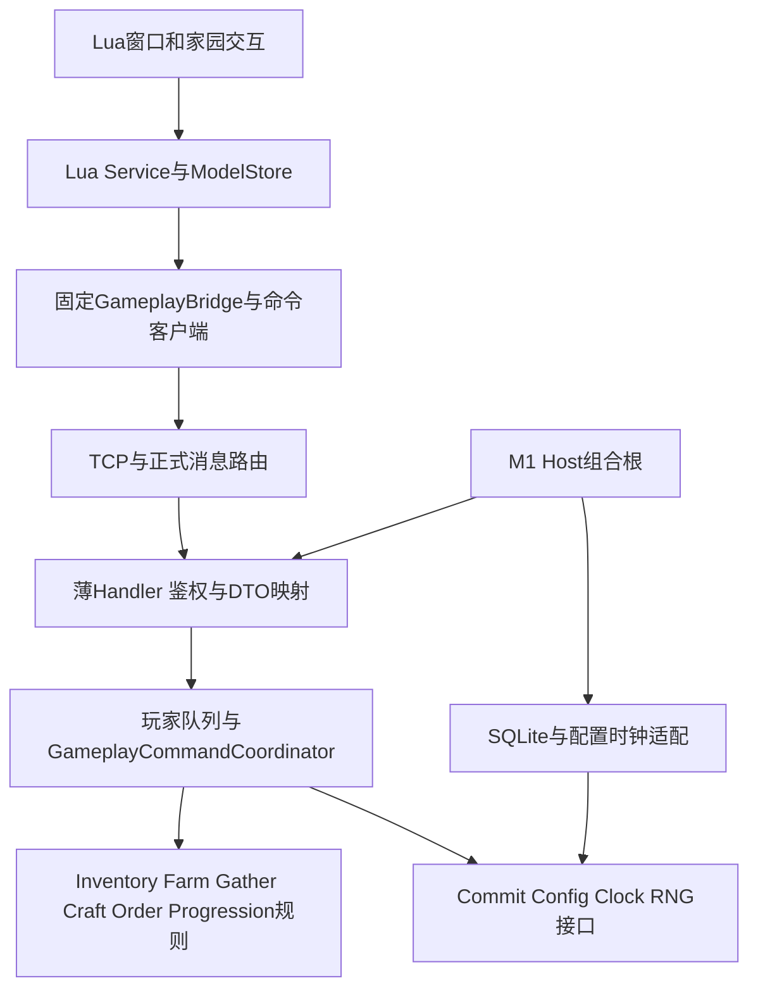

# M2 家园核心玩法：设计、任务与验收

版本：v1.0；编制日期：2026-10-21。**本文件是计划，M2尚未实施，所有任务与实际结果保持待办。**

## 0. 目标、依据与交付边界

目标：在M1框架上完成“购买种子→种植/采集→加工→交付订单→升级/解锁→继续生产”的经营闭环，Windows x64标准IL2CPP客户端与.NET 8服务端均可重建、保存和恢复。

依据：[总开发计划M2](06_开发计划.md)、[数值与配置](03_数值与配置表.md)、[协议权威说明](05_协议与接口.md)、[M1实现与复盘§9](06_M1_基础框架任务拆解.md#9-m1实际实现方法与问题复盘2026-10-21回填)。M1最终结果为T01–T68及58项通过；当前服务端225项、受影响PlayMode9项、基础69项、输入模态7项为回归基线，不把它们当作M2业务已完成。

| 纳入M2 | 后续里程碑 |
|---|---|
| 物品、堆叠/容量、出售/购买/扩容；成长与解锁 | M3家园装饰编辑、角色换装、新手引导及通用GM面板 |
| 播种/浇水/施肥/收获/批量拖拽；采集/冷却/掉落/工具升级 | M4广场同步与社交；M5抽卡和活动 |
| 设施建造/升级、生产槽、配方、领取、钻石加速 | 移动端适配、美术最终替换、大规模并发扩容 |
| 日订单、提交/刷新、跨日及3/6条里程碑奖励 | 访问/点赞他人家园、邮件溢出补偿等未定义业务 |
| 固定灰盒家园、真实Lua交互、离线8小时、30分钟节奏校准 | 实际支付、外部账号系统 |

M0灰盒、`Assets/Demo/Greybox`、旧`Program.cs`模式和`GreyboxMessages`仅作为规则/交互参考。先逐项评估可复用纯规则；正式M2接入M1 Host/协议/存档链，避免第二套账号、网络或资源系统。

### 0.1 版本与既有数据

- **拟定新基包AppVersion=0.4.0、bridge=m2-bridge-0.4，Res/Config=200；兼容数据补丁201。** M2新增固定C#桥/协议类型，必须新安装；不能将M1的100→101资源补丁变成M2代码升级。
- ProtoVersion默认继续1：新增字段/消息遵守现有兼容规则。如果T003确认改变了既有字段/ID语义，则先记录不兼容决策、改为2并验证106；不为“新增消息”机械递增版本。
- 当前SQLite schema=2。拟增加scope、命令账本和时间/初始化版本等数据，迁移版本由T005核实后登记，预计为3；高版本库拒绝降级。
- 新基包门槛同时覆盖Login和Reconnect：后者补充App/Res/Config/bridge信息，缺失或不兼容返回106，防止旧安装拿有效Token绕过更新检查。
- M1已提交数据及Token生命周期需回归。新家园状态初始化一次、版本化且可重入；不得因每次登录或读取配置重复赠送资产。
- 实施不排工时；原总计划的105小时仅为旧估算。每个小任务完成后按实际验证勾选，功能数量不是完成判据。

## 1. 软件设计原则与本项目约束

| 原则 | 在M2的具体落实 | 对应M1教训/验证 |
|---|---|---|
| 单一职责、内聚 | Handler处理鉴权/映射；Application协调命令；Domain计算规则；Repository负责SQL；Lua View仅展示/输入 | 禁止Host重复解绑，禁止巨型GameService把全部业务混在一起 |
| 依赖倒置 | Domain只依赖纯数据/接口；注入`IGameClock`、`IRandomSource`、`IGameConfigSnapshot`、提交端口；组合根创建具体实现 | 可用假时间/RNG验证离线与失败，生产规则无Unity/Socket/SQL依赖 |
| 小接口、组合 | Bag/Reward/Progression各有明确能力；统一事务协调器调用它们；优先组合而非按业务层层继承 | 防止窗口/网络取消跨层误改业务生命周期 |
| 明确所有权、状态机 | 玩家命令、连接、场景、窗口分别拥有生命周期；事务受理后不由UI关闭取消；终止码由一个拥有者通知一次 | 204内层自我取消漏通知；单连接异常曾扩大为Host停机 |
| 服务端权威 | 价格、产量、掉落、成熟/冷却、订单奖励和解锁均由服务器配置/时间计算；客户端仅显示预估 | 改本地时钟或请求携带伪造价格/奖励不能改变资产 |
| 原子性与幂等 | 状态、revision、命令结果同一DB事务；成功提交后才发通知/响应；重复请求重放结果 | M1内存64项窗口及5秒批量保存不足以保护经济写入 |
| 一致的数据投影 | 一个逻辑提交对应一个revision和一个增量批次，客户端完整校验后原子替换Model再刷新View | 网络成功不等于Lua模型已经成功应用 |
| KISS、渐进交付 | 一个模块化服务端进程、一个玩家聚合事务；每阶段形成可运行纵向闭环 | 暂不拆微服务、事件总线集群或通用工作流引擎 |
| 可观察、可重现 | 日志关联player/scope/op/msg/seq/revision；测试注入精确提交故障；每份报告绑定构建与配置指纹 | 不用文件存在、点击回执、空测试报告或硬编码文案冒充通过 |

以下接口、表和新消息均是拟实现契约，先在对应任务更新权威协议/配置，再生成代码；不是当前已有API。

## 2. 结构与依赖方向



图中接口实现与调用分开：Domain不反向调用Host，业务协调不直接创建Socket或Unity对象。

| 区域 | 拟路径 | 职责 |
|---|---|---|
| Domain | `Server/CloudIsle.Server/Gameplay/Domain/{Inventory,Farm,Gather,Craft,Orders,Progression}` | 不变量、纯规则、候选状态/领域结果 |
| Application | `Server/.../Gameplay/Application` | `GameplayCommandCoordinator`、`DailyReconciler`、查询、领域/协议映射 |
| Infrastructure | `Server/.../Gameplay/Infrastructure` | SQLite命令提交、账本/scope、只读配置适配、生产时钟/RNG |
| Transport | `Server/.../Gameplay/Handlers`、`Shared/Proto/*.proto` | 正式协议，复用MessageRouter/SessionRegistry，不从请求信任playerId |
| 固定客户端 | `Assets/Framework/Gameplay` | 允许列表桥、命令队列/本地待确认记录、revision比较、通知泵；不计算经济结算 |
| Lua业务 | `Assets/Lua/{Models,Services,UI/Windows,Home}` | 单一ModelStore、状态展示、输入意图、取消观察者 |
| 配置 | `Shared/config/{Defines,Datas}` | 保留已有18张表；明确补Shop、实例布局、初始化数据等缺口后由Luban生成 |
| 验证 | `Server/CloudIsle.Tests/M2`、`Assets/Tests/{EditMode,PlayMode}/M2`、`Tools/M2` | 纯规则、事务/协议、真实Native及经济模拟 |

初期使用现有服务端程序集中的目录边界；纯规则复用确有收益时才抽独立程序集。Proto生成结构只在边界映射，Domain不把可变protobuf对象直接交给View。

## 3. 先实施的写命令基础

### 3.1 操作身份、重试与跨设备

M1 `op_id`是本地按玩家递增；M2不能假定设备A和B共用同一计数文件。

1. 服务端登录签发并持久化`operation_scope_id`，与当前账号的写权限关联。Reconnect恢复同一scope；新的登录创建新scope并终止旧scope的新写权限。
2. 写命令身份为`(player_id, operation_scope_id, op_id)`。每scope从1单调递增；客户端同玩家同时最多一个待确认写命令，提交前持久化原payload、scope/op及版本。
3. 重试复用原scope/op和业务payload，仅seq随新连接重封；禁止超时后立刻换新op再次扣费。
4. 服务端先鉴权，再查持久账本。命中且摘要相同，返回原提交结果；同key不同payload明确冲突。原scope关闭后，有效新登录可查询自己旧命令的已记录结果；不存在的旧scope操作不能重新执行。
5. 每scope保存持久高水位；结果超过保留期或已淘汰后，旧op明确返回过期/需同步，不能因缓存miss重做。内存64条仅为加速缓存。
6. 新scope的排队写请求在玩家队列中验证权限；受理点之前取消可拒绝，受理后业务事务使用自己的完成范围。新登录/顶号也在同玩家队列排序，避免旧连接提交越过新登录。

拟表：`command_scope(scope_id, player_id, next_op_id, closed, created_at_ms)`；`command_receipt(player_id, scope_id, op_id, request_hash, code, committed_revision, result_blob, config_version, committed_at_ms)`；主键/唯一约束落实身份。`result_blob`存规范化业务结果及增量，不存原seq/Token/密码。

账本清理建议：只清超过7天的详细结果；保留scope墓碑/高水位。该期限在T002冻结为服务运行参数，并测试结果过期后不会二次执行；不是对无限历史结果的存储承诺。

### 3.2 一次命令的事务顺序

```text
鉴权/限长 → 同玩家队列 → 查持久账本并核验摘要
  命中：重封原结果/增量，不再次调用Domain或RNG
  未命中：核验scope/下一个op → 必要的跨日校正 → 版本/revision前置检查
        → 固定一次配置快照、服务器now、RNG边界 → Clone候选 → Domain校验/计算
        → SQLite事务：比较当前revision、写状态、写结果账本/高水位 → Commit
        → 队列内替换已提交缓存 → 同一增量批次Ntf → Resp
```

- 正常业务拒绝也记录确定性结果并推进该scope的op，重试返回相同拒绝；临时DB/服务故障在未提交时不伪造成功记录。
- Domain返回候选，不直接修改共享缓存。扣费、奖励、成长、槽位/地块变化必须一起验证和提交。
- `SqliteStore.ExecuteAsync`中执行同步事务；事务回调不await、不再次进入同一玩家/DB队列。锁顺序固定“玩家队列→DB队列”。
- `GameplayCommandCoordinator`是M2经济状态唯一写入口。M1 SaveService/Logout保存也必须纳入revision比较，旧快照不能覆盖较新的命令提交；不再依赖5秒后保存来确认扣费成功。
- DB提交后发布缓存失败时，标记该玩家缓存不可用并从DB重载；未完成重载前拒绝继续写。不能声称回滚了已经提交的DB。
- 客户端断线不会撤销已提交操作；通知或响应发送失败只结束该连接。下一次重试从账本恢复，Reconnect从DB完整快照恢复。

### 3.3 增量一致性与Lua应用

- 保留“数据通过Ntf、Resp只返回结果”的协议原则。拟新增`PlayerDeltaBatchNtf`（建议ID2110，T003查冲突后登记），包含`base_revision/new_revision`、scope/op、各模块变更与server_time。
- M2一次逻辑提交只发送一个完整批次；原模块Ntf定义保留，M2同一变更不重复发送两套通知。客户端先验证完整批次，在临时模型计算后一次替换，再通知各View。
- `new_revision <= current`丢弃重复；base不连续、解码/校验失败则停止业务输入并请求完整快照，禁止只更新金币而遗漏物品。
- 拟新增状态同步/命令结果查询2007/2008；每日里程碑领取6007/6008。二者均须先在05和proto确认ID/语义，不直接手写Generated。
- 已重放命令的旧增量可以被revision去重；若跨过缺口则完整同步。失败或旧响应不能回滚已应用的新状态。
- C#固定桥仅公开允许列表命令和DTO转换；建议`SendCommand(commandKey, dtoJson, done)`、`SubscribeDelta(handler)`、`SyncState(done)`，由GenAll固定AOT类型。Lua不能动态反射任意C#业务类型。
- 玩家ID、货币、revision、scope内op等64位值保留字符串；比较revision使用固定桥的64位比较函数，不经Lua `tonumber`损失精度。
- 窗口关闭仅释放观察者；全局ModelStore继续接收已提交增量。重新打开窗口从ModelStore重绘，不依赖已经销毁窗口的回调。

### 3.4 时间、离线与配置

| 契约 | 设计 |
|---|---|
| 权威时间 | `IGameClock`提供服务端有效UTC毫秒；每次处理固定一个now；客户端倒计时仅使用同步的ServerClock与本地单调计时 |
| 回拨 | 持久化有效时间下界，服务进程重启后不让已确认时间倒退；发现主机时钟异常记录诊断。服务器大幅前跳属于运维问题，不能宣称从客户端算法彻底消除 |
| 作物/加工/采集 | 存ready/finish/next_ready时间戳；离线不按帧补跑，不后台自动领取奖励；领取时验证now达到边界 |
| 跨日 | 固定UTC+8，刷新小时从Global读取并在T002冻结；按day_index判断，跨多日直接到当前日，不循环补发未领取日奖励 |
| 日校正 | `DailyReconciler`在玩家队列内单独幂等提交并发送新revision。若其更新使原写请求expected_revision过期，返回冲突并同步，禁止无提示使用旧订单继续扣物 |
| 配置适配 | 将Luban字符串材料/奖励表达式在加载时一次解析成只读类型；缺键/引用/重复实例/负价格在监听或启用前拒绝 |
| 一次配置版本 | 命令固定读取一份快照；结果账本记录版本。已提交旧结果优先重放，不因当前配置更新重新算奖励 |
| 长任务配置 | 播种固定收获规格；生产固定输出规格；订单固定需求/奖励；存配置版本和关键已接受参数。补丁更新不追改已经扣费启动的任务 |
| 热更边界 | 200→201只改已编译字段内的数据/Lua/资源；新增表结构、协议、桥类型/native要求新App基包 |

## 4. 各业务的规则和不变量

### 4.1 背包、商店、成长

- 复用Item/Level/Plot/Global源，适配`stack_default`等配置。占格按每种物品`ceil(count/maxStack)`求和；中间计算使用checked宽整数。未知ID、数量<=0、超上限、溢出和不足均拒绝。
- `InventoryPolicy.TryApply(state, deltas)`先聚合同物品增减，检查最终容量/非负，再生成候选；`RewardPolicy`统一奖励，`ProgressionPolicy`统一经验、连续升级和解锁，避免每模块各算一次。
- 购买价格/解锁/限购以服务器配置为准，客户端只提交商品ID和数量。当前Datas没有Shop正式表，T006补齐，不临时硬编码所有价格。
- 出售、购买、扩容、地块解锁均一事务。扩容档位/最大值读取Global，重复请求不重复扣款或加格子。
- Lv上限经验处理、等级奖励、初始地块/工具/种子一次赠送在T002列决策表；不擅自改变03已有经济值。

### 4.2 种植

```text
Locked --等级/费用解锁--> Empty --扣种子播种--> Growing
Growing --一次浇水/一次施肥调整deadline--> Growing
Growing --服务端now达到ready_time--> 可收获投影
可收获 --背包/奖励整体成功提交--> Empty
```

浇水/施肥按服务器处理时的剩余时间缩短，比例按Global，施肥同时扣肥料；已成熟或重复施加返回明确错误。材料与解锁在服务器校验。批量上限沿用05示例24并在T003明确；重复plotId整包拒绝，按plotId稳定排序；业务上允许逐地块结果，整个批次只用一次DB事务，DB失败整批回滚。记录每块结果供相同op重放，避免把重试变成再次收获。

### 4.3 采集

配置的GatherNode.Id/Code代表类型；地图实例使用独立node_instance_id并映射到配置Id，不能把G01显示Code或第几个可见对象当持久身份。校验解锁、工具与冷却；服务器RNG计算普通/稀有掉落，背包不足不推进冷却、不消耗成本。成功结果和随机结果写入账本，重试不重新抽样。工具升级仅影响后续采集。

### 4.4 加工

建造/升级按配置即时结算，除非T002明确引入建造时长；不凭空增加倒计时。设施/槽位实例身份稳定。启动生产一次扣除配方材料并保存输出规格/finish_time；领取校验成熟及容量，一次发奖并清槽。钻石加速按服务端剩余时间与配置计价，确认点击后剩余时间变化必须重新核验价格；不足不扣费，重复不重复加速/扣钻。

### 4.5 订单与每日奖励

- 读取OrderRule/Item/Recipe及玩家解锁集合，生成有限候选集合再抽样；禁止无界重试生成。需求、奖励、难度、rare标记和day_index在生成时固定。
- 奖励公式按03逐项实现并测试取整。提交校验当前day/order_id、未完成状态和库存，扣物/发奖/经验/进度一起提交。
- 刷新单条订单的费用和每日次数服务端验证；每日3/6条奖励独立显式领取，领取状态与奖励同事务，跨日清状态不重复发昨日奖励。
- **需要先解决的原文歧义**：03把“可立即完成”解释为“已持有或可由已解锁链生产”，总计划测试却写“至少2条可立即完成”。空背包时不可能在不赠送物品的情况下保证2条真正可提交。
- T002必须将两概念区分并同步03/05：建议“库存充分的测试输入至少2条真正可提交，且对这两条做合并库存分配；库存不足时至少2条已解锁可生产并明确降级原因”。这是拟定澄清，不能默默缩小原验收；确认并记录前，相关订单验收保持未通过。禁止伪造库存、零需求订单或重复礼包来满足指标。

## 5. 分阶段任务（80个最小交付动作）

每行交付一个可检查动作。`[ ]`表示未实施；依赖写前置任务尾号。验证产物统一进入`Docs/Acceptance/M2/<run-id>`，整理后的可上传证据进入`Docs/Delivery/M2`；原始缓存/凭证不上传。

### 阶段A：基线、协议与配置（M2_01 Log）

先核对M1和PoC的真实边界，冻结会影响事务和玩法的决策，完成协议/schema生成后再进入写业务。

| 任务 | 依赖 | 具体交付 | 验证/退出条件 |
|---|---|---|---|
| [ ] M2-T001 | M1 | 登记源码提交/依赖/当前DB、Proto/配置版本，列PoC复用清单；干净目录重建M1基础测试 | 来源清单明确；225/9/69/7基线真实结果可追溯，不假定后续数量恒定 |
| [ ] M2-T002 | 001 | ADR冻结scope/账本期限、受理取消、跨日/时区、订单歧义、奖励容量和初始数据策略 | 每个决策有输入例/预期/边界；未决玩法规则不进入实现 |
| [ ] M2-T003 | 002 | 更新05，登记scope/revision/DeltaBatch/同步查询/日奖消息及错误码，核查全部ID/字段号 | 无重复/改义；旧字段保留或reserved；协议兼容决策明确 |
| [ ] M2-T004 | 003 | 新增inventory/farm/gather/craft/order/shop/sync正式proto，扩展gen_proto正式输入白名单与描述集 | 全类型进入MsgRegistry，重复ID负例非0且旧成功生成物保持 |
| [ ] M2-T005 | 003 | schema迁移增加scope/账本/时间与初始化版本；M1快照映射/迁移 | M1库升级、空库初始化、重复迁移、高版本拒绝均通过 |
| [ ] M2-T006 | 002 | 补Shop/地图实例/初始化配置缺口，材料奖励字符串解析成只读类型 | 缺引用/重复实例/非法数量失败；两端导出SHA一致 |
| [ ] M2-T007 | 004/006 | 固定GameplayBridge允许列表、DTO及xLua生成配置；scope/op/revision64位保真 | 禁止任意类型调用；大于2^53值往返精确；GenAll后编译 |
| [ ] M2-T008 | 005/006 | 初始状态候选构造/映射与grant_version规格；本项不发放或写入资产 | 纯构造/映射可测；真正一次发放必须经T011/T012，不能走旧5秒保存旁路 |

### 阶段B：可靠写入与同步（M2_02 Log）

先用最小测试命令验证“提交后丢响应仍只执行一次”，再允许正式扣费业务接入。

| 任务 | 依赖 | 具体交付 | 验证/退出条件 |
|---|---|---|---|
| [ ] M2-T009 | 004/005 | scope签发/持久恢复/关闭，登录与顶号串行衔接；有效旧Token仅在合格M2重连时一次补scope | 两设备本地同op不冲突；旧scope不能发新写；重连恢复相同scope；旧安装不能绕过106 |
| [ ] M2-T010 | 009 | command_receipt仓储、唯一键、高水位及CanonicalCommandHasher；首版经济路径直接查持久账本 | 同key异payload拒绝；seq不影响摘要；M1内存窗不能承接持久或业务拒绝语义 |
| [ ] M2-T011 | 010 | GameplayCommandCoordinator原子提交候选状态/账本/revision | 提交任一点故障无半扣半奖；提交结果可重放 |
| [ ] M2-T012 | 008/011 | SaveService/Logout纳入revision守卫，提交后替换/重载缓存；初始赠送经同一协调器一次发放 | 旧快照不能覆盖新状态；缓存失败可恢复；注册/迁移/重复登录不重复发放 |
| [ ] M2-T013 | 007/010 | 客户端CommandClient持久待确认单写队列，重试复用scope/op/payload | 超时/退出重开/新登录旧命令查询，均不重复执行或静默丢意图 |
| [ ] M2-T014 | 011 | PlayerDeltaBatchNtf投递与Resp排序；账本重放重封新seq | 增量先于响应；通知发送失败不回滚DB或停Host |
| [ ] M2-T015 | 014 | Lua ModelStore临时模型校验/原子应用/revision去重与全量同步 | 重复/乱序/缺口/坏DTO不会形成半更新模型 |
| [ ] M2-T016 | 005/011 | IGameClock、持久时间下界、DailyCalendar/DailyReconciler | 本地/服务器回拨边界、跨日一次、跨多日不补发奖励 |
| [ ] M2-T017 | 013/015 | 窗口观察者与命令生命周期分离，错误分类与重试提示 | 关窗后命令仍完成，Model更新；204/106停止，业务拒绝不盲重试 |
| [ ] M2-T018 | 012–017 | 真实Host故障注入回归：提交前失败/提交后断网/提交后强杀/旧会话 | 只影响故障连接；原DB与账本恢复；其他玩家持续可用 |

### 阶段C：背包、商店与成长（M2_03 Log）

建立全业务共用的资产修改入口，再做购买、出售与升级的真实纵向流程。

| 任务 | 依赖 | 具体交付 | 验证/退出条件 |
|---|---|---|---|
| [ ] M2-T019 | 006/011 | InventoryPolicy聚合同物品变化、堆叠/占格/非负/溢出 | 容量边界、负数、重复ID、超长输入与checked运算通过 |
| [ ] M2-T020 | 019 | RewardPolicy统一物品/货币奖励并做最终容量预检 | 多来源奖励一次生效，拒绝后无局部资产变化 |
| [ ] M2-T021 | 020 | ProgressionPolicy经验、多级升级、上限/解锁及等级奖励 | 连升边界、重复奖励、满级处理符合T002 |
| [ ] M2-T022 | 019/014 | BagSell正式Handler与账本接入 | 扣物/加金币同提交；重复请求/库存不足正确 |
| [ ] M2-T023 | 019/014 | BagExpand档位/费用/上限实现 | 第1–5次及上限边界；重复不重复扩容扣款 |
| [ ] M2-T024 | 019/016 | ShopBuy价格、限购、等级、跨日计数 | 伪造价格无效；扣款/入包/限购同提交 |
| [ ] M2-T025 | 021 | PlotUnlock正式规则与稳定plot_id | 按配置等级/费用，已解锁/不足无重复扣费 |
| [ ] M2-T026 | 015/022–025 | Lua Inventory/Shop/Progression Service与窗口 | 生产按钮→真实协议→增量→UI，关窗无泄漏 |
| [ ] M2-T027 | 024/026 | 灰盒家园入口和最小购买/出售纵向联调 | Native买种子/出售/扩容、退出重开资产一致 |
| [ ] M2-T028 | 018/027 | 经济入口重复/断线/强杀回归及资产守恒检查 | 任意重试不会负数、双扣或双奖；新问题留Log并复验 |

### 阶段D：种植闭环（M2_04 Log）

用现有配置先完成一块地的完整流程，再扩展批量输入；UI倒计时不参与成熟结算。

| 任务 | 依赖 | 具体交付 | 验证/退出条件 |
|---|---|---|---|
| [ ] M2-T029 | 025/016 | FarmState/PlotState机、类型化deadline与播种时收获规格 | 空地/生长/成熟投影/解锁状态边界正确 |
| [ ] M2-T030 | 029/019 | Plant单地块命令扣种子/写deadline | 无种/未解锁/非空地拒绝且无变化 |
| [ ] M2-T031 | 030 | Water一次标记与剩余时间比例 | deadline前后边界、重复和已成熟处理正确 |
| [ ] M2-T032 | 031/020 | Fertilize扣肥料与时间缩短同提交 | 不足/重复/失败不吞肥料或改deadline |
| [ ] M2-T033 | 030/021 | Harvest整体验容量/发奖/经验/清地 | ready-1/ready时刻；满包保持作物；重复只一次 |
| [ ] M2-T034 | 030/033 | 批量规范化、最多24、稳定顺序、逐项结果与整事务 | 重复plotId拒绝；部分业务成功可重放；DB失败整批回滚 |
| [ ] M2-T035 | 026/034 | 灰盒地块、选种、状态/倒计时、拖拽批量意图 | 模态不透传；输入只生成意图；断线遮罩阻止新写 |
| [ ] M2-T036 | 035/018 | 买种→播种→水/肥→收获→出售Native闭环与重开 | 真实UI/DB一致；离线/补丁不改变已接受deadline/产量 |

### 阶段E：采集与工具（M2_05 Log）

先固定地图实例身份，再做掉落与升级，确保显示对象和持久状态有稳定对应。

| 任务 | 依赖 | 具体交付 | 验证/退出条件 |
|---|---|---|---|
| [ ] M2-T037 | 006/008 | node_instance_id映射与初始化，配置数量/类型校验 | 多个同类点独立冷却，非法实例拒绝 |
| [ ] M2-T038 | 037/019/016 | Gather校验解锁/工具/冷却/容量与生产RNG适配 | 边界时刻、满包不推进冷却、普通/稀有可控测试 |
| [ ] M2-T039 | 038/010 | 随机结果随提交/账本持久化 | 同op跨重启结果一致，不能断线重抽 |
| [ ] M2-T040 | 021/019 | ToolUpgrade材料/金币/等级同提交 | 级别上限与材料不足；仅影响后续采集 |
| [ ] M2-T041 | 015/039/040 | Lua采集点/工具窗口与冷却展示 | 正式UI和服务端实例一致；时间漂移不改结算 |
| [ ] M2-T042 | 041 | Native采集/升级/离线冷却与重试联调 | 重登/强杀无重复产出，未提交失败不丢材料 |

### 阶段F：加工（M2_06 Log）

槽位与材料/成品采用同一资产规则；只有领取时发奖，客户端销毁不会取消生产。

| 任务 | 依赖 | 具体交付 | 验证/退出条件 |
|---|---|---|---|
| [ ] M2-T043 | 006/021 | Facility/Slot实例状态与建造规则 | 等级/金币/重复建造检查，不生成重复槽 |
| [ ] M2-T044 | 043 | FacilityUpgrade与槽位扩展/占用策略 | 升级成本/上限正确，已有生产不丢失 |
| [ ] M2-T045 | 043/019/016 | CraftStart扣材料并固定输出/finish_time | 未解锁配方/设施不匹配/忙槽拒绝，无半扣 |
| [ ] M2-T046 | 045/020 | CraftCollect整体发奖与清槽 | 成熟边界、满包保持、重复领取不发双份 |
| [ ] M2-T047 | 045 | CraftSpeedup剩余时长计价及确认价格核验 | 取整/钻石不足/已完成/重复请求均正确 |
| [ ] M2-T048 | 044–047/015 | Lua加工UI、槽位/配方/领取/加速确认 | 正式按钮与增量一致，关窗生产继续 |
| [ ] M2-T049 | 048 | Native建造→生产→离线→领取/加速与重启回归 | 扣材料到成品守恒；8小时后不自动重复发奖 |

### 阶段G：订单与日切（M2_07 Log）

把“真正可提交”与“可生产”分开，先实现有界、可验证的生成算法，再接入提交和日奖励。

| 任务 | 依赖 | 具体交付 | 验证/退出条件 |
|---|---|---|---|
| [ ] M2-T050 | 002/006 | OrderCandidateBuilder按解锁链生成有限候选集合 | 无未解锁/不可达物品；空集合有明确结果，不无限循环 |
| [ ] M2-T051 | 050/019 | OrderGenerator库存分配、难度比例、服务端RNG | 库存充足至少2条真正可提交；不足按已冻结澄清处理 |
| [ ] M2-T052 | 051 | OrderRewardCalculator实现03公式与取整，生成时固定结果 | 固定示例与边界逐项一致，稀有加成不重复抽 |
| [ ] M2-T053 | 052/020 | OrderSubmit扣物/奖励/经验/进度同提交 | 完成/过期/不足/重复提交无双扣双奖 |
| [ ] M2-T054 | 051/016 | OrderReroll费用/次数/新ID与日切 | 超次数、不足、跨日旧订单安全拒绝 |
| [ ] M2-T055 | 053/016 | 每日3/6条显式领奖，day_index与claimed同事务 | 第3/6条边界、重复领奖、跨日不补发旧奖励 |
| [ ] M2-T056 | 053–055/015 | Lua订单面板/可提交/可生产/材料去向/领奖提示 | 客户端不自算奖励；日切后旧按钮不误提交 |
| [ ] M2-T057 | 056 | 真实Native订单生成/提交/刷新/日奖联调 | 库存与DB一致，断线重试/午夜边界/强杀通过 |

### 阶段H：家园整合与可用性（M2_08 Log）

在已有纵向交互上统一布局、输入与错误反馈，不能用一个全能Home脚本替代模块职责。

| 任务 | 依赖 | 具体交付 | 验证/退出条件 |
|---|---|---|---|
| [ ] M2-T058 | 035/041/048/056 | 固定灰盒地图标定、相机与实例选择；配置/场景ID对齐 | 无持久ID碰撞；不引入M3自由摆放 |
| [ ] M2-T059 | 058/015 | HUD货币/等级/背包/订单入口统一订阅与整批刷新 | 全量恢复和增量结果一致，订阅可清理 |
| [ ] M2-T060 | 059 | 错误码到可读反馈/确认/忙状态映射 | 满包/不足/未成熟/冲突/204/106均有明确路径 |
| [ ] M2-T061 | 060 | 切场景/关窗/模态/拖拽/失焦/断线组合验证 | 无透传和重复请求，处理中的写命令不依赖窗口存活 |
| [ ] M2-T062 | 061 | 三分辨率/safearea/资源租约/池生命周期回归 | 1280×720、1920×1080、1080×1920可用，反复切换回基线 |
| [ ] M2-T063 | 059/016 | 全量重连恢复所有模块与UI倒计时 | 不保留旧模型脏显示；完整快照足够且不超当前帧限 |
| [ ] M2-T064 | 063 | M1账号/补丁/资源/连接隔离回归 | 新业务错误不拖垮其他账号或全局Host |

### 阶段I：模拟、构建与最终验收（M2_09 Log）

先用同一规则适配器做可重复模拟，再通过真实安装验证闭环；模拟时间加速不能代替真实试玩的节奏结论。

| 任务 | 依赖 | 具体交付 | 验证/退出条件 |
|---|---|---|---|
| [ ] M2-T065 | 036/042/049/057 | 经济模拟入口：固定配置/策略/seed、30分钟与8小时样本 | 输出操作轨迹/资产守恒/升级时间，复用正式规则而非复制公式 |
| [ ] M2-T066 | 065 | 多seed/背包压力/订单可达性报告，记录Lv5–7节奏偏差 | 零负资产/无界循环；置信范围和偏差如实记录，不只挑成功seed |
| [ ] M2-T067 | 066 | 数值调整只改源表，导出/回归/模拟再比较 | 每次调整有前后差异及原因；失败导出不污染目标 |
| [ ] M2-T068 | 064/067 | 构建脚本去M1专属硬编码，支持新0.4/200与基线输出 | 完整协议/GenAll/配置/Yoo/IL2CPP，缺工具非0，路径带空格 |
| [ ] M2-T069 | 068 | 固定唯一200基包、配置、source/依赖/native指纹与三SHA | 干净目录重建可追溯，冻结后禁止改固定代码做201 |
| [ ] M2-T070 | 069/065 | 新账号Native真实纵向闭环并记录可分享截图/操作轨迹 | 购买→种植/采集→加工→订单→升级/解锁，每步DB与UI相符 |
| [ ] M2-T071 | 070 | 原库重登/8小时离线/客户端时间±24h验收 | 通过测试时钟输入，不改用户OS时间；结算只受服务器影响 |
| [ ] M2-T072 | 070 | 提交前/提交后强杀、丢Ntf/Resp、结果重放、账本过期验收 | 每个操作最多一次资产变化，缓存与DB最终一致 |
| [ ] M2-T073 | 070 | 两设备同时写/顶号/新scope/旧命令查询、第三玩家存活 | 无op碰撞/旧scope新写；无抢回；无全局停服 |
| [ ] M2-T074 | 069/067 | 同安装200→201兼容数据/Lua补丁，已有生产任务跨版本 | 固定输出与deadline保持，三安装SHA相同，坏资源真Retry |
| [ ] M2-T075 | 070/066 | 真实约30分钟新账号试玩与节奏记录 | Lv5–7目标偏差有评估/校准；无GM/调速冒充实际试玩 |
| [ ] M2-T076 | 071–075 | 完整NUnit/Unity报告、模拟结果、原生截图与日志扫描 | 实际数量>0、必需项失败/跳过0，凭证不进入可上传证据 |
| [ ] M2-T077 | 076 | 冻结候选对应验收矩阵，每项写具体步骤/预期/实际/证据 | 不按CLI退出0或照片路径存在盲勾，适用来源一致 |
| [ ] M2-T078 | 077 | 回填M2各Log、权威03/05、任务表/总计划与问题复盘 | 保留真实失败与解决链，未完成项不能掩盖 |
| [ ] M2-T079 | 078 | 干净checkout验证构建入口、迁移、忽略/交付清单 | 无本机绝对路径依赖，不含测试账号/DB/安装缓存 |
| [ ] M2-T080 | 079 | M2最终验收记录与发布候选说明 | 所有冻结决策/必需验收通过才标M2完成 |

## 6. 必需验收矩阵

实际结果在执行前统一为“待执行”。每项需绑定App/Proto/配置/提交版本；同一场景的单位测试与Native验证分开记，不能互相冒充。

| 编号 | 名称/具体步骤 | 预期结果 | 实际 |
|---|---|---|---|
| A01 | M1库迁移→登录→重复登录→重启 | 原数据保持、初始礼包只一次 | 待执行 |
| A02 | 两设备相同本地op、不同scope写 | 独立身份，不碰撞；旧scope权限正确 | 待执行 |
| A03 | 同key同payload跨重启重放、同key异payload | 前者同结果且一次执行，后者明确冲突 | 待执行 |
| A04 | 内存第65项淘汰后发旧op；再单独测试持久详情超过保留期 | L1 miss回源DB，未过期重放原结果；仅持久详情已清理时返回过期/同步，均不重执行 | 待执行 |
| A05 | 注入提交前失败、DB只读、提交后丢响应/强杀 | 无半扣半奖、重试从账本恢复、已提交不丢 | 待执行 |
| A06 | 挂起旧SaveService快照，先提交新命令再恢复旧保存 | 新revision与数据不被覆盖 | 待执行 |
| A07 | Ntf重复/乱序/缺口/部分解码失败 | 原子应用或全量同步，无半更新 | 待执行 |
| A08 | 命令处理中关窗、切场景、退出客户端 | 已受理事务完成，观察者释放、重开正确 | 待执行 |
| B01 | 满包/堆叠临界/负数/超量/溢出/未知物品 | 正确拒绝或结算，不出现负数/溢出 | 待执行 |
| B02 | 买/卖/扩容/解锁及重复请求 | 成本和资产同提交，配置档位正确 | 待执行 |
| B03 | 一次奖励连续升级、满级和解锁 | 等级/奖励正确且只一次 | 待执行 |
| C01 | 种植→一次水/肥→成熟前1ms/边界收获 | 时间与消耗符合配置，成熟前拒绝 | 待执行 |
| C02 | 批量重复ID/24上限/部分失败/DB失败重试 | 规范化明确、业务部分结果可重放、DB失败整批回滚 | 待执行 |
| C03 | 满包收获后扩容再收 | 第一次不丢作物，第二次仅发一次 | 待执行 |
| D01 | 同类型多采集点、缺工具/冷却边界 | 实例独立，权限/工具检查正确 | 待执行 |
| D02 | 固定RNG验证普通/稀有掉落，提交后丢响应重试 | 分布边界可测，同命令不重抽 | 待执行 |
| D03 | 升工具并切配置/重登 | 成本一次，后续采集用新等级 | 待执行 |
| E01 | 建/升设施，起生产，关窗/离线 | 槽位不丢，材料只扣一次 | 待执行 |
| E02 | 成熟前/后领取、满包领取、重复领取 | 不早领/吞成品/双发 | 待执行 |
| E03 | 加速取整、钻石不足、确认价格变化及重复 | 正确计价，拒绝后不扣，重复不再扣 | 待执行 |
| F01 | 充足库存/不足库存/空背包/候选空集合生成订单 | 按T002冻结澄清验证，真正可提交与可生产分开 | 待执行 |
| F02 | 多seed难度比例、奖励公式、稀有加成 | 可达、有界、公式和取整一致 | 待执行 |
| F03 | 提交/刷新/第3及第6条领奖，重复和断线 | 不重复扣物/发奖，次数/费用准确 | 待执行 |
| F04 | 刷新前1ms/边界/跨多日、旧订单点击 | 日切一次，旧订单不误提交，昨日奖不补发 | 待执行 |
| G01 | 离线8小时再登录，作物/生产/节点均有任务 | deadline投影正确，未领取不自动双发 | 待执行 |
| G02 | 客户端测试时钟±24h，服务端回拨边界/重启 | 客户端无权改变结果，服务端时间下界保持 | 待执行 |
| G03 | 断线/强杀恢复后全模块快照与HUD比较 | DB/Model/View一致，无旧模型残留 | 待执行 |
| G04 | A故障退出/恶意包、B持续操作、HTTP与新TCP | 单连接隔离，B和Host继续可用 | 待执行 |
| H01 | 三窗口尺寸+safearea、模态与拖拽、20次开关 | 可用、无透传、订阅/租约回基线 | 待执行 |
| H02 | 生产200安装→201数据补丁→旧任务领取 | 三SHA相同，任务已固定规格不被追改 | 待执行 |
| H03 | 坏资源/不兼容桥/重复协议ID/非法配置 | 可见失败、非0/不激活、保留最后可用产物 | 待执行 |
| H04 | 同规则经济模拟及真实30分钟新号试玩 | 资产守恒、Lv5–7偏差已评估和校准 | 待执行 |
| H05 | 全部报告、源码指纹、可上传日志/凭证扫描 | 实际用例数与候选一致，0必需失败/跳过/私密值匹配 | 待执行 |

## 7. 实施命令与接口说明

### 7.1 当前已有命令

从完整工程根运行；不依赖本机固定盘符。参数不是凭证，命令输出不打印Token或请求正文。

```powershell
$projectRoot = (Get-Location).Path
$protoc = (Get-Command protoc -ErrorAction Stop).Source
pwsh -NoProfile -File Tools/gen_proto.ps1 -RepoRoot $projectRoot -ProtocPath $protoc
# Luban当前适配器使用Windows PowerShell 5.1；M2配置/schema完成后导200。
powershell.exe -NoProfile -File Tools/gen_config.ps1 -RepoRoot $projectRoot `
  -SourceDir (Join-Path $projectRoot 'Shared/config') `
  -ExporterPath (Join-Path $projectRoot 'Tools/Luban/Luban/Luban.dll') -ConfigVersion 200
dotnet test Server/CloudIsle.Tests/CloudIsle.Tests.csproj -c Release `
  --logger 'trx;LogFileName=m2.trx' --results-directory Docs/Acceptance/M2/current/server
```

M2 proto白名单尚未扩展，M2类型/数据尚未落地；以上生成命令在当前状态不等同完成M2。

### 7.2 T068后才可执行的构建示例

```powershell
pwsh -NoProfile -File Tools/build_client_win.ps1 -RepoRoot $projectRoot `
  -AppVersion 0.4.0 -ResVersion 200 -OutputDir 'Builds/M2/Base 200'
pwsh -NoProfile -File Tools/build_patch.ps1 -RepoRoot $projectRoot `
  -AppVersion 0.4.0 -ResVersion 201 -ConfigVersion 201 `
  -BaseBuildManifest 'Builds/M2/Base 200/baseline-manifest.json' -OutputDir 'Builds/M2/Publish'
pwsh -NoProfile -File Tools/run_server.ps1 -RepoRoot $projectRoot `
  -DatabasePath 'Server/Data/M2/m2.db' -ConfigDirectory 'Server/ConfigLuban' `
  -ConfigVersion 200 -RequiredConfigVersion 200 -AppVersion 0.4.0 -ResVersion 200 `
  -TcpPort 17780 -HttpPort 18080 -ContentRoot 'Builds/M2/Publish'
```

示例中的配置与发布目录必须先生成；端口占用应明确失败，不停止其他服务。构建输出存在时选择新候选目录，不覆盖已验收产物。PlayMode/EditMode命令沿M1的`-runTests -testPlatform -testFilter -testResults -logFile`，实际过滤条件按已存在M2用例登记；测试数为0必须失败。

### 7.3 核心拟接口的参数职责

| 接口 | 参数/返回含义 |
|---|---|
| `ExecuteAsync(identity, command, shutdownCt)` | identity由已鉴权会话产生；command含scope/op/expected_revision/版本及业务DTO；受理后不用窗口/连接取消令牌中断提交 |
| `ICommandCommitStore.Commit(expectedRevision, candidate, receipt)` | 同一事务比较版本并写状态/结果；返回已提交revision，失败不能发布候选 |
| `InventoryPolicy.TryApply(state, deltas, config)` | 聚合同物品变化并检查最终容量/非负/溢出；返回候选或明确业务拒绝 |
| `IGameClock.NowMs` / `IRandomSource.Next` | 一次处理固定now；RNG由服务端拥有，测试可替换，结果随提交持久化 |
| `ApplyBatch(baseRevision, newRevision, changes)` | 临时模型校验后原子替换；返回Applied/Duplicate/NeedFullSync，不部分应用 |
| `SubscribeDelta(handler)` | 返回明确可Dispose租约；窗口释放自身订阅，不释放全局ModelStore或业务事务 |

## 8. Log结构与验收纪律

每阶段先写对应`Assets/ReferenceDoc/Logs/M2_01_Logs.md`等，再实施。模板如下，实际值只能执行后填写：

```markdown
## M2-Txxx 任务名称
### 任务介绍
自然语言描述玩家流程、输入/输出、涉及的拥有者、失败边界。
### 最小步骤清单
- [ ] 修改哪个文件/函数，为什么；具体源码与参数/函数注释。
- [ ] 实际命令、配置/DB/版本、输出路径、退出码检查。
### 验证
| 名称 | 具体步骤 | 预期结果 | 实际结果 | 证据 |
|---|---|---|---|---|
| ... | ... | ... | 待执行 | 待产生 |
### 问题与方案
| 触发情况 | 发生问题 | 确认原因/待验证假设 | 修复方式 | 复验结果 |
|---|---|---|---|---|
| ... | ... | ... | ... | 待执行 |
```

只在对应门槛通过后勾任务；真实失败报告保留。修复影响固定C#后重新冻结安装；只改测试夹具且完整指纹相同，可以保留Native产物适用性。每个阶段先实现一个可见纵向流程，不并发改同一状态/协议。电量检查沿用户当前要求保持暂停，恢复需用户明确指令。

## 9. 风险与修复方向

| 风险 | 预防/发现方式 | 修复顺序 |
|---|---|---|
| 旧保存覆盖新经济提交 | revision条件写、同玩家队列、受控并发测试 | 先统一CommitCoordinator，再接玩法 |
| 多设备op冲突/旧账本清理后双执行 | scope、高水位、拒绝过期、登录串行 | 先协议/DB身份，再重试UI |
| 断线/关窗导致半扣半奖 | 候选状态、单事务、受理完成范围 | 先提交点故障注入，再做领取按钮 |
| 配置热更追改生产结果 | 记录已接受规格/配置版本，跨版本旧任务测试 | 先冻结配置策略，再发布201 |
| 未解锁或空库存下订单不可达 | 有限候选、合并库存分配、区分可提交/可生产 | T002先解决需求歧义，不靠隐藏赠送修补 |
| 大量模块一次集成才暴露问题 | 按C→D→E→F→G逐个纵向Native闭环 | 每阶段关闭问题，不把缺口留到最后矩阵 |
| 测试环境依赖前台/本机绝对路径 | 明确输入更新与焦点、独立临时目录、干净checkout | 仅修夹具时验证指纹，不随意重建业务 |

## 10. 原则依据与项目决策区分

- [Microsoft：领域模型及分层](https://learn.microsoft.com/en-us/dotnet/architecture/microservices/microservice-ddd-cqrs-patterns/ddd-oriented-microservice)：参考按业务内聚组织模型、分离领域与展示的原则；本项目采用单进程模块边界，没有由该资料推出必须部署微服务。
- [SQLite：事务控制](https://www.sqlite.org/lang_transaction.html)：作为提交/回滚及单写事务约束的依据；具体队列、scope与账本结构为本项目设计。
- [Microsoft：重试模式](https://learn.microsoft.com/en-us/azure/architecture/patterns/retry)：参考区分临时故障和终止故障、评估有副作用重试的原则；不能以加退避替代业务幂等。

版本号、账本保留期、目录/任务编号、增量批次及订单澄清均为本次拟定项目决策。需按阶段冻结并实测，当前不登记为已经实现或验证。
