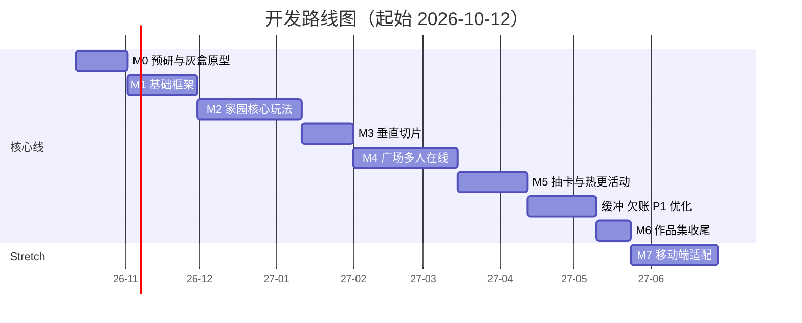
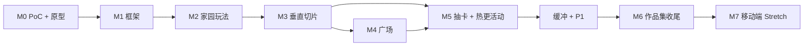

# 06 开发计划


> 单人开发、每周约 15~20 小时（按平均 **17.5 小时/周**估算）。

> 本计划同时是**进度跟踪表**：完成一项就勾选一项，并在文末更新“进度看板”。


---


## 1. 计划总览


### 1.1 前提与估算方法


| 项 | 说明 |

|---|---|

| 起始日期 | 2026-10-12（周一），日期可整体平移 |

| 每周投入 | 约 17.5 小时（工作日 2×3 小时 + 周末 2×5.5 小时，仅作参考） |

| 估时单位 | 小时（h），含编码、调试、写日志；**不含**大量美术制作（美术用素材包 / 低模，见 M3、M6） |

| 缓冲 | 核心线额外预留 4 周（约 15%）用于欠账、P1 功能与性能优化 |

| 核心线总计 | 约 28 周开发 + 4 周缓冲 ≈ **32 周（约 7.5 个月）**（v1.1：配置表改 Luban，M0 +6 h、M1 +4 h，共 +10 h ≈ 0.6 周，由缓冲吸收，周期不变） |

| 含 Stretch | 移动端 +5 周，合计约 **37 周（约 8.5 个月）** |


### 1.2 里程碑总表


| 里程碑 | 名称 | 周期 | 估时 | 一句话目标 | 可演示产物 |

|---|---|---|---|---|---|

| M0 | 预研与灰盒原型 | 3 周 | 61 h | 技术可行 + 核心循环好玩 | PoC 报告、灰盒可玩原型 |

| M1 | 基础框架 | 4 周 | 79 h | 热更 + 联网 + 配表 + UI 框架跑通 | 登录进空家园；热更一个面板 |

| M2 | 家园核心玩法 | 6 周 | 105 h | 种→采→加工→订单→升级闭环 | 30 分钟闭环（v0.1） |

| M3 | 垂直切片 | 3 周 | 52 h | 20 分钟可对外演示的体验 | 演示录屏 v1、性能记录 #1 |

| M4 | 广场多人在线 | 6 周 | 105 h | 多人同屏稳定、可压测 | 机器人压测数据、广场录屏 |

| M5 | 抽卡与热更活动 | 4 周 | 70 h | 纯热更上线新卡池 | 热更演示录屏 |

| 缓冲 | 欠账 / P1 / 优化 | 4 周 | 70 h | 补齐 P1，性能达标 | 性能记录 #2 |

| M6 | 作品集收尾 | 2 周 | 35 h | 文档、README、视频就绪 | **作品集可发布版本** |

| M7（Stretch） | 移动端适配 | 5 周 | 88 h | Android 中端机流畅运行 | 真机演示、性能对比 |


### 1.3 路线图





按起始日期推算的大致时间：M0 至 11 月初；M1 至 11 月底；M2 至次年 1 月中；M3 至 1 月底；M4 至 3 月中；M5 至 4 月中；缓冲至 5 月中；M6 至 5 月底。


### 1.4 依赖关系





> M5 的抽卡服务端与客户端 UI 部分不依赖广场，必要时可在 M4 后期提前并行；但**广场抽卡 NPC 入口**依赖 M4。


---


## 2. 迭代与工作方式


| 项 | 约定 |

|---|---|

| 迭代长度 | 2 周；每个迭代结束产出一个**可运行的 PC 构建** |

| 每周复盘 | 周日 15 分钟：本周完成什么 / 卡在哪 / 下周计划，写入 `Docs/DevLog/` |

| 时间盒 | 任何 spike（技术验证）超过估时的 2 倍，必须停下评估：换方案 / 降范围 / 记录风险 |

| 范围控制 | 新想法先写入 Backlog，**不当场实现**；每个里程碑开始时再决定是否纳入 |

| 先竖后横 | 每个系统先做“最小闭环（客户端 + 服务端 + 配置）”，再扩展内容量 |

| 数据驱动 | 一个功能完成前，其数值必须已在配置表中，不允许硬编码 |

| 服务端校验 | 涉及时间 / 随机 / 货币的功能，**先写服务端规则与单元测试**，再接客户端 |

| 性能习惯 | 每个里程碑运行一次 `PerfLogger`；每月一次 Android 真机构建（不要求达标，仅发现问题） |

| 提交习惯 | 每天结束前提交；每个里程碑打 tag（`m0`~`m6`） |


### 里程碑退出条件（通用）


每个里程碑结束前，必须全部满足：


- [ ] 本里程碑任务清单全部勾选（或明确移入 Backlog / 砍掉并记录原因）

- [ ] 对应的自测清单（`02_玩法设计.md` 第 15 节）条目通过

- [ ] 产出可演示构建；录制 1 段 30~60 秒录屏或 GIF

- [ ] DevLog 记录本阶段关键问题与解决方式

- [ ] 性能记录已更新（M2 起）

- [ ] 相关文档已回填（PoC 结论、ADR、配置表、协议）

- [ ] Git 打 tag


---


## 3. 各里程碑详细任务


> 格式：`[ ] 任务（估时）`。估时为参考，**以验收标准为准**。


### M0：预研与灰盒原型（3 周 / 61 h）


**目标**：证明“技术能做、玩法好玩”，冻结技术栈。


#### 3.0.1 工程准备（约 3 h）


- [x] 创建 Git 仓库、LFS 配置、`.gitignore`、目录结构（见 `04` 第 4 节）（2 h）

- [x] 建立 Unity 6000.3 + URP 工程，完成首次 Windows 打包（1 h）【PoC #1】


#### 3.0.2 技术 PoC（历史 M0 记录，约 47 h）

> 以下勾选/结论保留当时环境，不能作为 xLua 验收。当前专项见 [07](07_xLua迁移方案与PoC.md)。旧 Android 勾选不代表新栈已真机验证。


- [x] 【#2】HybridCLR：构建并运行热更 DLL；修改热更代码后仅替换补丁生效（8 h）— *已通过（用户确认闭环）；见 PoC_HybridCLR_操作说明.md*

- [x] 【#3】YooAsset 本地补丁模式：修改 Prefab，补丁下发后显示新内容（6 h）— *已通过：YooAsset 3.0.6 OfflinePlayMode；v1→v2 StreamingAssets 替换后显示新 Prefab（见 `PoC_YooAsset_操作说明.md`）*

- [x] 【#4】Protobuf 在热更代码中序列化 / 反序列化，处理 AOT 泛型（5 h）— *已通过：热更 Entry.RunProtobufPoC；LoginReq/Resp + repeated/map；见 PoC_Protobuf_操作说明.md*

- [x] 【#5】`Game.Shared` 前后端共享源码，客户端与服务端均可编译（3 h）— *已通过：Server/CloudIsle.Shared 同源编译；见 PoC_GameShared_操作说明.md*
- [x] 【#6】最小服务端（.NET 8）：TCP 监听 + 登录 + SQLite 读写一条数据（6 h）— *已通过：PacketCodec + Login/AddGold + SQLite；见 PoC_ServerTcp_操作说明.md*

- [x] 【#7】导表：Excel / CSV → 数据文件 + 代码生成，双端读取（5 h）— *已通过（自写管线，现作为 Luban 回退基线）：xlsx→JSON+ConfigTables.g.cs；见 PoC_ConfigExport_操作说明.md*

- [x] 【#7b】Luban 接入（时间盒内部分通过）：Datas+Defines+导表+双端读取+ref+改值重导；Tool 联合主键回退 list；见 PoC_Luban_操作说明.md

- [x] 【#9】换装合并最小 Demo：6 部位→1 SMR/1 材质（URP Unlit）+ LRU64 + 40 人压测；见 `PoC_换装合并Demo_操作说明.md`（2026-10-13 通过）

- [x] 【#10】空广场 + 100 机器人：EnterOk=100、掉线 0、Tick P99≈5~8ms、10 min 稳态；见 `PoC_服务端稳定性测试_操作说明.md`（2026-10-13 通过）

- [x] 【#8】Android 真机跑通同一 Demo（时间盒 4 h，**可延期**至 M1，不阻塞）


#### 3.0.3 灰盒玩法原型（约 10 h）


- [x] 平面场景 + 3×3 地块 + 1 个设施 + 订单板（方块表示）+ GuideUI（`Assets/Demo/Greybox`，见 `灰盒玩法测试_操作说明.md`）

- [x] 背包 + 播种→成熟→收获 + 加工 + 订单交付（**TCP + 服务端权威**；grow=10s / craft=8s；`verify_greybox.ps1` T02–T13≈30s 通过，2026-10-13）

- [x] ~~朋友试玩~~ **已砍**；改为 GuideUI 逐步验收 T01–T13（无外部试玩）


#### 3.0.4 文档与决策（约 1 h 之内完成，穿插进行）


- [x] 将 PoC 结论回填到 `04_技术方案与架构.md` 末尾；更新 ADR；必要时启用回退方案


**验收标准**


- [x] PoC #1~#7 均有明确结论（通过 / 回退），技术栈已冻结

- [ ] PoC #7b 结论已回填 `04` §15，ADR-12 状态明确（采纳 / 回退自写管线）

- [x] 灰盒原型：联网闭环 ≤300s（实测 ~30s）；见 `灰盒玩法测试_操作说明.md` §7

- [ ] 若 #2 或 #3 失败：已按回退方案调整，并确认对计划的影响


---


### M1：基础框架（4 周 / 79 h）

> M0 旧 HybridCLR/Android 勾选保留原文，仅作历史；不得解释为新栈移动端已通过。

**xLua 迁移说明**：固定 C# AOT 基础与 Lua 业务经生成桥接互调。旧 HybridCLR 安装需新基包；迁移PoC为0.2.0；正式M1最终基包0.3.0 / ProtoVersion1 / bridge m1-bridge-0.3，100→101 发生在新 xLua 安装内。迁移/清理另记 [07](07_xLua迁移方案与PoC.md)；正式账号、UI、Launcher和完整恢复已于2026-10-21通过58项验收，见 [最终验收记录](../../Docs/Delivery/M1/M1_Acceptance.md)。原工时是原估算，迁移复盘后重评。


**目标**：搭好“后面所有功能都要用到的地基”，**不做玩法**。


#### 客户端


- [x] Launcher：版本检查、Lua/资源下载校验、进度界面、LuaIndex/桥接兼容检查、入口就绪后提交活动版本（12 h）

- [x] 资源管理封装（加载 / 释放 / 句柄 / 引用计数 / 泄漏报告）（8 h）

- [x] 网络层：TCP、帧编解码、请求 / 响应匹配、超时、心跳、重连、op_id（10 h）

- [x] 事件总线、对象池、计时器、日志（文件日志）（4 h）

- [x] UI 框架：Lua 控制器 + 固定 C# 宿主；窗口栈 / 层级 / 生命周期 / Toast / 通用弹窗 / Safe Area；取消与租约释放（10 h）

- [x] 场景管理：Launcher → Login → Home 切换 + Loading（3 h）

- [x] 输入抽象 `IInputProvider` + 鼠标键盘实现（2 h）


#### 服务端


- [x] 工程骨架：TCP 会话、Pipelines 收包、消息路由、Handler 注册（8 h）

- [x] 数据层：SQLite 访问、玩家缓存、脏标记与定时落库、玩家串行队列（6 h）

- [x] 账号：注册 / 登录 / Token / 重连 / 顶号（6 h）

- [x] 静态文件服务（补丁 + 版本信息）（2 h）

- [x] 日志（Serilog）与基础指标输出（2 h）


#### 工具与流程


- [x] `gen_proto.ps1`：生成 C#、`MsgRegistry`、ID 校验（4 h）

- [x] 配置导表管线切换到 Luban（8 h，依赖 PoC #7b）：按 `03` §13 迁移全部业务表（`Datas/*.xlsx` + `__tables__/__beans__/__enums__`）、`ConfigTests` 校验、新旧管线逐字段对比、`gen_config.ps1` 改造（导出 + 校验 + 同步双端目录 + `config_version`）、`Game.Config` 程序集接入；`gen_config.py` 移入 `Tools/legacy/`

- [x] `build_client_win.ps1`、`build_patch.ps1`、`run_server.ps1`（3 h）：基包前生成桥接并重编译；补丁核对 AOT/Proto/native/bridge 基线，输出 LuaIndex、Lua TextAsset、资源与兼容配置。

- [x] NUnit 测试工程骨架 + 第一条测试（1 h）


**验收标准**


- [x] 新账号注册 → 登录 → 进入空白家园场景，退出重登数据保持

- [x] **演示热更**：新 xLua 基包内不重装客户端，101 新增 Lua 模块/文案与兼容 Global 键、真实新Prefab（T63已验收）；100 无这些专属内容；exe/GameAssembly/global-metadata 哈希不变。

- [x] 断线重连：拔网线 / 杀服务端后重启，客户端能自动恢复

- [x] 三个一键脚本可用；测试工程可运行

- [x] 配置经 Luban 导出：改一项数值重导后，服务端读到新值、客户端仅靠补丁读到新值；新旧导出对比差异清零；校验失败时不覆盖目标目录


---


### M2：家园核心玩法（6 周 / 105 h）

具体设计、80个最小任务与验收见[06_M2_开发计划.md](06_M2_开发计划.md)；当前为计划，尚未开始实施。


**目标**：完成“种植 → 采集 → 加工 → 订单 → 升级”的完整经营闭环（先灰盒表现）。


每个子系统遵循：**配置表 → 服务端规则 + 单测 → 协议 → 客户端 Model/Service → View**。


- [ ] 物品与背包：物品表、堆叠、容量、出售、BagChangeNtf（10 h）

- [ ] 种植：地块、播种 / 浇水 / 施肥 / 收获、批量拖拽、成熟判定（时间戳）（18 h）

- [ ] 采集：采集点、工具、冷却、稀有掉落、工具升级（10 h）

- [ ] 加工：设施建造 / 升级、槽位、配方、领取、钻石加速（16 h）

- [ ] 订单：生成算法、交付、刷新、每日里程碑奖励、跨日刷新（16 h）

- [ ] 成长：经验 / 等级 / 解锁、LevelUpNtf、解锁提示（8 h）

- [ ] 商店：购买 / 出售 / 背包扩容 / 地块解锁（10 h）

- [ ] 家园场景：固定地图灰盒搭建，地块 / 设施 / 采集点布置（9 h）

- [ ] 经济模拟脚本 + 数值校准（参见 `03` 第 14 节）（8 h）


**验收标准**


- [ ] 自测清单中“种植 / 采集 / 加工 / 订单 / 成长”全部通过

- [ ] 新账号 30 分钟左右完成闭环并升到 Lv5~7；与 `03` 的节奏目标偏差已评估并校准

- [ ] 离线 8 小时后重登，作物 / 加工 / 采集冷却状态正确

- [ ] 修改本地系统时间不影响任何结果

- [ ] 订单生成单元测试覆盖：至少 2 条可立即完成、难度比例、奖励公式


---


### M3：垂直切片（3 周 / 52 h）


**目标**：把“可玩”变成“可展示”：有引导、有换装、有装饰、有初步美术。


- [ ] 家园装饰：编辑模式、网格摆放 / 旋转 / 收纳、碰撞占位、布局保存（14 h）

- [ ] 新手引导：7 步强引导、进度存服务端、可跳过（10 h）

- [ ] 角色与换装：角色模型 + 6 部位 + 合并网格 / 图集 + 缓存 + 装扮界面（16 h）

- [ ] 调试面板（GM）：加资源 / 跳等级 / 完成计时 / 重置 / 活动开关（4 h）

- [ ] 美术替换第一轮：家园场景、UI 皮肤、作物与设施模型（用素材包）；统一风格（8 h）


**验收标准**


- [ ] 一个陌生人在 **20 分钟内**能在无指导下完成引导并体验主要玩法

- [ ] 6 部位换装同步到服务端，重登保持

- [ ] 家园布局保存后重登一致，摆放无重叠

- [ ] **性能记录 #1**：家园场景 PC ≥ 60 FPS，DrawCall ≤ 200

- [ ] 录制演示录屏 v1（1~2 分钟）


---


### M4：广场多人在线（6 周 / 105 h）


**目标**：多人同屏稳定，可压测，有数据可展示。


- [ ] 广场场景搭建 + 导出可行走格文件（服务端校验用）（14 h）

- [ ] 服务端：分线管理、实体、AOI 九宫格、Tick 循环、批量差量广播（20 h）

- [ ] 服务端：移动校验（速度 / 可行走）、纠正推送、断线保位 30 秒（10 h）

- [ ] 客户端：进入 / 离开、本地玩家移动与预测、他人位置插值、纠正处理（16 h）

- [ ] 客户端：实体管理、距离分级渲染（LOD）、同屏上限控制（12 h）

- [ ] 外观同步：进入视野时拼装他人外观，变更推送（6 h）

- [ ] 表情（6 种）+ 气泡聊天 + 频率限制 + 简易敏感词（10 h）

- [ ] **机器人客户端**：登录 / 进入广场 / 随机移动 / 表情聊天，可配数量（10 h）

- [ ] 压测与优化：Tick 耗时、带宽、客户端渲染；输出报告（7 h）


**验收标准**


- [ ] 两个真人客户端互相可见、移动平滑、表情 / 聊天正常

- [ ] **100 机器人**稳定 30 分钟：无崩溃，掉线率 < 1%，Tick 耗时 < 20 ms（记录实测值）

- [ ] 超速 / 瞬移被服务端拒绝并纠正

- [ ] 客户端同屏 40 个完整角色，PC ≥ 60 FPS

- [ ] 录制广场录屏（含机器人场景）


---


### M5：抽卡与热更活动（4 周 / 70 h）


**目标**：完成“不重装客户端，上线一个新卡池”的完整演示。


- [ ] 服务端：抽卡逻辑（保底 / UP / 重复转碎片 / 事务 / 记录）（12 h）

- [ ] `gacha_sim` 工具 + 抽卡单元测试（10 万次模拟对照 `03` 第 11 节）（6 h）

- [ ] 客户端：卡池界面、单抽 / 十连、抽卡表现（Timeline）、结果展示（16 h）

- [ ] 概率公示页、抽卡记录、碎片商店（8 h）

- [ ] 活动框架：服务端活动配置 / 推送；客户端入口配置化（广场公告板 + 主界面）（12 h）

- [ ] 制作“春日野餐”卡池：6 件限时外观、活动界面、配置、资源包（8 h）

- [ ] `build_patch.ps1` 完善 + 热更演练 + 录屏（按 `04` 第 9 节演示脚本）（8 h）


**验收标准**


- [ ] 10 万次模拟统计与公示概率一致（偏差在统计误差范围内）；保底 / UP / 分池独立规则正确

- [ ] 重复请求不重复扣费；卡池关闭后抽卡被服务端拒绝（902）

- [ ] **完整热更演示**：旧版客户端不重装，仅靠补丁 + 服务端配置完成卡池上线 → 开启 → 结束

- [ ] 录制热更演示视频（2~3 分钟，作品集核心素材）


---


### 缓冲阶段：欠账 / P1 / 优化（4 周 / 70 h）


**目标**：补齐 P1 功能、清理欠账、让性能达标。按以下顺序，做到哪算哪：


| 优先级 | 任务 | 估时 |

|---|---|---|

| 1 | M0~M5 遗留缺陷与欠账清单清零 | 弹性 |

| 2 | 性能优化：对照 `04` 第 8 节预算，修复超标项；输出**性能记录 #2**（含优化前后对比） | 16 h |

| 3 | F23 画质分档（低 / 中 / 高） | 8 h |

| 4 | F20 访问好友家园（只读 + 点赞） | 10 h |

| 5 | F24 简版成就 / 日常任务（5~8 项） | 12 h |

| 6 | F25 调试面板补全；热更自检脚本 | 4 h |

| 7 | 美术替换第二轮：广场场景、角色、外观图标、特效 | 弹性 |

| 8 | 全流程回归（自测清单逐项） | 6 h |


**验收标准**


- [ ] 全部 P0 功能通过自测清单；已完成的 P1 功能通过自测

- [ ] 性能达标（见 `01` 第 6 节），并有优化前后对比数据

- [ ] 无阻断性缺陷；连续试玩 60 分钟无崩溃


---


### M6：作品集收尾（2 周 / 35 h）


**目标**：把项目变成**别人看得懂、看得上**的作品。


- [ ] README：简介、核心特性、截图 / GIF、架构图、技术亮点、运行方式、素材来源（8 h）

- [ ] 导出并整理图表：架构图、热更流程、广场同步、抽卡时序（Mermaid → 图片）（3 h）

- [ ] 演示视频（3~5 分钟）：脚本 → 录制 → 剪辑（12 h）

  建议结构：① 经营闭环（60 s）② 广场与机器人（60 s）③ 热更新上线新卡池（90 s）④ 性能数据与架构（60 s）

- [ ] 文档回填：PoC 结论、ADR、最终配置表、最终协议表、性能记录汇总（5 h）

- [ ] 素材与开源库授权清单 `ThirdParty-LICENSES.md`（2 h）

- [ ] 干净环境验证：新克隆仓库 → 按 README 能构建并运行（含服务端）（3 h）

- [ ] （可选）技术文章 1~2 篇：热更新方案、广场同步与压测（弹性）


**验收标准**


- [ ] 他人仅凭 README 能在 30 分钟内跑起来（至少客户端 + 本地服务端）

- [ ] 演示视频与截图就绪；所有素材授权已登记

- [ ] 仓库内无敏感信息（密钥、个人路径）

- [ ] 打 tag `v1.0`


---


### M7（Stretch）：移动端适配（5 周 / 88 h）


**触发条件**：M6 完成且仍有精力。不影响作品集主线。


- [ ] `TouchInput`：点击 / 拖拽 / 摇杆，PC 与移动共用玩法层（12 h）

- [ ] UI 适配：Safe Area、触控热区、不同分辨率与比例（12 h）

- [ ] 画质与资源：ASTC 压缩、贴图尺寸降档、Shader 变体精简、画质自动分档（14 h）

- [ ] Android 构建：xLua + YooAsset + IL2CPP 真机验证，匹配平台/架构原生库并生成桥接；Windows 结果不能代替（10 h）

- [ ] 中端机性能优化：DrawCall / 内存 / 发热 / 加载时间（24 h）

- [ ] 前后台切换、弱网、重连专项（8 h）

- [ ] 真机测试 3~5 台（高 / 中 / 低端各至少 1 台）+ 记录（8 h）


**验收标准**


- [ ] 中端机家园 ≥ 30 FPS；广场同屏 ≥ 30 角色可接受

- [ ] 连续游玩 30 分钟无崩溃，发热与电量在可接受范围

- [ ] 真机热更演示成功；更新 README 与性能对比表


---


## 4. 砍功能线（进度落后时的决策表）


> 落后超过 **2 周**时，不加班硬赶，按顺序砍；每次砍功能都在“变更记录”中登记（`01` 第 12 节）。


| 顺序 | 可砍项 | 对作品集的影响 |

|---|---|---|

| 1 | M7 移动端整体 | 小：作为“后续计划”写入 README |

| 2 | F24 成就 / 日常任务 | 小 |

| 3 | F20 访问好友家园 | 小 |

| 4 | 画质分档 F23 | 小（仅保留固定画质） |

| 5 | 聊天（保留表情） | 中：广场仍可展示多人同步 |

| 6 | 采集系统简化：仅保留树木与浆果丛，砍掉工具升级 | 中 |

| 7 | 家具数量压缩到 5 件；砍掉设施 Lv3 | 中 |

| 8 | 抽卡限时池只保留 UP 规则，砍掉碎片商店 | 中 |


**不可砍（核心）**：服务端权威的经营闭环、热更新（代码 + 资源 + 配置）、广场多人同步与压测数据、抽卡服务端与热更上线新卡池、README 与演示视频。


---


## 5. 风险与应对（计划视角）


| 风险 | 触发信号 | 应对 |

|---|---|---|

| M0 技术栈不兼容 | PoC #2 / #3 超时 2 倍仍未通过 | 立即启用回退方案；不继续深挖 |

| M2 范围膨胀 | 单个子系统超估时 50% | 砍内容量（作物 / 配方数量），保规则完整 |

| 广场联调 bug 多 | 同步抖动难排查 | 先用机器人复现；加详细日志；简化同步（降低频率、放宽校验） |

| 美术拖延 | 美术相关任务连续两周占比 > 30% | 回到素材包；降低风格要求；统一后处理 / 配色提升观感 |

| 动力不足 / 时间被打断 | 连续 2 周投入 < 8 h | 缩小下周目标为“只做一个可演示点”；必要时触发砍功能线 |

| 环境 / 版本问题（Unity、SDK 升级） | 编辑器或包更新导致编译失败 | 冻结 Unity 与关键包版本；升级必须在独立分支验证 |

| 数据丢失 | 误操作 / 磁盘故障 | Git 远程仓库每日推送；数据库与资源定期备份 |


---


## 6. 记录模板


### 6.1 每周复盘（`Docs/DevLog/YYYY-WW.md`）


```markdown

# 2026-W42 复盘

- 本周投入：__ h（计划 17.5 h）

- 完成：

  - [x] ……

- 未完成 / 原因：

  - [ ] ……

- 遇到的问题与解决（现象 → 原因 → 解决）：

  1. ……

- 下周计划（≤ 5 项）：

  1. ……

- 范围变更 / 新想法（进入 Backlog）：

  - ……

```


### 6.2 踩坑记录（`Docs/DevLog/Pitfalls.md`，面试素材）


```markdown

## [xLua] 委托未退订导致 LuaEnv 释放失败（示例标题，不代表本项目实测故障）

- 现象：……

- 原因：……

- 解决：……

- 教训：……

```


### 6.3 性能记录（`Docs/Perf/`）


| 日期 | 里程碑 | 场景 | 平台 / 机型 | FPS（均值 / 1% low） | DrawCall | 三角面 | 内存峰值 | 备注 / 优化项 |

|---|---|---|---|---|---|---|---|---|

| | | | | | | | | |


### 6.4 Backlog（`Docs/Backlog.md`）


| 编号 | 想法 / 需求 | 来源 | 价值（高 / 中 / 低） | 成本（h） | 决定（纳入 Mx / 不做） |

|---|---|---|---|---|---|

| | | | | | |


---


## 7. 进度看板


> 每周日更新。状态：未开始 / 进行中 / 已完成 / 延期 / 已砍。


| 里程碑 | 计划起止 | 实际起止 | 状态 | 实际投入 / 估时 | 备注 |

|---|---|---|---|---|---|

| M0 预研与灰盒原型 | 10-12 ~ 11-01 | 10-12 ~ | 进行中 | ~36 / 61 h | PoC #1✔…#10✔；§3.0.3 灰盒联网闭环✔（`verify_greybox` ~30s）；#7b△ / #8 可延期 |

| M1 基础框架 | 11-02 ~ 11-29（原计划） | 2026-10-21 | 已完成 | 未统计 / 79 h（原估算） | xLua / Windows x64，T01–T68及58项验收通过 |

| M2 家园核心玩法 | 11-30 ~ 01-10 | | 未开始 | / 105 h | |

| M3 垂直切片 | 01-11 ~ 01-31 | | 未开始 | / 52 h | |

| M4 广场多人在线 | 02-01 ~ 03-14 | | 未开始 | / 105 h | |

| M5 抽卡与热更活动 | 03-15 ~ 04-11 | | 未开始 | / 70 h | |

| 缓冲 欠账 / P1 / 优化 | 04-12 ~ 05-09 | | 未开始 | / 70 h | |

| M6 作品集收尾 | 05-10 ~ 05-23 | | 未开始 | / 35 h | |

| M7 移动端（Stretch） | 05-24 ~ 06-27 | | 未开始 | / 88 h | |


**P0 功能完成度**


| 编号 | 功能 | 状态 |

|---|---|---|

| F01 | 账号登录与存档 | [ ] |

| F02 | 背包与物品 | [ ] |

| F03 | 种植 | [ ] |

| F04 | 采集 | [ ] |

| F05 | 加工 | [ ] |

| F06 | 订单 | [ ] |

| F07 | 成长 | [ ] |

| F08 | 家园场景（含装饰） | [ ] |

| F09 | 广场场景 | [ ] |

| F10 | 角色外观 | [ ] |

| F11 | 抽卡 | [ ] |

| F12 | 热更新（代码 + 资源 + 配置） | [ ] |

| F13 | 新手引导 | [ ] |


**作品集交付物**


| 交付物 | 状态 |

|---|---|

| README（含截图 / GIF / 架构图） | [ ] |

| 演示视频（3~5 分钟） | [ ] |

| 6 份核心文档（已回填最终内容） | [ ] |

| 性能记录与优化前后对比 | [ ] |

| 机器人压测报告 | [ ] |

| 素材与开源授权清单 | [ ] |

| 可运行构建（PC） | [ ] |

