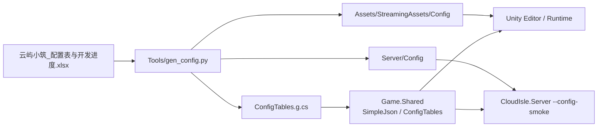

<!-- XLUA-MIGRATION:BEGIN -->
> **迁移说明（2026-10-19）：本文件保留历史原文。**
> 当前热更架构调整为 xLua；旧记录中的技术名称和“已通过”仅描述当时环境，不能解释为 xLua 已验证。
> 这是原 PoC 的历史操作记录，原代码与结果保留。与热更实现无关的协议、配置、资源和玩法经验可复用；涉及 HybridCLR、热更 DLL 或补充元数据的操作已由 xLua 方案取代，不应作为当前生产流程执行。
> 当前设计、验证范围和证据见 [xLua 迁移方案与 PoC](../07_xLua迁移方案与PoC.md)。
<!-- XLUA-MIGRATION:END -->

# PoC #7 导表：Excel → JSON + 代码生成，双端读取

> 数据源：`Assets/ReferenceDoc/云屿小筑_配置表与开发进度.xlsx`  
> Unity **6000.3.22f1** / .NET **8**；对应 `06_开发计划.md` M0 · `04` §12 #7

---

## 1. PoC 需要实现的目标

| 目标 | 通过标准 | 状态 |
|---|---|---|
| 读取项目配置 Excel | 17 张业务表导出（跳过说明/校验/进度/计算器页） | ✔ |
| 产出数据文件 | `StreamingAssets/Config/*.json` 与 `Server/Config/*.json` 一致 | ✔ |
| 代码生成 | `Assets/Shared/Config/Generated/ConfigTables.g.cs` | ✔ |
| 客户端可读 | 编辑器菜单加载 StreamingAssets，读到 Item/Global | ✔ |
| 服务端可读 | `--config-smoke` 读同一份 JSON | ✔ |
| 改表重导生效 | 覆盖 `bag_init_slots` 后服务端读到新值 | ✔ |
| 失败回退 | 自写 CSV/JSON 管线（本 PoC 即回退方案） | ✔ |
| Luban 主路径 | 见 §7：当前 **03 + 现有 xlsx 尚不足以直接喂 Luban**，需先补格式/元数据 | ✖ 未接入 |

**一句话**：用自写导表工具把 xlsx 导出为 JSON + Shared C# 表类，客户端与服务端加载同一数据；改值重导后两端都能读到新值。

---

## 2. 工具的类图和功能（可视化）



### Excel 约定

| 行 | 含义 |
|---|---|
| 1 | 字段名 |
| 2 | 类型（`int/long/float/string/bool`；`calc` 跳过） |
| 3 | 注释 |
| ≥4 | 数据 |

字段名以 `#` 开头的列不导出。

### 菜单 / 脚本

| 入口 | 功能 |
|---|---|
| `Farming/Config PoC/1. Generate From Excel` | 调用 `gen_config.py` |
| `Farming/Config PoC/2. Verify Export + Server Read` | `verify_config.ps1` |
| `Farming/Config PoC/3. Load StreamingAssets Config` | 客户端读表冒烟 |
| `Tools/gen_config.ps1` / `gen_config.py` | 命令行导表 |
| `Tools/verify_config.ps1` | 基线 → 覆盖重导 → 校验 → 恢复 |

---

## 3. 工具方法与工程过程（有序）

1. 放置 / 更新 `Assets/ReferenceDoc/云屿小筑_配置表与开发进度.xlsx`
2. 运行 `python Tools/gen_config.py`（或 Unity 菜单 1）
3. 得到 JSON（双目录）+ `ConfigTables.g.cs`
4. 客户端：菜单 3；服务端：`dotnet run --project Server/CloudIsle.Server -- --config-smoke`
5. 修改 Excel 后重复 2，两端应读到新值

**PoC 验证期望输出（服务端）**

```
[Config PoC] Server OK ... bag_init_slots=60 item1001=小麦/8 cropC01.growSec=120
```

覆盖重导后 `bag_init_slots=61`。

---

## 4. 遇到的问题和解决办法

| # | 问题 | 解决办法 |
|---|---|---|
| 1 | Luban 未接入 | 见 §7：03/xlsx 缺 Luban 表头与 `__tables__` 等元数据，先自写管线闭环；补齐后再迁 Luban |
| 2 | Shared 不能依赖 UnityEngine.JsonUtility | 手写 `SimpleJson` 解析导表 JSON |
| 3 | Tool / GachaPoolItem 主键不唯一 | 仅对取值唯一的字段生成 `Get` 字典 |
| 4 | OrderCalc / GachaSim 非数据表 | `SKIP_SHEETS` 排除 |

---

## 5. 关键路径速查

| 用途 | 路径 |
|---|---|
| Excel 源 | `Assets/ReferenceDoc/云屿小筑_配置表与开发进度.xlsx` |
| 导表脚本 | `Tools/gen_config.py` |
| 客户端数据 | `Assets/StreamingAssets/Config/` |
| 服务端数据 | `Server/Config/` |
| 生成代码 | `Assets/Shared/Config/Generated/ConfigTables.g.cs` |
| 运行时 | `Assets/Shared/Config/SimpleJson.cs` |

---

## 6. 与下一 PoC 的关系

配置管线已可用；后续 M1「配置导表接入工作流」应在补齐 §7 后迁到 Luban，或继续增强本脚本。PoC **#9/#10** 不依赖本 PoC 运行时。

---

## 7. Luban 接入可行性评估（相对 `03_数值与配置表.md` / 现有 xlsx）

### 7.1 结论

| 维度 | 是否足够 | 说明 |
|---|---|---|
| 业务表清单与字段语义 | **基本足够** | 03 有表清单、字段名、类型约定、ID 段、初版数值；xlsx 已落地多数表 |
| 直接作为 Luban 工程输入 | **不足** | 缺 Luban 表头标记、`__tables__` 注册、主键/mode、列表写法、工程入口等 |
| 当前动作 | **不执行 Luban 配置与测试** | 按「不支持则先补文档」执行；补齐下列项后再接入 |

对照 Luban 4.x 约定：数据表 **A1 必须以 `##` / `##var` 开头**，否则整表被忽略；并需在 `__tables__.xlsx`（或等价 Schema）中注册每张表。

### 7.2 已有、可复用的内容（不必重写数值）

以下内容已能支撑「业务表定义」，迁 Luban 时可直接映射：

- 表清单：`Global / Item / Crop / GatherNode / Tool / Facility / FacilityLevel / Recipe / Level / Plot / OrderRule / Furniture / AvatarItem / GachaRule / GachaPool / GachaPoolItem / Activity`
- 基础类型：`int / long / float / string / bool`（03 §13）
- 字段名与注释、初版行数据（xlsx 第 4 行起）
- `#` 前缀列 = 不导出（与 Luban「`#` 开头字段为注释列」一致）
- 主键直觉：`Item.id`、`Crop.id`、`Global.key` 等

### 7.3 必须补充到「文件内容」的项（否则 Luban 无法正确吃表）

请在 **`03_数值与配置表.md` §13（或新建 §15 Luban）** 与 **`云屿小筑_配置表与开发进度.xlsx`（或拆出的 `Config/Datas/`）** 中补充如下。

#### A. Excel 表头格式（每张业务表）

把现有「第 1 行字段 / 第 2 行类型 / 第 3 行注释」改为 Luban 可识别表头，例如：

| 行 | 现有写法 | 需改为（示例） |
|---|---|---|
| 字段名 | `id, name, …`（A1=`id`） | A1=`##var`，其后为 `id, name, …` |
| 类型 | `int, string, …` | A1=`##type`，其后为类型 |
| 注释 | 中文说明 | A1=`##` 或 `##comment`，其后为注释 |
| 分组（可选） | 无 | A1=`##group`，按需填 `c` / `s` / `c,s` |
| 数据行 | 第 4 行起 | 紧接表头；注释行首列以 `##` 开头 |

**现状问题**：当前 A1 为 `key`/`id` 等，**不以 `##` 开头**，Luban 会忽略整张 Sheet。

#### B. 表注册：`__tables__.xlsx`（或 XML Schema）

为每张导出表增加一行注册（列名以 Luban 模板为准），至少包含：

| 列 | 含义 | 本项目示例 |
|---|---|---|
| `full_name` | 生成表类名 | `TbItem`、`TbCrop`… |
| `value_type` | 行 bean 名 | `Item`、`Crop`… |
| `read_schema_from_file` | 从数据表头推断字段 | 建议 `true`（与 ##var/##type 配套） |
| `input` | 数据文件 | `item.xlsx` 或 `Item@云屿小筑_….xlsx` |
| `index` | 主键 | 见下表 C |
| `mode` | `map` / `list` / `one` | 见下表 C |
| `group` / `comment` | 可选 | 双端共用可留空 |

03 与 xlsx **均未包含**该注册表。

#### C. 主键与表模式（03 未写死，必须补）

| 表 | 建议 `index` | 建议 `mode` | 原因 |
|---|---|---|---|
| Item / Crop / GatherNode / Facility / Recipe / Furniture / AvatarItem / Activity | `id` 或 `activityId` | `map` | 单主键 |
| Global / OrderRule / GachaRule | `key` | `map` | KV 表 |
| Level | `level` | `map` | |
| Plot | `stage` | `map` | |
| FacilityLevel | `level` | `map` | 若日后按设施分表需改 |
| GachaPool | `poolId` | `map` | |
| **Tool** | `toolId+level` | `map` 或 `list` | **单列不唯一**（每种工具多等级） |
| **GachaPoolItem** | `poolId+itemId`（或 `list`） | `map`/`list` | **poolId 不唯一** |
| OrderCalc / GachaSim | — | **不进 Luban** | 计算器/模拟页，非配置数据 |

#### D. 列表 / 复合字段写法（与 Luban 类型对齐）

03 §13 写的是：

- 列表用 `;`，如 `3001:2;3002:1`
- 范围用 `~`，如 `2~3`

Luban 侧通常需要**显式类型**（如 `(id#num)` bean 列表、`list,int`、`array,int` 等），不能只写「字符串里塞分号」。请在 03 中为下列字段补「Luban 类型 + 单元格示例」：

| 表.字段 | 现状 | 需补充 |
|---|---|---|
| `Global.bag_expand_costs` / `order_reroll_costs` | `500;1000;…` 字符串 | 定为 `list,int`（或保留 string 并声明不解析） |
| `Crop.stageRatio` | `25;25;25;25` | `list,int` 或 string |
| `GachaPool.upItemIds` | 字符串 | `list,int` |
| Recipe / Tool / FacilityLevel 材料列 | 拆成 `mat1_id/mat1_n` | 可维持多列，或改为 `list,(ItemId#Count)` 并给示例 |
| 枚举（`Item.type`、`AvatarItem.part/rarity`） | 自由字符串 | 可选：建 `__enums__.xlsx`（`ItemType` 等），或继续 `string` 并写明不生成枚举 |

#### E. 表完整性缺口（文档有、工程无）

| 项 | 03 | 现有 xlsx | 补充要求 |
|---|---|---|---|
| `Shop` | §9.1 有分类说明 | **无 Shop Sheet** | 若商店要导表：补字段行（如 `id, category, itemId, price, limit`）+ 数据；若仅引用 Item/Furniture，在 03 写明「Shop 不单独出表」 |
| 多 Sheet 单文件 vs 一表一文件 | 未规定 | 全在一个大 xlsx | 选定一种：`Sheet@file.xlsx` 或拆成 `Datas/*.xlsx`，写入 03/操作说明 |
| 校验规则落地 | §13「引用 ID 存在」等 | 仅有「校验」页公式 | 标明哪些用 Luban `ref`/`path` 校验，哪些仍人工 |

#### F. 工程级内容（不在数值正文，但接入 Luban 必补）

这些不必写进「数值单元格」，但要在仓库/操作说明固定：

1. `luban.conf`（`dataDir`、`schemaFiles`、`targets` client/server、`topModule`）
2. 工具链：`Tools/Luban/Luban.dll`（或 dotnet tool）版本锁定
3. Unity Runtime：`com.code-philosophy.luban`（与生成目标 `cs-simple-json`/`cs-bin` 匹配）
4. 生成命令与输出目录（建议：`Assets/Shared` 或独立 `Game.Config` + `StreamingAssets` / `Server/Config`）
5. 与现有自写管线的切换策略（并存期 / 替换期）

### 7.4 建议补充顺序（补完后再执行 Luban 配置与测试）

1. 在 03 §13/§15 写明 Luban 表头、`__tables__` 列、主键表（上文 C）、列表类型（上文 D）、Shop 是否出表（上文 E）。
2. 将业务表改为 `##var`/`##type`/`##` 格式（可脚本从现表转换，但**规范应以文档+xlsx 为准**）。
3. 新增 `Config/Datas/__tables__.xlsx`（及按需 `__enums__`）。
4. 添加 `luban.conf` + 生成脚本，装 Runtime，跑 client/server 双端读取冒烟（可复用现有 `bag_init_slots` / `Item.1001` 用例）。

**在完成 1–3 之前，不应声称「数值文档已支持 Luban」；完成后再开 Luban 配置与测试任务。**
