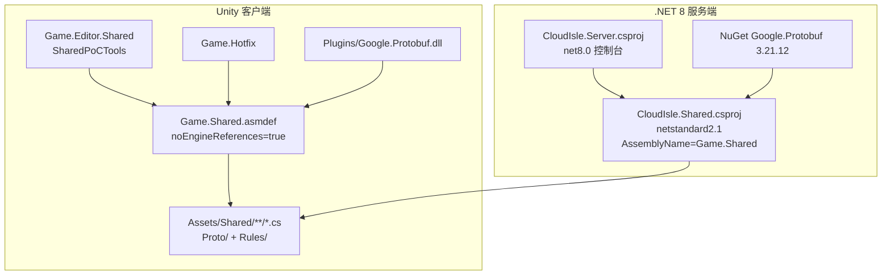
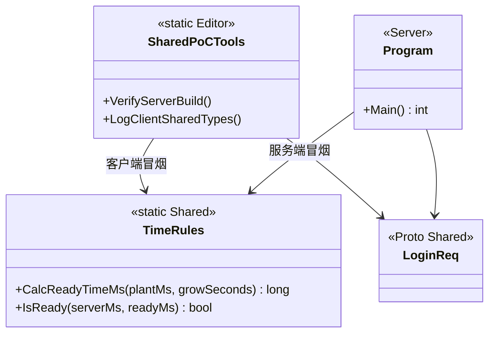

<!-- XLUA-MIGRATION:BEGIN -->
> **迁移说明（2026-10-19）：本文件保留历史原文。**
> 当前热更架构调整为 xLua；旧记录中的技术名称和“已通过”仅描述当时环境，不能解释为 xLua 已验证。
> 这是原 PoC 的历史操作记录，原代码与结果保留。与热更实现无关的协议、配置、资源和玩法经验可复用；涉及 HybridCLR、热更 DLL 或补充元数据的操作已由 xLua 方案取代，不应作为当前生产流程执行。
> 当前设计、验证范围和证据见 [xLua 迁移方案与 PoC](../07_xLua迁移方案与PoC.md)。
<!-- XLUA-MIGRATION:END -->

# PoC #5 Game.Shared 前后端共享编译

> Unity **6000.3.22f1**（客户端 `Game.Shared`） / .NET **8**（服务端 `CloudIsle.Server`）  
> 对应计划：`06_开发计划.md` M0 · `04_技术方案与架构.md` §12 #5

---

## 1. PoC 需要实现的目标

| 目标 | 通过标准 | 状态 |
|---|---|---|
| Shared **不依赖 UnityEngine** | `Game.Shared.asmdef` → `noEngineReferences: true` | ✔ |
| **同一份源码**被双端引用 | 服务端 csproj `Compile Include=Assets/Shared/**/*.cs` | ✔ |
| 客户端可编译引用 | Unity 编译通过；编辑器菜单打出 Client OK | ✔ |
| 服务端可编译引用 | `dotnet build Server/CloudIsle.sln` 成功 | ✔ |
| 服务端可运行使用 Shared | Console：`[Shared PoC] Server OK ...` | ✔ |
| 失败回退 | 改为生成 DLL 引用（未启用） | — |

**一句话**：证明协议与规则放在 `Assets/Shared`，客户端 asmdef 与服务端 netstandard2.1 工程**源码级共享**，避免双端不一致。

---

## 2. 工具的类图和功能（可视化）

### 2.1 源码共享关系



### 2.2 类关系



### 2.3 菜单 / 脚本

| 入口 | 功能 |
|---|---|
| `Farming/Shared PoC/1. Verify Server Build (dotnet)` | 调用 `Tools/verify_shared.ps1` |
| `Farming/Shared PoC/2. Log Client Shared Types` | 编辑器内使用 `TimeRules` + `LoginReq` |
| `Tools/verify_shared.ps1` | `dotnet build` + `dotnet run` |

---

## 3. 工具方法与工程过程（有序）

### 3.1 创建了哪些文件 / 写入了什么

| 顺序 | 路径 | 内容要点 |
|---|---|---|
| 1 | `Assets/Shared/Game.Shared.asmdef` | `noEngineReferences: true`，禁止依赖 UnityEngine |
| 2 | `Assets/Shared/Rules/TimeRules.cs` | 纯 C# 成熟时间公式（非 proto 共享示例） |
| 3 | `Assets/Shared/Proto/Poc.cs` | （已有）协议生成代码，一并编入 Shared |
| 4 | `Server/CloudIsle.Shared/CloudIsle.Shared.csproj` | netstandard2.1；Link 编译 `Assets/Shared/**/*.cs`；NuGet Protobuf 3.21.12 |
| 5 | `Server/CloudIsle.Server/CloudIsle.Server.csproj` | net8.0 Exe；ProjectReference → Shared |
| 6 | `Server/CloudIsle.Server/Program.cs` | 协议往返 + `TimeRules` 冒烟，打印 Server OK |
| 7 | `Server/CloudIsle.sln` | 解决方案（经典 `.sln`，非 SDK10 默认 `.slnx`） |
| 8 | `Server/.gitignore` | 忽略 bin/obj |
| 9 | `Tools/verify_shared.ps1` | 一键 build + run |
| 10 | `Assets/Editor/Shared/SharedPoCTools.cs` | Unity 菜单触发验证 |
| 11 | `Assets/Editor/Shared/Game.Editor.Shared.asmdef` | 引用 `Game.Shared` |

**服务端 csproj 关键写法**

```xml
<Compile Include="..\..\Assets\Shared\**\*.cs" LinkBase="Shared" />
<PackageReference Include="Google.Protobuf" Version="3.21.12" />
```

### 3.2 如何构建工程

**客户端（Unity）**

1. 打开工程，等待 `Game.Shared` 编译完成（无 Console 报错）。  
2. 菜单 **2. Log Client Shared Types** → 期望 `[Shared PoC] Client OK ...`。  

**服务端（dotnet）**

```powershell
cd Server
dotnet build CloudIsle.sln -c Release
dotnet run --project CloudIsle.Server/CloudIsle.Server.csproj -c Release
```

或：

```powershell
powershell -File Tools/verify_shared.ps1
```

或 Unity 菜单 **1. Verify Server Build (dotnet)**。

### 3.3 如何测试

| 侧 | 期望输出 |
|---|---|
| 客户端菜单 2 | `[Shared PoC] Client OK TimeRules.readyMs=1700000060000 LoginReqBytes=19 asm=Game.Shared` |
| 服务端 run | `[Shared PoC] Server OK protoBytes=53 user=shared_poc_server readyMs=1700000060000` |

两边 `readyMs` 必须一致（同一公式、同一输入）。

---

## 4. 遇到的问题和解决办法

| # | 问题 | 解决办法 |
|---|---|---|
| 1 | .NET 10 `dotnet new sln` 默认生成 `.slnx`，旧脚本找不到 | 使用 `dotnet new sln --format sln` 生成经典 `.sln` |
| 2 | Shared 若引用 UnityEngine 则服务端无法编 | asmdef 设 `noEngineReferences: true`；规则/协议只用 BCL + Protobuf |
| 3 | 客户端 Plugins DLL 与服务端 NuGet 版本不一致有风险 | 对齐 **3.21.12**（与 `Google.Protobuf.dll` 一致） |
| 4 | Unity 自动生成的 `*.csproj/*.sln` 被 Assets/.gitignore 忽略 | 服务端工程放在仓库根下 `Server/`，不受 Assets 规则影响 |

---

## 5. 关键路径速查

| 用途 | 路径 |
|---|---|
| 共享源码 | `Assets/Shared/` |
| 共享规则 | `Assets/Shared/Rules/TimeRules.cs` |
| 服务端 Shared 工程 | `Server/CloudIsle.Shared/CloudIsle.Shared.csproj` |
| 服务端入口 | `Server/CloudIsle.Server/Program.cs` |
| 解决方案 | `Server/CloudIsle.sln` |
| 验证脚本 | `Tools/verify_shared.ps1` |
| 编辑器工具 | `Assets/Editor/Shared/SharedPoCTools.cs` |

---

## 6. 与下一 PoC 的关系

PoC **#6** 将在 `CloudIsle.Server` 上叠加 TCP 监听、登录与 SQLite；**继续引用同一 `CloudIsle.Shared` 工程**，无需再拆一份协议代码。
