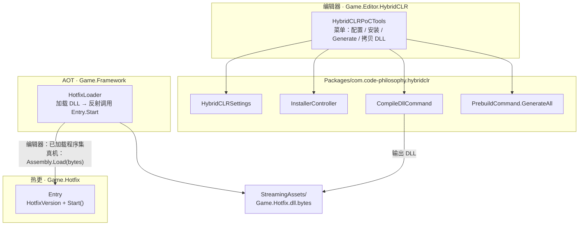
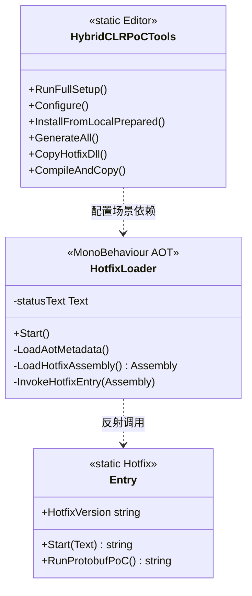

<!-- XLUA-MIGRATION:BEGIN -->
> **迁移说明（2026-10-19）：本文件保留历史原文。**
> 当前热更架构调整为 xLua；旧记录中的技术名称和“已通过”仅描述当时环境，不能解释为 xLua 已验证。
> 这是原 PoC 的历史操作记录，原代码与结果保留。与热更实现无关的协议、配置、资源和玩法经验可复用；涉及 HybridCLR、热更 DLL 或补充元数据的操作已由 xLua 方案取代，不应作为当前生产流程执行。
> 当前设计、验证范围和证据见 [xLua 迁移方案与 PoC](../07_xLua迁移方案与PoC.md)。
<!-- XLUA-MIGRATION:END -->

# PoC #2 HybridCLR 操作说明

> Unity **6000.3.22f1** / HybridCLR **9.0.2**（本地嵌入）  
> 对应计划：`06_开发计划.md` M0 · `04_技术方案与架构.md` §12 #2

---

## 1. PoC 需要实现的目标

| 目标 | 通过标准 | 状态 |
|---|---|---|
| 在 Unity 6000.3 上集成 HybridCLR | 工程可编译，热更程序集可配置 | ✔ |
| AOT / 热更分层 | `Game.Framework`（AOT）不直接引用 `Game.Hotfix`；运行时反射加载 | ✔ |
| 编辑器运行热更入口 | Play 后 Console / UI 输出 `[Hotfix] Entry.Start OK — patch vX` | ✔ |
| **闭环**：改热更代码后仅替换补丁生效 | 不重打安装包，只换 `StreamingAssets/Game.Hotfix.dll.bytes` → 显示新版本 | ✔（用户确认） |
| 失败回退 | 若不可用 → 仅做资源 + 配置热更（见技术方案） | 未启用 |

**一句话**：证明「玩法代码放在热更 DLL，发补丁即可改逻辑」，为后续活动 / Bugfix 管线奠基。

---

## 2. 工具的类图和功能（可视化）

### 2.1 程序集与职责

### 2.2 类关系（PoC 自有类型）

### 2.3 菜单功能一览

路径：`Farming/HybridCLR PoC/`

| 菜单 | 方法 | 功能摘要 |
|---|---|---|
| 0. Run Full PoC Setup | `RunFullSetup` | 配置 → 本地安装 → GenerateAll → Compile+Copy |
| 1. Configure Player + HotUpdate Assemblies | `Configure` | Standalone 后端设为 IL2CPP；`hotUpdateAssemblies=["Game.Hotfix"]` |
| 2. Install From Local | `InstallFromLocalPrepared` | 从 `HybridCLRData/Repos/il2cpp_plus/libil2cpp` 安装，绕过 git 代理 |
| 3. Generate All | `GenerateAll` | 调用 `PrebuildCommand.GenerateAll`（需 IL2CPP 模块） |
| 4. Copy Hotfix DLL to StreamingAssets | `CopyHotfixDll` | 拷贝已编译 DLL → `.dll.bytes` |
| 5. CompileDll + Copy | `CompileAndCopy` | 改热更代码后的标准补丁流程 |

---

## 3. 工具方法与工程过程（有序）

### 3.1 创建了哪些文件 / 写入了什么

| 顺序 | 路径 | 内容要点 |
|---|---|---|
| 1 | `Packages/com.code-philosophy.hybridclr`（file:） | HybridCLR 包本体（本地嵌入） |
| 2 | `HybridCLRData/Repos/...` | 预克隆的 hybridclr / il2cpp_plus，供 InstallFromLocal |
| 3 | `Assets/Framework/Game.Framework.asmdef` | AOT 程序集定义（引用 UI / YooAsset / HybridCLR.Runtime） |
| 4 | `Assets/Framework/Boot/HotfixLoader.cs` | 运行时加载热更 DLL + 反射 `Entry.Start`；玩家包加载 AOT 元数据 |
| 5 | `Assets/Hotfix/Game.Hotfix.asmdef` | 热更程序集（引用 Framework / Shared / UI） |
| 6 | `Assets/Hotfix/Entry.cs` | `HotfixVersion` 常量 + `Start` 入口（后续兼跑 Protobuf PoC） |
| 7 | `Assets/Editor/HybridCLR/HybridCLRPoCTools.cs` | 编辑器菜单工具 |
| 8 | `Assets/Editor/HybridCLR/Game.Editor.HybridCLR.asmdef` | 编辑器程序集 |
| 9 | `Assets/Scenes/HybridCLR_PoC.unity` | 含 `HotfixLoader`（及 UI Text）的验收场景 |
| 10 | `Assets/StreamingAssets/Game.Hotfix.dll.bytes` | 热更补丁产物（由菜单 4/5 生成） |
| 11 | `Library/HybridCLR/HotUpdateDlls/<Target>/Game.Hotfix.dll` | CompileDll 中间输出 |

**`HotfixLoader` 行为摘要**

1. （玩家包）从 `StreamingAssets/AOT/*.dll.bytes` 调用 `RuntimeApi.LoadMetadataForAOTAssembly`  
2. 编辑器：取已加载的 `Game.Hotfix`；真机：`Assembly.Load` 读取 `.dll.bytes`  
3. 反射 `Game.Hotfix.Entry.Start(Text)`，把返回字符串写到 UI / Console  

**`Entry.Start` 写入内容（逻辑）**

- 日志与 UI：`[Hotfix] Entry.Start OK — patch {HotfixVersion}`  
- 改 `HotfixVersion` → 重新 CompileDll + Copy → 即视为新补丁  

### 3.2 如何构建工程

1. Unity Hub 打开工程（6000.3.22f1）。  
2. 菜单 **1. Configure**（IL2CPP + 热更程序集名）。  
3. 若未安装 HybridCLR 运行时：菜单 **2. Install From Local**。  
4. （出包前）安装 **Windows Build Support (IL2CPP)**，再菜单 **3. Generate All**。  
5. 菜单 **5. CompileDll + Copy**，确认存在 `StreamingAssets/Game.Hotfix.dll.bytes`。  
6. Build Settings：场景含 `HybridCLR_PoC`；Standalone Windows 64 + IL2CPP → Build And Run。  

### 3.3 如何测试

**A. 编辑器快速验收**

1. 打开 `Assets/Scenes/HybridCLR_PoC.unity`。  
2. Enter Play Mode。  
3. Console / 场景 UI 出现 `[Hotfix] Entry.Start OK — patch vX`。  

**B. 补丁闭环（玩家包）**

1. 按 §3.2 打出 IL2CPP 包，确认显示 `patch v1`（或当前版本）。  
2. 将 `Assets/Hotfix/Entry.cs` 中 `HotfixVersion` 改为 `v2`。  
3. 菜单 **5. CompileDll + Copy**。  
4. **不要重打安装包**，仅覆盖客户端目录下  
   `StreamingAssets/Game.Hotfix.dll.bytes`。  
5. 重启客户端 → 应显示 `patch v2`。  

---

## 4. 遇到的问题和解决办法

| # | 问题 | 解决办法 |
|---|---|---|
| 1 | git 全局代理 `127.0.0.1:7890` 不可用，HybridCLR Installer 克隆失败 | `git -c http.proxy=` 本地克隆 hybridclr_unity / hybridclr / il2cpp_plus；菜单用 **InstallFromLocal** |
| 2 | HybridCLR 9.x 命名空间与旧教程不符（无 `*.Editor.*`） | 使用 `HybridCLR.Settings` / `HybridCLR.Commands` / `HybridCLR.Installer` |
| 3 | 缺 Windows IL2CPP 模块 → `Generate/All` / 出包报 *IL2CPP is not installed* | Unity Hub → 6000.3.22f1 → Add Modules → Windows Build Support (IL2CPP) |
| 4 | AOT 层不能编译期引用热更程序集 | `HotfixLoader` 仅反射；`Game.Framework` 不 reference `Game.Hotfix` |
| 5 | 编辑器与真机加载路径不同 | `#if UNITY_EDITOR` 用已加载程序集；否则读 StreamingAssets bytes |

---

## 5. 关键路径速查

| 用途 | 路径 |
|---|---|
| 编辑器工具 | `Assets/Editor/HybridCLR/HybridCLRPoCTools.cs` |
| 热更入口 | `Assets/Hotfix/Entry.cs` |
| AOT 加载器 | `Assets/Framework/Boot/HotfixLoader.cs` |
| 编译输出 | `Library/HybridCLR/HotUpdateDlls/<Target>/Game.Hotfix.dll` |
| 运行时补丁 | `Assets/StreamingAssets/Game.Hotfix.dll.bytes` |
| 验收场景 | `Assets/Scenes/HybridCLR_PoC.unity` |
