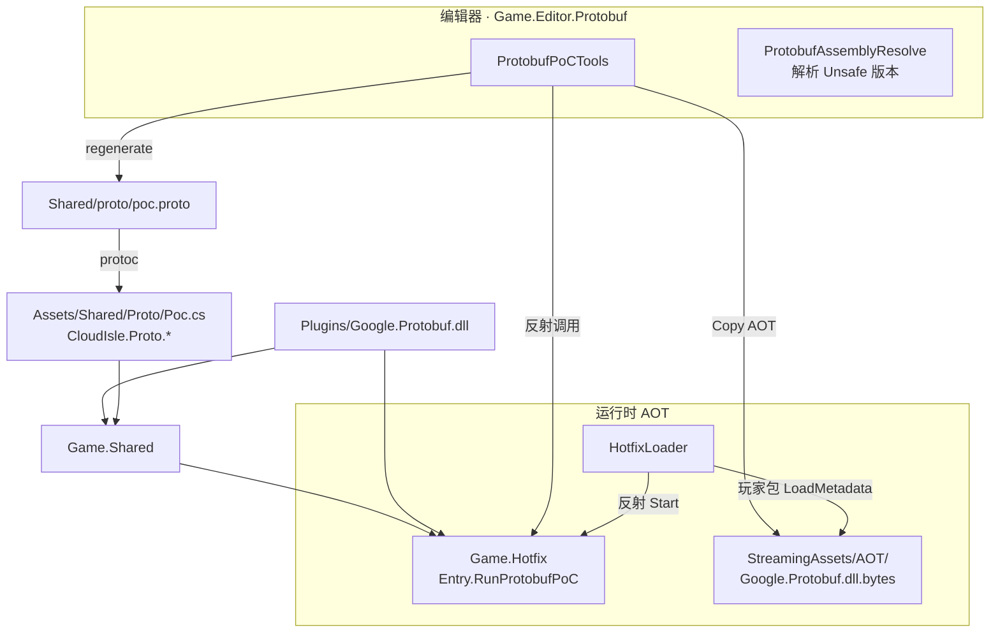
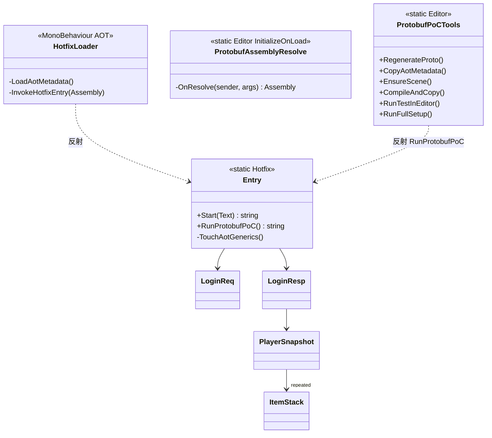

<!-- XLUA-MIGRATION:BEGIN -->
> **迁移说明（2026-10-19）：本文件保留历史原文。**
> 当前热更架构调整为 xLua；旧记录中的技术名称和“已通过”仅描述当时环境，不能解释为 xLua 已验证。
> 这是原 PoC 的历史操作记录，原代码与结果保留。与热更实现无关的协议、配置、资源和玩法经验可复用；涉及 HybridCLR、热更 DLL 或补充元数据的操作已由 xLua 方案取代，不应作为当前生产流程执行。
> 当前设计、验证范围和证据见 [xLua 迁移方案与 PoC](../07_xLua迁移方案与PoC.md)。
<!-- XLUA-MIGRATION:END -->

# PoC #4 Protobuf 操作说明

> Unity **6000.3.22f1** / Google.Protobuf（Plugins DLL）+ HybridCLR 热更程序集  
> 对应计划：`06_开发计划.md` M0 · `04_技术方案与架构.md` §12 #4 · 协议见 `05_协议与接口.md`

---

## 1. PoC 需要实现的目标

| 目标 | 通过标准 | 状态 |
|---|---|---|
| 工程内可用 Google.Protobuf | 客户端程序集可引用并编译 | ✔ |
| proto3 → C# 生成管线 | `Shared/proto/poc.proto` → `Assets/Shared/Proto/Poc.cs` | ✔ |
| **在热更代码中**序列化 / 反序列化 | `Game.Hotfix.Entry.RunProtobufPoC` 往返成功 | ✔ |
| 覆盖压力点 | `repeated`（List）+ `map` + 嵌套 message | ✔ |
| AOT / 裁剪准备 | `link.xml` 保留；StreamingAssets AOT 元数据；清单含 `Google.Protobuf.dll` | ✔ |
| 无 AOT 泛型运行时异常 | 编辑器 / Play 无异常日志 | ✔（编辑器） |
| 失败回退 | 换序列化或扩大元数据列表 | 未启用 |

**一句话**：证明「协议代码进 Shared、业务在热更里编解码」，为后续 TCP 登录与双端共享协议铺路。

> 玩家包 IL2CPP 下的 `LoadMetadataForAOTAssembly` 路径已接好；完整出包验证依赖 HybridCLR PoC 的 IL2CPP 环境。

---

## 2. 工具的类图和功能（可视化）

### 2.1 数据流与程序集

### 2.2 类关系

### 2.3 菜单功能一览

路径：`Farming/Protobuf PoC/`

| 菜单 | 方法 | 功能摘要 |
|---|---|---|
| 0. Regenerate Proto C# | `RegenerateProto` | 调用本机 `protoc` 生成 C# |
| 1. Copy AOT Metadata | `CopyAotMetadata` | `Google.Protobuf.dll` → `StreamingAssets/AOT/*.dll.bytes` |
| 2. Ensure HybridCLR PoC Scene | `EnsureScene` | 保证场景有 `HotfixLoader` |
| 3. Compile Hotfix DLL + Copy | `CompileAndCopy` | 转调 HybridCLR 菜单 5 |
| 4. Run Protobuf Test In Editor | `RunTestInEditor` | 无 Play，反射调用 `RunProtobufPoC` |
| 5. Run Full Setup | `RunFullSetup` | 0→1→2→3，delayCall 再测 4 |

---

## 3. 工具方法与工程过程（有序）

### 3.1 创建了哪些文件 / 写入了什么

| 顺序 | 路径 | 内容要点 |
|---|---|---|
| 1 | `Assets/Plugins/Google.Protobuf/Google.Protobuf.dll` (+ xml) | Protobuf 运行时 |
| 2 | `Assets/Plugins/.../System.Runtime.CompilerServices.Unsafe.dll` | Protobuf 依赖；`ProtobufAssemblyResolve` 兜底解析 |
| 3 | `Shared/proto/poc.proto` | PoC 消息：`ItemStack` / `LoginReq` / `LoginResp` / `PlayerSnapshot`（含 `repeated` + `map`） |
| 4 | `Assets/Shared/Proto/Poc.cs` | protoc 生成；命名空间 `CloudIsle.Proto` |
| 5 | `Assets/Shared/Game.Shared.asmdef` | 共享程序集（协议生成代码所在） |
| 6 | `Assets/Hotfix/Game.Hotfix.asmdef` | 增加引用 `Game.Shared` |
| 7 | `Assets/Hotfix/Entry.cs` | `RunProtobufPoC`：往返 + `MergeFrom` + `TouchAotGenerics`；`Start` 内调用 |
| 8 | `Assets/Framework/Boot/HotfixLoader.cs` | 玩家包加载 `StreamingAssets/AOT/Google.Protobuf.dll.bytes` |
| 9 | `Assets/HybridCLR/Generate/link.xml` | `preserve` Google.Protobuf、Game.Shared |
| 10 | `Assets/HybridCLR/Generate/AOTGenericReferences.cs` | `PatchedAOTAssemblyList` 含 `Google.Protobuf.dll` |
| 11 | `Assets/Editor/Protobuf/ProtobufPoCTools.cs` | 编辑器菜单 |
| 12 | `Assets/Editor/Protobuf/ProtobufAssemblyResolve.cs` | 编辑器域 `AssemblyResolve` → Unsafe |
| 13 | `Assets/StreamingAssets/AOT/Google.Protobuf.dll.bytes` | AOT 元数据拷贝产物 |

**`poc.proto` 覆盖字段**

- 标量：string / int32 / int64  
- 嵌套：`LoginResp.data → PlayerSnapshot`  
- `repeated ItemStack bag`  
- `map<string, int32> flags`  

**`RunProtobufPoC` 验证逻辑（摘要）**

1. `TouchAotGenerics`：触碰 `List<ItemStack>` / `Dictionary` / `MessageParser`  
2. 构造 `LoginReq` → `ToByteArray` → `ParseFrom` → 字段比对  
3. 构造 `LoginResp`（2 个背包项 + 2 个 map）→ 往返比对  
4. `MergeFrom(respBytes)` 再验一遍  
5. 成功日志：`[Protobuf PoC] OK req={n}B resp={m}B bag=2 map=2 nick=...`  

### 3.2 如何构建工程

1. 确认本机有 `protoc`（PATH 可调用；当前环境曾用 3.20.x）。  
2. 菜单 **0. Regenerate Proto C#**（或已有 `Poc.cs` 可跳过）。  
3. 菜单 **1. Copy AOT Metadata**。  
4. 确认 `Game.Hotfix.asmdef` 引用 `Game.Shared`，等待编译空闲。  
5. 菜单 **3. Compile Hotfix DLL + Copy**（更新热更补丁）。  
6. （玩家包）先完成 HybridCLR Generate All + IL2CPP 出包；确保包内带上 `StreamingAssets/AOT/`。  

### 3.3 如何测试

**A. 编辑器无 Play（最快）**

1. 菜单 **4. Run Protobuf Test In Editor**。  
2. Console：`[Protobuf PoC] OK req=48B resp=83B bag=2 map=2 nick=云上农夫`。  

**B. Play Mode（经热更入口）**

1. 打开 `Assets/Scenes/HybridCLR_PoC.unity`。  
2. Enter Play。  
3. 期望同时出现：  
   - `[Hotfix] Entry.Start OK — patch vX`  
   - `[Protobuf PoC] OK req=... bag=2 map=2 ...`  

**C. 一键**

- 菜单 **5. Run Full Setup**；若当时正在编译，空闲后再点一次菜单 **4**。  

---

## 4. 遇到的问题和解决办法

| # | 问题 | 解决办法 |
|---|---|---|
| 1 | Google.Protobuf 依赖精确版本的 `System.Runtime.CompilerServices.Unsafe`，编辑器解析失败 | Plugins 放入 Unsafe DLL；`ProtobufAssemblyResolve` 在 `AssemblyResolve` 中 `LoadFrom` |
| 2 | 热更程序集找不到协议类型 | `Game.Hotfix.asmdef` 增加 `Game.Shared` 引用；协议生成代码放 Shared |
| 3 | `CodedOutputStream` Dispose 关闭底层 `MemoryStream` → `ObjectDisposedException` | 去掉该路径，改用 `ToByteArray` / `ParseFrom` / `MergeFrom`（已验证足够） |
| 4 | IL2CPP 裁剪可能删掉 Protobuf 反射/泛型 | `link.xml` preserve；AOT 清单 + 运行时 `LoadMetadataForAOTAssembly` |
| 5 | 编辑器误用路径名 `HotUpdate` 找不到目录 | 实际程序集/目录名为 **`Hotfix`**（与 HybridCLR PoC 一致） |

---

## 5. 关键路径速查

| 用途 | 路径 |
|---|---|
| proto 源 | `Shared/proto/poc.proto` |
| 生成 C# | `Assets/Shared/Proto/Poc.cs` |
| 热更验证 | `Assets/Hotfix/Entry.cs` → `RunProtobufPoC` |
| AOT 加载 | `Assets/Framework/Boot/HotfixLoader.cs` |
| AOT 元数据 | `Assets/StreamingAssets/AOT/Google.Protobuf.dll.bytes` |
| 裁剪保留 | `Assets/HybridCLR/Generate/link.xml` |
| 补充清单 | `Assets/HybridCLR/Generate/AOTGenericReferences.cs` |
| 编辑器工具 | `Assets/Editor/Protobuf/ProtobufPoCTools.cs` |
| 验收场景 | `Assets/Scenes/HybridCLR_PoC.unity`（与 HybridCLR 共用） |
