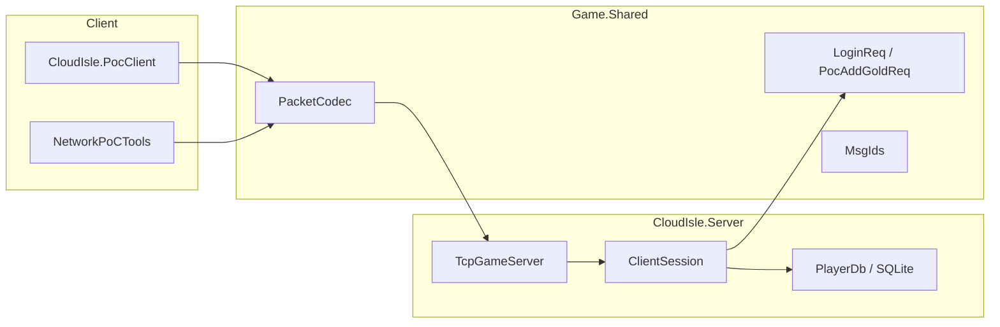
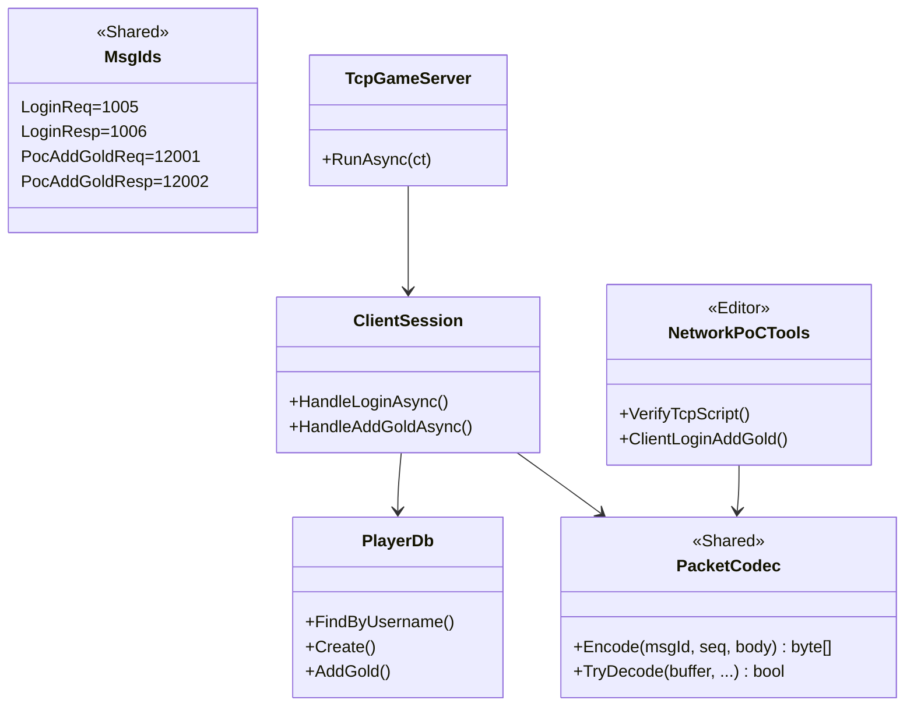

<!-- XLUA-MIGRATION:BEGIN -->
> **迁移说明（2026-10-19）：本文件保留历史原文。**
> 当前热更架构调整为 xLua；旧记录中的技术名称和“已通过”仅描述当时环境，不能解释为 xLua 已验证。
> 这是原 PoC 的历史操作记录，原代码与结果保留。与热更实现无关的协议、配置、资源和玩法经验可复用；涉及 HybridCLR、热更 DLL 或补充元数据的操作已由 xLua 方案取代，不应作为当前生产流程执行。
> 当前设计、验证范围和证据见 [xLua 迁移方案与 PoC](../07_xLua迁移方案与PoC.md)。
<!-- XLUA-MIGRATION:END -->

# PoC #6 最小服务端：TCP + 登录 + SQLite

> Unity **6000.3.22f1**（编辑器客户端） / .NET **8**（`CloudIsle.Server`）  
> 对应计划：`06_开发计划.md` M0 · `04_技术方案与架构.md` §12 #6

---

## 1. PoC 需要实现的目标

| 目标 | 通过标准 | 状态 |
|---|---|---|
| TCP 监听 | `127.0.0.1:17777` 可 Accept | ✔ |
| 帧编解码 | `len(4)+msgId(2)+seq(4)+body`，小端，Shared 双端共用 | ✔ |
| 登录 | `LoginReq(1005)` → `LoginResp(1006)`，含 `PlayerSnapshot` | ✔ |
| SQLite 读 | 登录从 `player` 表加载 gold 等字段 | ✔ |
| SQLite 写 | `PocAddGoldReq(12001)` 改 gold 并落库；重登一致 | ✔ |
| 客户端验证 | `CloudIsle.PocClient` / Unity 菜单打出 Client OK | ✔ |

**一句话**：证明客户端与服务端可用同一套 Shared 协议帧完成 TCP 登录，并能把一条玩家数据写入 SQLite 后再次读出。

---

## 2. 工具的类图和功能（可视化）

### 2.1 运行时结构



### 2.2 类关系



### 2.3 菜单 / 脚本

| 入口 | 功能 |
|---|---|
| `Farming/Network PoC/1. Verify TCP Login+SQLite` | 调用 `Tools/verify_tcp.ps1` |
| `Farming/Network PoC/2. Client Login+AddGold` | 编辑器直连已启动的服务端 |
| `Tools/verify_tcp.ps1` | 起服 → PocClient → 停服 |
| `dotnet run --project Server/CloudIsle.Server` | 前台跑服务端 |

---

## 3. 工具方法与工程过程（有序）

### 3.1 创建了哪些文件 / 写入了什么

| 顺序 | 路径 | 内容要点 |
|---|---|---|
| 1 | `Shared/proto/poc.proto` | 增加 `PocAddGoldReq/Resp`；`protoc` 重生成 `Assets/Shared/Proto/Poc.cs` |
| 2 | `Assets/Shared/Net/MsgIds.cs` | 消息 ID / 错误码 / ProtoVersion |
| 3 | `Assets/Shared/Net/PacketCodec.cs` | 帧编解码 |
| 4 | `Server/.../Data/PlayerDb.cs` | SQLite `player` 表 CRUD + AddGold |
| 5 | `Server/.../Net/TcpGameServer.cs` | TcpListener |
| 6 | `Server/.../Net/ClientSession.cs` | 收包、登录、加金币 |
| 7 | `Server/.../Program.cs` | 默认 TCP；`--shared-smoke` 保留 #5 |
| 8 | `Server/CloudIsle.PocClient/` | 控制台验证客户端 |
| 9 | `Tools/verify_tcp.ps1` | 一键验证 |
| 10 | `Assets/Editor/Network/NetworkPoCTools.cs` | Unity 菜单 |

### 3.2 如何构建 / 运行

```powershell
cd Server
dotnet build CloudIsle.sln -c Release

# 前台服务端
dotnet run --project CloudIsle.Server -c Release -- --host 127.0.0.1 --port 17777

# 另开终端：客户端
dotnet run --project CloudIsle.PocClient -c Release -- --host 127.0.0.1 --port 17777 --user alice --pass x --delta 10
```

或：

```powershell
powershell -File Tools/verify_tcp.ps1
```

### 3.3 如何测试

| 步骤 | 期望 |
|---|---|
| 首次登录 | 自动建号，`gold=100` |
| AddGold delta=10 | 响应 `gold=110` |
| 断开后重登 | `gold=110`（SQLite 已落库） |
| 脚本汇总行 | `[TCP PoC] Client OK ... goldAfterRelogin=110` |

---

## 4. 遇到的问题和解决办法

| # | 问题 | 解决办法 |
|---|---|---|
| 1 | #5 冒烟若默认起 TCP 会挂起不退出 | `Program` 增加 `--shared-smoke`；`verify_shared.ps1` 传该参数 |
| 2 | 完整协议尚未全部生成 | PoC 仅实现 Login + PocAddGold；帧格式与文档一致，便于后续扩展 |
| 3 | 首次无账号 | PoC 登录时自动 `INSERT`（正式服应走 Register） |

---

## 5. 关键路径速查

| 用途 | 路径 |
|---|---|
| 协议 | `Shared/proto/poc.proto` |
| 帧 / MsgId | `Assets/Shared/Net/` |
| 服务端 | `Server/CloudIsle.Server/` |
| 控制台客户端 | `Server/CloudIsle.PocClient/` |
| 验证脚本 | `Tools/verify_tcp.ps1` |
| 编辑器菜单 | `Assets/Editor/Network/NetworkPoCTools.cs` |
| 默认端口 | `17777` |

---

## 6. 与下一 PoC 的关系

PoC **#7** 导表不依赖本 PoC 的运行时；后续正式网络层可复用 `PacketCodec` / `MsgIds`，并把 `PlayerDb` 扩展为完整 Schema 与 Handler 路由。
