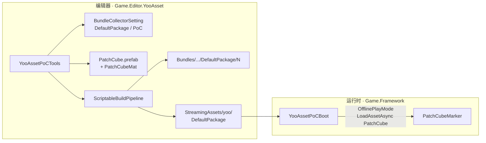
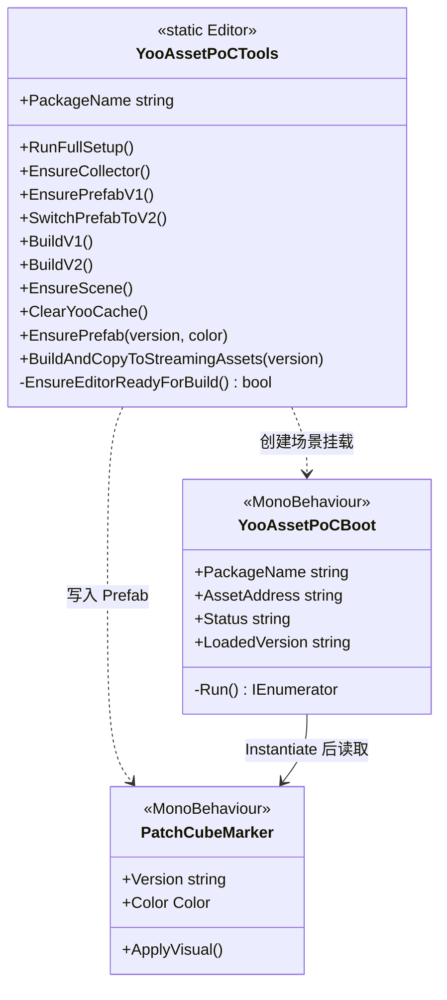

<!-- XLUA-MIGRATION:BEGIN -->
> **迁移说明（2026-10-19）：本文件保留历史原文。**
> 当前热更架构调整为 xLua；旧记录中的技术名称和“已通过”仅描述当时环境，不能解释为 xLua 已验证。
> 这是原 PoC 的历史操作记录，原代码与结果保留。与热更实现无关的协议、配置、资源和玩法经验可复用；涉及 HybridCLR、热更 DLL 或补充元数据的操作已由 xLua 方案取代，不应作为当前生产流程执行。
> 当前设计、验证范围和证据见 [xLua 迁移方案与 PoC](../07_xLua迁移方案与PoC.md)。
<!-- XLUA-MIGRATION:END -->

# PoC #3 YooAsset 操作说明

> Unity **6000.3.22f1** / YooAsset **3.0.6**（OpenUPM）  
> 对应计划：`06_开发计划.md` M0 · `04_技术方案与架构.md` §12 #3

---

## 1. PoC 需要实现的目标

| 目标 | 通过标准 | 状态 |
|---|---|---|
| 集成 YooAsset 并配置收集器 | `DefaultPackage` 收集 `Assets/Res/PoC`，可寻址 | ✔ |
| OfflinePlayMode 本地包加载 | Play 能 Instantiate 热更 Prefab | ✔ |
| **本地补丁闭环** | 改 Prefab → 只替换 StreamingAssets → 客户端显示新内容（不改代码） | ✔ |
| 可视化可验收 | v1 红立方体 / v2 蓝立方体 + Console `prefab=v1|v2` | ✔ |
| 失败回退 | Addressables | 未启用 |

**一句话**：证明「资源打进包 → 只下发新 Bundle 即可换表现」，与 HybridCLR 代码热更互补。

本 PoC 用 **OfflinePlayMode + ClearAndCopyAll 到 StreamingAssets** 模拟本地补丁；后续 HostPlayMode（CDN）可复用同一收集 / 构建管线。

---

## 2. 工具的类图和功能（可视化）

### 2.1 运行时与编辑器协作

### 2.2 类关系

### 2.3 菜单功能一览

路径：`Farming/YooAsset PoC/`

| 菜单 | 方法 | 功能摘要 |
|---|---|---|
| 0. Run Full Setup | `RunFullSetup` | 收集器 + Prefab v1 + 构建 v1 + 场景 |
| 1. Ensure Collector Config | `EnsureCollector` | 配置 DefaultPackage / 组 PoC / 路径 `Assets/Res/PoC` |
| 2. Ensure Prefab v1 (Red) | `EnsurePrefabV1` | 红材质 + `Version=v1` |
| 3. Switch Prefab to v2 (Blue) | `SwitchPrefabToV2` | 蓝材质 + `Version=v2` |
| 4. Build … (version=1) | `BuildV1` | 收集器 + 红 Prefab + SBP 构建并拷贝 |
| 5. Build … (version=2) | `BuildV2` | 收集器 + 蓝 Prefab + SBP 构建并拷贝 |
| 6. Ensure PoC Scene | `EnsureScene` | 新建场景并挂 `YooAssetPoCBoot` |
| 7. Clear Yoo Cache | `ClearYooCache` | 删除 `Library/yoo` |

---

## 3. 工具方法与工程过程（有序）

### 3.1 创建了哪些文件 / 写入了什么

| 顺序 | 路径 | 内容要点 |
|---|---|---|
| 1 | `Packages/manifest.json` | OpenUPM 依赖 `com.tuyoogame.yooasset@3.0.6` |
| 2 | `Assets/AssetBundleCollectorSetting.asset` | 收集器：DefaultPackage → 组 PoC → `Assets/Res/PoC`；AddressByFileName / PackSeparately |
| 3 | `Assets/Res/PoC/` | 热更资源目录 |
| 4 | `Assets/Res/PoC/PatchCubeMat.mat` | URP Lit；v1 红 / v2 蓝（`_BaseColor`） |
| 5 | `Assets/Res/PoC/PatchCube.prefab` | Cube + 材质 + `PatchCubeMarker` |
| 6 | `Assets/Framework/Resource/PatchCubeMarker.cs` | `Version` / `Color`；Awake 改名 `PatchCube_{Version}` |
| 7 | `Assets/Framework/Resource/YooAssetPoCBoot.cs` | OfflinePlayMode 初始化 → RequestVersion → LoadManifest → LoadAsset `PatchCube` → Instantiate |
| 8 | `Assets/Editor/YooAsset/YooAssetPoCTools.cs` | 编辑器一键配置 / 构建 |
| 9 | `Assets/Editor/YooAsset/Game.Editor.YooAsset.asmdef` | 编辑器程序集（引用 YooAsset.Editor） |
| 10 | `Assets/Scenes/YooAsset_PoC.unity` | Boot + 相机 + 灯光 |
| 11 | `Bundles/StandaloneWindows64/DefaultPackage/<ver>/` | SBP 构建输出 |
| 12 | `Assets/StreamingAssets/yoo/DefaultPackage/` | 内置包：`*.bundle`、`DefaultPackage_N.bytes/hash`、`BuiltinCatalog.*`、`DefaultPackage.version` |

**收集器写入规则（EnsureCollector）**

- Package：`DefaultPackage`，`EnableAddressable=true`，`AutoCollectShaders=true`  
- Group：`PoC`，`EnableGroup`  
- Collector：路径 `Assets/Res/PoC`，`MainAssetCollector`，地址=文件名（故地址为 `PatchCube`）  

**构建参数要点（BuildAndCopyToStreamingAssets）**

- 管线：`ScriptableBuildPipeline`  
- `BundledCopyOption = ClearAndCopyAll`（整包覆盖 StreamingAssets）  
- 构建前：`EnsureEditorReadyForBuild` + `ClearYooCache`  

**Boot 加载步骤**

1. `YooAssets.Initialize`  
2. `OfflinePlayModeOptions` + 默认 Builtin 文件系统  
3. `RequestPackageVersionAsync` → `LoadPackageManifestAsync`  
4. `LoadAssetAsync<GameObject>("PatchCube")` → `InstantiateSync`  
5. 读 `PatchCubeMarker`，GUI / 日志：`OK package={ver} prefab={v1|v2}`  

### 3.2 如何构建工程

1. 确认 OpenUPM 已装 YooAsset 3.0.6（见 `Packages/manifest.json`）。  
2. 菜单 **0. Run Full Setup**（或分步 1→2→4→6）。  
3. 确认 `StreamingAssets/yoo/DefaultPackage/DefaultPackage.version` 为 `1`。  
4. （无需打玩家包即可验收编辑器 OfflinePlayMode。）  

### 3.3 如何测试

**补丁闭环（编辑器）**

1. 菜单 **0. Run Full Setup**（已做过可跳过）。  
2. 打开 `Assets/Scenes/YooAsset_PoC.unity`，Enter Play。  
3. 期望：红立方体 `PatchCube_v1`；日志 `OK package=1 prefab=v1`。  
4. Exit Play。  
5. 菜单 **5. Build Package + Copy StreamingAssets (version=2)**。  
6. **不改代码**，再次 Play。  
7. 期望：蓝立方体 `PatchCube_v2`；日志 `OK package=2 prefab=v2`；无 `PatchCube_v1`。  

> 若仍显示旧内容：菜单 **7. Clear Yoo Cache**，再 Play。

**复测记录（2026-10-13）**：v1 → Play ✔ → 构建 v2 → Play ✔。

---

## 4. 遇到的问题和解决办法

| # | 问题 | 解决办法 |
|---|---|---|
| 1 | SBP 构建失败：`Error building Player because scripts have compile errors` / `scriptCompilationFailed=true` | 多因 `Assembly-CSharp-Editor.dll` 被占用；等编译空闲，`RequestScriptCompilation` 后再构建；工具增加 `EnsureEditorReadyForBuild` |
| 2 | Play 仍读到旧包 | 构建前 `ClearYooCache`（删 `Library/yoo`）；StreamingAssets 使用 ClearAndCopyAll |
| 3 | Prefab Marker 脚本误放在 `Res/PoC` 被打进 Bundle | `EnsurePrefab` 删除 `Assets/Res/PoC/PatchCubeMarker.cs`；脚本放在 `Framework/Resource` |
| 4 | MCP Play 过早返回导致误判未加载 | 以 Console 日志 / Hierarchy 中 `PatchCube_v*` 为准，加载完成后再验收 |
| 5 | 构建中途改资源触发重编导致 DLL 锁 | 构建前 ForceSynchronousImport，并拒绝在 `isCompiling` 时开建 |

---

## 5. 关键路径速查

| 用途 | 路径 |
|---|---|
| 热更资源 | `Assets/Res/PoC/PatchCube.prefab` |
| 运行时加载 | `Assets/Framework/Resource/YooAssetPoCBoot.cs` |
| Prefab 标记 | `Assets/Framework/Resource/PatchCubeMarker.cs` |
| 编辑器工具 | `Assets/Editor/YooAsset/YooAssetPoCTools.cs` |
| 内置包 | `Assets/StreamingAssets/yoo/DefaultPackage/` |
| 构建输出 | `Bundles/StandaloneWindows64/DefaultPackage/<version>/` |
| 收集器配置 | `Assets/AssetBundleCollectorSetting.asset` |
| 验收场景 | `Assets/Scenes/YooAsset_PoC.unity` |
