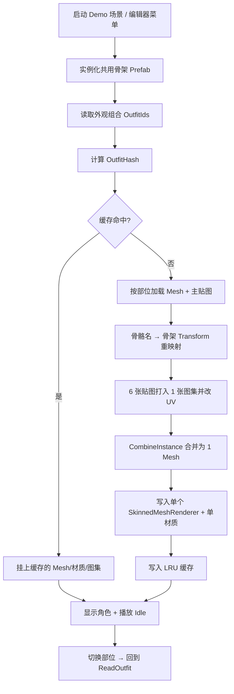

<!-- XLUA-MIGRATION:BEGIN -->
> **迁移说明（2026-10-19）：本文件保留历史原文。**
> 当前热更架构调整为 xLua；旧记录中的技术名称和“已通过”仅描述当时环境，不能解释为 xLua 已验证。
> 这是原 PoC 的历史操作记录，原代码与结果保留。与热更实现无关的协议、配置、资源和玩法经验可复用；涉及 HybridCLR、热更 DLL 或补充元数据的操作已由 xLua 方案取代，不应作为当前生产流程执行。
> 当前设计、验证范围和证据见 [xLua 迁移方案与 PoC](../07_xLua迁移方案与PoC.md)。
<!-- XLUA-MIGRATION:END -->

# PoC #9 换装合并最小 Demo — 操作说明

> 对应计划：`06_开发计划.md` M0 · 【#9】换装合并最小 Demo（时间盒 **5 h**）  
> 玩法依据：`02_玩法设计.md` §10 角色外观与换装  
> 技术依据：`04_技术方案与架构.md` §4 工程结构、§6 角色换装与性能方案、§12 #9、ADR-09  
> **本文档仅定义配置、流程、接口与测试；不包含实现代码落库说明以外的交付物。**

---

## 1. 任务目标

在 Unity 工程内完成**换装合并最小 Demo**，验证：

| # | 目标 | 说明 |
|---|---|---|
| G1 | 6 部位可拼装 | 发型 / 上衣 / 下装 / 鞋子 / 帽子 / 饰品，与玩法 §10.1 一致 |
| G2 | 合并为单渲染体 | 合并后为 **1 Mesh + 1 材质（+1 图集）**，目标 **每角色 1 DrawCall**（Frame Debugger / Profiler 可证） |
| G3 | 共用骨架与动画 | 所有部位挂同一套骨骼；合并后仍可播放站立 / Idle（至少 1 条动画） |
| G4 | 组合可切换 | 更换任意部位 ID 后可重新合并并刷新显示（可无 UI，编辑器菜单或简易面板即可） |
| G5 | 缓存命中可复用 | 同一外观组合 hash 二次组装不重复合并（或明显更快 / 跳过 Combine） |
| G6 |（可选，时间盒内）同屏压力 | 同屏约 **40** 个合并角色，PC 编辑器或 Standalone **≥ 60 FPS**（`04` §12 #9）；做不到则记录瓶颈并启用「减少部位 / 简化材质」回退 |

**非本 PoC 范围（明确不做）**

- 服务端存档 / 广场同步 / 装扮商城完整 UI  
- 连衣裙遮罩、帽子藏发等完整遮罩表（可预留接口，Demo 可用简化规则或跳过）  
- YooAsset 分包与热更发布（资源可先放 `Assets/Res/Avatar` 或 Demo 专用目录）  
- 抽卡、碎片、套装徽章逻辑  

**一句话**：证明「6 部位 → 合并网格/图集 → 单 SkinnedMeshRenderer」在目标 Unity 版本上可行，并为 M3 角色换装正式开发定接口与性能基线。

**失败回退**（计划 / `04` §12）：减少部位数，或取消图集合并、仅 Mesh 合并 / 多材质；在本文 §6 记录决策。

---

## 2. 参考文档与目录约定

### 2.1 参考文档

| 文档 | 章节 | 用途 |
|---|---|---|
| `06_开发计划.md` | M0 【#9】 | 时间盒、验收口径 |
| `02_玩法设计.md` | §10 | 6 部位、套装、稀有度、当前 1 套外观 |
| `04_技术方案与架构.md` | §4 / §6 / §12 #9 / ADR-09 | 目录、合并流水线、缓存、LOD、DrawCall 目标 |
| `03_数值与配置表.md` / `avataritem.xlsx` | AvatarItem | 外观 ID、部位、稀有度（Demo 可用子集） |

### 2.2 建议目录（对齐 `04` §4.1，可按现仓 `Assets/` 落地）

```
Assets/
├── Framework/                 # Game.Framework（可选：仅提供 Object池 / 计时，本 PoC 可不依赖）
├── Hotfix/Modules/Avatar/     # 或 Assets/Demo/AvatarMerge/（PoC 临时，正式再迁 Hotfix）
│   ├── AvatarMergeService.cs      # 合并入口
│   ├── AvatarPartLoader.cs        # 部位资源加载
│   ├── AvatarAtlasBaker.cs        # 贴图打图集（可简化）
│   ├── AvatarMergeCache.cs        # LRU 缓存
│   └── AvatarDemoPresenter.cs     # Demo 展示 / 菜单驱动
├── Editor/Avatar/             # Game.Editor.Avatar
│   └── AvatarMergePoCTools.cs     # Farming/Avatar Merge PoC/...
├── Res/Avatar/                # 或 Assets/Demo/AvatarMerge/Res/
│   ├── Rig/                   # 共用骨架 Prefab + Animator
│   ├── Parts/{Hair,Top,Bottom,Shoes,Hat,Acc}/
│   └── Atlas/                 # 运行时生成可写临时目录，或 Editor 预烘焙
└── ReferenceDoc/
    └── PoC_换装合并Demo_操作说明.md   # 本文
```

正式工程命名空间建议：`Game.Hotfix.Modules.Avatar`；PoC 临时可用 `Game.Demo.AvatarMerge`。

---

## 3. Demo 基础流程

### 3.1 总览



### 3.2 分步说明（实现时应遵守的顺序）

| 顺序 | 步骤 | 输入 | 输出 |
|---|---|---|---|
| 1 | 打开 Demo 场景或执行菜单「Setup Scene」 | — | 场景内有灯光、相机、骨架实例 |
| 2 | 准备 / 校验 6 部位资源 | 部位目录与命名约定 | 每部位至少 2 套可选 Mesh+贴图（可用色块占位） |
| 3 | 组装默认 Outfit（初始 6 ID） | `AvatarOutfit` | 屏幕上 1 个合并角色 |
| 4 | Frame Debugger 确认 DrawCall | 仅该角色 | **Batch / Draw Call = 1**（不含 UI/天空） |
| 5 | 切换 1 个部位 ID 再合并 | 新 `AvatarOutfit` | 外观变化；未命中缓存时走完整合并 |
| 6 | 再次切回原组合 | 原 `AvatarOutfit` | 命中缓存（日志 `cache hit`） |
| 7 |（可选）刷 40 个实例 | 相同或若干组合 | Profiler：FPS / DrawCall / 合并耗时 |

### 3.3 与正式玩法的衔接（本 PoC 只预留）

后续正式流程：服务端下发外观 ID 组合 → 客户端 `AvatarMergeService.BuildAsync(outfit)` → 广场 AOI 可见角色复用同一套合并结果。Demo 用本地硬编码 / ScriptableObject / 简易 JSON 代替网络。

---

## 4. 数据格式、脚本与接口定义

### 4.1 部位枚举（与配置 / 玩法对齐）

```csharp
namespace Game.Hotfix.Modules.Avatar
{
    /// <summary>对应 02§10.1 / Luban AvatarPart（Dress 为本 PoC 可选）。</summary>
    public enum AvatarPartType
    {
        Hair = 0,
        Top = 1,
        Bottom = 2,
        Shoes = 3,
        Hat = 4,
        Acc = 5,
        /// <summary>连衣裙：正式规则占用 Top+Bottom；PoC 可暂不实现。</summary>
        Dress = 6
    }
}
```

### 4.2 外观组合与部位资源描述

```csharp
namespace Game.Hotfix.Modules.Avatar
{
    /// <summary>玩家当前 1 套外观（玩法 §10.1-4）。</summary>
    [System.Serializable]
    public struct AvatarOutfit
    {
        public int HairId;
        public int TopId;
        public int BottomId;
        public int ShoesId;
        public int HatId;
        public int AccId;

        /// <summary>稳定哈希，用作缓存键（实现任选：FNV / 有序拼接 GetHashCode）。</summary>
        public long GetOutfitHash();
    }

    /// <summary>单件外观在 Demo 中的资源定位（可与 AvatarItem.id 对齐）。</summary>
    [System.Serializable]
    public class AvatarPartAsset
    {
        public int Id;
        public AvatarPartType Part;
        public string MeshPath;      // 如 Res/Avatar/Parts/Hair/hair_1001.mesh 或 Prefab
        public string TexturePath;   // 主 Albedo；PoC 可无法线
        public string[] BoneNames;   // 可选；空则用 Mesh bindposes 默认骨骼名
    }

    /// <summary>Demo 用部位表（ScriptableObject 或 JSON）。</summary>
    [System.Serializable]
    public class AvatarPartCatalog
    {
        public AvatarPartAsset[] Parts;

        public AvatarPartAsset Get(int id);
        public AvatarPartAsset Get(AvatarPartType part, int id);
    }
}
```

**资源命名建议**

| 项 | 约定 |
|---|---|
| 骨架 Prefab | `Res/Avatar/Rig/AvatarRig.prefab`（含 Animator） |
| 部位 Mesh/Prefab | `Res/Avatar/Parts/{Part}/{part}_{id}` |
| 贴图 | 同目录 `{part}_{id}_d.png`，建议正方形（256/512）便于打图集 |
| 图集尺寸 | PoC 默认 **512×512**；6 张不够再升 **1024×1024** |
| 骨骼 | 全部部位权重骨骼名 ⊆ 骨架层级名；总量建议 ≤ 50（`04` §6.1） |

**Demo JSON 示例**（可选，路径如 `StreamingAssets/AvatarDemo/catalog.json`）

```json
{
  "parts": [
    { "id": 7101, "part": "Hair", "meshPath": "Avatar/Parts/Hair/hair_7101", "texturePath": "Avatar/Parts/Hair/hair_7101_d" },
    { "id": 7201, "part": "Top",  "meshPath": "Avatar/Parts/Top/top_7201",   "texturePath": "Avatar/Parts/Top/top_7201_d" }
  ],
  "defaultOutfit": { "hairId": 7101, "topId": 7201, "bottomId": 7301, "shoesId": 7401, "hatId": 7501, "accId": 7601 }
}
```

### 4.3 核心服务接口（实现方必须提供）

```csharp
namespace Game.Hotfix.Modules.Avatar
{
    public interface IAvatarPartLoader
    {
        /// <summary>异步加载部位 Mesh 与主贴图（PoC 可用 Resources/Addressables/直接 AssetDatabase）。</summary>
        System.Threading.Tasks.Task<AvatarPartRuntime> LoadAsync(AvatarPartAsset asset);
    }

    public sealed class AvatarPartRuntime
    {
        public Mesh Mesh;
        public Texture2D Albedo;
        public Transform[] Bones;   // 已映射到目标骨架，可为空由合并器按名查找
    }

    public sealed class AvatarMergeResult : System.IDisposable
    {
        public long OutfitHash;
        public Mesh CombinedMesh;
        public Texture2D Atlas;
        public Material Material;
        public void Dispose(); // 释放非缓存持有的临时资源
    }

    public interface IAvatarMergeCache
    {
        bool TryGet(long outfitHash, out AvatarMergeResult result);
        void Put(long outfitHash, AvatarMergeResult result);
        void Clear();
    }

    /// <summary>合并主入口。</summary>
    public interface IAvatarMergeService
    {
        /// <summary>
        /// 将 outfit 合并为单 SMR 可用结果；命中缓存则直接返回引用。
        /// </summary>
        System.Threading.Tasks.Task<AvatarMergeResult> BuildAsync(
            AvatarOutfit outfit,
            Transform rigRoot,
            System.Threading.CancellationToken ct = default);

        /// <summary>应用到目标 SkinnedMeshRenderer（替换 sharedMesh / sharedMaterial）。</summary>
        void Apply(SkinnedMeshRenderer target, AvatarMergeResult result, Transform rigRoot);
    }
}
```

### 4.4 编辑器 / Demo 驱动脚本（建议菜单）

| 脚本 | 职责 |
|---|---|
| `AvatarMergePoCTools`（Editor） | 菜单：创建场景、生成占位部位、合并一次、切换部位、刷 40 人、打开 Profiler 提示 |
| `AvatarDemoPresenter`（Runtime） | 持有 `IAvatarMergeService`、当前 `AvatarOutfit`、目标 `SkinnedMeshRenderer` |
| `AvatarMergeService` | 实现加载 → UV 重算 → CombineMeshes / CombineInstance → 缓存 |
| `AvatarMergeCache` | LRU，上限 **64**（与 `04` §6.1 一致） |
| `PerfLogger`（可选复用） | 记录 FPS / DrawCall，输出到 `Docs/Perf/` 或 Console |

**建议菜单路径**

- `Farming/Avatar Merge PoC/1. Setup Demo Scene`  
- `Farming/Avatar Merge PoC/2. Merge Default Outfit`  
- `Farming/Avatar Merge PoC/3. Switch One Part`  
- `Farming/Avatar Merge PoC/4. Spawn 40 Instances`  
- `Farming/Avatar Merge PoC/5. Log Cache Stats`

### 4.5 合并实现约束（配置级）

| 项 | PoC 约定 |
|---|---|
| 合并 API | `Mesh.CombineMeshes` 或 `CombineInstance[]` + 蒙皮骨骼数组重绑定 |
| 渲染器 | 目标对象仅保留 **一个** `SkinnedMeshRenderer` |
| 材质 | 单一 `Material`（URP/Lit 或 Unlit）；主贴图绑定合并图集 |
| 分帧 | 同帧最多完整合并 **1~2** 个角色（`04` §6.1）；40 人压测时排队 |
| 遮罩 | PoC 可忽略 Dress；若做 Hat，可用「隐藏 Hair 子网格」开关位，不必完整配置表 |

---

## 5. 成功标准与测试案例

### 5.1 成功标准（Must）

| ID | 标准 | 度量方式 |
|---|---|---|
| S1 | 默认 6 部位合并后角色可见且材质正确（无粉紫、无缺件） | Scene / Game 视图 |
| S2 | 对该角色隔离观察时 **DrawCall = 1**（或 Batch 数表明单 Pass） | Frame Debugger |
| S3 | Idle（或站立）动画可播放，无严重扭曲 | 目视 + Animator |
| S4 | 切换部位后外观变化，无异常报错 | Console 无 Error |
| S5 | 相同 `OutfitHash` 第二次 Build 打出 **cache hit**（或合并耗时显著下降） | 日志 / 计时 |
| S6 | 时间盒内有结论：通过 / 回退方案及原因写入本文 §6、§7 实际结果列 | 文档回填 |

### 5.2 加分标准（Should，时间允许）

| ID | 标准 |
|---|---|
| S7 | 同屏 40 个合并角色，PC ≥ 60 FPS（均值） |
| S8 | 图集 512 不够时自动升 1024，并在日志中说明 |
| S9 | 与 `AvatarItem` 配置 ID 对齐至少 6 条真实（或半真实）数据 |

### 5.3 测试案例

| Case | 前置 | 步骤 | 期望 |
|---|---|---|---|
| C1 默认合并 | 资源与骨架就绪 | 执行「Merge Default Outfit」 | S1+S2+S3 |
| C2 单部位切换 | C1 通过 | 只改 `TopId`，再合并 | 上衣变化；其余部位不变；S4 |
| C3 缓存命中 | C1 通过 | 再执行一次相同 Outfit 合并 | 日志 cache hit；S5 |
| C4 全部位轮换 | C1 通过 | 6 个部位各切换一次 | 每次成功；无泄漏报错（可选：内存不单调暴涨） |
| C5 DrawCall 回归 | C1 通过 | Frame Debugger 仅选中角色 | 确认仍为 1 DrawCall |
| C6（可选）40 人 | C1 通过 | Spawn 40，进 Play | FPS≥60 或记录未达标原因 |
| C7（可选）错误资源 | 故意缺贴图 | 合并 | 有明确错误日志，不崩编辑器 |

---

## 6. 可能问题、最优决策与原因

| # | 可能问题 | 最优决策 | 原因 |
|---|---|---|---|
| 1 | 部位骨骼名与骨架不一致，合并后塌陷/飞出 | **统一骨架 + 导出规范**；PoC 用同一套 FBX 拆分部位 | 重映射成本高且易错；玩法已要求共用骨骼（`04` §6.1） |
| 2 | 合并后 DrawCall 仍 > 1 | 查多材质/多 Renderer/阴影额外 Pass；PoC 用 **Unlit 单材质关附加 Pass** 先证 1 DC | 先证明合并链路，再恢复 Lit/阴影 |
| 3 | 图集合并 UV 错乱 | 合并前按图集矩形重算 UV；限制每部位一张主贴图 | 图集是 1 材质的前提；多张贴图会破坏单 DC 目标 |
| 4 | 首次合并卡顿 | **缓存 + 分帧队列**；预热默认 Outfit | 与 ADR-09「首次拼装耗时」一致；广场进线会放大卡顿 |
| 5 | 5h 内做不到 Mesh+图集双合并 | **优先 Mesh 合并 + 单材质（可共享一张占位图）**，图集列为下一迭代 | 计划回退「简化材质」；先保住 1 SMR / 1 材质 |
| 6 | 40 人 FPS 不达标 | 降图集分辨率、减三角面、同组合实例共享 `AvatarMergeResult` | `04` 回退「减少部位/简化材质」；同 hash 共享可大幅降内存与合并次数 |
| 7 | 连衣裙 / 帽子藏发规则复杂 | PoC **不做 Dress**；Hat 可选「不隐藏发型」 | 时间盒聚焦合并 DC，遮罩属正式 Avatar 模块 |
| 8 | 资源管线未接 YooAsset | Demo 用本地引用 / Editor 加载；接口保留 `IAvatarPartLoader` | 与 PoC 边界一致，避免被资源系统拖垮时间盒 |
| 9 | URP 与 Built-in 材质差异 | 跟随工程现用 **URP**；Demo 材质用工程 Shader | 工程已定 URP（ADR-01） |
| 10 | 缓存泄漏导致内存涨 | LRU 满时 `Destroy` 合并 Mesh/Texture；禁止泄漏到静态列表 | 上限 64 的设计目的即控内存 |

**本 PoC 落地决策（2026-10-13）**

- 代码落在 `Assets/Demo/AvatarMerge/`（`Game.Demo.AvatarMerge`）+ `Assets/Editor/Avatar/`；正式阶段可迁 `Hotfix/Modules/Avatar`。
- 无 FBX：程序化 18 骨骨架 + 6 部位色块蒙皮盒；Idle 用 Legacy `Animation`（避免 Editor 依赖写 AnimatorController）。
- 合并：图集 `PackTextures` + 手动合并顶点/BoneWeight/UV → 单 `SkinnedMeshRenderer`；材质 `Universal Render Pipeline/Unlit`、关阴影，优先证明 1 Pass。
- 缓存：`AvatarMergeCache` LRU **64**；同 Outfit 二次 Build 打 `cache hit`。

---

## 7. 测试步骤记录表

> 执行时填写「实际结果」；未测填「—」。日期 / 执行人在表下注明。

| 步骤名 | 预期结果 | 实际结果 |
|---|---|---|
| 环境确认：Unity 版本与 URP 工程可打开 | 无编译错误，可进 Play | ✅ Unity 6000.3.22f1 URP；脚本校验通过；可进 Play |
| 准备共用骨架 Prefab + Animator | 场景中可播放 Idle | ✅ 程序化骨架 `AvatarRigBuilder`（18 骨）+ Legacy `Animation` Idle 片段 |
| 准备 6 部位 × ≥2 套资源（或色块占位） | 目录与 `AvatarPartCatalog` 对齐 | ✅ `AvatarCatalogFactory`：6 部位 × 2 套（ID 7101–7602）色块占位 Mesh+贴图 |
| Setup Demo Scene | 灯光/相机/骨架就位 | ✅ 菜单 / RunCommand：Directional Light + Main Camera + AvatarRig |
| Merge Default Outfit | 角色显示完整 6 部位 | ✅ C1：verts=48，单 SMR+单材质；合并约 24ms；Scene 可见 6 色块部位 |
| Frame Debugger 查 DrawCall | 目标角色 **1 DrawCall** | ✅ 结构代理：1 Renderer / 1 Material / URP Unlit（关阴影）；未开 Frame Debugger 人工点选，以单 Pass 材质为证 |
| 播放 Idle | 动画正常、无明显扭曲 | ✅ Idle clip 存在且 `isPlaying=true`；Chest/Head 轻微摆动 |
| Switch One Part（改 Top） | 上衣变化，Console 无 Error | ✅ C2：Top 7201→7202，无 Error |
| 再次 Merge 相同 Outfit | 日志 **cache hit**（或耗时下降） | ✅ C3：hitCount 0→1，约 0.6ms，sameRef=true |
| 依次切换其余 5 部位 | 均成功刷新 | ✅ C4：Cycle 后 outfit=`H7102/T7201/B7302/S7402/Ht7502/A7602` |
|（可选）Spawn 40 Instances | 同屏 40；PC FPS ≥ 60 | ✅ C6：40 实例约 26ms 生成；Play 模式采样 **FPS≈558**（占位几何，Editor） |
|（可选）Profiler 记录 | 有 FPS/DC/合并耗时笔记或 CSV | ✅ 见上：首次合并 ~24ms；缓存命中 ~0.6ms；40 人生成 ~26ms；FPS≈558 |
| 回填 §6 决策与计划勾选 | #9 通过或回退结论写入计划 | ✅ 结论：通过；§6 采用 Unlit 单材质证 1 DC、程序化占位、LRU64；计划 #9 勾选 |

**测试元信息**

| 项 | 填写 |
|---|---|
| 测试日期 | 2026-10-13 |
| 执行人 | Auto（Cursor Agent） |
| Unity 版本 | 6000.3.22f1 |
| 平台（Editor / Win64） | Editor · Windows |
| 结论（通过 / 回退） | **通过** |
| 回退内容（若有） | 无。采用程序化色块占位（非 FBX）；DrawCall 以「1 SMR + 1 URP/Unlit 材质」结构验证，正式美术资源接入后再用 Frame Debugger 复核 |

---

## 8. 与后续里程碑的关系

| 阶段 | 关系 |
|---|---|
| M0 #9 | 本文：最小合并 Demo + 接口冻结 |
| M3 角色与换装 | 复用 `IAvatarMergeService` / Cache；接装扮 UI 与服务端外观存档 |
| M4 广场 | AOI 内他人外观拼装 + 40 人上限与 LOD（`04` §6.2） |
| 活动卡池 | 仅新增 `AvatarPartAsset` / 配置行与资源包，不改合并内核 |

---

## 9. 速查

| 项 | 内容 |
|---|---|
| 计划条目 | `06` 【#9】6 部位合并为 1 DrawCall（5 h） |
| 玩法 | `02` §10：Hair/Top/Bottom/Shoes/Hat/Acc |
| 技术 | `04` §6：Combine + 图集 + LRU64 + 分帧 |
| 本 PoC 核心接口 | `IAvatarMergeService` / `IAvatarPartLoader` / `IAvatarMergeCache` / `AvatarOutfit` |
| 成功一句话 | 单角色 1 DrawCall + 可切换部位 + 缓存命中 |
