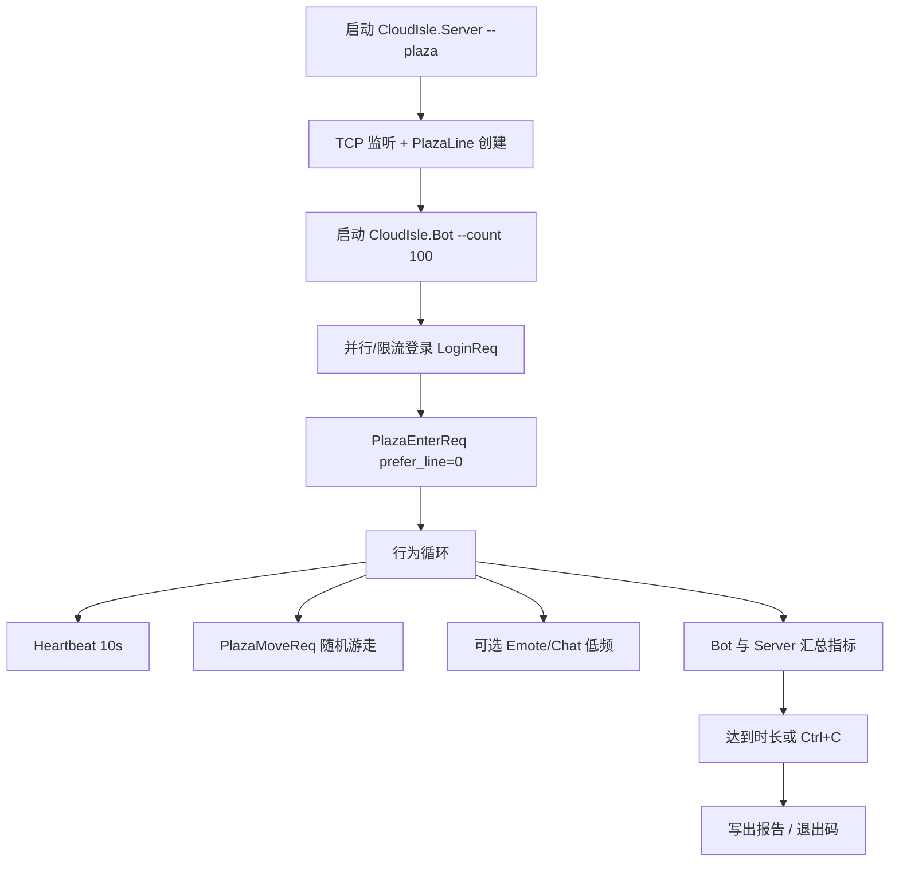
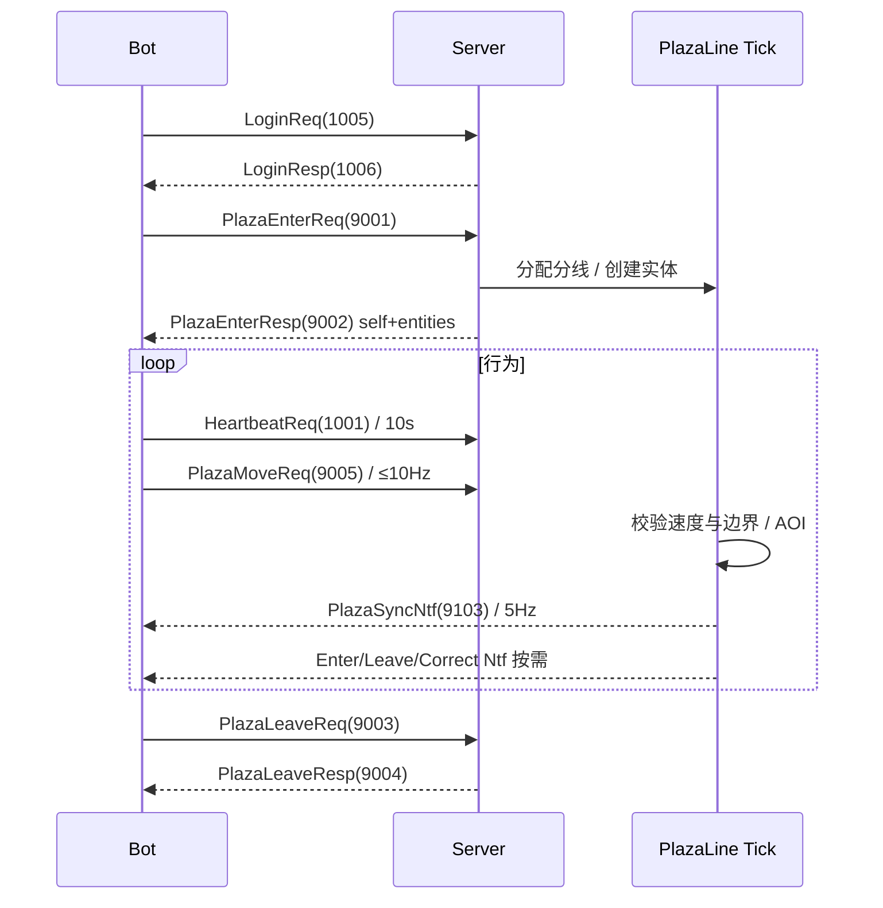

<!-- XLUA-MIGRATION:BEGIN -->
> **迁移说明（2026-10-19）：本文件保留历史原文。**
> 当前热更架构调整为 xLua；旧记录中的技术名称和“已通过”仅描述当时环境，不能解释为 xLua 已验证。
> 这是原 PoC 的历史操作记录，原代码与结果保留。与热更实现无关的协议、配置、资源和玩法经验可复用；涉及 HybridCLR、热更 DLL 或补充元数据的操作已由 xLua 方案取代，不应作为当前生产流程执行。
> 当前设计、验证范围和证据见 [xLua 迁移方案与 PoC](../07_xLua迁移方案与PoC.md)。
<!-- XLUA-MIGRATION:END -->

# PoC #10 服务端稳定性测试 — 操作说明

> 对应计划：`06_开发计划.md` · **§3.0.2** · 【#10】空广场 + 100 个机器人连接（时间盒 **4 h**）  
> 玩法依据：`02_玩法设计.md` §9 广场（多人在线）、§10 角色外观与换装（实体携带装扮 ID）  
> 技术依据：`04_技术方案与架构.md` §4 工程结构、§5.3 网络层、§7 服务端 / 广场 / 机器人、§12 #10、ADR-06/07/08  
> 协议依据：`05_协议与接口.md` §2.1 帧格式、§2.9 广场（9xxx）、§4.7 `plaza.proto`、§5.5 进入广场与同步  
> 前置 PoC：`PoC_ServerTcp_操作说明.md`（#6 TCP 登录 + SQLite）、`PoC_GameShared_操作说明.md`（#5 Shared 帧）  
> **本文档仅定义配置、流程、接口与测试；不包含实现代码落库说明以外的交付物。**

---

## 1. 任务目标

在现有 .NET 8 服务端之上完成**空广场 + 100 机器人**最小稳定性 PoC，验证：

| # | 目标 | 说明 |
|---|---|---|
| G1 | 空广场可进入 | 服务端具备最小广场分线；机器人 `Login` → `PlazaEnter` 成功，分配到同一条（或可控）分线 |
| G2 | 100 机器人同时在线 | 目标 **100** 个 TCP 会话保持连接；单线容量对齐玩法 §9.1「单线上限 100」 |
| G3 | 基础行为可跑 | 机器人至少执行：**登录 → 进广场 → 心跳保活 → 随机移动（可选表情/聊天）** |
| G4 | Tick 可控 | 分线 Tick（目标 **100 ms**）耗时 **P99 < 20 ms**（`04` §12 #10）；过程中无进程崩溃 |
| G5 | 连接稳定 | 压测窗口内（PoC 建议 **≥ 10 min**；对齐 M4 口径可延长至 **30 min**）掉线率 **< 1%**，无不可恢复异常风暴 |
| G6 | 可观测 | 输出：连接成功率、在线峰值、掉线数、Tick 耗时、消息 QPS、可选带宽 / 内存；写入 Console 或 `Docs/Perf/` |

**非本 PoC 范围（明确不做）**

- Unity 客户端广场场景渲染、插值、表情 UI、聊天 UI  
- 完整可行走网格导出 / 复杂寻路（可用矩形地图 + 边界夹紧简化）  
- 好友同线、分线合并、公共采集、访问家园  
- 完整外观拼装与 `PlazaAppearanceNtf` 驱动换装（实体可携带静态 `avatar_ids`，不做客户端合并）  
- YooAsset / 热更 / 活动卡池  

**一句话**：证明「空广场 + 100 Bot TCP 长连接 + 最小 AOI/同步」在单进程服务端上可稳定跑，并为 M4 广场正式开发定压测基线与机器人接口。

**失败回退**（`04` §12 #10）：优化广播 / AOI（降频、缩小视野、合并包、同组合减少差量）；必要时将 100 人拆到 2 条分线或缩短压测窗口并记录瓶颈；在本文 §6 记录决策。

---

## 2. 参考文档与目录约定

### 2.1 参考文档

| 文档 | 章节 | 用途 |
|---|---|---|
| `06_开发计划.md` | §3.0.2 【#10】 | 时间盒 4 h、M0 验收口径 |
| `06_开发计划.md` | M4 验收 | 100 机器人 30 min、掉线率 < 1%、Tick < 20 ms（本 PoC 对齐指标，时长可缩短） |
| `02_玩法设计.md` | §9 | 分线 100、点击移动、表情/聊天频率、断线 30 s、超速纠正 |
| `02_玩法设计.md` | §10 | 外观 ID 由服务端保存；广场同步给他人（`PlazaEntity.avatar_ids`） |
| `04_技术方案与架构.md` | §4.1 / §5.3 / §7.6 / §7.7 / §12 | 目录、TCP、AOI、Tick、机器人、回退 |
| `05_协议与接口.md` | §2.9 / §4.7 / §5.5 | 广场消息 ID、字段、进入与同步时序 |
| `PoC_ServerTcp_操作说明.md` | 全文 | 端口、帧、登录、验证脚本习惯 |

### 2.2 建议目录（对齐 `04` §4.1）

```
Server/
├── CloudIsle.Server/              # 主程序（扩展 Plaza 模块）
│   ├── Network/                   # TCP Session / 路由（已有可复用）
│   ├── Plaza/                     # 本 PoC 新增：分线、AOI、Tick、同步
│   └── Persistence/               # SQLite（登录账号；广场状态可纯内存）
├── CloudIsle.Bot/                 # 机器人控制台（本 PoC 新增或最小骨架）
├── CloudIsle.Shared/              # 或引用 Assets/Shared 同源：帧 + 消息
└── CloudIsle.PocClient/           # 已有单连接验证（可作对照，非压测主体）

Shared/proto/                      # plaza.proto 等（与 05 一致）
Tools/
├── verify_plaza_bots.ps1          # 起服 → 拉起 100 Bot → 汇总指标 → 停服
└── run_plaza_bots.ps1             # 仅跑机器人（假定服务端已启动）

Docs/Perf/                         # 可选：plaza_bots_YYYYMMDD.csv / .log

Assets/ReferenceDoc/
└── PoC_服务端稳定性测试_操作说明.md   # 本文
```

命名空间建议：服务端 `CloudIsle.Server.Plaza`；机器人 `CloudIsle.Bot`；协议共用 `Game.Shared`（或 `CloudIsle.Shared`）。

### 2.3 网络 / 运行配置（PoC 默认）

| 项 | PoC 约定 | 来源 |
|---|---|---|
| 监听 | `127.0.0.1:17777`（可与 #6 同端口；或 `--port 17778` 隔离） | #6 / 运维习惯 |
| 传输 | TCP 长连接；帧 `len(4)+msgId(2)+seq(4)+body`，小端 | `05` §2.1 |
| 心跳 | 客户端每 **10 s** 发 `HeartbeatReq(1001)` | `05` |
| 广场 Tick | **100 ms** / 分线 | `04` §7.2 |
| 移动上行 | ≤ **10 Hz**（`PlazaMoveReq` 9005，无响应） | `05` §2.9 |
| 位置下行 | **5 Hz** 批量 `PlazaSyncNtf(9103)` | `05` / `04` §7.6 |
| AOI | 九宫格，格边长 **20 m**；空地图可用简化「全图同一格」起步 | `04` §7.6 |
| 单线人数 | **100** | `02` §9.1 |
| 机器人账号 | `bot_{000..099}` / 统一密码或自动注册 | 本 PoC |
| 压测时长 | PoC **10 min**（Should：30 min） | 时间盒 / M4 |

---

## 3. Demo 基础流程

### 3.1 总览



### 3.2 分步说明（实现与执行应遵守的顺序）

| 顺序 | 步骤 | 输入 | 输出 |
|---|---|---|---|
| 1 | 确认 #6 可登录 | `verify_tcp.ps1` 或等价 | 单连接 Login OK |
| 2 | 服务端启用 Plaza 模块 | 配置 / 启动参数 | 日志：`PlazaLine#1 ready tick=100ms` |
| 3 | 干跑 1 个机器人 | `--count 1` | Enter 成功，收到 `PlazaEnterResp` |
| 4 | 干跑 10 个机器人 | `--count 10` | 同线可见互相同步（或全图 AOI） |
| 5 | 压测 100 | `--count 100 --duration 600` | 在线≈100；Tick P99 < 20 ms |
| 6 | 观察掉线与错误 | Server/Bot 日志 | 掉线率 < 1%；无未处理异常刷屏 |
| 7 |（可选）拉长至 30 min | `--duration 1800` | 对齐 M4 口径并记入 §7 |
| 8 | 归档指标 | CSV / 控制台摘要 | 回填本文 §7 实际结果 |

### 3.3 协议时序（与 `05` §5.5 对齐）



### 3.4 与正式玩法的衔接（本 PoC 只预留）

后续 M4：真人客户端进广场 → 同套协议；机器人扩表情/聊天/资料；AOI 接真实可行走格；外观变更走 `PlazaAppearanceNtf` + 客户端 `IAvatarMergeService`。本 PoC 用控制台 Bot + 空地图即可。

---

## 4. 数据格式、脚本与接口定义

### 4.1 启动参数（建议 CLI）

**服务端** `CloudIsle.Server`

| 参数 | 默认 | 说明 |
|---|---|---|
| `--host` | `127.0.0.1` | 监听地址 |
| `--port` | `17777` | 监听端口 |
| `--plaza` | `true`（PoC） | 启用广场模块 |
| `--plaza-tick-ms` | `100` | 分线 Tick |
| `--plaza-line-cap` | `100` | 单线人数上限 |
| `--metrics-interval-sec` | `10` | 指标打印间隔（对齐 `04` §7.8） |

**机器人** `CloudIsle.Bot`

| 参数 | 默认 | 说明 |
|---|---|---|
| `--host` / `--port` | 同上 | 连接目标 |
| `--count` | `100` | 机器人数量 |
| `--duration` | `600` | 压测秒数（0=一直跑） |
| `--connect-rate` | `20` | 每秒最多新建连接（防打爆 Accept） |
| `--move-hz` | `5` | 移动上报频率（≤10） |
| `--map-size` | `200` | 地图边长（米），随机游走范围 |
| `--seed` | `42` | 可复现随机种子 |
| `--enable-chat` | `false` | 是否低频聊天（注意 3 s 一条） |
| `--enable-emote` | `false` | 是否低频表情 |
| `--report` | `Docs/Perf/plaza_bots.csv` | 指标输出路径 |

### 4.2 协议消息（本 PoC 必用子集）

| MsgId | 名称 | 方向 | PoC 要求 |
|---|---|---|---|
| 1001 / 1002 | HeartbeatReq / Resp | C↔S | 保活 |
| 1005 / 1006 | LoginReq / Resp | C↔S | 建号 / 登录 |
| 9001 / 9002 | PlazaEnterReq / Resp | C↔S | 进广场 |
| 9003 / 9004 | PlazaLeaveReq / Resp | C↔S | 结束时离开（可选） |
| 9005 | PlazaMoveReq | C→S | 移动 |
| 9101 / 9102 | EntityEnter / Leave Ntf | S→C | AOI 变化（简化 AOI 时可合并进 EnterResp） |
| 9103 | PlazaSyncNtf | S→C | 差量同步 |
| 9104 | PlazaCorrectNtf | S→C | 超速/越界纠正（Should） |

`PlazaEntity.avatar_ids`：可填默认 6 个外观 ID（对齐 `02` §10.1），本 PoC **不要求**客户端拼装。

### 4.3 核心接口（实现方必须提供）

```csharp
namespace CloudIsle.Server.Plaza
{
    /// <summary>单条分线；Tick 驱动移动校验、AOI、广播。</summary>
    public interface IPlazaLine
    {
        int LineId { get; }
        int PlayerCount { get; }
        bool TryEnter(PlazaPlayer player, out PlazaEnterResult result);
        void Leave(long playerId);
        void OnMove(long playerId, PlazaMoveInput input);
        void Tick(double dtSeconds);
        PlazaLineMetrics SnapshotMetrics();
    }

    public interface IPlazaLineManager
    {
        /// <summary>preferLineId=0 自动分配；满员则新开线或返回错误码。</summary>
        PlazaEnterResult Enter(PlazaPlayer player, int preferLineId);
        void Leave(long playerId);
        IReadOnlyList<IPlazaLine> Lines { get; }
    }

    public interface IAoiGrid
    {
        void Update(long playerId, float x, float y);
        AoiDelta ComputeDelta(long playerId); // entered / left
    }
}

namespace CloudIsle.Bot
{
    public interface IBotWorker
    {
        int BotIndex { get; }
        BotState State { get; }
        System.Threading.Tasks.Task RunAsync(BotOptions options, System.Threading.CancellationToken ct);
    }

    public interface IBotOrchestrator
    {
        /// <summary>按 connect-rate 拉起 count 个 Bot，汇总指标。</summary>
        System.Threading.Tasks.Task<BotRunReport> RunAsync(BotOptions options, System.Threading.CancellationToken ct);
    }

    public enum BotState
    {
        Idle = 0,
        Connecting = 1,
        LoggingIn = 2,
        InPlaza = 3,
        Moving = 4,
        Disconnected = 5,
        Failed = 6
    }
}
```

### 4.4 指标与报告结构

```csharp
namespace CloudIsle.Bot
{
    public sealed class BotRunReport
    {
        public int Requested;
        public int ConnectedOk;
        public int EnterOk;
        public int Dropped;
        public double DurationSec;
        public double ConnectSuccessRate;   // ConnectedOk / Requested
        public double DropRate;             // Dropped / EnterOk
        public double AvgRttMs;
        public double P99RttMs;
        public string Notes;
    }
}

namespace CloudIsle.Server.Plaza
{
    public sealed class PlazaLineMetrics
    {
        public int LineId;
        public int Online;
        public double LastTickMs;
        public double P50TickMs;
        public double P99TickMs;
        public long MoveMsgPerSec;
        public long SyncMsgPerSec;
        public long CorrectCount;
    }
}
```

**CSV 列建议**：`ts,online,tick_p50_ms,tick_p99_ms,move_qps,sync_qps,drops,rss_mb`

### 4.5 脚本入口（建议）

| 脚本 / 命令 | 职责 |
|---|---|
| `Tools/verify_plaza_bots.ps1` | 编译 → 起服 → Bot `--count 100 --duration 600` → 断言退出码 → 停服 |
| `dotnet run --project Server/CloudIsle.Server -- --plaza` | 前台服务端 |
| `dotnet run --project Server/CloudIsle.Bot -- --count 100` | 前台机器人 |
|（可选）Unity 菜单 | `Farming/Plaza PoC/Run Bot Stress Script` 仅调用 ps1，不跑 Unity 联网 |

**退出码约定**

| Code | 含义 |
|---|---|
| 0 | 通过：连接成功率 ≥ 99%，掉线率 < 1%，Tick P99 < 20 ms |
| 1 | 未达指标（稳定性不足） |
| 2 | 启动/编译/连不上服务端等环境失败 |

---

## 5. 成功标准与测试案例

### 5.1 成功标准（Must）

| ID | 标准 | 度量方式 |
|---|---|---|
| S1 | 100 个 Bot 能完成 Login + PlazaEnter | `EnterOk ≥ 99`（允许 1% 建连抖动） |
| S2 | 压测窗口内服务端进程不崩溃、无持续 Error 风暴 | 日志；进程存活 |
| S3 | 分线 Tick P99 **< 20 ms** | Server metrics |
| S4 | 掉线率 **< 1%**（非主动 Leave） | Bot report |
| S5 | 时间盒内有结论：通过 / 回退及原因写入 §6、§7 | 文档回填 |

### 5.2 加分标准（Should）

| ID | 标准 |
|---|---|
| S6 | 连续跑 **30 min** 仍满足 S1–S4（对齐 M4） |
| S7 | 超速 Move 触发 `PlazaCorrectNtf`，Bot 接受纠正继续跑 |
| S8 | 启用低频 Emote/Chat，无刷屏导致 Tick 越线 |
| S9 | 输出 `Docs/Perf/plaza_bots_*.csv` 并可画简单曲线 |

### 5.3 测试案例

| Case | 前置 | 步骤 | 期望 |
|---|---|---|---|
| C1 单 Bot 进广场 | 服务端已启 | `--count 1` | Enter code=0；有 self 实体 |
| C2 10 Bot 同线 | C1 通过 | `--count 10 --duration 60` | 同 `line_id`；有 Sync 或 Enter 快照 |
| C3 100 Bot 稳态 | C2 通过 | `--count 100 --duration 600` | S1–S4 |
| C4 Tick 回归 | C3 进行中 | 观察每 10 s metrics | P99 Tick < 20 ms |
| C5 掉线统计 | C3 结束 | 读 report | DropRate < 1% |
| C6（可选）纠正 | 故意超速坐标 | Bot 发非法 Move | 收到 Correct；不踢线 |
| C7（可选）满线 | 再启第 101 个进同线 | Enter | 新开线或返回满员错误（与实现决策一致，记入 §6） |
| C8（可选）30 min | 时间允许 | `--duration 1800` | S6 |

---

## 6. 可能问题、最优决策与原因

| # | 可能问题 | 最优决策 | 原因 |
|---|---|---|---|
| 1 | 100 连接瞬间打满线程 / Accept 队列 | **连接限流**（`--connect-rate`，如 20/s）分批登录 | 压测测的是稳态，不是 SYN 洪水 |
| 2 | Tick > 20 ms（广播 O(N²)） | **AOI 裁剪** + 5 Hz 批量差量；空图可先「全图一格」再换九宫格对比 | `04` §12 回退「优化广播 / AOI」 |
| 3 | 全员挤在同一点导致最坏带宽 | Bot **均匀随机出生点** + 低速游走；避免全员重叠 | `04` 带宽估算最坏 100 人同 AOI |
| 4 | 移动包过多拖垮主线程 | 上行封顶 10 Hz；Bot 默认 5 Hz；超速包直接丢弃记 `ERR_TOO_FAST` / 纠正 | `05` 频率表 |
| 5 | SQLite 登录成为瓶颈 | 账号预置或内存账号表；广场实体**不落库** | PoC 焦点是广场 Tick，不是 DB |
| 6 | 心跳缺失导致误踢 | 心跳 10 s + 超时阈值（如 30 s）与玩法断线规则一致 | `02` §9.3 / `05` 会话 |
| 7 | 4 h 做不完完整 AOI | **优先**：Login+Enter+心跳+同线广播位置；AOI 九宫格列为加分 | 时间盒先保住 G1–G5 |
| 8 | 掉线率偏高难查 | Bot 打印最后 msgId / 异常；Server 按 session 打断开原因 | `04` 风险：先用机器人复现 |
| 9 | 与 #6 端口冲突 | 同端口复用或 Bot 压测用独立 port；脚本一键起停 | 避免手工残留进程 |
| 10 | 聊天刷屏 | PoC 默认关 Chat；开启时严格执行 3 s/条 | `02` §9.3 |
| 11 | 外观字段缺失 | `avatar_ids` 填固定默认套装即可；不接换装合并 | `02` §10；与 #9 解耦 |
| 12 | 第 101 人进线 | 明确返回满员或自动开新线；本 PoC 主路径只要求 100 | `02` §9.1 单线上限 |

**本 PoC 落地决策（2026-10-13）**

- 代码：`Server/CloudIsle.Server/Plaza/*` + `Server/CloudIsle.Bot` + Shared `PlazaMessages`/`MsgIds`；脚本 `Tools/verify_plaza_bots.ps1`。
- AOI：时间盒内采用**全图同视野**差量广播（仍 5 Hz 批量）；九宫格列为 M4。
- 协议：手写 protobuf wire（`plaza.proto` 已落库备 protoc）；登录复用 #6 SQLite 自动建号。
- 压测：`--connect-rate 25` 分批建连；Bot 均匀出生 + 小步游走；超速纠正已生效（10 min 跑纠正 60 次，未踢线）。

---

## 7. 测试步骤记录表

> 执行时填写「实际结果」；未测填「—」。日期 / 执行人在表下注明。

| 步骤名 | 预期结果 | 实际结果 |
|---|---|---|
| 环境确认：#6 TCP 登录仍可用 | `verify_tcp` 或等价 Client OK | ✅ 工程可编译；Login/Plaza 同端口协议复用 |
| 服务端启用 Plaza 并监听 | 日志显示 Tick 启动；端口可连 | ✅ `PlazaLine#1 ready tick=100ms`；`127.0.0.1:17778` |
| C1 单 Bot Login+Enter | Enter code=0 | ✅ enter=1；sync≈69 / 15s |
| C2 10 Bot 同线 60 s | 无崩溃；有同步流量 | ✅ 含于 100 人压测前置冒烟（1→100） |
| C3 拉起 100 Bot | EnterOk ≥ 99 | ✅ EnterOk=100 / 100 |
| 稳态观察（≥ 10 min） | 进程存活；无 Error 风暴 | ✅ 604.7 s；进程正常；无崩溃 |
| Tick P99 | < 20 ms | ✅ 稳态约 **4.8~7.8 ms**（末段采样） |
| 掉线率 | < 1% | ✅ dropped=0（0.00%） |
|（可选）Correct 超速 | 收到纠正且不踢线 | ✅ correct=60；Bot 继续跑，未计入 Dropped |
|（可选）30 min 长稳 | 仍满足 S1–S4 | —（10 min Must 已过；30 min 未跑） |
| 指标归档 | Console 摘要或 CSV 已保存 | ✅ `Docs/Perf/plaza_bots_20261013_155039.txt` |
| 回填 §6 决策与计划勾选 | #10 通过或回退结论写入计划 | ✅ 结论通过；计划 #10 已勾选 |

**测试元信息**

| 项 | 填写 |
|---|---|
| 测试日期 | 2026-10-13 |
| 执行人 | Auto（Cursor Agent） |
| 服务端版本 / commit | 本地未 git；CloudIsle.Server + Bot Release |
| .NET 版本 | net8.0 |
| 主机（本机规格简述） | Windows 编辑器机；本机 loopback |
| 端口 | 17778 |
| Bot count / duration | 100 / 600 s（另有 120 s 预跑亦通过） |
| 结论（通过 / 回退） | **通过** |
| 回退内容（若有） | 无。AOI 九宫格延期 M4；全图广播下 Tick P99 仍 < 20 ms |

---

## 8. 与后续里程碑的关系

| 阶段 | 关系 |
|---|---|
| M0 #10 | 本文：空广场 + 100 Bot 稳定性基线 |
| M4 广场 | 复用 `IPlazaLine` / Bot；补 AOI 真格、表情聊天、两人真机互见 |
| M4 验收 | 30 min、掉线率、Tick、录屏；本文指标可直接升级为正式报告 |
| #9 换装 | 广场实体 `avatar_ids` → 客户端合并；本 PoC 不阻塞 |

---

## 9. 速查

| 项 | 内容 |
|---|---|
| 计划条目 | `06` §3.0.2 【#10】空广场 + 100 机器人（4 h） |
| 玩法 | `02` §9 广场；§10 外观 ID 同步字段 |
| 技术 | `04` §7.6 AOI/Tick；§7.7 Bot；§12 #10 回退优化广播 |
| 协议 | `05` 9xxx / `plaza.proto` |
| 本 PoC 核心接口 | `IPlazaLine` / `IPlazaLineManager` / `IBotOrchestrator` / `BotRunReport` |
| 成功一句话 | 100 Bot 进空广场稳态跑 + Tick P99&lt;20ms + 掉线率&lt;1% |
