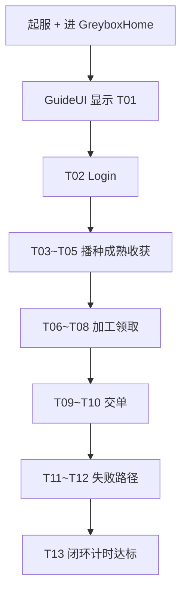
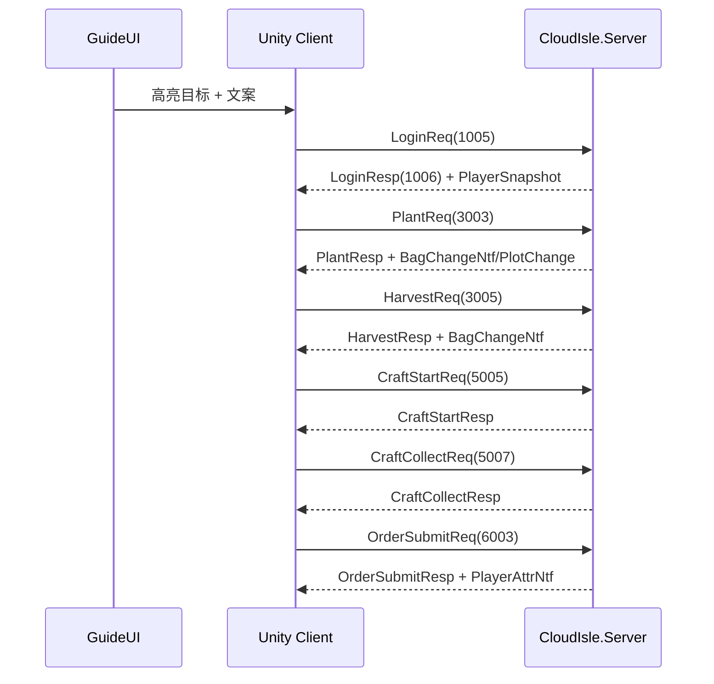

<!-- XLUA-MIGRATION:BEGIN -->
> **迁移说明（2026-10-19）：本文件保留历史原文。**
> 当前热更架构调整为 xLua；旧记录中的技术名称和“已通过”仅描述当时环境，不能解释为 xLua 已验证。
> 这是原 PoC 的历史操作记录，原代码与结果保留。与热更实现无关的协议、配置、资源和玩法经验可复用；涉及 HybridCLR、热更 DLL 或补充元数据的操作已由 xLua 方案取代，不应作为当前生产流程执行。
> 当前设计、验证范围和证据见 [xLua 迁移方案与 PoC](../07_xLua迁移方案与PoC.md)。
<!-- XLUA-MIGRATION:END -->

# M0 灰盒玩法测试 — 操作说明

> 对应计划：`06_开发计划.md` · **§3.0.3** 灰盒玩法原型（**不设 10 h 时间盒**；以可验收闭环为准）  
> 玩法依据：`02_玩法设计.md` §1 核心循环、§3 种植、§5 加工、§6 订单、§7 成长、§15 自测清单（子集）  
> 技术依据：`04_技术方案与架构.md` §4 工程结构、§5.3 网络层、§7 服务端权威  
> 协议依据：`05_协议与接口.md` Login / Bag / Plant / Harvest / Craft / Order（**客户端必须走 TCP，服务端裁决**）  
> 前置：`PoC_ServerTcp_操作说明.md`（#6）、`PoC_服务端稳定性测试_操作说明.md`（#10 会话模型可复用）  
> **本文档仅定义配置、流程、接口与测试；不包含实现代码落库说明以外的交付物。**

---

## 1. 任务目标

在 Unity **6000.3.22f1** + **CloudIsle.Server（.NET 8）** 上完成**联网灰盒经营原型**，验证基本玩法闭环，并在 **Game 视图 UI 中逐步提示测试步骤**（含点击位置与操作方法）。

| # | 目标 | 可验收口径（禁止仅写「正确」） |
|---|---|---|
| G1 | 灰盒场景 | Play 后可见 **9** 个带 Collider 的地块、**1** 磨坊方块、**1** 订单板方块；对象名 `Plot_0..8` / `Facility_Mill` / `OrderBoard` |
| G2 | 联网登录 | 客户端连接 `127.0.0.1:17777`（或配置端口）后 `LoginResp.code=0`，HUD 显示 `playerId` 与初始背包 |
| G3 | 种植闭环 | 对空地块发 `PlantReq` → 服务端返回成功 → HUD 种子数 **-1**；成熟后 `HarvestReq` 成功 → 小麦数 **≥ 播种前 +1**，地块回到 Empty |
| G4 | 加工闭环 | `CraftStartReq` 成功时小麦 **-3**；完成后 `CraftCollectReq` 面粉 **+1**，槽位回 Idle |
| G5 | 订单闭环 | `OrderSubmitReq` 成功：面粉按需求扣除，金币 **+20**、经验 **+10**（灰盒默认奖励）；二次提交 `code≠0` |
| G6 | 引导 UI | 屏幕常驻 **测试步骤面板**：当前步骤 ID、操作文案、**世界目标高亮/箭头**、点击区域说明；步骤随验收自动推进 |
| G7 | 五分钟闭环 | 从步骤 `T01` 到 `T12` 完成，墙钟 **≤ 300 s**（允许服务端将作物成熟设为 10 s） |

**非本范围**

- 广场、抽卡、换装、热更活动、完整 UGUI 商城  
- 采集点 / 工具 / 设施升级 / 订单跨日刷新算法完整实现（可用服务端预置 1 条固定订单）  
- 朋友 / 外部试玩（**已删除**）  
- 纯本地内存模拟（**禁止**作为主路径；必须 TCP + 服务端状态）

**一句话**：联网灰盒跑通「种→收→加工→交单」，且 UI 逐步告诉测试者点哪里、怎么点。

**失败回退**

- 协议未齐：服务端先实现灰盒专用最小 Handler（字段对齐 `05`），客户端仍走同一 MsgId。  
- 成熟过慢：服务端灰盒模式 `crop.grow_sec=10`。  
- 决策记入 §6。

---

## 2. 参考文档与目录约定

### 2.1 参考文档

| 文档 | 章节 | 用途 |
|---|---|---|
| `06_开发计划.md` | §3.0.3 | 灰盒场景与闭环范围（忽略原文 10 h / 朋友试玩估时） |
| `02_玩法设计.md` | §1 / §3 / §5 / §6 | 规则语义 |
| `04_技术方案与架构.md` | §4 / §5.3 / §7 | 目录、TCP、服务端权威 |
| `05_协议与接口.md` | 1xxx~6xxx | Login / Plant / Harvest / Craft / Order |
| `PoC_ServerTcp_操作说明.md` | 全文 | 端口、帧、登录基线 |

### 2.2 建议目录

```
Assets/
├── Scenes/GreyboxHome.unity
├── Hotfix/Modules/Greybox/
│   ├── GreyboxClientSession.cs      # TCP 会话（复用 Shared PacketCodec）
│   ├── GreyboxNetFarmApi.cs         # Plant/Harvest 封装
│   ├── GreyboxNetCraftApi.cs
│   ├── GreyboxNetOrderApi.cs
│   ├── GreyboxWorldPresenter.cs     # 地块/设施/订单板表现
│   └── UI/
│       ├── GreyboxTestGuideUI.cs    # ★ 测试步骤面板（必做）
│       ├── GreyboxHudUI.cs          # 金币/经验/背包数字
│       └── GreyboxWorldMarker.cs    # 目标物体描边/箭头/脉冲
├── Editor/Greybox/GreyboxSetupTools.cs
Server/CloudIsle.Server/
├── Greybox/                         # 或扩展现有 Handler
│   ├── GreyboxFarmHandler.cs
│   ├── GreyboxCraftHandler.cs
│   └── GreyboxOrderHandler.cs
Assets/ReferenceDoc/
└── 灰盒玩法测试_操作说明.md
```

### 2.3 运行配置

| 项 | 约定 |
|---|---|
| Unity | 6000.3.22f1 / URP |
| 服务端 | `dotnet run --project Server/CloudIsle.Server -- --host 127.0.0.1 --port 17777 --greybox` |
| 时钟 | **仅服务端 UTC**；客户端倒计时 = `readyTime - serverNow`（用心跳/`server_time` 校准） |
| 地块 | 3×3，`plot_id=0..8`，全部解锁 |
| 作物 | 小麦 seed=`2001`，产出 item=`1001`；灰盒 `grow_sec=10` |
| 设施 | `facility_id=1` 磨坊，slot=`0`；配方 `recipe_id=1`：3×小麦→1×面粉，`craft_sec=8` |
| 订单 | 预置 `order_id=1`：面粉×1 → gold+20、exp+10 |
| 初始 | Login 后种子×9、金币 100、经验 0、等级≥1 |
| 测试账号 | `greybox_tester` / `poc`（自动建号） |

---

## 3. 基础流程

### 3.1 总览



### 3.2 协议时序（主路径）



### 3.3 测试引导 UI 要求（Must）

屏幕左侧（或顶部）固定面板，**任何时刻**至少显示：

| UI 元素 | 要求 |
|---|---|
| 步骤 ID | 如 `T05`，字号 ≥ 28 |
| 步骤标题 | 一句话，如「收获成熟作物」 |
| 操作方法 | 明确输入：`鼠标左键点击` / `点击 HUD「交付」按钮` |
| 点击位置 | 文字描述世界目标 + 屏幕方位，例：`场景中央偏左 · 绿色地块 Plot_0` |
| 验收条件 | 当前步通过条件的数值断言（见 §5 各 ID） |
| 进度 | `当前/总步` + 已用秒数 |
| 世界标记 | 当前目标物体：黄色描边或箭头；非目标降低亮度 |
| 阻挡 | 未完成当前步时，点击非目标给出 Toast：`请先完成 Txx：…` |

步骤推进：仅当 **服务端回包满足该步断言** 后自动进入下一步（禁止仅靠本地猜测）。

---

## 4. 数据格式、脚本与接口

### 4.1 测试步骤定义表（数据驱动 UI）

```csharp
namespace Game.Hotfix.Modules.Greybox
{
    public enum GreyboxGuideAction
    {
        None = 0,
        ClickWorldTarget = 1,   // 点场景物体
        ClickHudButton = 2,     // 点 UI 按钮
        WaitServerState = 3,    // 等待成熟/完成（可显示倒计时）
        AssertOnly = 4          // 只读断言，无点击
    }

    [System.Serializable]
    public sealed class GreyboxGuideStep
    {
        public string Id;                 // T01...
        public string Title;
        public string HowTo;              // 操作方法
        public string Where;              // 点击位置描述
        public GreyboxGuideAction Action;
        public string WorldTargetName;    // Plot_0 / Facility_Mill / OrderBoard
        public string HudButtonId;        // 可选
        public string PassPredicateId;    // 对应断言器
    }
}
```

### 4.2 网络 API（客户端，对齐 `05`）

```csharp
namespace Game.Hotfix.Modules.Greybox
{
    public interface IGreyboxClientSession
    {
        System.Threading.Tasks.Task ConnectAsync(string host, int port);
        System.Threading.Tasks.Task<CloudIsle.Proto.LoginResp> LoginAsync(string user, string pass);
        bool IsConnected { get; }
        long PlayerId { get; }
    }

    public interface IGreyboxFarmApi
    {
        System.Threading.Tasks.Task<PlantResult> PlantAsync(int plotId, int seedId, long opId);
        System.Threading.Tasks.Task<HarvestResult> HarvestAsync(int plotId, long opId);
    }

    public interface IGreyboxCraftApi
    {
        System.Threading.Tasks.Task<CraftStartResult> StartAsync(int facilityId, int slotId, int recipeId, long opId);
        System.Threading.Tasks.Task<CraftCollectResult> CollectAsync(int facilityId, int slotId, long opId);
    }

    public interface IGreyboxOrderApi
    {
        System.Threading.Tasks.Task<OrderSubmitResult> SubmitAsync(int orderId, long opId);
    }

    /// <summary>镜像服务端权威状态（仅由 Ntf/Resp 更新，禁止本地私自改数值）。</summary>
    public interface IGreyboxPlayerState
    {
        int Gold { get; }
        int Exp { get; }
        int GetItemCount(int itemId);
        PlotState GetPlotState(int plotId);
        SlotState GetSlotState(int facilityId, int slotId);
        bool IsOrderCompleted(int orderId);
    }
}
```

结果类型须含：`int Code`、变更后的关键数量或实体快照（便于断言）。

### 4.3 服务端灰盒 Handler 约定

| MsgId | 名称 | 灰盒行为 |
|---|---|---|
| 1005/1006 | Login | 自动建号；发初始种子 9、预置磨坊与订单 |
| 3003/3004 | Plant | 校验空地+种子；写 `plantTime/readyTime=now+10s` |
| 3005/3006 | Harvest | `now>=readyTime`；产量固定 **2**（灰盒简化，免随机） |
| 5005/5006 | CraftStart | 扣 3 小麦；`finishTime=now+8s` |
| 5007/5008 | CraftCollect | Done→发 1 面粉 |
| 6003/6004 | OrderSubmit | 扣 1 面粉；+20 金 +10 经验；标记完成 |
| 1001/1002 | Heartbeat | 携带 `server_time` 供倒计时 |

所有写操作带 `op_id`；重复 `op_id` 返回首次结果（幂等）。

### 4.4 GuideUI 仿写要点（Unity 6000.3）

使用 **uGUI**：`Canvas`（Screen Space Overlay）+ `TextMeshPro`（或 `UnityEngine.UI.Text`）+ `Button`。世界标记用目标物体子节点 `SpriteRenderer`/简单四棱锥，或 Outline。

```csharp
// 逻辑示意：步骤面板绑定（非落库强制实现）
using UnityEngine;
using UnityEngine.UI;

namespace Game.Hotfix.Modules.Greybox
{
    public sealed class GreyboxTestGuideUI : MonoBehaviour
    {
        [SerializeField] Text _stepId;
        [SerializeField] Text _title;
        [SerializeField] Text _howTo;
        [SerializeField] Text _where;
        [SerializeField] Text _passHint;
        [SerializeField] Text _progress;

        public void Bind(GreyboxGuideStep step, int index, int total, float elapsedSec)
        {
            _stepId.text = step.Id;
            _title.text = step.Title;
            _howTo.text = "操作：" + step.HowTo;
            _where.text = "位置：" + step.Where;
            _passHint.text = "通过条件：" + step.PassPredicateId;
            _progress.text = $"{index + 1}/{total}  用时 {elapsedSec:0}s";
        }
    }
}
```

点击：`Physics.Raycast` 命中 `WorldTargetName` 后才调用对应 Net API；Input System 工程用 `Mouse.current.leftButton.wasPressedThisFrame`。

---

## 5. 成功标准与测试案例（逐步 ID）

### 5.1 Must 总览

| ID | 标准 |
|---|---|
| S1 | GuideUI 可见且含步骤 ID/操作/位置三块文案 |
| S2 | 全主路径 `T01`→`T12` 均按断言通过 |
| S3 | 任意断言依赖的背包/金币变化均来自服务端回包 |
| S4 | Console 无未处理 Exception；断线时 GuideUI 显示「请重启服务端」 |
| S5 | `T13` 墙钟 ≤ 300 s |

### 5.2 逐步测试案例（每步可独立勾选）

> **Pass** 列是唯一验收依据；填写 §7「实际结果」时写：`通过` / `失败(现象)` / `—`。

| 步骤 ID | UI 应显示的标题 | 操作方法 | 点击位置 | Pass（可度量） |
|---|---|---|---|---|
| **T01** | 确认场景与引导 UI | 进入 Play，无需点击 | — | GuideUI 显示 `T01`；Hierarchy 存在 `Plot_0..8`、`Facility_Mill`、`OrderBoard`；`GreyboxWorldMarker` 指向 `Plot_0` |
| **T02** | 连接并登录 | 点击 HUD「登录」按钮 | 屏幕右上 HUD 按钮 `Btn_Login` | `LoginResp.code==0`；HUD `playerId>0`；种子数 `==9`；金币 `==100`；Guide 自动进入 T03 |
| **T03** | 播种第 1 块地 | 鼠标左键点击 | 场景：高亮的 `Plot_0`（空地，灰色） | `PlantResp.code==0`；种子 `==8`；`Plot_0.state==Growing`；Marker 仍可留在 Plot_0 或改倒计时 |
| **T04** | 等待作物成熟 | 等待（可看倒计时） | —（禁止点其他地块） | 客户端显示剩余秒 ≤10；当 `Plot_0.state==Ripe`（以服务端刷新/查询为准）进入 T05；等待超时墙钟 &gt;15 s 则本步失败 |
| **T05** | 收获 | 鼠标左键点击 | `Plot_0`（成熟，绿色） | `HarvestResp.code==0`；小麦 `== 收获前+2`；`Plot_0.state==Empty`；种子仍为 8 |
| **T06** | 再种 3 块凑材料 | 依次左键点击 | 高亮 `Plot_1`→`Plot_2`→`Plot_3`（每块一次） | 三次 Plant 均 `code==0`；种子 `==5`；三地块均为 Growing 或已 Ripe |
| **T07** | 收获三块地 | 依次左键点击成熟地块 | `Plot_1`/`Plot_2`/`Plot_3`（须 Marker 逐个指示） | 三次 Harvest `code==0`；小麦 `≥ 收获前累计 +6`（固定产量 2×3） |
| **T08** | 开始磨坊加工 | 鼠标左键点击 | `Facility_Mill`（蓝色方块，场景右侧） | `CraftStartResp.code==0`；小麦 **-3**；槽位 `Working`；Guide 显示剩余加工秒 |
| **T09** | 等待加工完成并领取 | 完成后左键点击磨坊 | `Facility_Mill` | `CraftCollectResp.code==0`；面粉 `== 领取前+1`；槽位 `Idle` |
| **T10** | 交付订单 | 鼠标左键点击订单板 或 HUD「交付」 | `OrderBoard`（场景后方木牌）或 `Btn_SubmitOrder` | `OrderSubmitResp.code==0`；面粉 **-1**；金币 `==120`；经验 `==10`；订单完成标志 true |
| **T11** | 重复交单应失败 | 再次点击订单板/交付按钮 | 同 T10 | `OrderSubmitResp.code≠0`（建议 501/`ERR_ORDER_INVALID`）；金币仍为 **120**（不变） |
| **T12** | 材料不足加工应失败 | 左键点磨坊尝试开新单 | `Facility_Mill` | 当小麦 &lt;3 时 `CraftStartResp.code≠0`；小麦数量不变；槽位保持 Idle |
| **T13** | 闭环计时 | 自动 | — | 从 T02 登录成功到 T10 首次交单成功，`realtimeSinceStartup` 差 **≤300**；GuideUI 显示 `PASS` |

### 5.3 辅助案例（回归）

| Case ID | 前置 | 操作 | Pass |
|---|---|---|---|
| R01 | 未登录 | 点 `Plot_0` | 不发 Plant 或回 `102`；种子不变；Toast 提示先登录 |
| R02 | T03 后 | 再点同一 `Plot_0` | Plant `code≠0`；种子不再减少 |
| R03 | 服务端关闭 | 任意写操作 | GuideUI 报错文案含「连接断开」；无客户端私自改背包 |
| R04 | 完成 T10 | 打开 Console | 无 Error；允许既有无关 Warning |

---

## 6. 可能问题、最优决策与原因

| # | 可能问题 | 最优决策 | 原因 |
|---|---|---|---|
| 1 | 想偷懒做纯本地 | **禁止**；主路径必须 TCP+服务端 | 需求明确联网权威；避免与 M2 双轨 |
| 2 | `05` 消息体未全部生成 | 灰盒 Handler 用与 #10 相同的手写 wire / 增量 proto，**MsgId 不变** | 保持协议表稳定 |
| 3 | 测试者不知道点哪 | GuideUI + WorldMarker **强制**；未点对目标则拦截 | 需求第 4 点 |
| 4 | 成熟/加工等待无聊 | 灰盒 `grow_sec=10`、`craft_sec=8`；倒计时显示服务端剩余 | 保证 T13≤300s |
| 5 | 产量随机导致断言不稳 | 灰盒收获固定产量 **2** | 步骤 Pass 可机器判定 |
| 6 | 客户端本地先扣再等回包 | 禁止乐观扣减；或乐观后以 Resp 校准，失败回滚 | 防假通过 |
| 7 | 输入系统不一致 | Raycast + 旧 Input 或 Input System 二选一，写入元信息 | Unity 6000 工程差异 |
| 8 | 步骤 ID 与实现脱节 | `GreyboxGuideStep` 表驱动 UI 与断言器同一份数据 | 防文档/UI 漂移 |
| 9 | 订单奖励与文档不符 | 固定 20 金 / 10 经验，写死在服务端灰盒配置 | 断言金币==120 |
| 10 | 误用 timeScale 加速服务端 | 客户端 timeScale **不影响**服务端 readyTime | 权威在服 |
| 11 | Unity 收包假死 / 登录卡「连接中」 | **禁止**主线程 `ReadAsync`+短超时取消；Connect 后起**独立收包循环**填 inbox | 见 §6.1 |
| 12 | 点击地块回包延迟数十秒 | **禁止**每帧 fire-and-forget `PumpAsync` 抢同一把 IO 锁 | 见 §6.1 |
| 13 | 服务端已 Login OK、客户端无感 | 以客户端 Console `[GreyboxNet] recv` 为准；补阶段 Toast / 点击日志 | 服务端成功≠客户端已消费回包 |
| 14 | 点了没反应难排查 | 鼠标按下立刻打 `[GreyboxClick]`（含 hit / target / busy） | 区分「没点到」与「网络慢」 |

### 6.1 Unity 客户端网络联调踩坑（2026-10-13）

> 控制台冒烟 `verify_greybox.ps1` / `CloudIsle.GreyboxSmoke` **一直正常**（闭环 ~30s）；下列问题只出现在 **Unity `GreyboxNetClient` 手测路径**。

#### 现象 A：T02 服务端已登录，客户端卡「连接中」约 15～20s

| 项 | 内容 |
|---|---|
| 服务端日志 | `[TCP] +session` → `[Login] greybox OK user=… seeds=9 gold=100`（请求已处理、回包已写出） |
| 客户端表现 | GuideUI / Toast 长期停在「连接中…」，迟迟不进 T03 |
| 错误根因 | ① 用 `NetworkStream.ReadAsync` + `CancellationToken` 做短超时轮询：在 Unity 上取消常**不返回**，`WaitAsync` 假死；② 与 `Update` 并发读同一流，帧破碎/丢包风险 |
| 决策 | Connect 成功后 `Task.Run` 启动**唯一收包循环**→ `Decode` 入 `_inbox`；业务 `Request` 只 `Send` + 轮询 inbox（`Task.Delay(5)`），**不再**在请求路径上直接 `ReadAsync`+Cancel |
| 代码落点 | `Assets/Demo/Greybox/GreyboxNetClient.cs`（`RecvLoopAsync` / `WaitInboxAsync`） |

#### 现象 B：点击地块后 ≥30s 才收到 Plant/任务回馈

| 项 | 内容 |
|---|---|
| 服务端 | 往往早已处理完 Plant（本地延迟并不在服） |
| 客户端 | 点击后很久才 `Advance` / Toast 成功；体感「网络极慢」 |
| 错误根因 | `Update` **每帧** `_ = PumpAsync(...)`（fire-and-forget）。大量 Pump 在 `SemaphoreSlim` 上排队，各自持锁做 `Delay` 轮询；真正的 `PlantReq` 发送被堵在队尾 → 累计可达数十秒 |
| 决策 | **删除每帧 Pump**；收包只走后台循环；发送用独立 `_sendGate` 同步 `Write`，与收包解耦 |
| 验收口径 | Console 应在点击后立刻出现 `>> Plant send`，随后 `<< Plant done Xms`，**正常 X&lt;100**（本机回环） |

#### 现象 C：点了屏幕但不知道有没有点到地块

| 项 | 内容 |
|---|---|
| 决策 | 任意鼠标左键按下立刻 `Debug.Log`：`[GreyboxClick] mouseDown` → `hit=` / `地块已点击 target=` / `ignore: busy|stepKind|无 Clickable` |
| 代码落点 | `GreyboxBootstrap.HandleClick` |
| 读日志 | 有 `mouseDown` 无 `hit=` → 未射中 Collider；`hit=Ground` → 点到地面；`目标不符` → Guide 要求点高亮目标 |

#### 排查速查（手测卡住时）

1. **服务端窗口**是否已有对应日志（Login / 若有 Plant Handler 日志）——有则问题在客户端消费。  
2. Unity Console 过滤 `Greybox`：  
   - `[GreyboxClick]`：输入与 Raycast  
   - `[GreyboxNet] send/recv`：帧是否进出  
   - `>> xxx send` / `<< xxx done Nms`：单次 RTT  
3. Inspector 选中 `GreyboxHost`：端口是否为 **17777**（与 `dotnet run … --port` 一致）。  
4. 勿再引入「每帧异步 Pump + 共享读锁」；若要空闲泵包，必须与 Request **串行且不可堆积**。

#### 与控制台客户端的差异（备忘）

| 路径 | 收包模型 | 结论 |
|---|---|---|
| `CloudIsle.GreyboxSmoke` / Bot | 单线程 `Request` 内阻塞/`ReadAsync` 等回包 | 稳定，作数值回归 |
| Unity `GreyboxNetClient`（修前） | 主线程等待 + 每帧 Pump 并发读 | 假死 / 数十秒排队 |
| Unity `GreyboxNetClient`（修后） | 后台唯一 RecvLoop + inbox | 与冒烟同量级即时回包 |

---

## 7. 测试步骤记录表

> 「实际结果」只允许：`通过` / `失败(简述)` / `—`。逐 ID 填写。

| 步骤 ID | 预期结果（摘要） | 实际结果 |
|---|---|---|
| T01 | GuideUI+9 地块+磨坊+订单板+Marker→Plot_0 | 通过（Unity Play：9 地块+Mill+Board+Marker+GuidePanel） |
| T02 | Login code=0；种子9；金100；playerId&gt;0 | 通过（`verify_greybox.ps1` / GreyboxSmoke Login+初始态） |
| T03 | Plant 成功；种子8；Plot_0 Growing | 通过 |
| T04 | ≤15s 内 Plot_0→Ripe | 通过（grow_sec=10） |
| T05 | Harvest 成功；小麦+2；Plot_0 Empty | 通过（WheatGained=2） |
| T06 | 三块 Plant 成功；种子5 | 通过 |
| T07 | 三块 Harvest 成功；小麦+6 | 通过（wheat≥8） |
| T08 | CraftStart 成功；小麦-3；Working | 通过 |
| T09 | CraftCollect 成功；面粉+1；Idle | 通过 |
| T10 | OrderSubmit 成功；金120；经验10；面粉-1 | 通过 |
| T11 | 二次交单 code≠0；金仍120 | 通过 |
| T12 | 小麦&lt;3 时 CraftStart 失败；数量不变 | 通过（预消耗至 wheat=2 后失败） |
| T13 | T02→T10 墙钟≤300s；显示 PASS | 通过（闭环 **30.1 s**） |
| R01 | 未登录点击被拒 | —（Unity 手测项；Guide 拦截未登录） |
| R02 | 重复播种失败 | — |
| R03 | 断线提示 | — |
| R04 | 无 Console Error | 通过（Play 进场景无 Greybox 相关 Error；AI Assistant 无关噪声忽略） |

**测试元信息**

| 项 | 填写 |
|---|---|
| 测试日期 | 2026-10-13 |
| 执行人 | Auto / GreyboxSmoke |
| Unity 版本 | 6000.3.22f1 |
| 服务端启动命令 | `dotnet run --project Server/CloudIsle.Server -c Release -- --host 127.0.0.1 --port 17779 --db %TEMP%\cloudisle_greybox.db --no-plaza` |
| 端口 | 17779（脚本）；客户端默认 17777 |
| 输入方案（旧 Input / Input System） | 旧 Input（`Input.GetMouseButtonDown` + Physics Raycast） |
| T13 实测秒数 | 30.1 |
| 结论（通过 / 失败） | **通过**（数值闭环 T02–T13 已由 `Tools/verify_greybox.ps1` 机器验收；GuideUI 手测路径见 Editor 菜单） |
| 失败步骤 ID 列表 | 无 |

---

## 8. 与后续里程碑的关系

| 阶段 | 关系 |
|---|---|
| M0 §3.0.3 | 本文：联网灰盒闭环 + **强制测试引导 UI** |
| M1 | 登录/家园场景升级；GuideUI 可降级为新手引导 |
| M2 | 完整 Plant/Craft/Order 规则、配置表、随机产量、跨日订单 |
| M3 | 演示片复用已验证点击路径与短循环节奏 |

---

## 9. 速查

| 项 | 内容 |
|---|---|
| 计划 | `06` §3.0.3（忽略 10h / 朋友试玩） |
| 玩法 | `02` 种→收→加工→订单 |
| 协议 | `05` 1005 / 3003 / 3005 / 5005 / 5007 / 6003 |
| 核心接口 | `IGreyboxClientSession` / `IGreyboxFarmApi` / `IGreyboxCraftApi` / `IGreyboxOrderApi` / `GreyboxTestGuideUI` |
| 网络踩坑 | §6.1（收包假死 / 每帧 Pump 排队 / 点击日志） |
| Console 过滤 | `GreyboxClick` · `GreyboxNet` |
| 成功一句话 | 联网权威下按 T01–T13 逐步 UI 引导跑完闭环，每步均有数值断言 |
