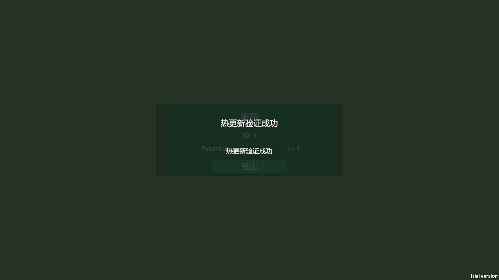

# M1 验收与源码交付

验收日期：2026-10-21；范围：Windows x64标准IL2CPP/xLua，.NET 8服务端。

**T01–T68完成，58项验收通过。** 本文件与包含它的源码提交一起交付；M2仅制定计划，尚未实施。

## 1. 版本与结果

- App0.3.0 / Proto1 / bridge m1-bridge-0.3；Res/Config100→101。
- 实际Native账号/更新、坏资源真Retry、完整退避、同库强杀恢复、Token过期、双客户端顶号、旧Token及106均通过。
- 同安装同缓存下载42→5→0；三个安装文件SHA不变。
- 当前服务端225/225、受影响PlayMode9/9、基础EditMode69/69、输入模态PlayMode7/7；失败跳过均0。
- C1的27项与C2的13项复用证据单独标注，不重复计入当前测试总数。

| 安装文件 | SHA-256 |
|---|---|
| exe | `29ab39aae700ec2503f7b7fe7de2d853e661c5588c5a225c540ad81474dcd0f1` |
| gameAssembly | `91b7d8f7a1fdc110e04f18b8ac6c21c1ddf390eba28a0f0dfac7456d7be5d079` |
| metadata | `cd94d993b9f329d566ccf413dac999b5c78d816d0a0588310558227ef4c409a9` |

## 2. 可移植证据

- [58项机器可读矩阵](AcceptanceMatrix.json)
- [实现方法、问题及方案回填](../../../Assets/ReferenceDoc/06_M1_%E5%9F%BA%E7%A1%80%E6%A1%86%E6%9E%B6%E4%BB%BB%E5%8A%A1%E6%8B%86%E8%A7%A3.md)
- [具体命令、函数参数、完整脚本与验证过程](../../../Assets/ReferenceDoc/Logs/M1_07_Logs.md)
- [M2设计和80项待办计划](../../../Assets/ReferenceDoc/06_M2_%E5%BC%80%E5%8F%91%E8%AE%A1%E5%88%92.md)

| 编号 | 实际结果 | 随源码提供的证据 |
|---|---|---|
| A01 | 新隔离DB初始化schema2；正式TCP/HTTP就绪；最终停机cleanupFailures=0。 | [actions.json](Evidence/Root-Finalization/Native-20261021-141638-780/actions.json)；[server.txt](Evidence/Root-Finalization/Native-20261021-141638-780/server-100-account/server.txt) |
| A02 | 最终R2标准IL2CPP100进入真实Login，entry/committed=True。 | [A02-B02-login100.json](Evidence/Root-Finalization/Native-20261021-141638-780/A02-B02-login100.json)；[100_login.png](Evidence/Root-Finalization/Native-20261021-141638-780/client/shots/100_login.png) |
| A03 | 真实按钮注册成功；仍未认证且无Token；独立DB account/player各1行。 | [A03-register-not-authorized.json](Evidence/Root-Finalization/Native-20261021-141638-780/A03-register-not-authorized.json)；[final-audit.json](Evidence/Root-Finalization/final-audit.json) |
| A04 | 真实Lua登录/模型应用/Token提交/家园HUD一致：ID1、FinalNick、Lv1。 | [A04-S1-home100.json](Evidence/Root-Finalization/Native-20261021-141638-780/A04-S1-home100.json)；[100_home.png](Evidence/Root-Finalization/Native-20261021-141638-780/client/shots/100_home.png) |
| A05 | S1完整Lua业务模型已保存；公开业务字段逐项与只读DB快照一致。 | [A04-S1-home100.json](Evidence/Root-Finalization/Native-20261021-141638-780/A04-S1-home100.json)；[A05-A08-database-snapshot.json](Evidence/Root-Finalization/Native-20261021-141638-780/A05-A08-database-snapshot.json) |
| A06 | 真实LogoutReq1009被处理；返回Login、无Token、模型playerId0；服务端登出撤销/保存测试通过。 | [A06-logout.json](Evidence/Root-Finalization/Native-20261021-141638-780/A06-logout.json)；[server.txt](Evidence/Root-Finalization/Native-20261021-141638-780/server-100-account/server.txt)；[root-server-final225.trx](Evidence/Root-Finalization/ServerTests/root-server-final225.trx) |
| A07 | 再次登录完整业务模型等于S1。 | [A07-login-again.json](Evidence/Root-Finalization/Native-20261021-141638-780/A07-login-again.json) |
| A08 | 命令回执后正常退出；拥有进程exit0、日志保留可读。 | [actions.json](Evidence/Root-Finalization/Native-20261021-141638-780/actions.json) |
| A09 | 同安装同缓存的新进程重新进入Login后再登录。 | [actions.json](Evidence/Root-Finalization/Native-20261021-141638-780/actions.json)；[A10-reopen-same-install.json](Evidence/Root-Finalization/Native-20261021-141638-780/A10-reopen-same-install.json) |
| A10 | 重开后登录的完整Lua业务模型与S1相等。 | [A10-reopen-same-install.json](Evidence/Root-Finalization/Native-20261021-141638-780/A10-reopen-same-install.json)；[final-audit.json](Evidence/Root-Finalization/final-audit.json) |
| A11 | PlayerPersistenceTests实际修改后保存重载、只读失败恢复均通过；Native恢复另验证非默认gold201/bag1×7/revision1。 | [root-server-final225.trx](Evidence/Root-Finalization/ServerTests/root-server-final225.trx)；[prepared-saved-state.json](Evidence/Root-Finalization/Recovery-20261021-141811-730/prepared-saved-state.json) |
| B01 | 最终R2安装三个SHA实际计算，标准Win64 IL2CPP/App0.3/Proto1。 | [install-before.json](Evidence/Root-Finalization/Native-20261021-141638-780/install-before.json)；[baseline-manifest.json](Evidence/Root%20Final%20100%20R2/baseline-manifest.json) |
| B02 | 100无新模块/Global/窗口；实际100 Yoo报告无PatchDemoWindow。 | [A02-B02-login100.json](Evidence/Root-Finalization/Native-20261021-141638-780/A02-B02-login100.json)；[DefaultPackage_100.report](Evidence/Root%20Final%20100%20R2/Publish/100/DefaultPackage_100.report) |
| B03 | 100进程完全退出，后续101启动为新进程/新Lua环境。 | [actions.json](Evidence/Root-Finalization/Native-20261021-141638-780/actions.json) |
| B04 | 正式补丁脚本exit0；101新增Lua/Prefab/Global；复用R2安装。 | [r2-patch-build.exit.txt](Evidence/Root-Finalization/r2-patch-build.exit.txt)；[DefaultPackage_101.report](Evidence/Root%20Final%20Publish%20R2/101/DefaultPackage_101.report)；[B08-real-prefab-and-global.json](Evidence/Root-Finalization/Native-20261021-141638-780/B08-real-prefab-and-global.json) |
| B05 | 完整101目录先复制到自有CDN，所有flat文件复制完成后才切指针。 | [Run-NativeAccountsAndPatch.ps1](Evidence/Root-Finalization/Run-NativeAccountsAndPatch.ps1)；[actions.json](Evidence/Root-Finalization/Native-20261021-141638-780/actions.json) |
| B06 | 原子换version.json为101；100目录保留；ServerConfig101加载成功。 | [actions.json](Evidence/Root-Finalization/Native-20261021-141638-780/actions.json)；[B06-updated101.json](Evidence/Root-Finalization/Native-20261021-141638-780/B06-updated101.json) |
| B07 | 原路径/同缓存启动101，实际差异下载5文件，少于100初装42文件。 | [B06-updated101.json](Evidence/Root-Finalization/Native-20261021-141638-780/B06-updated101.json)；[result.json](Evidence/Root-Finalization/Native-20261021-141638-780/result.json) |
| B08 | 真实UiBridge异步打开新Prefab；实际Global为热更新验证成功；Root已查看完整帧。 | [B08-real-prefab-and-global.json](Evidence/Root-Finalization/Native-20261021-141638-780/B08-real-prefab-and-global.json)；[101_patch_window.png](Evidence/Root-Finalization/Native-20261021-141638-780/client/shots/101_patch_window.png) |
| B09 | exe/GameAssembly/global-metadata更新前后逐一相同。 | [install-before.json](Evidence/Root-Finalization/Native-20261021-141638-780/install-before.json)；[install-after.json](Evidence/Root-Finalization/Native-20261021-141638-780/install-after.json) |
| B10 | 同缓存再次启动101下载0文件，登录后新Prefab仍可打开。 | [B10-cached101.json](Evidence/Root-Finalization/Native-20261021-141638-780/B10-cached101.json)；[B10-cached-home.json](Evidence/Root-Finalization/Native-20261021-141638-780/B10-cached-home.json)；[actions.json](Evidence/Root-Finalization/Native-20261021-141638-780/actions.json) |
| B11 | 仅截断自有CDN的实际bundle副本，新缓存隔离；原清单保留。 | [result.json](Evidence/Root-Finalization/BadResource-20261021-141811-409/result.json)；[Run-NativeBadResource.ps1](Evidence/Root-Finalization/Run-NativeBadResource.ps1) |
| B12 | 实际可见更新失败/重试；Lua未启动、候选未提交。 | [B12-visible-error-no-activation.json](Evidence/Root-Finalization/BadResource-20261021-141811-409/B12-visible-error-no-activation.json)；[download_error.png](Evidence/Root-Finalization/BadResource-20261021-141811-409/client/shots/download_error.png) |
| B13 | 恢复原bundle字节并核对原SHA256。 | [result.json](Evidence/Root-Finalization/BadResource-20261021-141811-409/result.json)；[actions.json](Evidence/Root-Finalization/BadResource-20261021-141811-409/actions.json) |
| B14 | 点击生产Retry按钮后进入Login；仅prepare尝试1、2，无双流水线。 | [B14-retry-success.json](Evidence/Root-Finalization/BadResource-20261021-141811-409/B14-retry-success.json)；[result.json](Evidence/Root-Finalization/BadResource-20261021-141811-409/result.json)；[retry_login.png](Evidence/Root-Finalization/BadResource-20261021-141811-409/client/shots/retry_login.png) |
| C01 | production PlayerStore.Save/reopen产生revision1非默认快照，Native读取gold201/bag1×7作为R1。 | [prepared-saved-state.json](Evidence/Root-Finalization/Recovery-20261021-141811-730/prepared-saved-state.json)；[C01-R1.json](Evidence/Root-Finalization/Recovery-20261021-141811-730/C01-R1.json)；[C01-R1-database.json](Evidence/Root-Finalization/Recovery-20261021-141811-730/C01-R1-database.json) |
| C02 | 关闭自有测试通路后真实遮罩出现；全屏raycastTarget按源码阻止输入，Root已查看实际遮罩。 | [C02-mask.json](Evidence/Root-Finalization/Recovery-20261021-141811-730/C02-mask.json)；[reconnect_mask.png](Evidence/Root-Finalization/Recovery-20261021-141811-730/client/shots/reconnect_mask.png)；[DisconnectOverlay.cs](../../../Assets/Framework/Account/DisconnectOverlay.cs) |
| C03 | 实际观察75秒以上，退避1/2/4/8/16/30，后续30；单循环尝试序列。 | [C03-real-backoff.json](Evidence/Root-Finalization/Recovery-20261021-141811-730/C03-real-backoff.json)；[actions.json](Evidence/Root-Finalization/Recovery-20261021-141811-730/actions.json) |
| C04 | 原端口/原DB恢复，无密码命令，原Token与完整Lua模型保持，Home恢复且遮罩消失。 | [C04-restored.json](Evidence/Root-Finalization/Recovery-20261021-141811-730/C04-restored.json)；[result.json](Evidence/Root-Finalization/Recovery-20261021-141811-730/result.json)；[restored_home.png](Evidence/Root-Finalization/Recovery-20261021-141811-730/client/shots/restored_home.png) |
| C05 | 强杀前只读DB确认SavedRevision1与实际snapshot摘要。 | [C05-R2.json](Evidence/Root-Finalization/Recovery-20261021-141811-730/C05-R2.json)；[C05-R2-database.json](Evidence/Root-Finalization/Recovery-20261021-141811-730/C05-R2-database.json) |
| C06 | 核对exe/父PID/精确DB后仅强杀自有dotnet，客户端进入重连。 | [actions.json](Evidence/Root-Finalization/Recovery-20261021-141811-730/actions.json)；[Run-NativeRecovery.ps1](Evidence/Root-Finalization/Run-NativeRecovery.ps1) |
| C07 | 同DB/配置/端口重启，原Token自动恢复，完整业务模型等于R2。 | [C07-restored-R2.json](Evidence/Root-Finalization/Recovery-20261021-141811-730/C07-restored-R2.json)；[result.json](Evidence/Root-Finalization/Recovery-20261021-141811-730/result.json) |
| C08 | 隔离DB真实事务将1条当前Token到期时间设为0；报告不含Token。 | [C08-expired-records.json](Evidence/Root-Finalization/Recovery-20261021-141811-730/C08-expired-records.json) |
| C09 | 真实204已返回Login，Token/模型清空，重连停止；已复验本轮修复。 | [C09-expired-return-login.json](Evidence/Root-Finalization/Recovery-20261021-141811-730/C09-expired-return-login.json)；[results.xml](Evidence/Root-Finalization/PlayMode-Final/results.xml) |
| C10 | 通过真实Login按钮重新获得认证，完整快照保持R2。 | [C10-relogin.json](Evidence/Root-Finalization/Recovery-20261021-141811-730/C10-relogin.json) |
| C11 | 第二个Native同账号登录，A清Token/模型回Login且不抢回，B保持Home。 | [C11-A-kicked.json](Evidence/Root-Finalization/Recovery-20261021-141811-730/C11-A-kicked.json)；[C11-B-current.json](Evidence/Root-Finalization/Recovery-20261021-141811-730/second-client/C11-B-current.json)；[kicked_login.png](Evidence/Root-Finalization/Recovery-20261021-141811-730/client/shots/kicked_login.png) |
| C12 | 用A旧Token实际TCP请求返回204且无快照；B仍认证，未被抢回。 | [C12-old-token-rejection.json](Evidence/Root-Finalization/Recovery-20261021-141811-730/C12-old-token-rejection.json)；[actions.json](Evidence/Root-Finalization/Recovery-20261021-141811-730/actions.json) |
| C13 | 实际Proto1客户端对Proto2服务端Login返回106，UI显示版本不兼容请更新且无重连。 | [result.json](Evidence/Root-Finalization/Protocol-20261021-141823-622/result.json)；[C13-version-mismatch.json](Evidence/Root-Finalization/Protocol-20261021-141823-622/C13-version-mismatch.json)；[version_update_required.png](Evidence/Root-Finalization/Protocol-20261021-141823-622/client/shots/version_update_required.png) |
| D01 | 带空格Root Final 100 R2目录完整gen_proto/gen_config/GenAll/Yoo/IL2CPP构建exit0。 | [r2-client-build.exit.txt](Evidence/Root-Finalization/r2-client-build.exit.txt)；[r2-client-build.stdout.txt](Evidence/Root-Finalization/r2-client-build.stdout.txt)；[baseline-manifest.json](Evidence/Root%20Final%20100%20R2/baseline-manifest.json) |
| D02 | 正式build_patch基于R2完整指纹exit0输出独立101；安装三SHA保持。 | [r2-patch-build.exit.txt](Evidence/Root-Finalization/r2-patch-build.exit.txt)；[r2-patch-build.stdout.txt](Evidence/Root-Finalization/r2-patch-build.stdout.txt)；[install-after.json](Evidence/Root-Finalization/Native-20261021-141638-780/install-after.json) |
| D03 | 正式run_server指定独立DB/配置/端口，真实TCP/HTTP/metrics可用，正常停机cleanupFailures0。 | [actions.json](Evidence/Root-Finalization/Native-20261021-141638-780/actions.json)；[server.txt](Evidence/Root-Finalization/Native-20261021-141638-780/server-100-account/server.txt)；[root-server-final225.trx](Evidence/Root-Finalization/ServerTests/root-server-final225.trx) |
| D04 | dotnet test实际225/225，失败0、跳过0；新增并存连接RST隔离测试通过。 | [root-server-final225.trx](Evidence/Root-Finalization/ServerTests/root-server-final225.trx)；[r2-exit.txt](Evidence/Root-Finalization/ServerTests/r2-exit.txt) |
| D05 | 当前PlayMode的UIResource两个实际用例均通过，开关和场景取消后资源回基线。 | [results.xml](Evidence/Root-Finalization/PlayMode-Final/results.xml) |
| D06 | 不存在Unity路径实际exit1，明确缺失路径，未创建成功输出目录。 | [result.json](Evidence/Root-Finalization/CliNegative/result.json)；[stderr.txt](Evidence/Root-Finalization/CliNegative/stderr.txt) |
| D07 | 真实protoc生成后重复ID校验exit1；最后成功的5个生成文件SHA不变，当前主脚本SHA仍相同。 | [result.json](Evidence/StageE/Root-ProtoDuplicate/Run-20261020-223154-240/result.json) |
| D08 | 真实build_patch拒绝固定AccountSession差异；源码逐字节恢复、Player和原发布指针不变、无错误101指针。 | [result.json](Evidence/Root-Finalization/AotNegative-R2-20261021-141623-394/result.json)；[patchbuild-report.txt](Evidence/Root-Finalization/AotNegative-R2-20261021-141623-394/Attempt/patchbuild-report.txt)；[final-audit.json](Evidence/Root-Finalization/final-audit.json) |
| E01 | 当前225内FrameCodec11/PipelineReader11/MessageRouter11覆盖半包、粘包、超长、未知ID、坏protobuf等。 | [root-server-final225.trx](Evidence/Root-Finalization/ServerTests/root-server-final225.trx) |
| E02 | 当前69项基础回归内Pending/生命周期/传输超时、取消、旧代次收尾等全部通过。 | [results.xml](Evidence/Root-Finalization/Foundation-Final/results.xml) |
| E03 | 当前OpIdStore8项覆盖重启持续递增、失败不发号、不同玩家、并发与边界。 | [results.xml](Evidence/Root-Finalization/Foundation-Final/results.xml) |
| E04 | 当前Idempotency11项覆盖重复执行一次、不同负载拒绝、64项淘汰与TTL等。 | [root-server-final225.trx](Evidence/Root-Finalization/ServerTests/root-server-final225.trx) |
| E05 | 复用同一UiManager/资源实现的C1最终27项：真实Lua/Prefab20次开关，生命周期/订阅/资源回基线；当前UIResource再通过。 | [playmode-results.xml](Evidence/StageC1/Root-NarrowFix/Run-20261020-172926/playmode-results.xml)；[results.xml](Evidence/Root-Finalization/PlayMode-Final/results.xml) |
| E06 | C1真实SceneService10次切换、取消/失败回Login/Loading与常驻Root通过；当前冷启动和Native场景链再通过。 | [playmode-results.xml](Evidence/StageC1/Root-NarrowFix/Run-20261020-172926/playmode-results.xml)；[results.xml](Evidence/Root-Finalization/PlayMode-Final/results.xml)；[A04-S1-home100.json](Evidence/Root-Finalization/Native-20261021-141638-780/A04-S1-home100.json) |
| E07 | C1三分辨率与非零safearea测试及4张实际UI截图已Root查看；相关布局代码未改变。 | [playmode-results.xml](Evidence/StageC1/Root-NarrowFix/Run-20261020-172926/playmode-results.xml)；[shot-1280x720.png](Evidence/StageC1/Review/shots/shot-1280x720.png)；[shot-1920x1080.png](Evidence/StageC1/Review/shots/shot-1920x1080.png)；[shot-1080x1920.png](Evidence/StageC1/Review/shots/shot-1080x1920.png)；[shot-safearea-nonzero.png](Evidence/StageC1/Review/shots/shot-safearea-nonzero.png) |
| E08 | 当前事件/对象池/计时器12项通过，含退订、重复归还、取消和非缩放计时。 | [results.xml](Evidence/Root-Finalization/Foundation-Final/results.xml) |
| E09 | 当前真实InputSystem设备5项和EventSystem模态点击2项全部通过；移动/点击/拖拽/滚轮与遮挡覆盖。 | [results.xml](Evidence/Root-Finalization/Input-Fixed/results.xml) |
| E10 | Native正式滚动client.log及服务端metrics保留；实际请求有session/msg/seq关联；FileLogger滚动/脱敏和Diagnostics测试通过；实际私密值扫描0匹配。 | [client.txt](Evidence/Root-Finalization/Native-20261021-141638-780/client/client-logs/client.txt)；[server.txt](Evidence/Root-Finalization/Native-20261021-141638-780/server-100-account/server.txt)；[results.xml](Evidence/Root-Finalization/Foundation-Final/results.xml)；[root-server-final225.trx](Evidence/Root-Finalization/ServerTests/root-server-final225.trx)；[final-audit.json](Evidence/Root-Finalization/final-audit.json) |
| E11 | 当前真实SQLITE_READONLY8失败保持Dirty，恢复可写后重试持久化成功。 | [root-server-final225.trx](Evidence/Root-Finalization/ServerTests/root-server-final225.trx) |
| E12 | 真实版本化xlsx导101；当前双端JSON逐文件SHA一致；Native与正式ServerConfigService均读取新值；错误清单/版本/必需键测试通过。 | [r2-config101.stdout.txt](Evidence/Root-Finalization/r2-config101.stdout.txt)；[server-config101-read.json](Evidence/Root-Finalization/server-config101-read.json)；[B08-real-prefab-and-global.json](Evidence/Root-Finalization/Native-20261021-141638-780/B08-real-prefab-and-global.json)；[root-server-final225.trx](Evidence/Root-Finalization/ServerTests/root-server-final225.trx)；[final-audit.json](Evidence/Root-Finalization/final-audit.json) |

## 3. 实际热更新画面

## 4. 上传范围与复现

仓库根已从Assets上移到完整Unity工程根，原提交历史保留。Assets/Packages/ProjectSettings/Server/Shared/Tools均纳入版本控制；源码中的Unity.meta及必需插件/导表DLL保留。
Library、Temp、安装包、CDN副本、数据库、Token、私有凭证、原始Cursor流和大体积本地验收工作目录由.gitignore排除。它们不是本次源码交付的一部分。
本目录仅复制矩阵明确引用的报告/状态/源码快照/实际截图。JSONL转为JSON数组，日志文件改.txt后缀；manifest.json记录原件与导出件SHA及转换，原本地证据不修改。
用工程根Tools脚本重建正式客户端/服务端。Evidence中的Root-Finalization脚本是原验收快照，若重新运行需要恢复其原相对目录、显式RepoRoot及生成对应本地候选；不能把已有安装SHA当作新机器构建的固定输出保证。
当前可上传包未携带Unity安装、MSVC/IL2CPP工具链、protoc或本机凭证。工具定位与失败退出见根README和原脚本参数。
