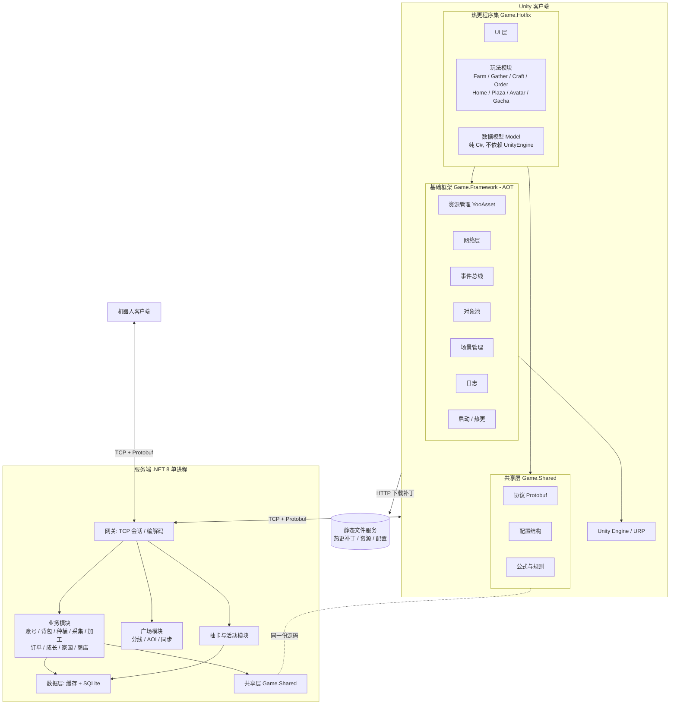
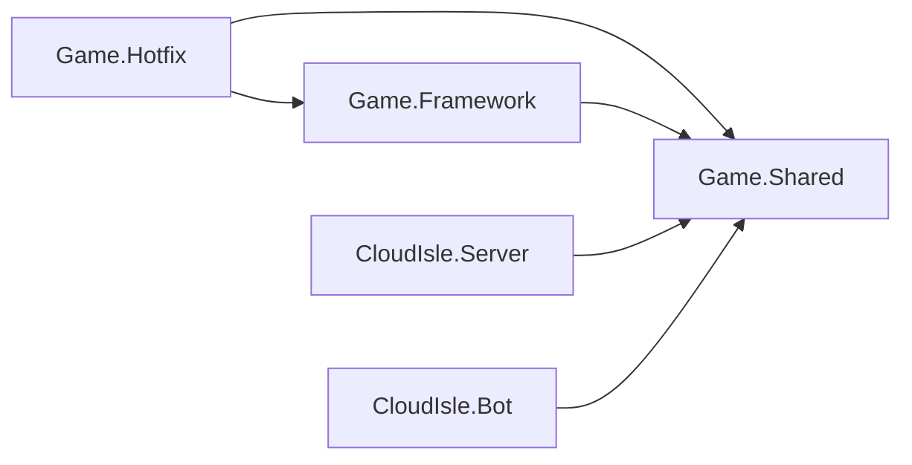
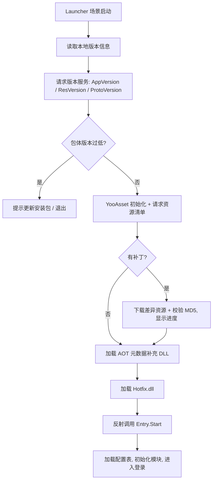
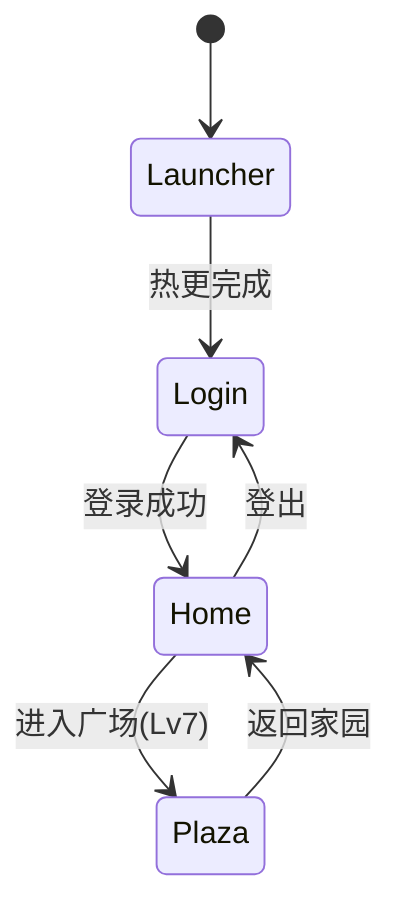
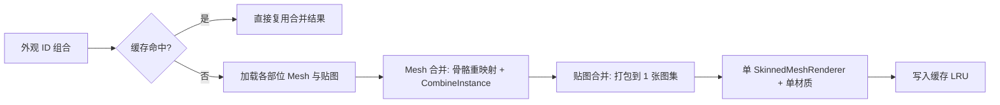
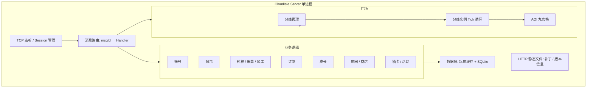
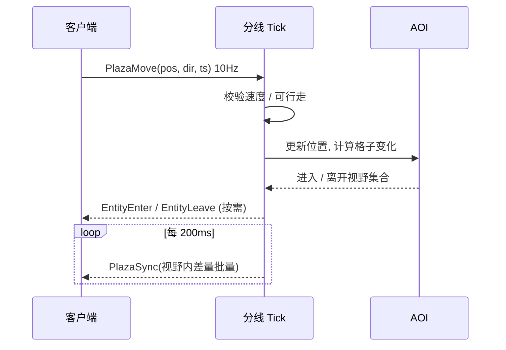

# 04 技术方案与架构

> 面向单人开发的**可落地方案**：每个选择都给出理由、验证方式与备选。
> 本文档的“PoC 验证清单”（第 12 节）必须在 M0 完成，结论回填到本文档。

---

## 1. 目标与约束

| 项 | 内容 |
|---|---|
| 引擎 | Unity 6000.3（Unity 6.3 LTS），URP |
| 平台 | PC（首发）；移动端（Stretch），**架构与资源从第一天按移动端预算设计** |
| 玩法 | 家园单机经营（服务端权威）+ 多人在线广场 + 热更新抽卡活动 |
| 团队 | 1 人；每周约 15~20 小时 |
| 核心原则 | ① 简单可控，少造轮子 ② 服务端权威 ③ 数据驱动 ④ 逻辑与表现分离 ⑤ 先跑通再优化，但**性能红线每月核对** |

> 单人项目的取舍：**架构要“看起来专业”但“实现上克制”**。例如服务端采用单进程 + 模块化，文档说明如何拆分为多进程，而不真的实现分布式。

---

## 2. 技术选型

| 领域 | 选择 | 理由 | 备选 / 回退 |
|---|---|---|---|
| 渲染管线 | **URP** | PC 与移动端共用；SRP Batcher、GPU Instancing 完善 | — |
| 代码热更 | **HybridCLR** | C# 原生热更，iOS 也可用；与 IL2CPP 配合 | 回退：仅资源 + 配置热更（玩法逻辑由配置驱动） |
| 资源热更 | **YooAsset** | 补丁流程完整，支持本地 / 远程模拟，国内资料多 | 备选：Addressables |
| 配置表 | **Luban**（或自写简易导表） | Excel → 二进制 / JSON + 代码生成，前后端共用 | 回退：自写 CSV → JSON 导表工具 |
| 协议 | **Protobuf（proto3）** | 强类型、体积小、双端代码生成 | — |
| 网络传输 | **TCP**（自定义帧：长度 + 消息 ID + 序号） | 经营与广场均使用；广场更新频率低（5~10 Hz），TCP 足够 | 进阶：广场改 KCP/UDP（文档说明，不实现） |
| 异步 | **UniTask** | 避免协程与 GC | — |
| UI | UGUI + TextMeshPro | 成熟稳定 | — |
| 服务端语言 | **C#（.NET 8）** | 与客户端共用协议、公式、配置结构；单人维护成本最低 | — |
| 服务端存储 | **SQLite（Microsoft.Data.Sqlite + Dapper）** | 零运维；Schema 与 MySQL 兼容，可切换 | 可切 MySQL |
| 缓存 | 进程内内存缓存（玩家会话数据） | 单进程无需 Redis | 文档说明何时引入 Redis |
| 日志 | 服务端 Serilog；客户端自封装文件日志 | 排查问题 | — |
| 测试 | NUnit（共享逻辑）、机器人（联网） | 覆盖离线结算、订单生成、抽卡等核心规则 | — |
| 版本控制 | Git + Git LFS | 管理大资源 | — |
| 构建 | Unity `-batchmode` + PowerShell 脚本 | 一键出包 / 出补丁 | GitHub Actions（仅服务端测试，可选） |

> **版本兼容提醒**：HybridCLR、YooAsset、Luban 对 Unity 6000.3 的支持以各自仓库说明为准，**PoC 必须在目标版本上实测**。若任何一项不可用，按“回退”列执行，并在 ADR 中记录。

---

## 3. 总体架构



### 关键设计决策

1. **三层客户端程序集**：`Game.Framework`（AOT，稳定不变）→ `Game.Shared`（前后端共享）→ `Game.Hotfix`（全部玩法与 UI，可热更）。
2. **前后端共享代码**：协议、配置结构、公式（如成熟时间计算、订单奖励公式、抽卡概率函数）放在 `Game.Shared`，客户端与服务端通过**同一份源码**引用，避免双端不一致。
3. **服务端权威**：时间、随机、扣费、产出全部服务端完成；客户端只做预表现与展示。
4. **单进程模块化**：网关、业务、广场、活动在同一进程内以模块划分，通过接口隔离，便于后续拆分。

---

## 4. 工程结构

### 4.1 仓库结构

```
CloudIsle/
├── Client/                         # Unity 工程
│   └── Assets/
│       ├── Framework/              # Game.Framework (AOT)
│       │   ├── Boot/               # 启动、热更、元数据补充
│       │   ├── Resource/           # YooAsset 封装
│       │   ├── Network/            # TCP、编解码、重连
│       │   ├── Core/               # 事件、对象池、计时器、日志
│       │   └── Platform/           # 平台差异、输入抽象
│       ├── Shared/                 # Game.Shared（与服务端共享，源码引用）
│       │   ├── Proto/              # 生成的协议代码
│       │   ├── Config/             # 生成的配置类
│       │   └── Rules/              # 公式与规则
│       ├── Hotfix/                 # Game.Hotfix（热更）
│       │   ├── Modules/            # Farm / Gather / Craft / Order / Home / Plaza / Avatar / Gacha / Bag / Shop
│       │   ├── UI/
│       │   └── Entry.cs            # 热更入口
│       ├── Res/                    # 热更资源（YooAsset 分包）
│       │   ├── Config/ UI/ Prefabs/ Scenes/ Avatar/ Effects/ Audio/
│       │   └── Activity/           # 每个活动一个子目录（独立资源包）
│       └── ThirdParty/
├── Server/                         # 服务端解决方案
│   ├── CloudIsle.Server/           # 主程序
│   ├── CloudIsle.Bot/              # 机器人客户端
│   ├── CloudIsle.Tools/            # 概率模拟 / 数据工具
│   └── CloudIsle.Tests/            # NUnit 测试
├── Shared/                         # 协议与配置源文件
│   ├── proto/                      # .proto
│   └── config/                     # Excel / CSV 配置表
├── Tools/                          # 导表、协议生成、构建脚本
├── Docs/                           # 6 份核心文档 + DevLog + Perf
└── README.md
```

### 4.2 程序集依赖规则



| 规则 | 说明 |
|---|---|
| Framework 不依赖 Hotfix | 框架通过接口与反射入口调用热更代码 |
| Shared 不依赖 UnityEngine | 保证可在服务端使用（目标 .NET Standard 2.1） |
| Model 不依赖 UnityEngine | 规则可单元测试 |
| View 只订阅事件刷新 | 不直接修改 Model |

---

## 5. 客户端核心模块设计

### 5.1 启动与热更新流程



| 版本号 | 含义 | 变化时机 |
|---|---|---|
| AppVersion | 安装包版本 | 引擎 / AOT 层变更，需整包更新 |
| ResVersion | 资源与热更代码版本 | 每次发补丁 |
| ProtoVersion | 协议版本 | 协议不兼容变更时递增；服务端登录时校验，不兼容则提示更新 |

**开发期运行模式**

| 模式 | 用途 |
|---|---|
| 编辑器模拟模式 | 日常开发，不打包，直接加载资源 |
| 本地补丁模式 | 本机启动静态文件服务（由服务端程序同时提供 HTTP 目录），模拟 CDN，验证完整热更流程 |
| 发布模式 | 演示与打包测试 |

**热更代码注意事项**

- 热更代码中使用的**泛型实例**（如 `List<自定义结构>`、Protobuf 泛型）可能需要 AOT 元数据补充；PoC 阶段验证并固化“补充元数据 DLL 列表”。
- 避免在热更代码中使用依赖 AOT 裁剪后可能缺失的反射；保持 `link.xml` 以保留必要类型。
- 每次发布补丁前运行**热更自检**（脚本）：验证 Hotfix.dll 可加载、入口存在、关键类型可实例化。

### 5.2 资源管理

| 项 | 方案 |
|---|---|
| 分包 | `common`（UI 基础、通用特效）、`home`（家园场景与资源）、`plaza`（广场场景）、`avatar`（外观，按部位 / 稀有度分包）、`config`、`activity_xxx`（每个活动一包） |
| 加载 | 统一 `ResMgr.LoadAsync<T>(address)`；返回句柄，**持有者负责释放** |
| 引用计数 | 句柄计数，场景切换后统一回收；开发期提供“资源泄漏报告” |
| 预加载 | 进入场景前预加载关键资源；活动资源在开始前 3 天预下载 |
| 缓存 | 玩家外观合并结果按外观组合 hash 缓存（LRU，上限 64） |

### 5.3 网络层

| 项 | 方案 |
|---|---|
| 帧格式 | `[len:4][msgId:2][seq:4][body:N]`（小端，len 为后续长度） |
| 请求 / 响应 | 请求携带 `seq`；响应带回同一 `seq`；支持超时（默认 8 秒）与有限重试（仅幂等请求） |
| 推送 | `seq = 0` 的服务端消息为推送，按 `msgId` 分发 |
| 心跳 | 每 10 秒一次，30 秒无响应判定断线 |
| 重连 | 指数退避（1/2/4/8 秒，上限 30 秒）；重连后携带登录 Token，服务端恢复会话并对账 |
| 写操作幂等 | 每个写请求带客户端递增 `opId`；服务端记录最近 N 个，重复请求直接返回缓存结果 |
| 线程模型 | 网络收发在后台线程，消息通过线程安全队列在主线程分发 |
| 弱网 | 请求队列 + 界面“处理中”遮罩，防止重复点击 |

### 5.4 配置表

- 导表产物：二进制 / JSON + 生成的 C# 类，作为 `config` 资源包发布。
- 前后端读取**同一份**配置；服务端启动时加载并校验。
- 配置版本随 ResVersion；服务端在登录时下发“配置版本号”，不一致提示更新。

### 5.5 事件与模块

```csharp
// 事件总线（强类型，避免装箱）
EventBus.Publish(new CropHarvestedEvent { PlotId = 3, ItemId = 1001, Count = 3 });
EventBus.Subscribe<CropHarvestedEvent>(OnCropHarvested);
```

每个玩法模块的结构：

| 层 | 职责 |
|---|---|
| `XxxModel` | 数据 + 规则（纯 C#），接收服务端同步数据 |
| `XxxService` | 与服务端通信（发请求、处理响应与推送），更新 Model，发布事件 |
| `XxxController` | 处理输入，调用 Service，驱动 View |
| `XxxView` | MonoBehaviour / Prefab 表现，订阅事件刷新 |

### 5.6 UI 框架

- 窗口栈 + 层级（Scene / Hud / Window / Popup / Guide / Toast）。
- 窗口生命周期：`OnCreate → OnOpen(args) → OnClose → OnDestroy`；窗口资源使用句柄管理。
- 大列表使用循环滚动列表（Loop Scroll）；动静分离 Canvas，减少重建。
- 适配：CanvasScaler 参考分辨率 1920×1080，Match 按宽高比动态；预留 Safe Area 组件。

### 5.7 场景管理



- 场景：`Launcher`（内置）、`Login`、`Home`、`Plaza`；UI 常驻 Root 不随场景销毁。
- 切换：Loading 遮罩 → 卸载旧场景资源 → 异步加载新场景 → 预热 → 关闭遮罩。
- **家园与广场不同时驻留内存**，避免移动端内存叠加。

### 5.8 输入抽象

```
IInputProvider: Move(Vector2), Tap(Vector2), DragStart/Drag/DragEnd, Zoom(float)
├── MouseKeyboardInput   (PC)
└── TouchInput           (移动端，Stretch)
```

玩法层只依赖 `IInputProvider`，保证后续移动端适配不改玩法代码。拖拽批量种植 / 收获沿用同一套拖拽事件。

### 5.9 家园系统（表现层要点）

| 项 | 方案 |
|---|---|
| 地块 | 网格坐标；地块与作物以对象池复用；作物按 4 阶段更换模型 / 材质属性 |
| 倒计时 | 使用服务端时间偏移 `serverTimeOffset` 计算剩余时间；每秒统一 Tick，而非每个作物单独 Update |
| 摆放 | 网格占位表（`bool[,]`）；摆放预览用半透明材质；碰撞检测在 Model 层 |
| 批量操作 | 拖拽划过地块，客户端合并为一次批量请求（`BatchPlant` / `BatchHarvest`） |

---

## 6. 角色换装与性能方案

### 6.1 换装拼装流程



| 项 | 方案 |
|---|---|
| 骨架 | 所有外观共用同一套骨骼与动画 |
| 合并 | 6 个部位合并为 1 个 Mesh、1 张图集（512×512 / 1024×1024）、1 个材质 → 每角色 **1 DrawCall** |
| 异步 | 资源加载异步；合并在主线程分帧完成（每帧最多合并 1~2 个角色），避免卡顿 |
| 缓存 | 按外观组合 hash 缓存，LRU 上限 64；超出时回收合并后的 Mesh / 贴图 |
| 隐藏部位 | 连衣裙隐藏上衣 + 下装；帽子隐藏部分发型（用部位遮罩配置） |
| 蒙皮 | 项目设置启用 GPU/Compute Skinning（若平台支持），限制骨骼数 ≤ 50 |

### 6.2 广场角色分级渲染（LOD）

| 距离 | 表现 | 动画 |
|---|---|---|
| 近（≤ 15 m） | 完整合并模型 | 全帧率 |
| 中（15~30 m） | 完整合并模型 | 降低 Animator 更新频率 |
| 远（> 30 m）或超过上限 | 简化占位（低模 / 胶囊 + 名牌） | 无 / 站立 |

- **同屏完整角色上限：40**（可配置，按画质分档）。
- 超出上限的角色按距离排序，最远者降级。

---

## 7. 服务端设计

### 7.1 进程与模块



### 7.2 并发模型

| 项 | 方案 |
|---|---|
| 网络 | `System.Net.Sockets` + `System.IO.Pipelines`，异步收发 |
| 业务串行化 | **每个玩家一个串行任务队列**（类似 Actor）：同一玩家的请求按序执行，天然避免并发修改玩家数据，无需细粒度锁 |
| 广场 | 每条分线一个**固定 Tick 循环**（100 ms），单线程处理该线所有玩家的移动与广播；分线之间并行 |
| 跨玩家操作 | 访问他人家园为只读：读缓存快照；点赞等通过目标玩家队列投递 |
| 定时任务 | 每日 0 点刷新订单（按玩家惰性刷新：玩家请求时若跨日则刷新）；无全局批处理 |

### 7.3 数据层

- **玩家数据缓存**：登录时从 SQLite 加载到内存；修改后标记脏，**定时（5 秒）+ 登出 + 关键操作（抽卡、扣费）**写回。
- **事务**：抽卡、订单交付、加工开始等涉及多表的操作使用一个事务。
- **幂等**：每个玩家保存最近 64 个 `opId` 及其结果，重复请求直接返回。

**主要表结构（SQLite，与 MySQL 兼容）**

| 表 | 主要字段 | 说明 |
|---|---|---|
| `account` | id, username, pwd_hash, salt, created_at | 账号 |
| `player` | id, account_id, nickname, level, exp, gold, gem, ticket, shard, bag_slots, guide_step, last_daily_reset | 玩家基础 |
| `bag_item` | player_id, item_id, count | 背包（复合主键） |
| `plot` | player_id, plot_id, state, crop_id, plant_time, ready_time, watered, fertilized | 地块 |
| `gather_node` | player_id, node_id, next_ready_time | 采集点冷却 |
| `facility` | player_id, facility_id, level | 设施等级 |
| `facility_slot` | player_id, facility_id, slot_id, recipe_id, finish_time, state | 加工槽位 |
| `tool` | player_id, tool_id, level | 工具等级 |
| `daily_order` | player_id, order_id, slot, items_json, reward_json, difficulty, rare, status, day_index | 日常订单 |
| `order_progress` | player_id, day_index, done_count, reroll_count, claimed_json | 每日进度 |
| `home_layout` | player_id, layout_json, version | 家园布局（JSON） |
| `avatar_owned` | player_id, avatar_id, obtained_at | 拥有外观 |
| `avatar_equipped` | player_id, slot, avatar_id | 当前装扮 |
| `gacha_state` | player_id, pool_id, pity_ssr, pity_sr, up_guarantee | 保底计数 |
| `gacha_log` | id, player_id, pool_id, item_id, rarity, is_up, time | 抽卡记录（保留 100 条 / 玩家） |
| `activity` | activity_id, config_json, start_time, end_time, enabled | 活动配置 |
| `idempotent` | player_id, op_id, result_blob, time | 幂等记录（可仅内存） |

### 7.4 关键算法

**离线结算**：采用**时间戳判定而非逐秒推算**。

- 种植：`now >= ready_time` 即成熟。
- 加工：`now >= finish_time` 即完成。
- 采集：`now >= next_ready_time` 即可采。
- 上线时无需结算循环，只需返回当前状态；任何时刻状态都可以由时间戳直接得出，**天然免疫离线时长与本地时间篡改**。

**订单生成**：输入等级与已解锁集合，按 `03_数值与配置表.md` 第 8 节规则生成，并校验“至少 2 条可立即完成”；种子（随机数）可记录到日志，便于复现。

**抽卡**：见 7.5。

### 7.5 抽卡服务端实现要点

```text
Pull(player, poolId, times):
  校验活动有效 / 货币足够
  开启事务
  扣费
  for i in 1..times:
      pity_ssr++ ; pity_sr++
      rarity = RollRarity(pity_ssr, pity_sr)     # 使用加密安全随机数或服务端 PRNG
      if rarity == SSR:
          isUp = pool.hasUp && (up_guarantee || Rand() < 0.5)
          item = isUp ? PickUp(pool) : PickNonUp(pool)
          up_guarantee = pool.hasUp && !isUp
          pity_ssr = 0; pity_sr = 0
      elif rarity == SR: pity_sr = 0
      item = PickItem(pool, rarity)
      重复? -> 转碎片，否则入库
      写抽卡记录
  提交事务
  返回结果 + 最新保底计数
```

- 随机数：服务端生成，客户端永不参与。
- 记录：每次抽卡写日志（含随机结果），便于审计与概率统计。
- 配套工具 `CloudIsle.Tools`：`gacha_sim` 跑 10 万次，输出各稀有度占比与平均抽数，与公示对照。

### 7.6 广场服务端设计

| 项 | 方案 |
|---|---|
| 地图 | 约 200 m × 200 m；从 Unity 场景导出**可行走格**（0.5 m 精度）文件，服务端加载用于位置合法性校验 |
| AOI | 九宫格，格子边长 20 m；玩家移动跨格时计算进入 / 离开视野的实体集合 |
| 上行（客户端→服务端） | 移动输入 10 Hz：位置、朝向、速度档位、时间戳 |
| 校验 | 距离 ≤ `maxSpeed × dt × 1.2 + 容差`；落点必须可行走；不合法则拉回最后合法位置并推送纠正 |
| 下行（服务端→客户端） | AOI 内玩家位置**差量**广播，5 Hz 批量合并为一个包；进入 / 离开视野单独消息 |
| 带宽估算 | 单实体位置更新约 16 B；最坏情况（100 人全部在同一 AOI）：每客户端下行约 99 × 5 Hz × 16 B ≈ 7.9 KB/s；服务端总出口约 0.8 MB/s（≈ 6.3 Mbps），可接受；常态因 AOI 远小于该值 |
| 分线 | 单线上限 100；好友优先同线；人数低于阈值（如 20）的线可合并 |
| 断线 | 30 秒内重连恢复原位置；超时移除实体 |



**客户端表现**：位置插值缓冲 100~150 ms；本地玩家直接按输入移动（客户端预测），收到服务端纠正时平滑回拉。

### 7.7 机器人客户端

- 独立控制台程序，复用 `Game.Shared` 协议，实现登录、进入广场、随机移动、发送表情与聊天。
- 参数：机器人数量、行为频率、地图范围；输出：连接成功率、平均延迟、掉线数。
- 用途：压测（100 机器人 30 分钟）、演示录屏（广场热闹场景）。

### 7.8 日志与可观测

| 项 | 方案 |
|---|---|
| 服务端日志 | Serilog：Info 业务、Warn 异常请求、Error 异常；每条请求日志含 `playerId / msgId / opId / 耗时` |
| 指标 | 每 10 秒输出一行：在线人数、各分线人数、Tick 耗时、每秒消息数、内存 |
| 客户端日志 | 文件日志（滚动），崩溃时附带最近日志；Debug 构建显示 FPS / 内存 / 网络延迟覆盖层 |
| 性能记录 | `PerfLogger` 通过 `ProfilerRecorder` 采集 FPS、DrawCall、三角面、内存，输出 CSV，供 `Docs/Perf/` 使用 |

---

## 8. 性能预算与优化策略

### 8.1 预算（PC 与移动端 Stretch）

| 指标 | PC | 移动端（中端机） |
|---|---|---|
| 目标帧率 | 60 FPS | 30 FPS |
| 家园 DrawCall | ≤ 200 | ≤ 150 |
| 广场 DrawCall | ≤ 300 | ≤ 250 |
| 场景三角面（可见） | ≤ 300k | ≤ 150k |
| 单角色三角面 | ≤ 8k | ≤ 5k |
| 同屏完整角色 | 40 | 30 |
| 内存（场景峰值） | ≤ 2 GB | ≤ 1.2 GB（家园）/ 1.5 GB（广场） |
| 单张贴图最大边 | 2048 | 1024（UI 与角色图集 512~1024） |
| 场景切换 | ≤ 5 s | ≤ 8 s |
| 每帧 GC 分配 | 接近 0（热路径） | 接近 0 |

### 8.2 优化手段

| 方向 | 手段 |
|---|---|
| 渲染 | URP + SRP Batcher；作物 / 装饰 GPU Instancing；静态物体批处理；实时光源 ≤ 1 个主光；阴影用 Blob / 片状阴影或低质量阴影 |
| 材质 | 统一 2~3 个 Shader（卡通 Lit、Alpha 特效、UI），控制变体数；构建时剥离未用变体 |
| 贴图 | 图集化；PC 使用 BC7 / DXT，移动端使用 ASTC；开启 Mipmap；角色图集合并 |
| 模型 | 低多边形风格；装饰按距离 LOD；关闭不必要的 Read/Write |
| 动画 | 共用骨架；远处降频；必要时 GPU 动画（Stretch） |
| UI | 图集拆分合理；动静分离 Canvas；循环列表；避免 Layout 组件嵌套 |
| 内存 | 句柄引用计数；场景切换后卸载；音频压缩（BGM 流式、音效 Decompress On Load 小文件） |
| GC | 禁止热路径 `new`、LINQ、字符串拼接；使用对象池、`Span`、缓存委托；UniTask 取代协程 |
| 加载 | 异步加载 + 分帧实例化；预热 Shader 变体集合（ShaderVariantCollection） |
| 画质分档 | 低 / 中 / 高：分辨率缩放、阴影、后处理、同屏角色上限、特效数量 |

### 8.3 性能回归流程

1. 每个里程碑结束，在固定测试场景运行 `PerfLogger`，输出 CSV 与截图到 `Docs/Perf/`。
2. 与预算表对比，超标项进入下一迭代的修复任务。
3. 每月至少一次 Android 真机构建（即使移动端是 Stretch），提前暴露兼容与性能问题。

---

## 9. 热更新发布流程


**“上线新卡池”演示脚本（验收用）**

1. 记录当前客户端 ResVersion（如 100），客户端**保持安装不变**。
2. 制作 `activity_spring_picnic` 资源包（新外观、活动界面、抽卡表现）与配置表 `P02`、`A001`。
3. 运行 `Tools/build_patch.ps1` 生成补丁（ResVersion → 101）。
4. 服务端写入活动配置：开启时间设为 2 分钟后。
5. 启动旧客户端：自动下载补丁 → 进入游戏 → 此时活动入口不可见。
6. 到点：服务端推送活动开启 → 入口出现 → 抽卡可用。
7. 到结束时间：入口消失，抽卡请求被服务端拒绝。
8. 录屏留存。

---

## 10. 构建、版本与工具

| 项 | 方案 |
|---|---|
| 分支 | `main`（稳定，每个里程碑打 tag）、`dev`（日常）、`feature/*`（较大功能） |
| 提交规范 | `feat/fix/perf/docs/refactor: 描述`，便于回顾 |
| LFS | 贴图、模型、音频、DLL 等二进制 |
| 一键脚本 | `build_client_win.ps1`（出 PC 包）、`build_patch.ps1`（出补丁）、`gen_proto.ps1`（生成协议）、`gen_config.ps1`（导表）、`run_server.ps1` |
| 编辑器工具 | 调试面板（加资源 / 跳时间 / 重置 / 活动开关）、资源泄漏报告、外观预览窗口 |
| 版本号 | `AppVersion = 主.次.修订`；`ResVersion = 递增整数`；`ProtoVersion = 递增整数` |

---

## 11. 测试策略

| 类型 | 内容 | 方式 |
|---|---|---|
| 单元测试 | 成熟时间计算、订单生成与奖励、抽卡保底与 UP、等级计算、背包堆叠 | NUnit，针对 `Game.Shared`，不依赖 Unity |
| 概率测试 | 抽卡 10 万次模拟 | `gacha_sim` 工具，结果与 `03` 文档对照 |
| 集成测试 | 登录 → 种植 → 加工 → 订单 → 升级 | 机器人脚本（无界面）自动跑一遍 |
| 压力测试 | 广场 100 机器人 30 分钟 | 机器人客户端，记录延迟 / 掉线 / CPU |
| 热更测试 | 旧版本客户端更新到新补丁；断点续传；补丁损坏回退 | 手动清单 |
| 性能测试 | 家园 / 广场固定路线 | `PerfLogger` |
| 手动自测 | 对照 `02_玩法设计.md` 第 15 节清单 | 每个里程碑一次 |

---

## 12. PoC 验证清单（M0 必做）

| # | 验证项 | 通过标准 | 失败时的回退 |
|---|---|---|---|
| 1 | Unity 6000.3 + URP 建工程，打 Windows 包 | 正常运行 | — |
| 2 | HybridCLR 在 6000.3 上构建并运行热更 DLL | 修改热更代码后，仅更新补丁即可生效 | 仅资源 + 配置热更 |
| 3 | YooAsset 本地补丁模式 | 修改一个 Prefab，补丁下发后客户端显示新内容 | 改用 Addressables |
| 4 | Protobuf 在热更代码中序列化 / 反序列化 | 无 AOT 泛型报错（必要时补充元数据） | 调整序列化方式或补充元数据列表 |
| 5 | 前后端共享 `Game.Shared` 源码 | 服务端与客户端均可编译引用 | 改为生成 DLL 引用 |
| 6 | 客户端 ↔ 服务端 TCP 登录与读写 | 登录并读取 / 修改一条数据 | — |
| 7 | 导表工具（Luban 或自写） | Excel 修改后重新导出，客户端与服务端均读到新值 | 自写 CSV 导表 |
| 8 | Android 真机运行同一 Demo | 热更在真机成功（Stretch 项，可延后） | 记录为风险 |
| 9 | 角色换装合并 Demo | 6 部位合并为 1 DrawCall；同屏 40 个角色 PC ≥ 60 FPS | 减少部位 / 简化材质 |
| 10 | 100 个机器人连接空广场 | 服务端稳定，Tick 耗时 < 20 ms | 优化广播 / AOI |

**PoC 结论模板**（完成后追加到本文档末尾）：

```
验证日期：
Unity 版本 / 包版本：
结果：#1 ✔ / #2 ✔ ...
遇到的问题与解决方式：
是否需要调整选型：
```

---

## 13. 架构决策记录（ADR 摘要）

| 编号 | 决策 | 理由 | 备选 / 影响 |
|---|---|---|---|
| ADR-01 | URP 作为唯一管线 | PC 与移动共用，减少维护 | 不使用 HDRP / 内置管线 |
| ADR-02 | 玩法逻辑全部放入热更程序集 | 支撑活动与快速修复 | 框架层保持稳定、极少改动 |
| ADR-03 | 服务端使用 C# | 共享协议与公式，单人维护成本最低 | Go 性能更好，但需双语言维护 |
| ADR-04 | 服务端权威（时间 / 随机 / 扣费） | 防篡改，规则一致 | 客户端需做预表现与失败回滚 |
| ADR-05 | 时间戳判定，不做逐秒离线推算 | 简单、可靠、免疫本地时间篡改 | 所有“进行中”状态必须存时间戳 |
| ADR-06 | 广场使用状态同步 + AOI，不做帧同步 | 休闲社交，对一致性要求低、对人数要求高 | 需客户端插值与服务端校验 |
| ADR-07 | TCP 单通道承载全部消息 | 实现简单，更新频率低足够 | 进阶可对广场使用 KCP |
| ADR-08 | 单进程服务端 + SQLite | 零运维、够用 | 拆分路径：网关 / 业务 / 广场独立进程 + Redis + MySQL |
| ADR-09 | 外观合并为单 Mesh 单材质 | 降低 DrawCall 与蒙皮开销 | 增加首次拼装耗时，需缓存与分帧 |
| ADR-10 | 活动资源提前下发，开关由服务端控制 | 避免本地时间依赖与上线瞬间拥堵 | 需要版本信息与活动配置接口 |
| ADR-11 | 抽卡使用虚拟货币，不接支付 | 不上线，聚焦技术展示 | 接口层保留支付抽象的位置（文档说明） |

---

## 14. 技术风险

| 风险 | 影响 | 应对 |
|---|---|---|
| HybridCLR / YooAsset / Luban 与 Unity 6000.3 不兼容 | 阻塞 | M0 PoC；回退方案已列出 |
| Protobuf 在 IL2CPP + 热更下的 AOT 泛型问题 | 运行时报错 | PoC 验证；固化补充元数据列表；必要时换序列化方式 |
| 角色合并耗时造成卡顿 | 广场进入时掉帧 | 分帧合并、缓存、预热；限制同帧合并数量 |
| 广场同步抖动 / 纠正过多 | 体验差 | 插值缓冲、客户端预测、放宽校验容差；先用机器人定位问题 |
| 单人维护两端（客户端 + 服务端） | 进度慢 | 共享代码；协议与配置自动生成；优先保证 P0 |
| 美术资产不足 | 展示效果差 | 先灰盒；统一素材包；最后一个里程碑集中替换美术 |

---

## 15. PoC 结论回填

```
验证日期：2026-10-12
Unity 版本 / 包版本：6000.3.22f1 / HybridCLR 9.0.2（嵌入）/ YooAsset 3.0.6（OpenUPM）
结果：
  #1 ✔（工程已存在）
  #2 ◐ 部分通过（见下）
  #3 ✔（YooAsset 3.0.6 OfflinePlayMode 本地补丁通过，见 PoC_YooAsset_操作说明.md）
遇到的问题与解决方式：
  1. git 全局代理 127.0.0.1:7890 不可用 → 以 git -c http.proxy= 本地克隆 hybridclr_unity / hybridclr / il2cpp_plus，Installer 用 InstallFromLocal。
  2. HybridCLR 9.x 命名空间为 HybridCLR.Settings / HybridCLR.Commands / HybridCLR.Installer（非 *.Editor.*）。
  3. 当前 Unity 安装缺少 Windows IL2CPP 模块 → Generate/All 与正式出包失败（错误：Currently selected scripting backend (IL2CPP) is not installed）。
  4. 编辑器 Play Mode 已验证：HotfixLoader 反射调用 Game.Hotfix.Entry.Start，日志 `[Hotfix] Entry.Start OK — patch v1`。
  5. YooAsset：构建 v1（红 PatchCube）→ Play 显示 prefab=v1；改 Prefab 为 v2（蓝）并 ClearAndCopyAll 到 StreamingAssets → Play 显示 PatchCube_v2。
是否需要调整选型：#3 确认选用 YooAsset，无需回退 Addressables。#2 暂不；待安装 IL2CPP 模块后完成「仅替换补丁生效」闭环验收，再将 #2 标为 ✔。
下一步（需人工）：
  1. Unity Hub → 6000.3.22f1 → Add Modules → Windows Build Support (IL2CPP)
  2. Farming/HybridCLR PoC/3. Generate All
  3. Build And Run（场景 Assets/Scenes/HybridCLR_PoC.unity）
  4. 改 Assets/Hotfix/Entry.cs 的 HotfixVersion → 菜单 5. CompileDll + Copy → 仅替换包内 StreamingAssets/Game.Hotfix.dll.bytes → 重启客户端验收
```
